# Dont Look up game

- Site : [https://www.dontlookup.app/](https://www.dontlookup.app/) — [aperçu statique local](apercu.html)
- Capturé le : 2026-11-02 — statut : ok
- Vidéo de scroll : [▶ ouvrir](https://github.com/t-baudry/bibliotheque-web/releases/download/videos/001-dont-look-up-game.webm)

<a href="captures/desktop-00-arrivee.jpg">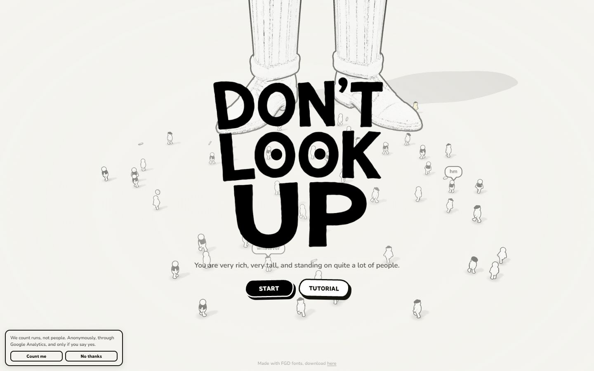</a> 

<details><summary>Toutes les captures</summary>

<a href="captures/desktop-01.jpg">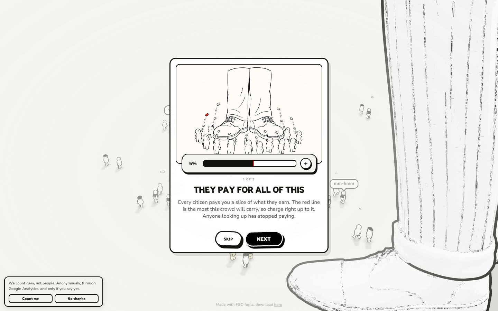</a> <a href="captures/desktop-02.jpg">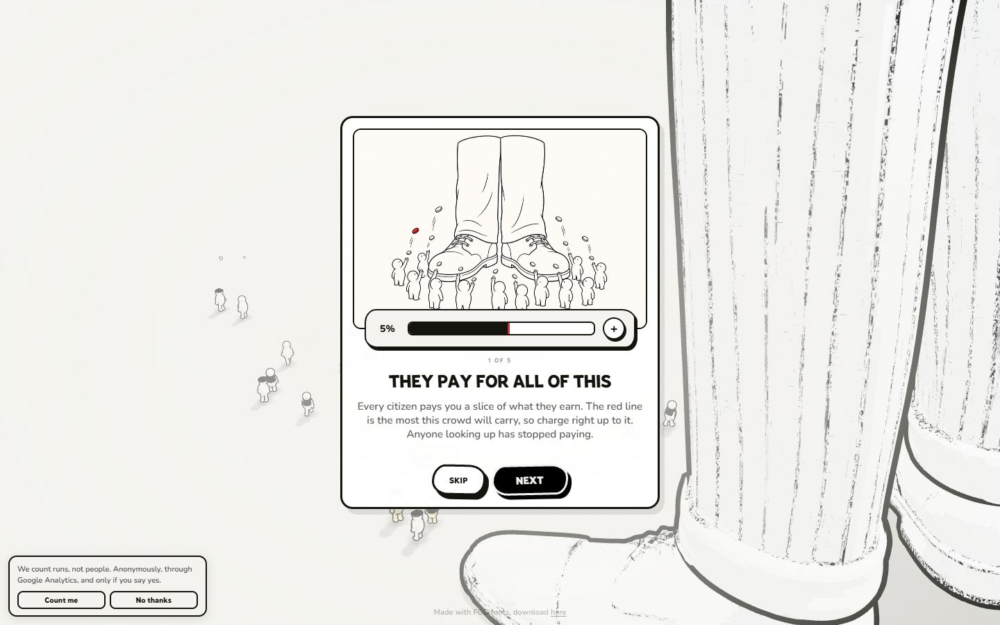</a> <a href="captures/desktop-03.jpg">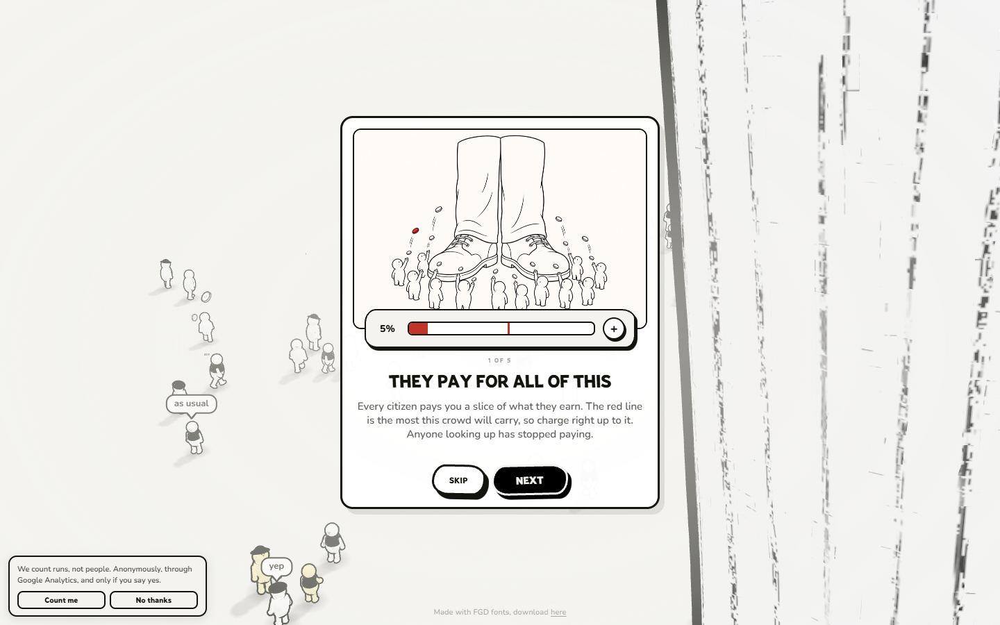</a> <a href="captures/desktop-04.jpg">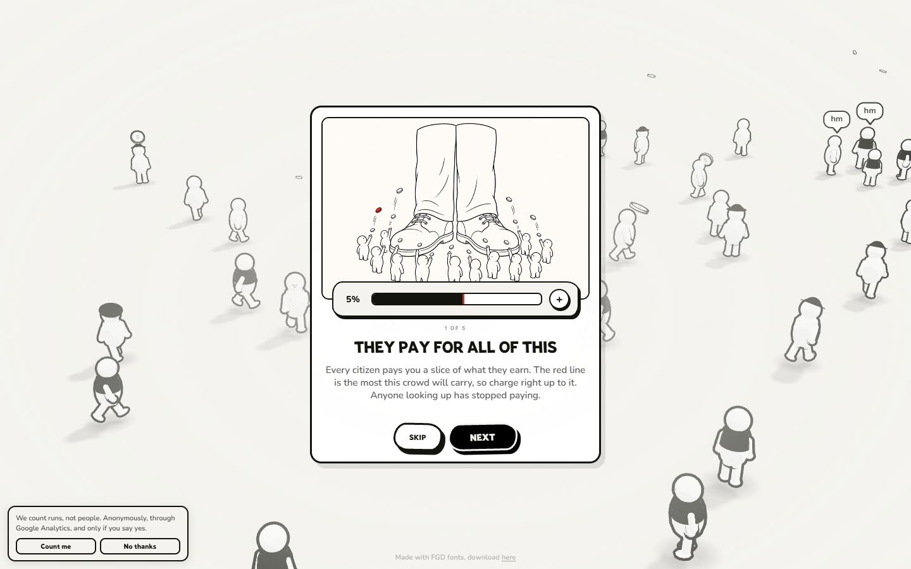</a> <a href="captures/desktop-05.jpg">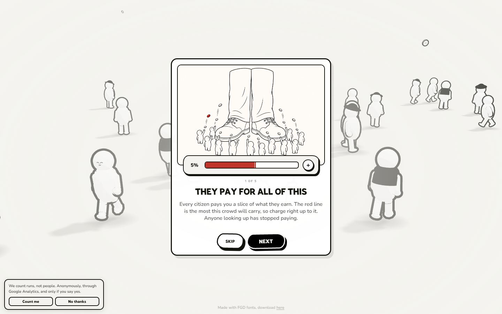</a> <a href="captures/desktop-06.jpg">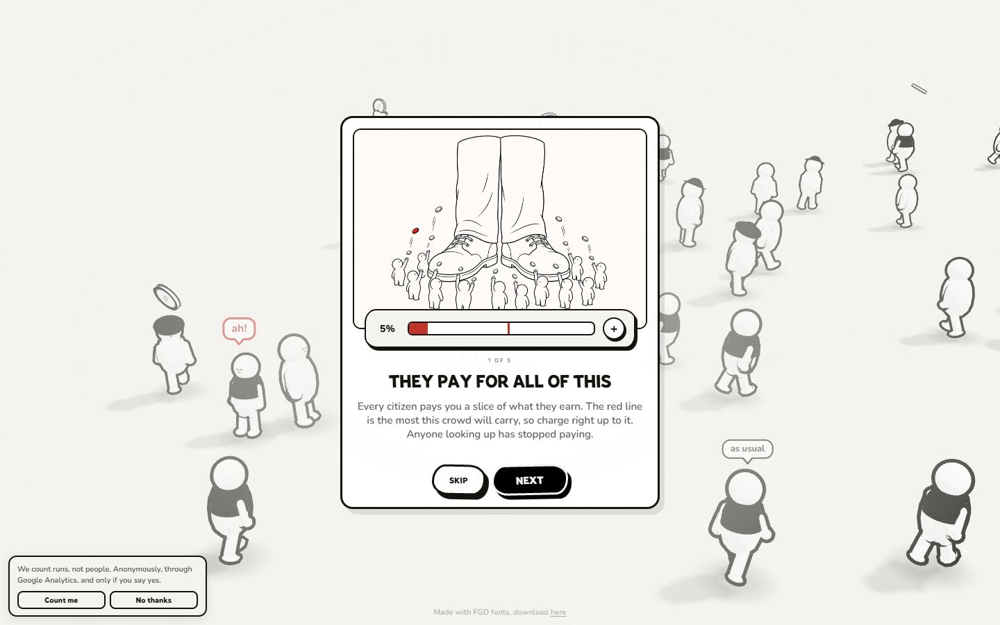</a> <a href="captures/desktop-07.jpg">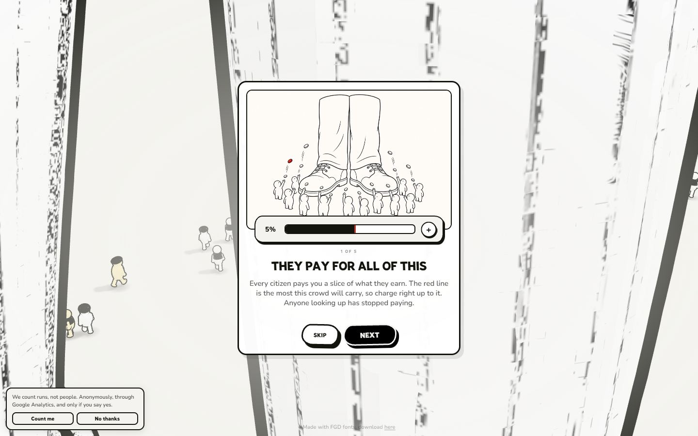</a> 


<a href="captures/mobile-01.jpg">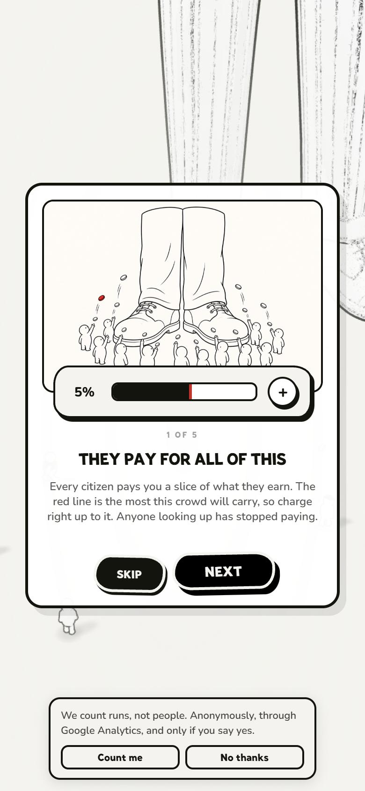</a> <a href="captures/mobile-02.jpg">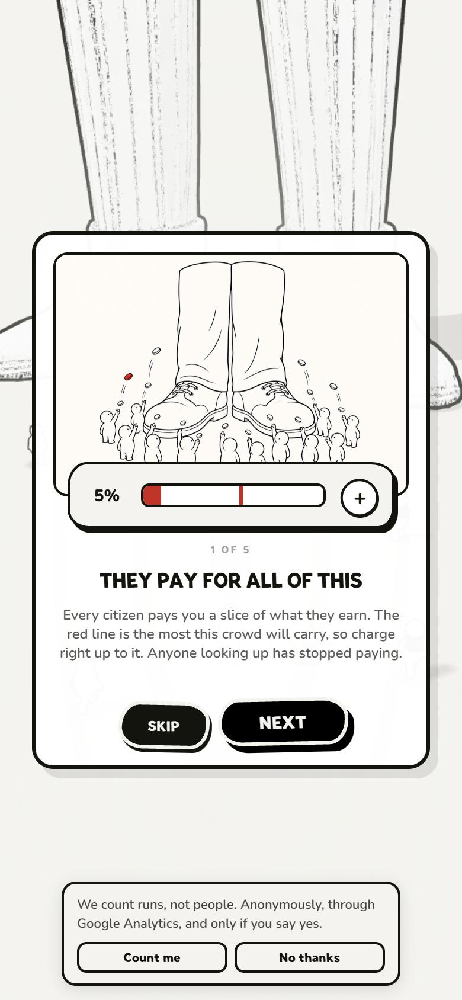</a> <a href="captures/mobile-03.jpg">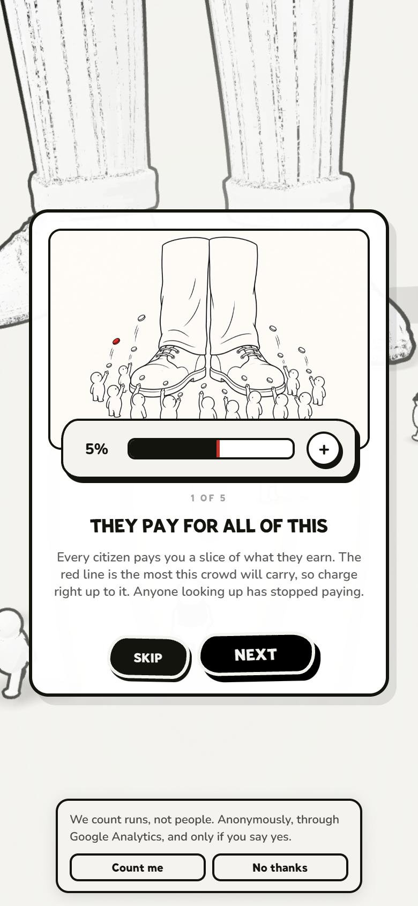</a> <a href="captures/mobile-04.jpg">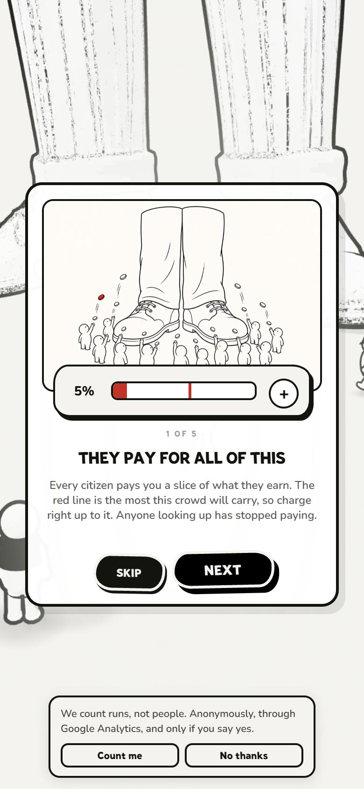</a> <a href="captures/mobile-05.jpg">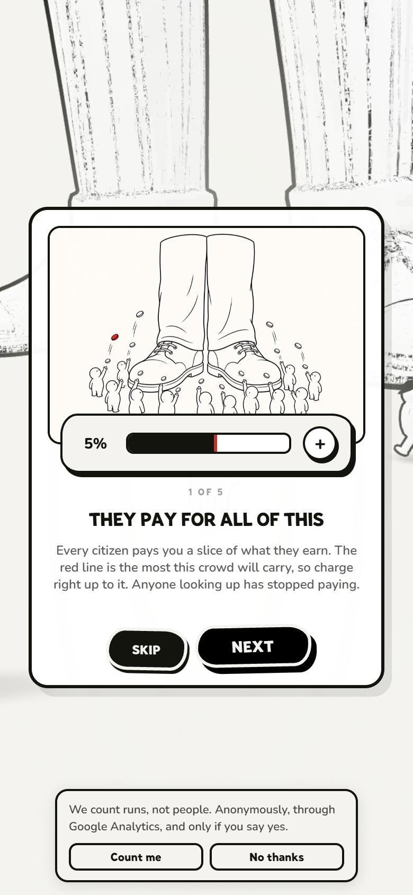</a> <a href="captures/mobile-06.jpg">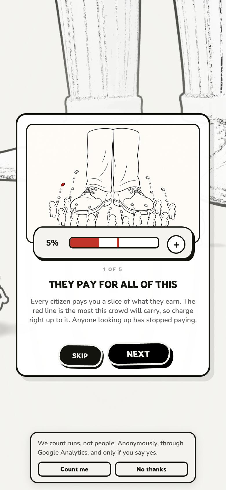</a> 

</details>

## Stack détectée
GSAP, ScrollTrigger, SplitText/SplitType, Three.js, WebGL

Versions : GSAP 3.15.0 · Three.js r?

Shaders GLSL personnalisés extraits : 40 (voir `shaders.glsl`)

## Design tokens
### Couleurs (fonds, pondérées par surface)
`#ffffff` · `#f4f3ef` · `#f8e08a` · `#14140f` · `#000000` · `#c0342a` · `#c98f06`
### Couleurs de texte
`#14140f` · `#000000` · `#f4f3ef`
### Polices utilisées (par volume de texte)
Nunito · Marsipan · Arial
### Fichiers de police chargés
- nunito-latin.woff2
- Marsipan-Regular.woff2
### Typographie
| Élément | Police | Taille | Graisse | Interligne | Interlettrage | Casse |
|---|---|---|---|---|---|---|
| p | Nunito, ui-rounded, "SF Pro Rounded", system-ui, s | 11px | 600 | 15.4px | normal | none |
| a | Nunito, ui-rounded, "SF Pro Rounded", system-ui, s | 11px | 600 | 16.5px | 0.11px | none |
| button | Arial | 13.3333px | 400 | normal | normal | none |
| body | Nunito, ui-rounded, "SF Pro Rounded", system-ui, s | 16px | 400 | normal | normal | none |

### Échelle des tailles de texte
13px (42) · 12px (11) · 11px (9) · 9px (8) · 15px (8) · 10px (5) · 9.5px (4) · 10.5px (4) · 12.5px (2) · 8px (2) · 14px (2) · 40px (1) · 7.25px (1) · 27px (1) · 17px (1) · 18px (1)
### Arrondis
12px · 3px · 50% · 24px 30px · 11px · 7px · 16px 20px · 22px 26px
### Transitions CSS fréquentes
- ease-out 0.14s ×5
- ease 0.18s ×3
- ease 0.3s ×2
- ease 0.26s ×2
- ease-in 0.26s ×2
- ease-out 0.12s ×2
- ease 0.14s ×2
- ease-out 0.13s ×2
### Points de rupture (media queries)
820px · 1060px · 520px · 821px
### Animations CSS (@keyframes)
feeAlarm, urgent, brink, pulse, tapbeat, dropIn, fadeUp, riseIn, pilewipe, coindrop-0, coindrop-1, coindrop-2, coindrop-3, coindrop-4, coindrop-5, coindrop-6, coindrop-7, coindrop-8, coindrop-9, coindrop-10, coindrop-11, coindrop-12, coindrop-13, coindrop-14, coindrop-15, coindrop-16, coindrop-17, coindrop-18, coindrop-19, coinface, coinsolid, dots, dropBob, feeBob, feeDemo, feePlus
### Variables CSS (:root)
```css
--paper: #f4f3ef;
--ink: #14140f;
--red: #c0342a;
--btn-h: 40px;
--convert: #9abeef;
--follow: #2b5a9b;
--y1: #f8e08a;
--y2: #f2c31a;
--y3: #c98f06;
--btn-r: 14px;
--display: 'Marsipan', 'Luckiest Guy', ui-rounded, "SF Pro Rounded", system-ui, sans-serif;
--body: 'Nunito', ui-rounded, "SF Pro Rounded", system-ui, sans-serif;
--font: var(--body);
--hand: var(--body);
--rail-n: 8;
--rail-bottom: calc(var(--btn-h) + 26px + env(safe-area-inset-bottom, 0px));
--rail-h: calc(var(--rail-n) * var(--btn-h) + (var(--rail-n) - 1) * 10px);
```

## Structure de la home
Hauteur : 900 px — 482 nœuds DOM — canvas 1, vidéos 0, images 58

| # | Bloc | Hauteur | Titre | Médias |
|---|---|---|---|---|
| 1 | div#stage . | 900 |  | 1 |
| 2 | div#bubbles . | 900 |  | 0 |
| 3 | div#top . | 187 |  | 0 |
| 4 | div#steps . | 900 |  | 4 |
| 5 | div#tbars . | 900 |  | 0 |
| 6 | div#loader .is-done | 900 |  | 40 |

**Navigation :** 

**Boutons / CTA :** Skip · Next

## SEO
- Title : Don't Look Up — a game about keeping everyone looking down
- Description : You are very rich, very tall, and standing on quite a lot of people. Keep them distracted and they keep paying. Let them look up, and they push you over.
- Langue : en — canonical : https://www.dontlookup.app/
- Open Graph : oui — JSON-LD : VideoGame
- H1 : 0 — images sans alt : 56/58

### Plan des titres
- (rien relevé)

## Performance (mesure locale, Chrome headless, connexion non bridée)
- TTFB 98 ms · LCP 280 ms (IMG) · CLS 0 · load 692 ms
- 44 requêtes · 24041 Ko transférés
- Par type : Document 1 req / 46 Ko, Image 13 req / 896 Ko, Font 2 req / 74 Ko, Script 1 req / 258 Ko, Fetch 25 req / 22753 Ko, Other 2 req / 14 Ko
- Plus gros fichiers :
- 8420 Ko — Fetch — https://www.dontlookup.app/assets/giant.glb
- 6681 Ko — Fetch — https://www.dontlookup.app/assets/audio/ambient_sound.aac
- 1906 Ko — Fetch — https://www.dontlookup.app/assets/prop_tv.glb
- 1849 Ko — Fetch — https://www.dontlookup.app/assets/audio/panic_music.aac
- 1204 Ko — Fetch — https://www.dontlookup.app/assets/prop_cat.glb
- 605 Ko — Fetch — https://www.dontlookup.app/assets/audio/priest.aac
- 556 Ko — Fetch — https://www.dontlookup.app/assets/audio/hat_shirt_crowd_sound.aac
- 258 Ko — Script — https://www.dontlookup.app/assets/index-urJsVLlw.js
- Services tiers : 

## Mobile
- H1 : None · corps : 16px · débordement horizontal : False · menu burger : False

## Fichiers
- `captures/` : arrivée, scroll desktop (1440×900), pleine page, pages internes, mobile (390×844 @2x) ; vidéo de scroll dans la release GitHub « videos » (lien en haut de fiche)
- `page.html` : DOM rendu · `styles.css` : CSS chargé · `scripts/` : JS chargé (index dans `_index.json`) · `shaders.glsl` : shaders extraits · `rea-bundle.json` : analyse REA du bundle (chunks, routes, endpoints)
