# G. Colombel - Portfolio 2026

- Site : [https://guillaumecolombel.fr/](https://guillaumecolombel.fr/) — [aperçu statique local](apercu.html)
- Capturé le : 2026-11-02 — statut : ok
- Vidéo de scroll : [▶ ouvrir](https://github.com/t-baudry/bibliotheque-web/releases/download/videos/005-g-colombel-portfolio-2026.webm)

<a href="captures/desktop-00-arrivee.jpg">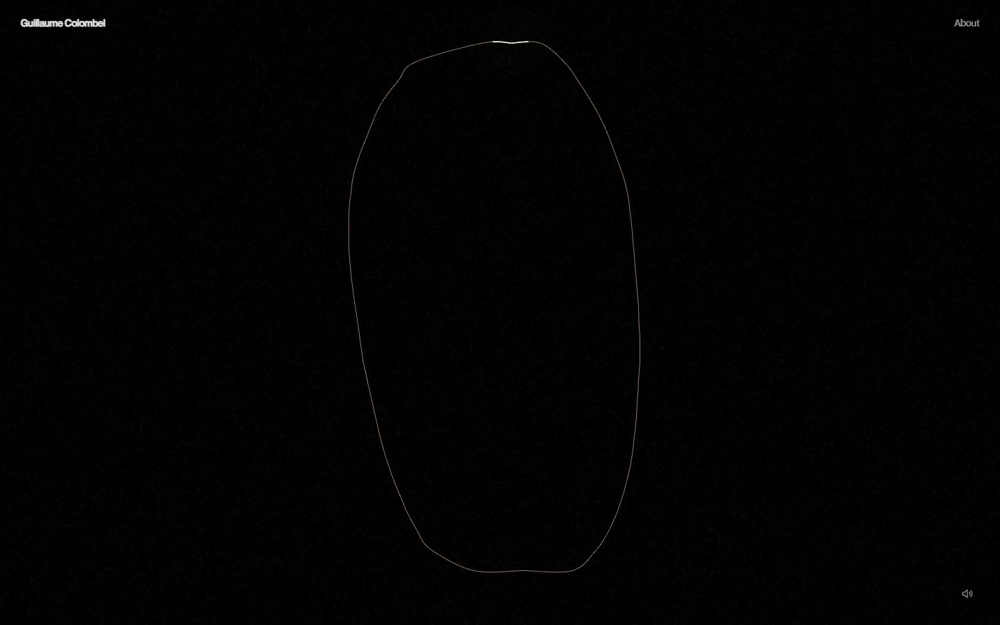</a> 

<details><summary>Toutes les captures</summary>

<a href="captures/desktop-01.jpg">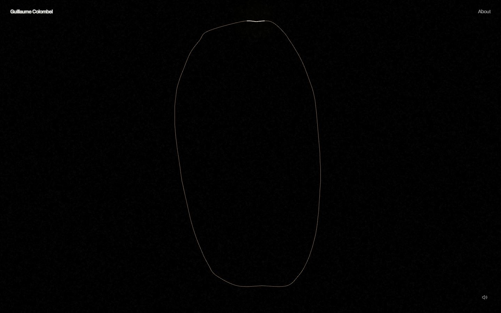</a> 

<a href="captures/page1-01.jpg"></a> <a href="captures/page1-02.jpg">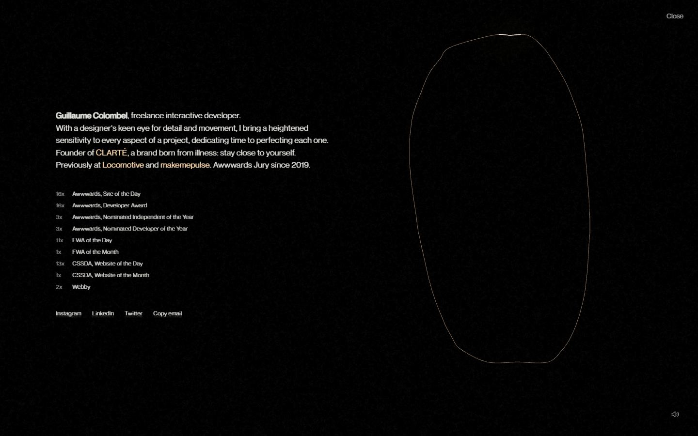</a> <a href="captures/page1-03.jpg"></a> <a href="captures/page1-04.jpg">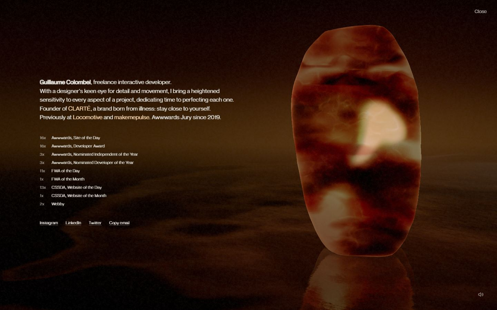</a> <a href="captures/page2-01.jpg">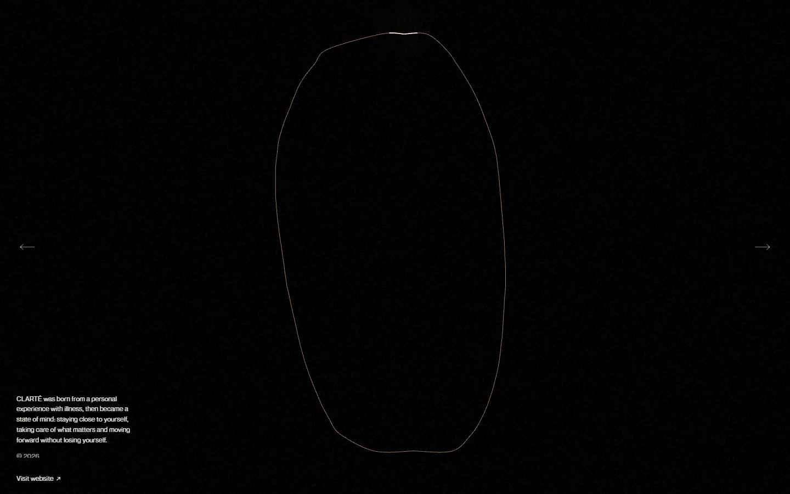</a> <a href="captures/page2-02.jpg">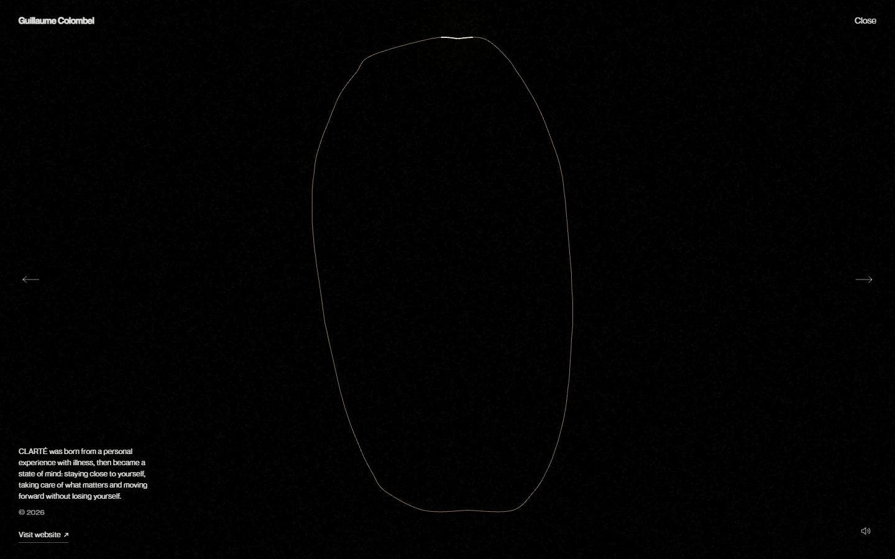</a> <a href="captures/page2-03.jpg">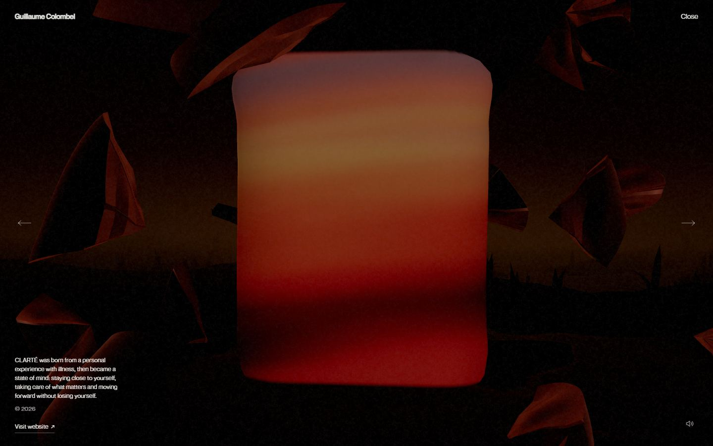</a> <a href="captures/page2-04.jpg">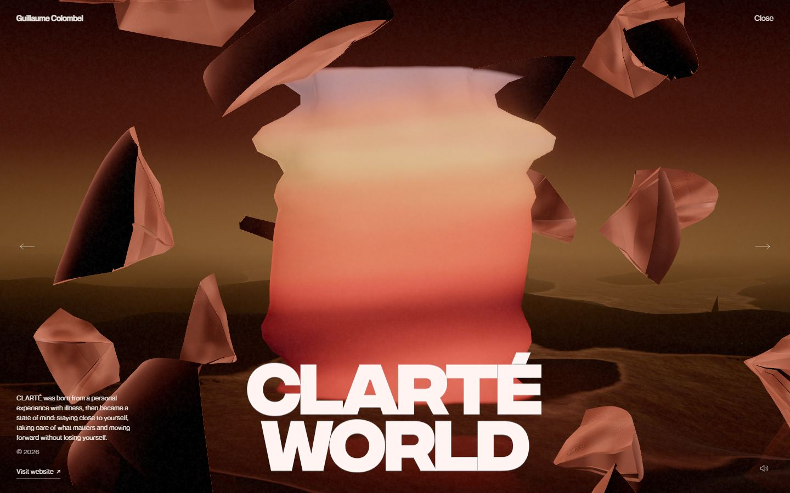</a> 

<a href="captures/mobile-01.jpg">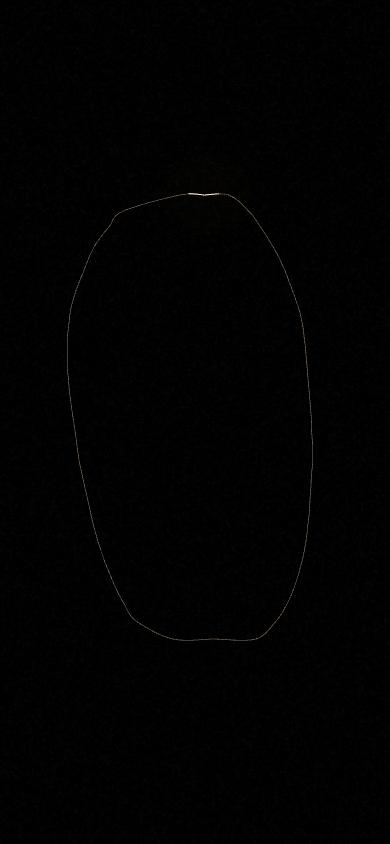</a> <a href="captures/mobile-02.jpg">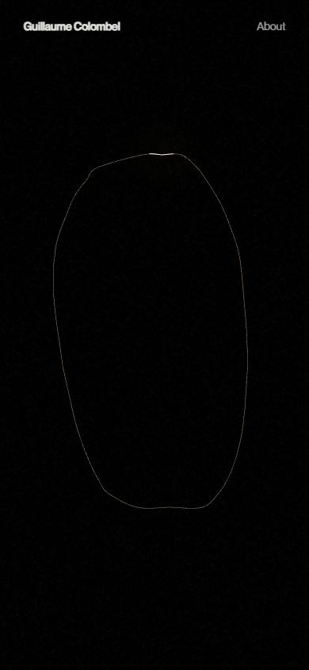</a> <a href="captures/mobile-03.jpg">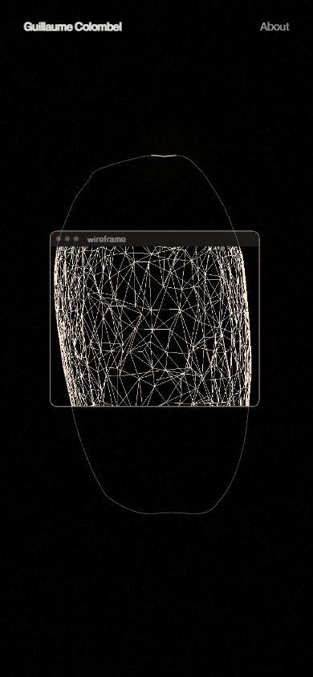</a> <a href="captures/mobile-04.jpg">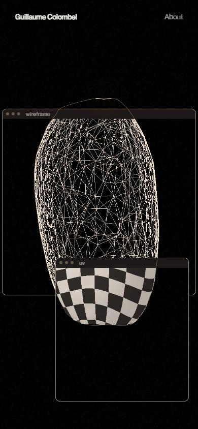</a> <a href="captures/mobile-05.jpg">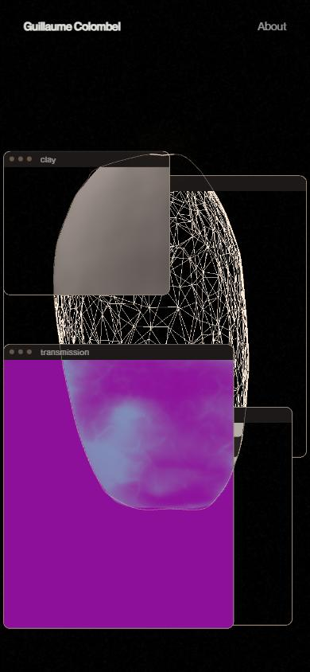</a> <a href="captures/mobile-06.jpg">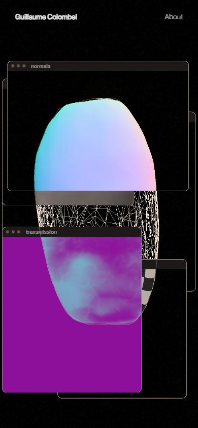</a> 

</details>

## Stack détectée
CMS Contentful, GSAP, Howler (audio), Lil-GUI/Tweakpane (debug), Locomotive Scroll, Nuxt, ScrollTrigger, SplitText/SplitType, Three.js, Vue, WebGL

Shaders GLSL personnalisés extraits : 8 (voir `shaders.glsl`)

## Design tokens
### Couleurs (fonds, pondérées par surface)
`#ffd6b0`
### Couleurs de texte
`#f4f2ee` · `#ffffff`
### Polices utilisées (par volume de texte)
Neue Montreal
### Fichiers de police chargés
- NeueMontreal-Medium.woff2
- NeueMontreal-Regular.woff2
### Typographie
| Élément | Police | Taille | Graisse | Interligne | Interlettrage | Casse |
|---|---|---|---|---|---|---|
| h1 | "Neue Montreal", system-ui, sans-serif | 32px | 700 | normal | normal | none |
| p | "Neue Montreal", system-ui, sans-serif | 17px | 400 | 25.5px | 0.085px | none |
| a | "Neue Montreal", system-ui, sans-serif | 14px | 600 | 16.8px | normal | none |
| button | "Neue Montreal", system-ui, sans-serif | 12px | 400 | normal | 0.24px | none |
| li | "Neue Montreal", system-ui, sans-serif | 12px | 400 | 18px | 0.24px | none |
| body | "Neue Montreal", system-ui, sans-serif | 16px | 400 | normal | normal | none |

### Échelle des tailles de texte
12px (46) · 17px (10) · 10px (7) · 14px (2) · 16px (2) · 32px (1)
### Arrondis
50%
### Transitions CSS fréquentes
- cubic-bezier(0.22 0.6s ×4
- ease 0.25s ×3
- cubic-bezier(0.165 0.4s ×2
- cubic-bezier(0.165 0.16s ×2
### Points de rupture (media queries)
768px
### Animations CSS (@keyframes)
sound-pop-on, sound-pop-off, stele-ui-in, visit-rule, visit-ne-out, visit-ne-in, arrow-leave, arrow-erase, arrow-draw, arrow-undraw, lost-in, lost-arrow-leave, lost-arrow-erase, lost-arrow-draw, lost-arrow-undraw
### Variables CSS (:root)
```css
--black: #050404;
--ivory: #f0ebe2;
```

## Structure de la home
Hauteur : 900 px — 260 nœuds DOM — canvas 2, vidéos 0, images 0

| # | Bloc | Hauteur | Titre | Médias |
|---|---|---|---|---|

**Navigation :** Guillaume Colombel · About · 01CLARTÉ · 02Jean Paul Gaultier — La Favorite · 03Chris Macari · 04Ousmane Ballon d'Or · 05Axel Vanhessche · 06Kaizen · 07Magical Pantry · 08Portfolio 2024 · 09Adrien Laurent · 10Jean Dawson · 11Salomon Ligthelm · 12Rabanne — 1 Million Black · Instagram · LinkedIn · Twitter

**Boutons / CTA :** 

## SEO
- Title : Guillaume Colombel — Freelance Interactive Developer
- Description : Freelance Interactive Developer specializing in immersive web experiences and creative websites. Based in Paris, available worldwide.
- Langue : en — canonical : https://guillaumecolombel.fr/
- Open Graph : oui — JSON-LD : Person, WebSite
- H1 : 1 — images sans alt : 0/0

### Plan des titres
- H1 Guillaume Colombel, freelance interactive developer

## Performance (mesure locale, Chrome headless, connexion non bridée)
- TTFB 260 ms · LCP 0 ms (None) · CLS 0 · load 612 ms
- 32 requêtes · 3273 Ko transférés
- Par type : Document 1 req / 8 Ko, Other 6 req / 326 Ko, Image 2 req / 200 Ko, Script 7 req / 111 Ko, Font 2 req / 47 Ko, Fetch 12 req / 791 Ko, Preflight 1 req / 0 Ko, Media 1 req / 1789 Ko
- Plus gros fichiers :
- 1789 Ko — Media — https://guillaumecolombel.fr/assets/covers/clarte.mp4
- 303 Ko — Other — https://guillaumecolombel.fr/_nuxt/q85zufTc.js
- 269 Ko — Fetch — https://guillaumecolombel.fr/assets/covers/axel-vanhessche.webp
- 239 Ko — Fetch — https://guillaumecolombel.fr/assets/covers/portfolio-2024.webp
- 193 Ko — Image — https://guillaumecolombel.fr/assets/fonts/integral-msdf.png
- 104 Ko — Script — https://guillaumecolombel.fr/_nuxt/BegnV_pG.js
- 89 Ko — Fetch — https://guillaumecolombel.fr/assets/covers/ousmane-ballon-dor.webp
- 70 Ko — Fetch — https://guillaumecolombel.fr/assets/covers/jean-dawson.webp
- Services tiers : cloud.umami.is, gateway.umami.is

## Mobile
- H1 : {'size': '32px', 'lineHeight': 'normal'} · corps : 16px · débordement horizontal : False · menu burger : False

## Fichiers
- `captures/` : arrivée, scroll desktop (1440×900), pleine page, pages internes, mobile (390×844 @2x) ; vidéo de scroll dans la release GitHub « videos » (lien en haut de fiche)
- `page.html` : DOM rendu · `styles.css` : CSS chargé · `scripts/` : JS chargé (index dans `_index.json`) · `shaders.glsl` : shaders extraits · `rea-bundle.json` : analyse REA du bundle (chunks, routes, endpoints)

## Pages internes capturées
- https://guillaumecolombel.fr/about
- https://guillaumecolombel.fr/projects/clarte
