# Awards Racing

- Site : [https://awards.racing/](https://awards.racing/) — [aperçu statique local](apercu.html)
- Capturé le : 2026-11-02 — statut : ok
- Vidéo de scroll : [▶ ouvrir](https://github.com/t-baudry/bibliotheque-web/releases/download/videos/006-awards-racing.webm)

<a href="captures/desktop-00-arrivee.jpg">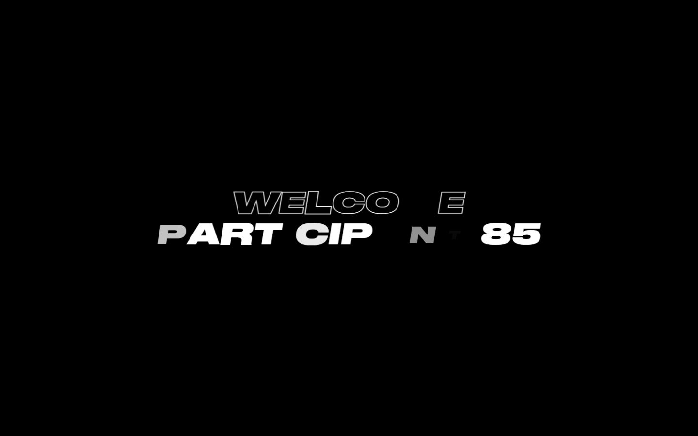</a> 

<details><summary>Toutes les captures</summary>

<a href="captures/desktop-01.jpg">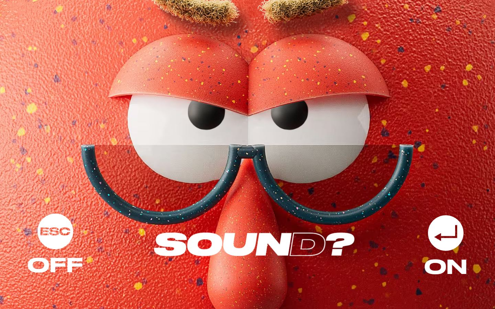</a> <a href="captures/desktop-02.jpg">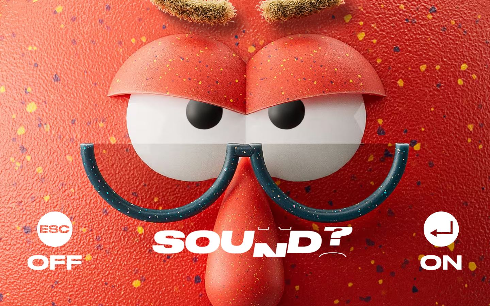</a> <a href="captures/desktop-03.jpg"></a> <a href="captures/desktop-04.jpg">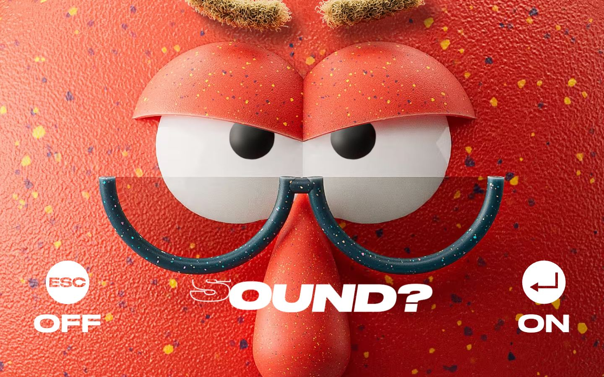</a> <a href="captures/desktop-05.jpg"></a> <a href="captures/desktop-06.jpg">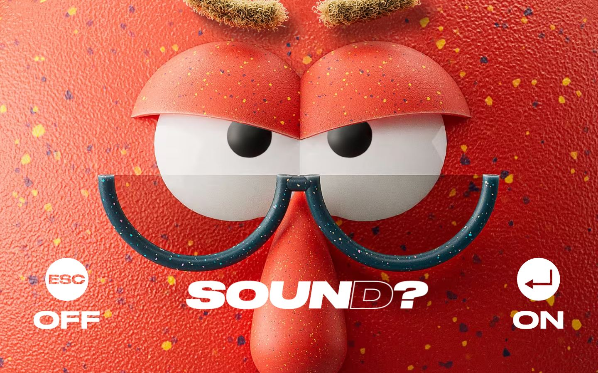</a> <a href="captures/desktop-07.jpg">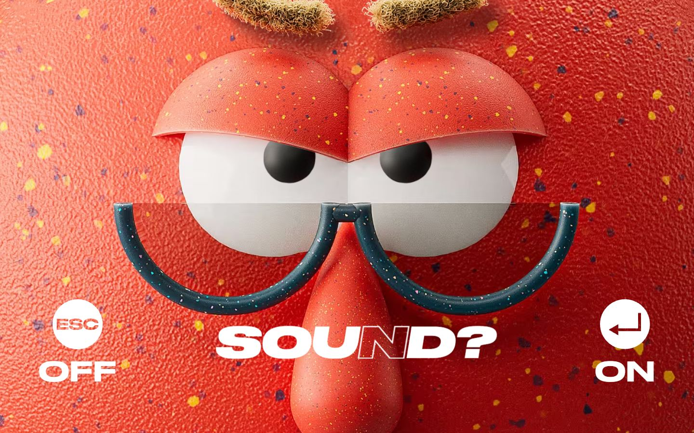</a> 


<a href="captures/mobile-01.jpg">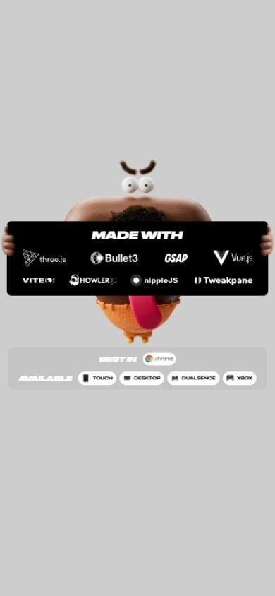</a> <a href="captures/mobile-02.jpg">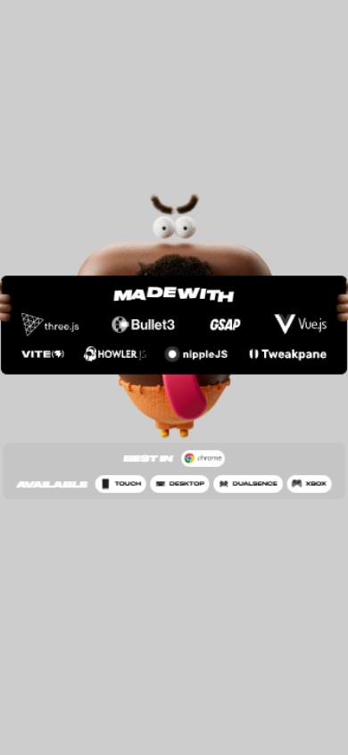</a> <a href="captures/mobile-03.jpg">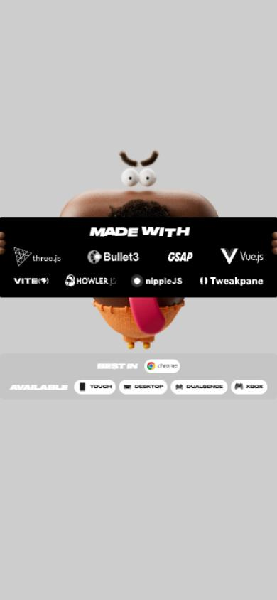</a> <a href="captures/mobile-04.jpg"></a> <a href="captures/mobile-05.jpg">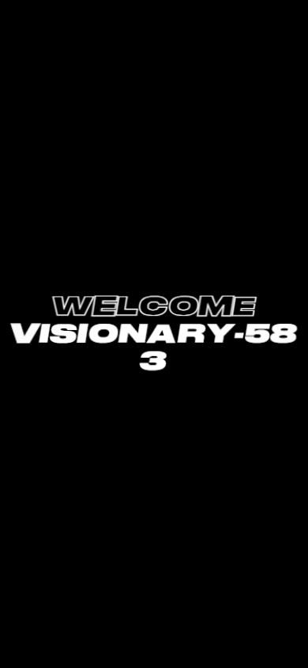</a> <a href="captures/mobile-06.jpg">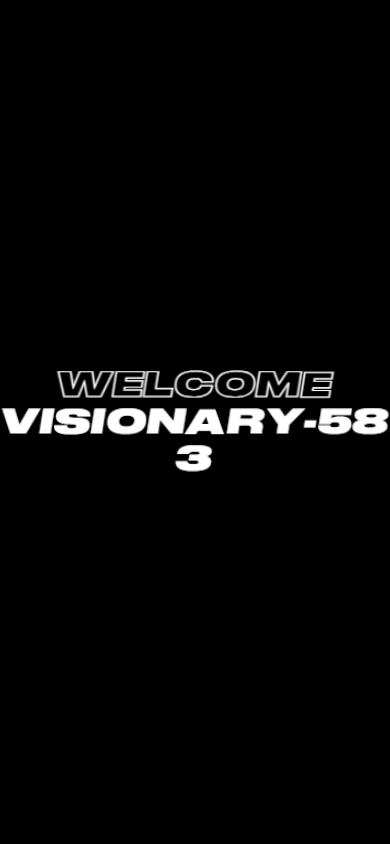</a> 

</details>

## Stack détectée
Embla, GSAP, Howler (audio), Lil-GUI/Tweakpane (debug), Nuxt, Postprocessing, React Three Fiber, ScrollTrigger, Three.js, Vue, WebGL

## Design tokens
### Couleurs (fonds, pondérées par surface)
`#000000`
### Couleurs de texte
`#ffffff`
### Polices utilisées (par volume de texte)
Druk Wide Cy TT
### Fichiers de police chargés
- DrukWide-HeavyItalic-Cy-Web.-i2-9fKe.woff2
- DrukWide-Medium-Cy-Web.De633Rvj.woff2
### Typographie
| Élément | Police | Taille | Graisse | Interligne | Interlettrage | Casse |
|---|---|---|---|---|---|---|
| button | "Druk Wide Cy TT", sans-serif | 56px | 500 | 56px | 0.84px | uppercase |
| body | "Druk Wide Cy TT", sans-serif | 16px | 500 | normal | normal | none |

### Échelle des tailles de texte
88px (18) · 56px (2) · 16px (2) · 24px (1) · 11px (1)
### Arrondis
aucun (angles droits)
### Transitions CSS fréquentes
- (rien relevé)
### Points de rupture (media queries)
558px · 768px · 700px · 1920px · 900px · 2560px · 400px · 479px · 1280px · 1440px · 992px · 820px
### Animations CSS (@keyframes)
online-counter-pulse-01f842bc, welcomeLetterPop, welcomeTitleFlyOutLeft, welcomeTitleFlyOutRight, revealCircle, share-link-press
### Variables CSS (:root)
```css
--font-primary: "Druk Wide Cy TT",sans-serif;
--base-font-size: 16px;
--color-theme: #ff1a1a;
--color-theme-dark: #1a0000;
--color-theme-overlay: rgba(255,26,26,.44);
--color-theme-selection: rgba(255,26,26,.6);
--color-line-1: #fff;
--color-line-2: #ff1a1a;
--color-line-3: #4d0000;
--color-line-4: #ff8080;
--color-accent: #ffc500;
--color-text-white: #fff;
--color-text-black: #000;
--color-text-gray-light: silver;
--color-text-gray-dark: #505050;
--color-text-disabled: #d9d9d9;
--color-bg-white: #fff;
--color-bg-black: #000;
--color-bg-gray-default: #e9e9e9;
--color-bg-gray-secondary: #ededed;
--color-bg-gray-light: #f6f6f6;
--color-border-gray: #909090;
--color-white: #fff;
--color-black: #000;
--ease-out-cubic: cubic-bezier(.33,1,.68,1);
--ease-in-out-cubic: cubic-bezier(.65,0,.35,1);
--header-height: 192px;
--header-offset-top: 48px;
--header-offset-inline: clamp(32px,2.5vw,48px);
--header-offset-bottom: 24px;
--header-logo-width: 270px;
```

## Structure de la home
Hauteur : 900 px — 407 nœuds DOM — canvas 1, vidéos 0, images 4

| # | Bloc | Hauteur | Titre | Médias |
|---|---|---|---|---|
| 1 | div#__nuxt . | 900 |  | 9 |

**Navigation :** 

**Boutons / CTA :** Drive · Back

## SEO
- Title : Awards Racing
- Description : Customize your car and race through parody award shows and galleries in Awards Racing (also known as Versus Racing and Versus: Design Grand Prix) - tune your ride, chase the leaderboard, and show off your style.
- Langue : en — canonical : None
- Open Graph : oui — JSON-LD : aucun
- H1 : 0 — images sans alt : 4/4

### Plan des titres
- (rien relevé)

## Performance (mesure locale, Chrome headless, connexion non bridée)
- TTFB 146 ms · LCP 18916 ms (IMG.made-with__character) · CLS 0 · load 879 ms
- 331 requêtes · 23262 Ko transférés
- Par type : Document 1 req / 7 Ko, Stylesheet 10 req / 37 Ko, Script 23 req / 1083 Ko, Other 62 req / 3034 Ko, Image 107 req / 6733 Ko, Font 2 req / 85 Ko, Fetch 82 req / 3895 Ko, Media 6 req / 7372 Ko, Preflight 1 req / 0 Ko, XHR 37 req / 1017 Ko
- Plus gros fichiers :
- 1538 Ko — Fetch — https://awards.racing/common/assets/everything5.202608121411.glb
- 1471 Ko — Media — https://awards.racing/common/tracks/chrome-vortex.202608301427.mp3
- 1409 Ko — Media — https://awards.racing/common/tracks/out-of-office.202609021305.mp3
- 1311 Ko — Media — https://awards.racing/common/tracks/rocket-burst.202608300946.mp3
- 1112 Ko — Media — https://awards.racing/common/tracks/emerald-mechanism.202608301427.mp3
- 1035 Ko — Media — https://awards.racing/common/tracks/hot-and-nebula-papapa-1.202608301004.mp3
- 1034 Ko — Media — https://awards.racing/common/tracks/evil-genius-ks-remont-u-sani-1.202608301007.mp3
- 799 Ko — Image — https://awards.racing/common/stickers.202608191257.avif
- Services tiers : api.awards.racing

## Mobile
- H1 : None · corps : 16px · débordement horizontal : False · menu burger : False

## Fichiers
- `captures/` : arrivée, scroll desktop (1440×900), pleine page, pages internes, mobile (390×844 @2x) ; vidéo de scroll dans la release GitHub « videos » (lien en haut de fiche)
- `page.html` : DOM rendu · `styles.css` : CSS chargé · `scripts/` : JS chargé (index dans `_index.json`) · `shaders.glsl` : shaders extraits · `rea-bundle.json` : analyse REA du bundle (chunks, routes, endpoints)
