# A24

- Site : [https://a24.raviklaassens.com/](https://a24.raviklaassens.com/) — [aperçu statique local](apercu.html)
- Capturé le : 2026-11-02 — statut : ok
- Vidéo de scroll : [▶ ouvrir](https://github.com/t-baudry/bibliotheque-web/releases/download/videos/007-a24.webm)

<a href="captures/desktop-00-arrivee.jpg">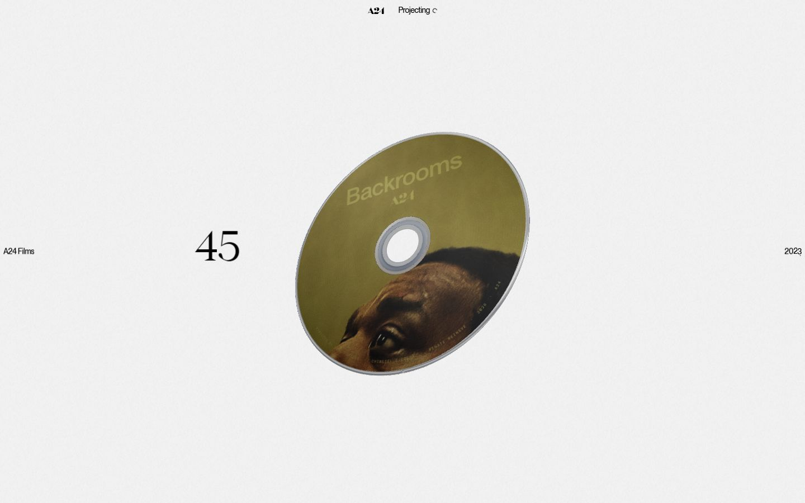</a> 

<details><summary>Toutes les captures</summary>

<a href="captures/desktop-01.jpg">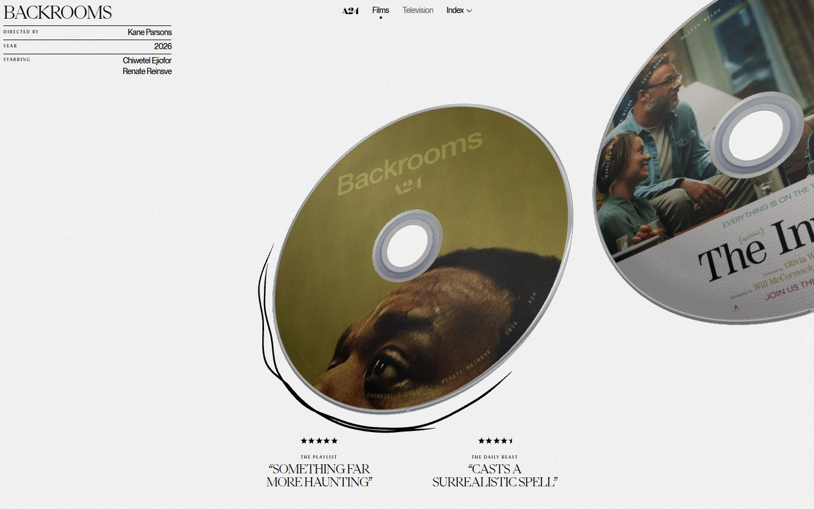</a> <a href="captures/desktop-02.jpg">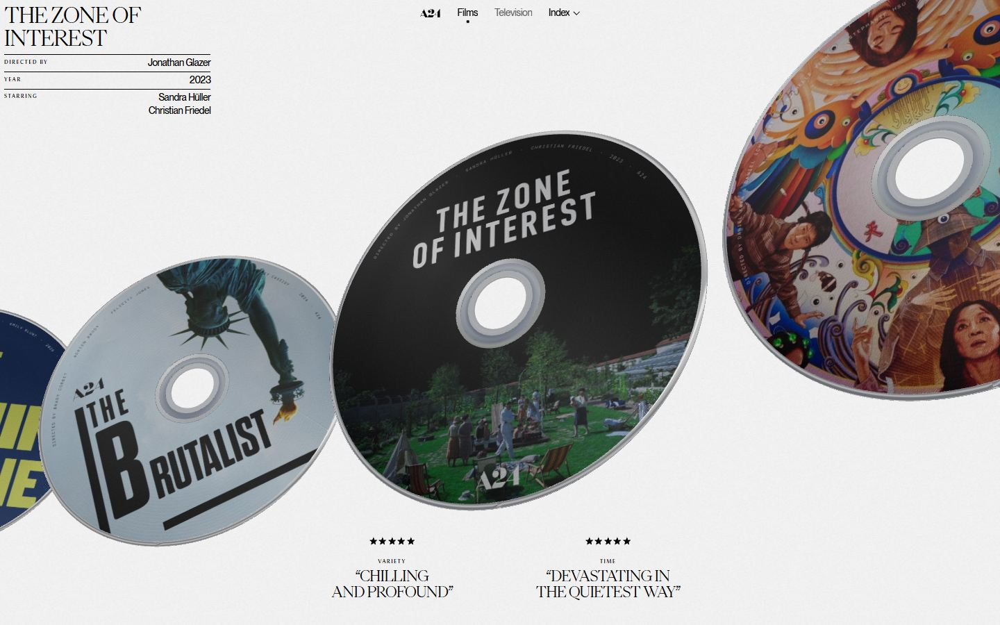</a> <a href="captures/desktop-03.jpg">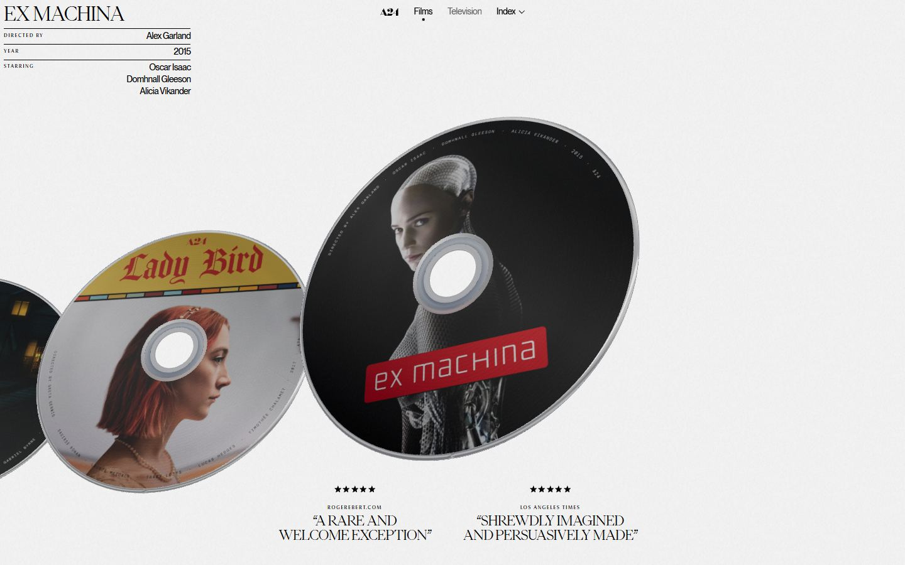</a> <a href="captures/desktop-04.jpg"></a> <a href="captures/desktop-05.jpg"></a> <a href="captures/desktop-06.jpg"></a> <a href="captures/desktop-07.jpg">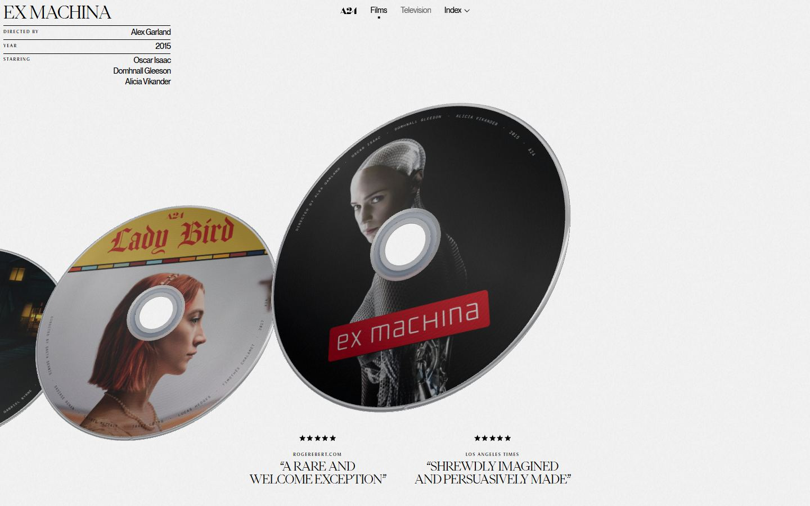</a> 

<a href="captures/page1-01.jpg">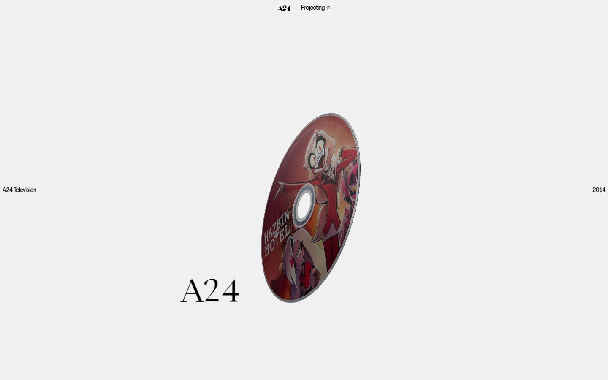</a> <a href="captures/page1-02.jpg">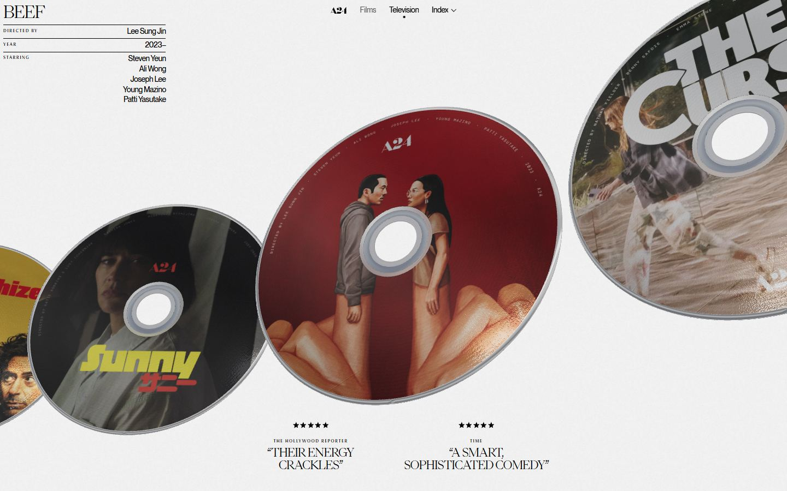</a> <a href="captures/page1-03.jpg">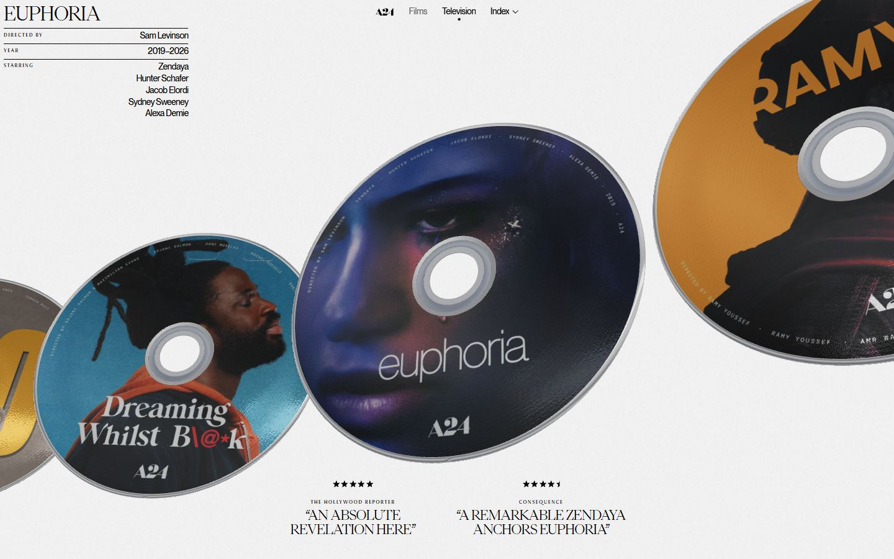</a> <a href="captures/page1-04.jpg">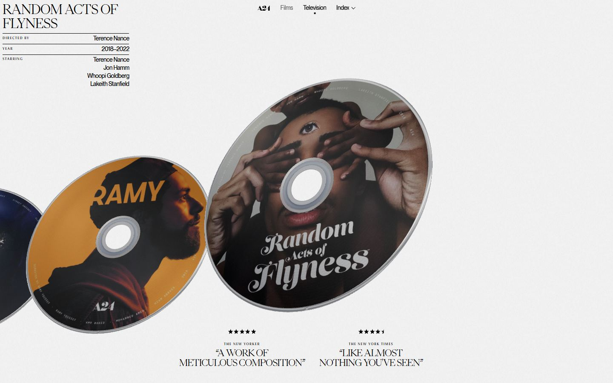</a> <a href="captures/page2-01.jpg">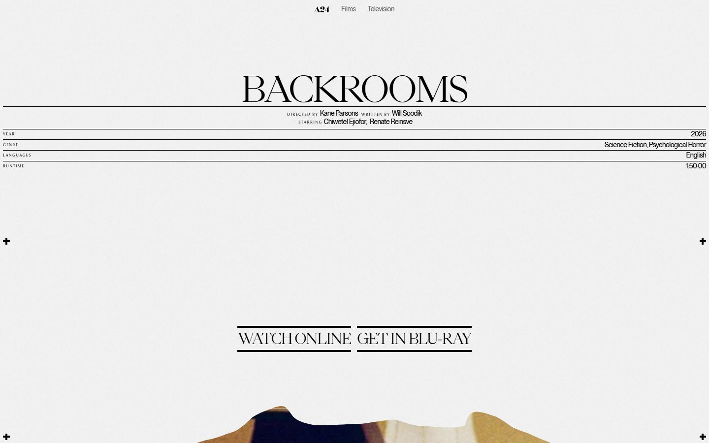</a> <a href="captures/page2-02.jpg">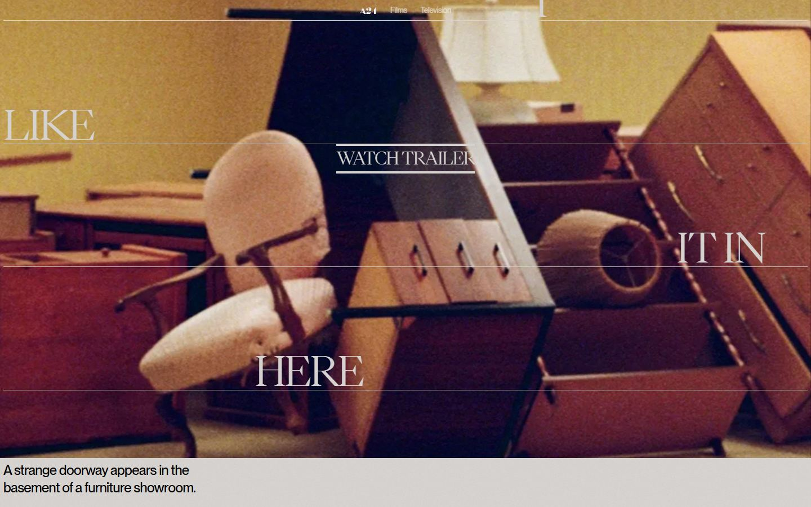</a> <a href="captures/page2-03.jpg">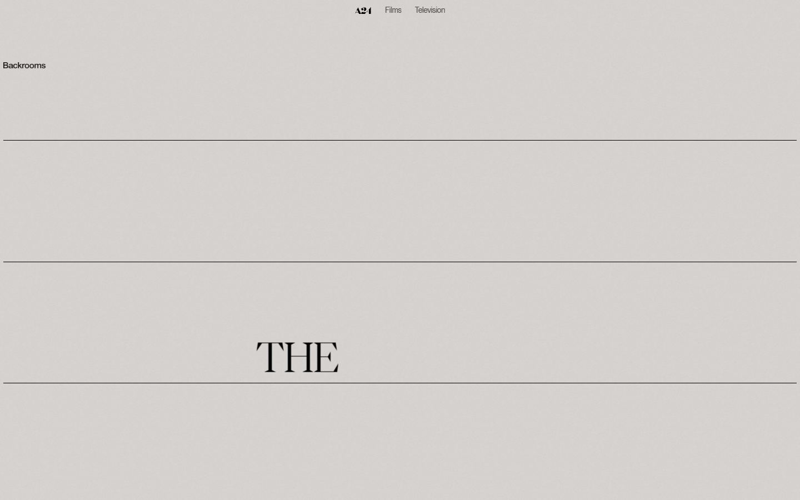</a> <a href="captures/page2-04.jpg">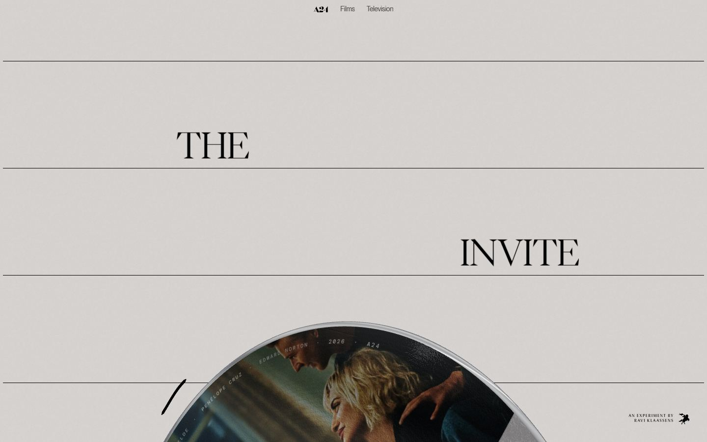</a> 

<a href="captures/mobile-01.jpg">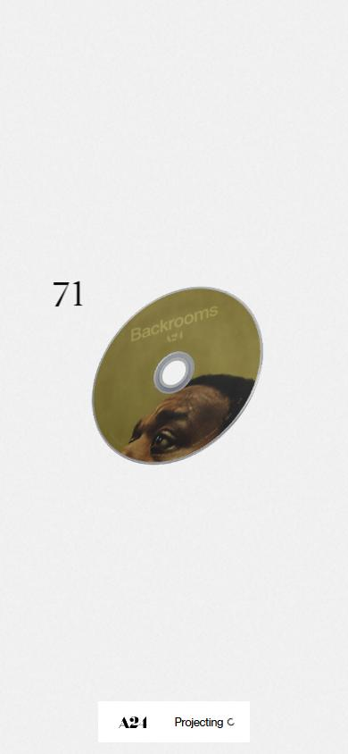</a> <a href="captures/mobile-02.jpg">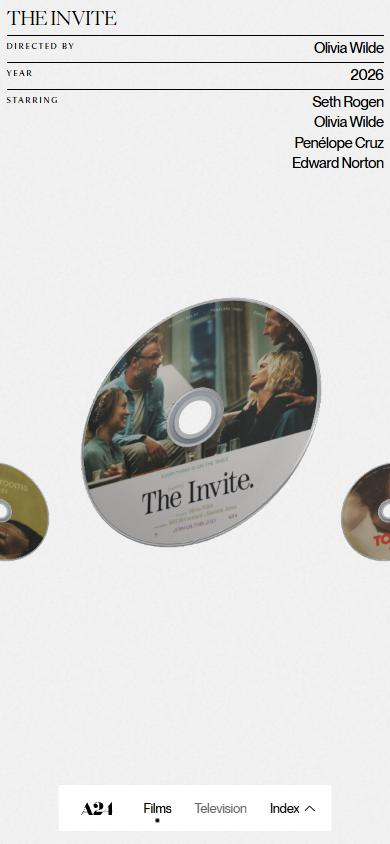</a> <a href="captures/mobile-03.jpg">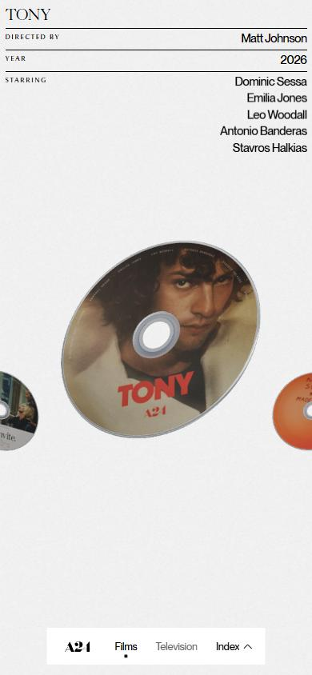</a> <a href="captures/mobile-04.jpg">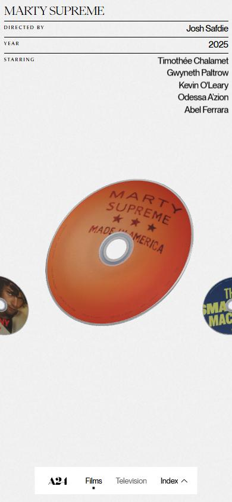</a> <a href="captures/mobile-05.jpg">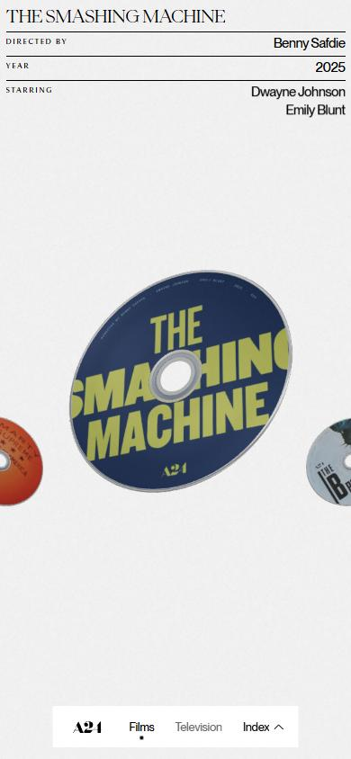</a> <a href="captures/mobile-06.jpg">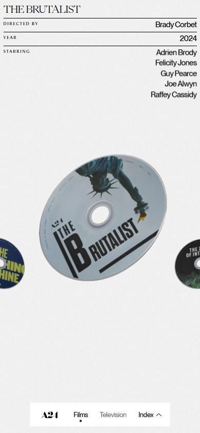</a> 

</details>

## Stack détectée
Astro, Barba.js, CMS Contentful, GSAP, Lenis, ScrollTrigger, SplitText/SplitType, Three.js, Virtual scroll, WebGL

Versions : GSAP 3.11.0 · Three.js r?

Shaders GLSL personnalisés extraits : 6 (voir `shaders.glsl`)

## Design tokens
### Couleurs (fonds, pondérées par surface)
`#f2f2f2` · `#000000`
### Couleurs de texte
`#000000`
### Polices utilisées (par volume de texte)
Ppneuemontreal · Ppeiko · Ppmuseum
### Fichiers de police chargés
- PPNeueMontreal-Medium.woff2
- PPEiko-Regular.woff2
- PPMuseum-Regular.woff2
### Typographie
| Élément | Police | Taille | Graisse | Interligne | Interlettrage | Casse |
|---|---|---|---|---|---|---|
| h1 | Ppeiko, Arial, sans-serif | 120px | 400 | 120px | -4.8px | none |
| h2 | Ppneuemontreal, Arial, sans-serif | 13.5px | 500 | 18.9px | -0.3375px | none |
| p | Ppeiko, Arial, sans-serif | 9px | 400 | 9px | normal | uppercase |
| a | Ppneuemontreal, Arial, sans-serif | 12px | 500 | 16.8px | -0.3px | none |
| button | Ppneuemontreal, Arial, sans-serif | 12px | 500 | 16.8px | -0.3px | none |
| li | Ppneuemontreal, Arial, sans-serif | 12px | 500 | 16.8px | -0.3px | none |
| body | Ppneuemontreal, Arial, sans-serif | 12px | 500 | 16.8px | -0.3px | none |

### Échelle des tailles de texte
7.5px (187) · 13.5px (37) · 21px (4) · 12px (2) · 9px (1) · 120px (1) · 30px (1)
### Arrondis
3px · 50%
### Transitions CSS fréquentes
- cubic-bezier(0.77 0.3s ×32
- cubic-bezier(0.32 0.3s ×2
- cubic-bezier(0.32 0.4s ×2
- cubic-bezier(0.32 0.46s ×1
- cubic-bezier(0.32 0.2s ×1
### Points de rupture (media queries)
991px · 767px · 479px · 992px · 768px · 480px
### Animations CSS (@keyframes)
spin, nav-loading-spin, grain, btn-film-jitter, btn-film-wiggle, nav-plate-jitter, nav-text-jitter, scroll-next-hint
### Variables CSS (:root)
```css
--_theme---background: var(--_colors---swatch--white);
--_paragraphs---paragraph-regular--font: var(--_fonts---fonts--paragraph);
--_theme---body-text: var(--_colors---swatch--black);
--_paragraphs---paragraph-regular--line-height: 1.4em;
--_paragraphs---paragraph-regular--font-weight: var(--_fonts---font-weight--medium);
--_paragraphs---paragraph-regular--letter-spacing: -.025em;
--_fonts---fonts--heading: Ppeiko, Arial, sans-serif;
--_headings---heading-xxl--font-size: var(--_sizes---size--104px);
--_headings---heading-xxl--line-height: 1em;
--_headings---heading-xxl--font-weight: var(--_fonts---font-weight--normal);
--_headings---heading-xxl--letter-spacing: -.04em;
--_headings---heading-xl--font: var(--_fonts---fonts--heading);
--_headings---heading-xl--font-size: var(--_sizes---size--96px);
--_headings---heading-xl--font-weight: var(--_fonts---font-weight--normal);
--_headings---heading-xl--letter-spacing: -.04em;
--_headings---heading-l--font: var(--_fonts---fonts--heading);
--_headings---heading-l--font-size: var(--_sizes---size--72px);
--_headings---heading-xl--line-height: 1.2em;
--_headings---heading-l--font-weight: var(--_fonts---font-weight--normal);
--_headings---heading-l--letter-spacing: -.04em;
--_headings---heading-m--font: var(--_fonts---fonts--heading);
--_headings---heading-m--font-size: var(--_sizes---size--48px);
--_headings---heading-m--line-height: 1em;
--_headings---heading-m--font-weight: var(--_fonts---font-weight--normal);
--_headings---heading-m--letter-spacing: -.04em;
--_headings---heading-s--font: var(--_fonts---fonts--heading);
--_headings---heading-s--font-size: var(--_sizes---size--32px);
--_headings---heading-s--line-height: 1.1em;
--_headings---heading-s--font-weight: var(--_fonts---font-weight--normal);
--_headings---heading-s--letter-spacing: -.04em;
--_headings---heading-xs--font: var(--_fonts---fonts--heading);
--_headings---heading-xs--font-size: var(--_sizes---size--28px);
--_headings---heading-xs--line-height: 1.1em;
--_headings---heading-xs--font-weight: var(--_fonts---font-weight--normal);
--_headings---heading-xs--letter-spacing: -.04em;
--color-mode-default--body-text<deleted|variable-cb61a870-d154-a6fe-c8a0-f25e0e5af2eb>: var(--swatch--gunmetal\<deleted\|variable-7aae26b0-9412-ed86-55f6-0d55abbd998f\>);
--_layout---padding-global--page-padding: 1.25em;
--_layout---padding-global--tablet<deleted|variable-a729b81a-e434-9b17-3dd4-232b48219fba>: 1.5em;
--_layout---padding-global--mobile<deleted|variable-c1796e7f-e37f-9814-266d-d39e03ff04a2>: 1rem;
--_sizes---size--96px: 3.5em;
--_sizes---size--128px: 4.75em;
--_sizes---size--320px: 12em;
--_sizes---size--64px: 2.5em;
--_sizes---size--40px: 1.75em;
--_sizes---size--16px: 1em;
--color-mode-default--active-state<deleted|variable-43f921cb-bd7a-3666-9ac5-0f1d734b1a8f>: var(--swatch--honeydew\<deleted\|variable-ce750e9f-1666-65be-5b8a-2186b18b3781\>);
--_paragraphs---paragraph-regular--font-size: 1em;
--_headings---heading-l--line-height: 1em;
--_paragraphs---paragraph-xl--font: var(--_fonts---fonts--paragraph);
--_paragraphs---paragraph-xl--font-size: 2em;
--_paragraphs---paragraph-xl--line-height: 1.3em;
--_paragraphs---paragraph-xl--font-weight: var(--_fonts---font-weight--medium);
--_paragraphs---paragraph-xl--letter-spacing: -.025em;
--_paragraphs---paragraph-l--font: var(--_fonts---fonts--paragraph);
--_paragraphs---paragraph-l--font-size: 1.5em;
--_paragraphs---paragraph-l--line-height: 1.4em;
--_paragraphs---paragraph-l--font-weight: var(--_fonts---font-weight--medium);
--_paragraphs---paragraph-l--letter-spacing: -.025em;
--_paragraphs---paragraph-m--font: var(--_fonts---fonts--paragraph);
--_paragraphs---paragraph-m--font-size: 1.125em;
--_paragraphs---paragraph-m--line-height: 1.4em;
--_paragraphs---paragraph-m--letter-spacing: -.025em;
--_paragraphs---paragraph-s--font: var(--_fonts---fonts--paragraph);
--_paragraphs---paragraph-s--font-size: .875em;
--_paragraphs---paragraph-s--line-height: 1.3em;
--_paragraphs---paragraph-s--font-weight: var(--_fonts---font-weight--medium);
--_paragraphs---paragraph-s--letter-spacing: -.025em;
--_paragraphs---paragraph-xs--font-size: .75em;
--_paragraphs---paragraph-xs--font-weight: var(--_fonts---font-weight--medium);
--_paragraphs---paragraph-xxs--font: var(--_fonts---fonts--paragraph);
--_paragraphs---paragraph-xxs--font-size: .625em;
--_paragraphs---paragraph-xxs--line-height: 1.4em;
--_paragraphs---paragraph-xxs--font-weight: var(--_fonts---font-weight--medium);
--_paragraphs---paragraph-xxs--letter-spacing: -.025em;
--element-button--gap<deleted|variable-0282ece1-564b-3134-a176-8a733f25aca8>: 1em;
--_layout---grid--gap: 1.25em;
--_layout---grid--gap-tablet<deleted|variable-ff4ab7d8-1b7d-e830-21bf-aa88e5d5e74c>: 1.5em;
--_layout---grid--gap-mobile<deleted|variable-4fadcf1f-040e-5667-91a8-46bc48510e01>: 1em;
--element-button--height<deleted|variable-d0d4f496-fb53-f8c5-27d6-19ba5c3f0b43>: 3rem;
--element-button--radius-desktop<deleted|variable-f8d99249-c057-b20e-d4ea-c9ff0273add7>: .5em;
```

## Structure de la home
Hauteur : 900 px — 663 nœuds DOM — canvas 1, vidéos 0, images 0

| # | Bloc | Hauteur | Titre | Médias |
|---|---|---|---|---|
| 1 | div .container | 900 | Discover the A24 library of Films | 0 |
| 2 | div .experience-canvas | 900 |  | 1 |

**Navigation :** Films · Television · Backrooms2026 · The Invite2026 · Tony2026 · Marty Supreme2025 · The Smashing Machine2025 · The Brutalist2024 · The Zone of Interest2023 · Everything Everywhere All at Once2022 · Uncut Gems2019 · Hereditary2018 · Lady Bird2017 · Ex Machina2015

**Boutons / CTA :** 

## SEO
- Title : A24 — Films
- Description : Explore A24's acclaimed film catalog featuring award-winning independent cinema from visionary directors. Discover upcoming releases and praised movies.
- Langue : en — canonical : https://a24.raviklaassens.com/
- Open Graph : oui — JSON-LD : CollectionPage
- H1 : 1 — images sans alt : 0/0

### Plan des titres
- H2 Backrooms
- H2 The Invite
- H2 Tony
- H2 Marty Supreme
- H2 The Smashing Machine
- H2 The Brutalist
- H2 The Zone of Interest
- H2 Everything Everywhere All at Once
- H2 Uncut Gems
- H2 Hereditary
- H2 Lady Bird
- H2 Ex Machina
- H1 Discover the A24 library of Films

## Performance (mesure locale, Chrome headless, connexion non bridée)
- TTFB 185 ms · LCP 11616 ms (SPAN) · CLS 0.007 · load 452 ms
- 41 requêtes · 2751 Ko transférés
- Par type : Document 1 req / 8 Ko, Stylesheet 1 req / 27 Ko, Script 8 req / 429 Ko, Font 3 req / 247 Ko, Image 13 req / 1841 Ko, Other 1 req / 1 Ko, Preflight 1 req / 0 Ko, Fetch 1 req / 1 Ko, XHR 12 req / 197 Ko
- Plus gros fichiers :
- 181 Ko — Image — https://raviklaassens.b-cdn.net/a24/films/backrooms/disc.webp?v=7
- 178 Ko — Image — https://raviklaassens.b-cdn.net/a24/films/uncut-gems/disc.webp?v=7
- 175 Ko — Image — https://raviklaassens.b-cdn.net/a24/films/the-brutalist/disc.webp?v=7
- 168 Ko — Script — https://a24.raviklaassens.com/_astro/three.module.B1_OyRqk.js
- 165 Ko — Image — https://raviklaassens.b-cdn.net/a24/films/tony/disc.webp?v=7
- 164 Ko — Image — https://raviklaassens.b-cdn.net/a24/films/marty-supreme/disc.webp?v=7
- 161 Ko — Image — https://raviklaassens.b-cdn.net/a24/films/everything-everywhere-all-at-once/disc.webp?v=7
- 159 Ko — Image — https://raviklaassens.b-cdn.net/a24/films/hereditary/disc.webp?v=7
- Services tiers : cloud.umami.is, gateway.umami.is, raviklaassens.b-cdn.net

## Mobile
- H1 : {'size': '52.1086px', 'lineHeight': '52.1086px'} · corps : 13.0271px · débordement horizontal : False · menu burger : False

## Fichiers
- `captures/` : arrivée, scroll desktop (1440×900), pleine page, pages internes, mobile (390×844 @2x) ; vidéo de scroll dans la release GitHub « videos » (lien en haut de fiche)
- `page.html` : DOM rendu · `styles.css` : CSS chargé · `scripts/` : JS chargé (index dans `_index.json`) · `shaders.glsl` : shaders extraits · `rea-bundle.json` : analyse REA du bundle (chunks, routes, endpoints)

## Pages internes capturées
- https://a24.raviklaassens.com/television
- https://a24.raviklaassens.com/production/backrooms
