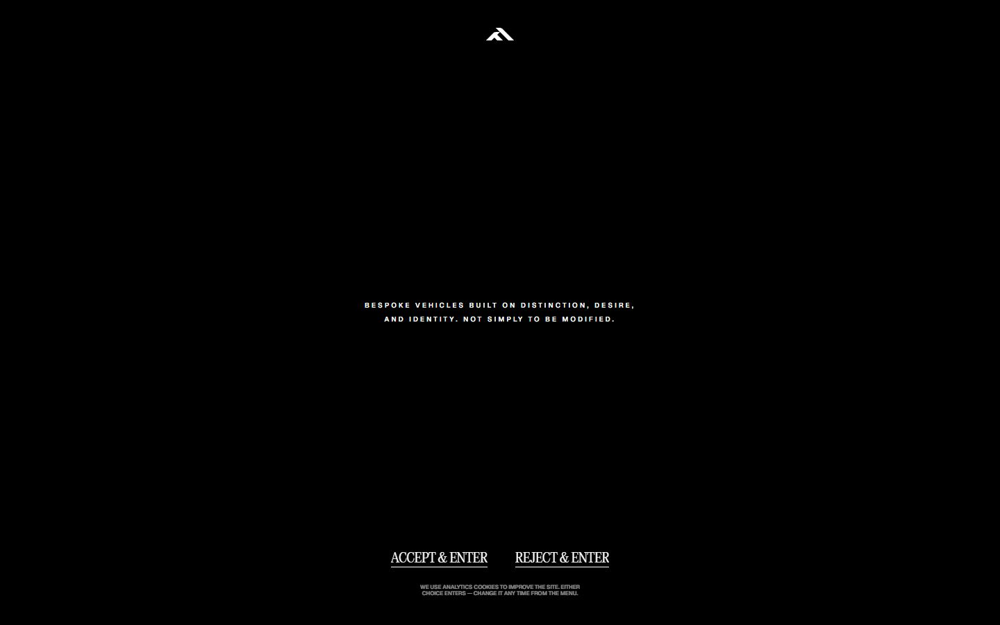
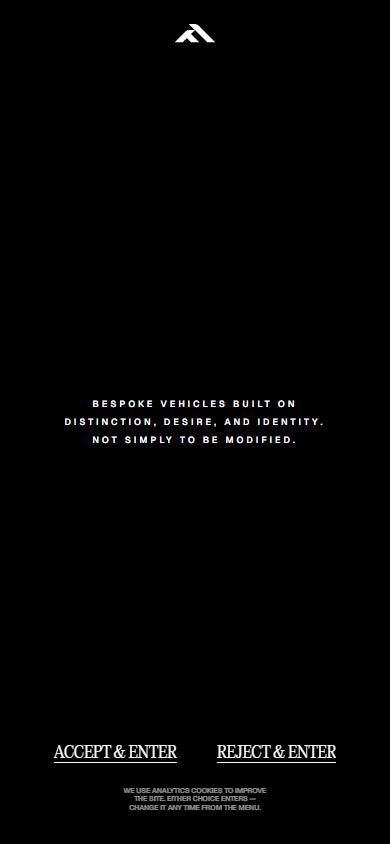

# Forge Automotive

- Site : [https://forgeautomotive.co.uk/](https://forgeautomotive.co.uk/) — [aperçu statique local](apercu.html)
- Capturé le : 2026-11-02 — statut : ok
- Vidéo de scroll : [▶ ouvrir](https://github.com/t-baudry/bibliotheque-web/releases/download/videos/008-forge-automotive.webm)

<a href="captures/desktop-00-arrivee.jpg"></a> 

<details><summary>Toutes les captures</summary>

<a href="captures/desktop-01.jpg"></a> <a href="captures/desktop-02.jpg"></a> <a href="captures/desktop-03.jpg"></a> <a href="captures/desktop-04.jpg"></a> <a href="captures/desktop-05.jpg"></a> <a href="captures/desktop-06.jpg"></a> <a href="captures/desktop-07.jpg"></a> 

<a href="captures/page1-01.jpg"></a> <a href="captures/page1-02.jpg"></a> <a href="captures/page1-03.jpg"></a> <a href="captures/page1-04.jpg"></a> <a href="captures/page2-01.jpg"></a> <a href="captures/page2-02.jpg"></a> <a href="captures/page2-03.jpg"></a> <a href="captures/page2-04.jpg"></a> <a href="captures/page3-01.jpg"></a> <a href="captures/page3-02.jpg"></a> <a href="captures/page3-03.jpg"></a> <a href="captures/page3-04.jpg"></a> 

<a href="captures/mobile-01.jpg"></a> <a href="captures/mobile-02.jpg"></a> <a href="captures/mobile-03.jpg"></a> <a href="captures/mobile-04.jpg"></a> <a href="captures/mobile-05.jpg"></a> <a href="captures/mobile-06.jpg"></a> 

</details>

## Stack détectée
CMS Sanity, GSAP, Lenis, Next.js, React, ScrollTrigger, SplitText/SplitType, Virtual scroll, WebGL

Versions : GSAP 3.11.0 · Three.js r?

Shaders GLSL personnalisés extraits : 12 (voir `shaders.glsl`)

## Design tokens
### Couleurs (fonds, pondérées par surface)
`#000000` · `#0c0c0c` · `#161616` · `#f2f1ed`
### Couleurs de texte
`#ffffff` · `#0c0c0c`
### Polices utilisées (par volume de texte)
GeistSans · Times New Roman · editorial
### Fichiers de police chargés
- ultralight-s.p.0zgba-tqx_tb1.woff2
- light-s.p.1q4b3b-dtiu5n.woff2
- ultralight_italic-s.p.2aups5f54pqez.woff2
- Geist_Variable-s.p.0mrjj4bg00-he.woff2
### Typographie
| Élément | Police | Taille | Graisse | Interligne | Interlettrage | Casse |
|---|---|---|---|---|---|---|
| h1 | editorial, "editorial Fallback", Georgia, Times, " | 90px | 200 | 108px | -2px | capitalize |
| h2 | editorial, "editorial Fallback", Georgia, Times, " | 80px | 200 | 96px | -1px | capitalize |
| h3 | editorial, "editorial Fallback", Georgia, Times, " | 96px | 200 | 115.2px | -2px | capitalize |
| p | GeistSans, "GeistSans Fallback", Arial, Helvetica, | 10px | 600 | 20px | 3px | uppercase |
| a | GeistSans, "GeistSans Fallback", Arial, Helvetica, | 14px | 400 | 16.8px | -0.5px | none |
| button | Arial | 13.3333px | 400 | normal | normal | none |
| li | "Times New Roman" | 10px | 400 | 10px | normal | none |
| body | "Times New Roman" | 10px | 400 | 10px | normal | none |

### Échelle des tailles de texte
10px (292) · 18px (59) · 140px (20) · 96px (14) · 80px (13) · 24px (6) · 8px (5) · 90px (5) · 14px (1)
### Arrondis
aucun (angles droits)
### Transitions CSS fréquentes
- cubic-bezier(0.43 0.5s ×235
- cubic-bezier(0.43 0.75s ×28
- ease-in-out 0.5s ×26
- ease-in-out 0.6s ×19
- ease-in-out 0.15s ×1
- cubic-bezier(0.43 1s ×1
### Points de rupture (media queries)
1024px · 700px · 1200px · 420px · 1600px · 1400px · 320px · 800px · 500px · 1920px
### Animations CSS (@keyframes)
page-fade-in, next-build-dim, next-build-rise, next-build-dim-lite, next-build-fade-out, next-build-fade-in, gradient-angle, shimmer, logoMarquee
### Variables CSS (:root)
```css
--page-beat-dur: .6s;
--page-leave-dur: var(--page-beat-dur);
--page-enter-dur: var(--page-beat-dur);
--page-enter-ease: cubic-bezier(.2, .7, .2, 1);
--black: var(--global-black);
--white: var(--global-white);
--bezzy: var(--easing-bezzy);
--bezzy2: var(--easing-bezzy2);
--bezzy3: var(--easing-bezzy3);
--next-build-dur: .6s;
--next-build-ease: cubic-bezier(.7, .05, .13, 1);
--brand-bc1: #0C0C0C;
--brand-bc2: #161616;
--brand-bc3: #410306;
--brand-bc4: #C5A064;
--brand-bc5: #F2F1ED;
--global-white: #ffffff;
--global-black: #000000;
--feedback-positive: #3adb76;
--feedback-negative: #cc4b37;
--feedback-warning: #face10;
--space-s: 4.8rem;
--space-m: 6rem;
--space-l: 10rem;
--space-xl: 12rem;
--space-col: calc(8.333vw + 1.8rem);
--gap-xxs: 0.2rem;
--gap-xs: 0.4rem;
--gap-s: 0.8rem;
--gap-sm: 1.6rem;
--gap-m: 2.4rem;
--gap-l: 3.2rem;
--gap-xl: 4rem;
--gap-xxl: 6.4rem;
--gap-huge: 8rem;
--gap-uber: 9.6rem;
--gap-massive: 12.8rem;
--gap-col: calc(8.333vw + 1.6rem);
--br-xs: 0.3rem;
--br-s: 0.6rem;
--br-m: 1.2rem;
--br-l: 1.8rem;
--br-round: 999rem;
--easing-bezzy: cubic-bezier(0.8, 0, 0, 1);
--easing-bezzy2: cubic-bezier(0.430, 0.195, 0.020, 1);
--easing-bezzy3: cubic-bezier(0.5, 0, 0, 1);
--easing-ease: ease-in-out;
--time-s: 0.15s;
--time-m: 0.3s;
--time-l: 0.6s;
--font-heading: var(--editorial),Georgia,Times,"Times New Roman",serif;
--font-body: var(--font-geist-sans),Arial,Helvetica,"Liberation Sans",sans-serif;
--font-mono: var(--font-geist-mono),"SFMono-Regular","Menlo","Monaco","Consolas","Liberation Mono","Courier New",monospace;
--font-script: var(--inter),"Comic Sans MS","Comic Sans",cursive,Arial,sans-serif;
--header-size: 3.2rem;
--header-size-mobile: 8.8rem;
--header-size-desktop: 9.6rem;
```

## Structure de la home
Hauteur : 900 px — 914 nœuds DOM — canvas 0, vidéos 0, images 61

| # | Bloc | Hauteur | Titre | Médias |
|---|---|---|---|---|
| 1 | div .lenis lenis-stopped | 900 | We don’t modify vehiclesWe build them for you | 83 |

**Navigation :** Builds · Stock · Contact · Legal · Powered by · Made by 12 Studio · Home · Builds · Stock · Contact · Legal · Sitemap

**Boutons / CTA :** Skip to content · Start Your Project · Start your project · Explore Builds · Browse Stock

## SEO
- Title : Bespoke Vehicle Builds & Styling | Forge Automotive
- Description : A luxury automotive atelier for bespoke styling, performance and craftsmanship — one-off Defender, G63, Range Rover, Urus and 911 builds.
- Langue : en-GB — canonical : https://forgeautomotive.co.uk/
- Open Graph : oui — JSON-LD : Organization
- H1 : 1 — images sans alt : 14/61

### Plan des titres
- H2 We don’t modify vehiclesWe build them for you
- H1 For Those Who Refuse Ordinary
- H2 Our Approach To Every Build
- H3 Identity
- H3 Insight
- H3 Cohesion
- H2 A vehicle should say something before it moves. Every line, material, and finish is consid
- H3 Bodystyling
- H3 Interior
- H3 Wheels
- H3 Lighting
- H3 Exhaust
- H3 Protection
- H2 Ends Here
- H2 Previous Builds
- H2 Available Stock
- H2 Refuse Ordinary

## Performance (mesure locale, Chrome headless, connexion non bridée)
- TTFB 504 ms · LCP 996 ms (H2.sc-337305d3-0) · CLS 0.002 · load 825 ms
- 74 requêtes · 6647 Ko transférés
- Par type : Document 1 req / 49 Ko, Font 4 req / 154 Ko, Stylesheet 3 req / 3 Ko, Image 30 req / 360 Ko, Script 30 req / 380 Ko, Other 1 req / 15 Ko, Fetch 4 req / 5687 Ko, EventSource 1 req / 0 Ko
- Plus gros fichiers :
- 2999 Ko — Fetch — https://cdn.forgeautomotive.media/files/ed72g2cx/production/1edf555085ef9a6ae1dde1a1bbc3ea6ff806db34.af
- 2669 Ko — Fetch — https://cdn.forgeautomotive.media/files/ed72g2cx/production/91db00e119f225ab9a13743fb569175afd125f02.af
- 116 Ko — Image — https://cdn.forgeautomotive.media/images/ed72g2cx/production/1ebe90ab77d2912275ef15f9ba86fe2fea1f451f-2880x3600.jpg?auto=format&fit=max&w=1920
- 114 Ko — Image — https://cdn.forgeautomotive.media/images/ed72g2cx/production/1ae29c489c262e30eeef1b5f2c27aea51088455a-740x740.jpg?w=1480&q=85&fit=max&auto=format
- 68 Ko — Font — https://forgeautomotive.co.uk/_next/static/media/Geist_Variable-s.p.0mrjj4bg00-he.woff2
- 61 Ko — Script — https://forgeautomotive.co.uk/_next/static/chunks/0-4srap-ffvu1.js
- 49 Ko — Document — https://forgeautomotive.co.uk/
- 40 Ko — Script — https://forgeautomotive.co.uk/_next/static/chunks/2bk5_69g8bfis.js
- Services tiers : cdn.forgeautomotive.media, ed72g2cx.api.sanity.io

## Mobile
- H1 : {'size': '64px', 'lineHeight': '76.8px'} · corps : 10px · débordement horizontal : False · menu burger : True

## Fichiers
- `captures/` : arrivée, scroll desktop (1440×900), pleine page, pages internes, mobile (390×844 @2x) ; vidéo de scroll dans la release GitHub « videos » (lien en haut de fiche)
- `page.html` : DOM rendu · `styles.css` : CSS chargé · `scripts/` : JS chargé (index dans `_index.json`) · `shaders.glsl` : shaders extraits · `rea-bundle.json` : analyse REA du bundle (chunks, routes, endpoints)

## Pages internes capturées
- https://forgeautomotive.co.uk/contact/
- https://forgeautomotive.co.uk/builds/
- https://forgeautomotive.co.uk/stock/
