# Brandon Yasin

- Site : [https://brandonyasin.com/](https://brandonyasin.com/) — [aperçu statique local](apercu.html)
- Capturé le : 2026-11-02 — statut : ok
- Vidéo de scroll : [▶ ouvrir](https://github.com/t-baudry/bibliotheque-web/releases/download/videos/009-brandon-yasin.webm)

<a href="captures/desktop-00-arrivee.jpg">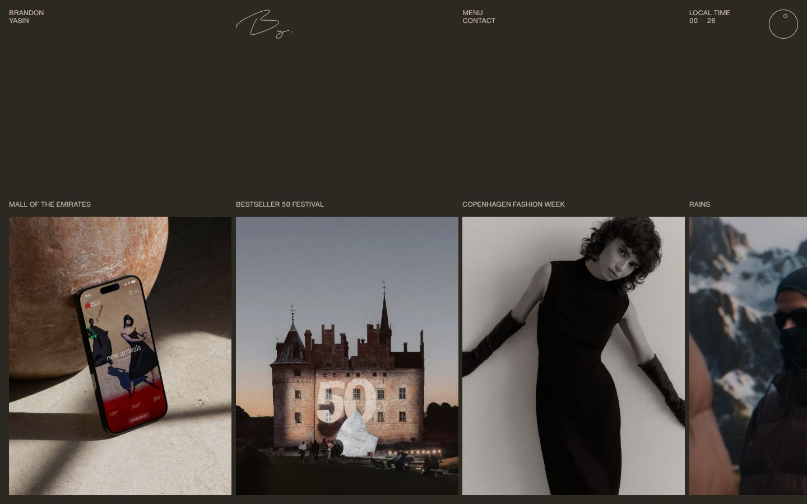</a> 

<details><summary>Toutes les captures</summary>

<a href="captures/desktop-01.jpg">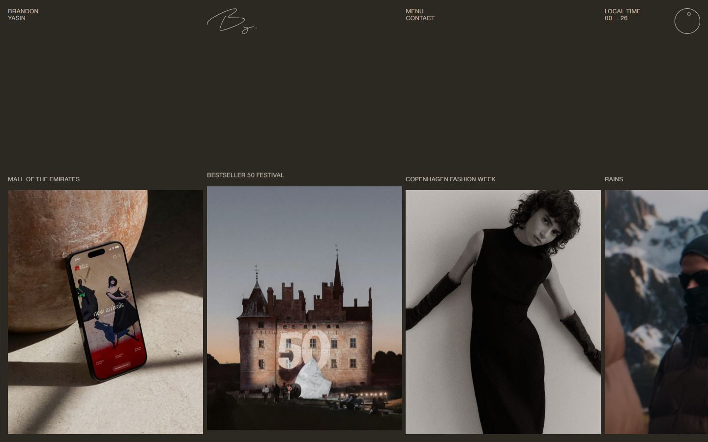</a> <a href="captures/desktop-02.jpg"></a> <a href="captures/desktop-03.jpg">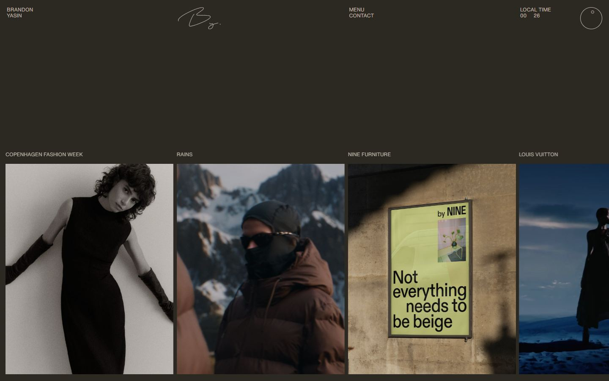</a> <a href="captures/desktop-04.jpg">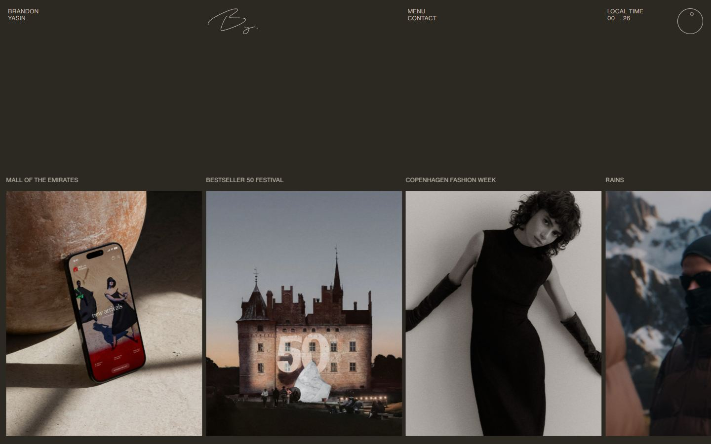</a> <a href="captures/desktop-05.jpg">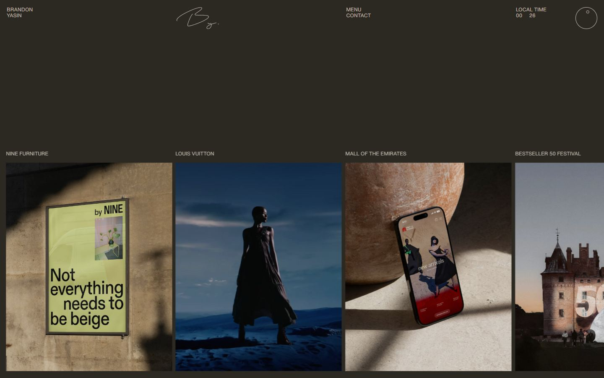</a> <a href="captures/desktop-06.jpg">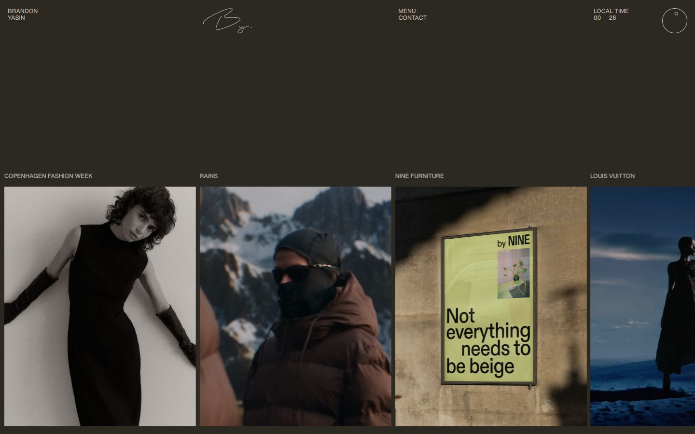</a> <a href="captures/desktop-07.jpg">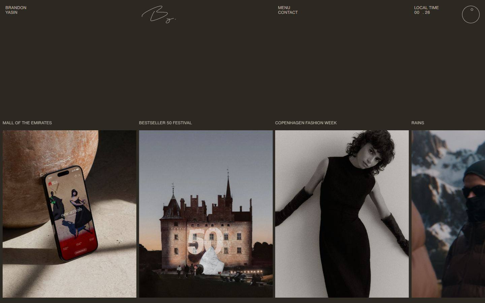</a> 

<a href="captures/page1-01.jpg">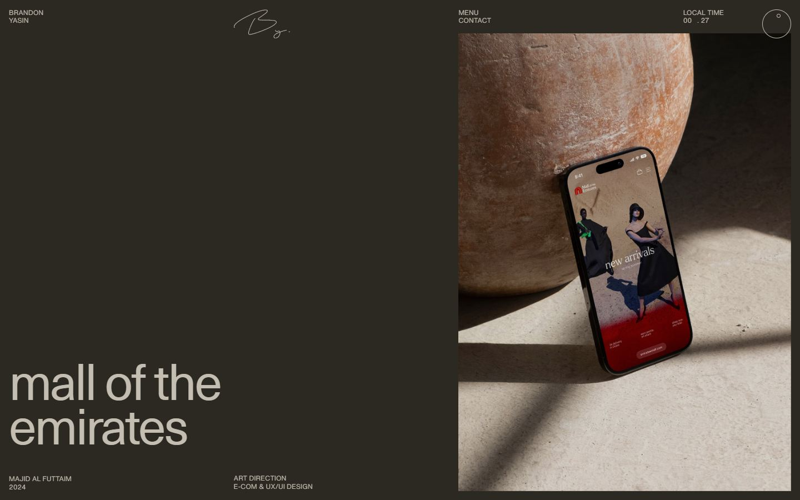</a> <a href="captures/page1-02.jpg">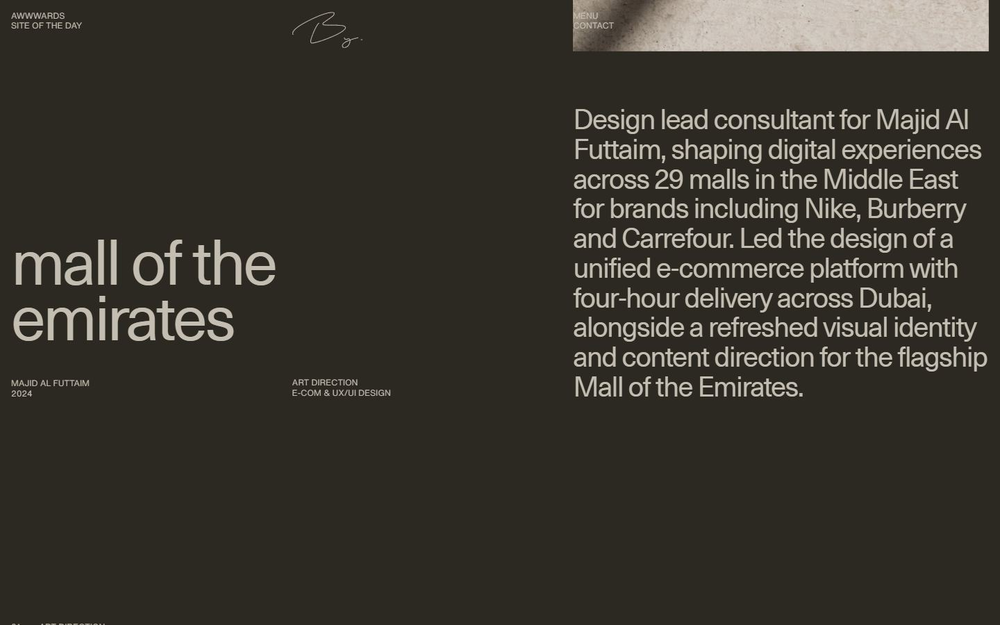</a> <a href="captures/page1-03.jpg">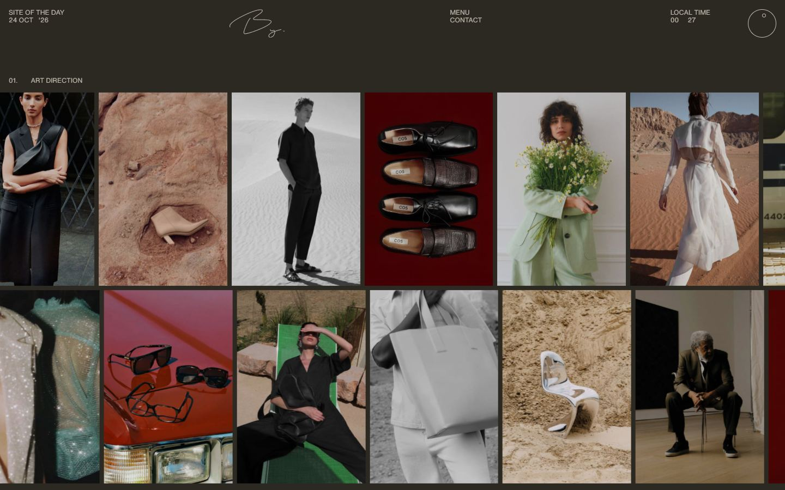</a> <a href="captures/page1-04.jpg">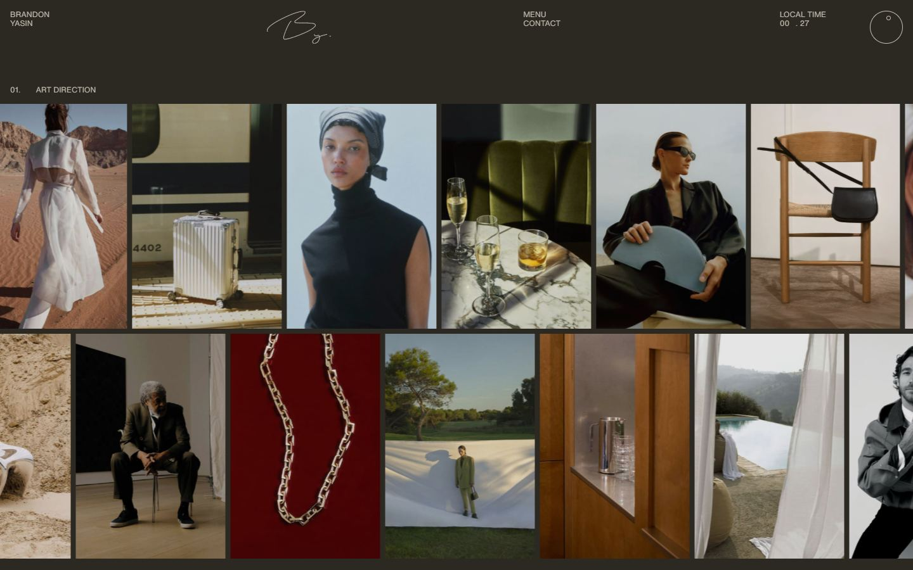</a> 

<a href="captures/mobile-01.jpg"></a> <a href="captures/mobile-02.jpg"></a> <a href="captures/mobile-03.jpg"></a> <a href="captures/mobile-04.jpg">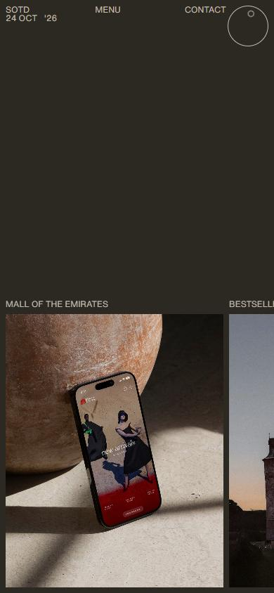</a> <a href="captures/mobile-05.jpg"></a> <a href="captures/mobile-06.jpg"></a> 

</details>

## Stack détectée
GSAP, Lenis, Nuxt, ScrollTrigger, SplitText/SplitType, Virtual scroll, Vue

Versions : GSAP 3.11.0 · Three.js r?

## Design tokens
### Couleurs (fonds, pondérées par surface)
`#2c2922`
### Couleurs de texte
`#c3beb1`
### Polices utilisées (par volume de texte)
Helvetica Now Variable · Neue Haas Unica Pro
### Fichiers de police chargés
- NeueHaasUnicaPro-Regular.CsAGy8LP.woff2
- HelveticaNowVar-Regular.BCGr3GKL.woff2
### Typographie
| Élément | Police | Taille | Graisse | Interligne | Interlettrage | Casse |
|---|---|---|---|---|---|---|
| h2 | "Neue Haas Unica Pro", "Helvetica Neue", Helvetica | 40.032px | 400 | 48.0384px | -1.60128px | none |
| p | "Neue Haas Unica Pro", "Helvetica Neue", Helvetica | 18px | 251 | 21.6px | -0.18px | none |
| a | "Helvetica Now Variable", "Helvetica Neue", Helvet | 12px | 400 | 12px | normal | uppercase |
| button | "Helvetica Now Variable", "Helvetica Neue", Helvet | 12px | 400 | 12px | normal | uppercase |
| li | "Helvetica Now Variable", "Helvetica Neue", Helvet | 12px | 400 | 12px | normal | uppercase |
| body | "Neue Haas Unica Pro", "Helvetica Neue", Helvetica | 15.984px | 400 | 20.7792px | normal | none |

### Échelle des tailles de texte
12px (89) · 24.048px (69) · 18px (38) · 90.144px (6) · 60.048px (3) · 15.984px (3) · 40.032px (3) · 13.968px (1)
### Arrondis
50%
### Transitions CSS fréquentes
- ease-out 0.25s ×1
### Points de rupture (media queries)
1025px · 1438px · 768px · 767px · 1024px · 420px · 692px · 850px · 1000px · 360px · 840px · 900px
### Animations CSS (@keyframes)
tick-458dfb20, rows-trail-7d6b1e40
### Variables CSS (:root)
```css
--color-main: #111;
--color-bg: #f8f6f2;
--selection-color: #111;
--selection-bg: #44300033;
--focus-bg: var(--color-main);
--focus-color: var(--color-bg);
--lvh: 1vh;
--svh: 1vh;
--img-over-opacity: 0;
--bg-brightness: 1;
--size: 1728;
```

## Structure de la home
Hauteur : 900 px — 788 nœuds DOM — canvas 0, vidéos 2, images 34

| # | Bloc | Hauteur | Titre | Médias |
|---|---|---|---|---|

**Navigation :** BrandonBrandonYasinYasinBrandonAwwwardsS · BrandonBrandonYasinYasinBrandonAwwwardsS · BrandonBrandonYasinYasinBrandonAwwwardsS

**Boutons / CTA :** 

## SEO
- Title : Brandon Yasin — Creative Director & Designer
- Description : Brand, digital and spatial design within lifestyle and luxury. AI scales the production, not the craft. Based in Denmark, working globally.
- Langue : en — canonical : https://brandonyasin.com/
- Open Graph : oui — JSON-LD : aucun
- H1 : 4 — images sans alt : 13/34

### Plan des titres
- H1 archive
- H1 I build refined brands and experiences across digital and physical spaces
- H1 my signature approach is guided by core values
- H1 established design process tried and tested on small and large brands
- H2 thank you
- H2 let’s buildtogether
- H2 join mynetwork

## Performance (mesure locale, Chrome headless, connexion non bridée)
- TTFB 523 ms · LCP 6356 ms (VIDEO) · CLS 0 · load 1284 ms
- 115 requêtes · 16398 Ko transférés
- Par type : Document 1 req / 20 Ko, Stylesheet 7 req / 22 Ko, Script 13 req / 206 Ko, Other 50 req / 12764 Ko, Image 38 req / 3304 Ko, Media 3 req / 0 Ko, Font 2 req / 81 Ko, Fetch 1 req / 0 Ko
- Plus gros fichiers :
- 1596 Ko — Other — https://brandonyasin.com/_nuxt/archive_16.CqiVaxxm.mp4
- 1309 Ko — Other — https://brandonyasin.com/_nuxt/archive_09.DbgvIWZh.mp4
- 1291 Ko — Other — https://brandonyasin.com/_nuxt/RAINS.bsJKHxaJ.mp4
- 1108 Ko — Other — https://brandonyasin.com/_nuxt/bg_2.BFp2NJKx.jpeg
- 793 Ko — Other — https://brandonyasin.com/_nuxt/thx_paper_bg_dark.D5PiLhWj.png
- 700 Ko — Other — https://brandonyasin.com/_nuxt/archive_03.DRKdGFuF.mp4
- 612 Ko — Other — https://brandonyasin.com/_nuxt/LV.CkZt_03C.mp4
- 536 Ko — Other — https://brandonyasin.com/_nuxt/archive_06.C5_Zp-eu.mp4
- Services tiers : 

## Mobile
- H1 : {'size': '54px', 'lineHeight': '66.96px'} · corps : 16px · débordement horizontal : False · menu burger : True

## Fichiers
- `captures/` : arrivée, scroll desktop (1440×900), pleine page, pages internes, mobile (390×844 @2x) ; vidéo de scroll dans la release GitHub « videos » (lien en haut de fiche)
- `page.html` : DOM rendu · `styles.css` : CSS chargé · `scripts/` : JS chargé (index dans `_index.json`) · `shaders.glsl` : shaders extraits · `rea-bundle.json` : analyse REA du bundle (chunks, routes, endpoints)

## Pages internes capturées
- https://brandonyasin.com/cases/mall-of-the-emirates
