# Cartier - Le Choeur des Pierres

- Site : [https://www.cartier.com/en-fr/lechoeurdespierres](https://www.cartier.com/en-fr/lechoeurdespierres) — [aperçu statique local](apercu.html)
- Capturé le : 2026-11-03 — statut : ok
- Vidéo de scroll : [▶ ouvrir](https://github.com/t-baudry/bibliotheque-web/releases/download/videos/013-cartier-le-choeur-des-pierres.webm)

<a href="captures/desktop-00-arrivee.jpg"></a> 

<details><summary>Toutes les captures</summary>

<a href="captures/desktop-01.jpg">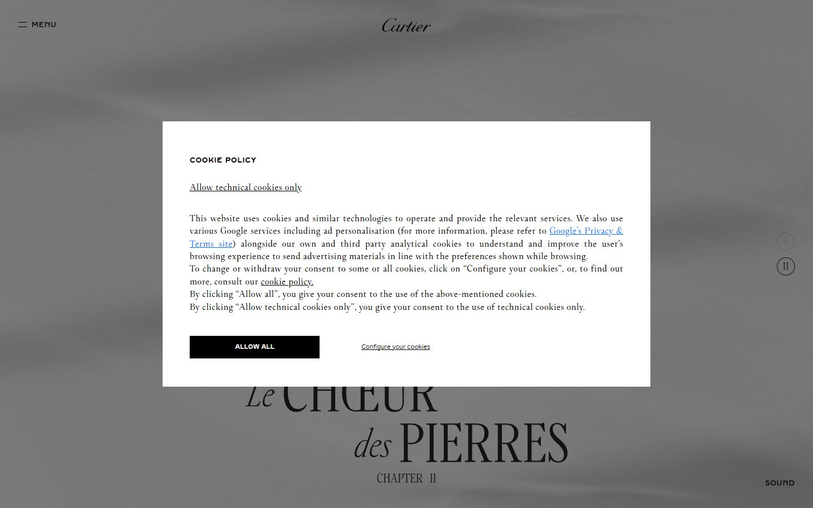</a> <a href="captures/desktop-02.jpg">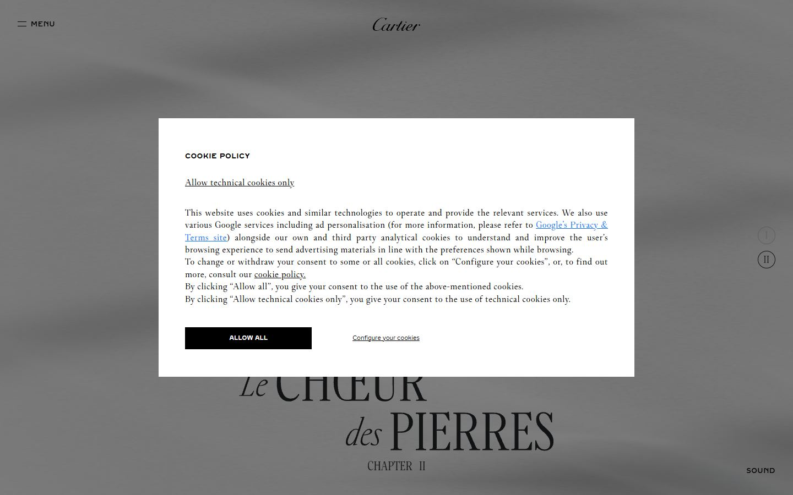</a> <a href="captures/desktop-03.jpg"></a> <a href="captures/desktop-04.jpg">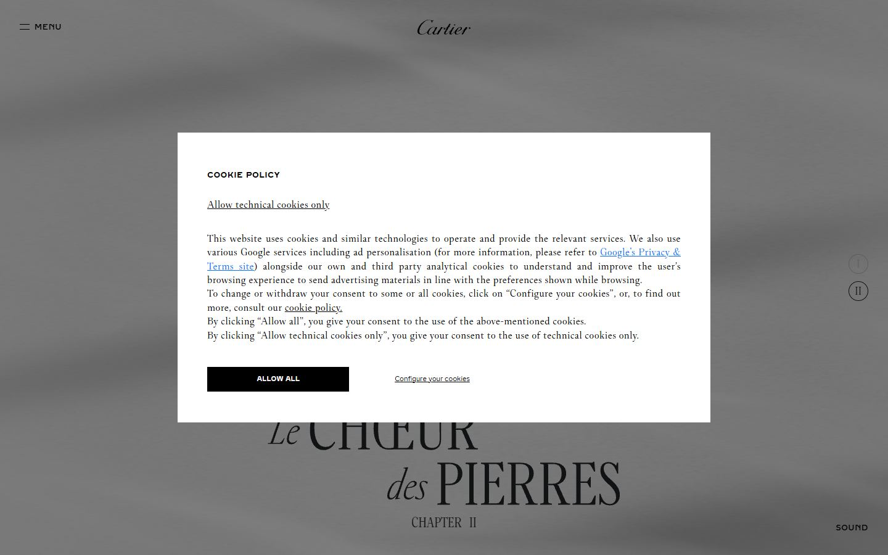</a> <a href="captures/desktop-05.jpg">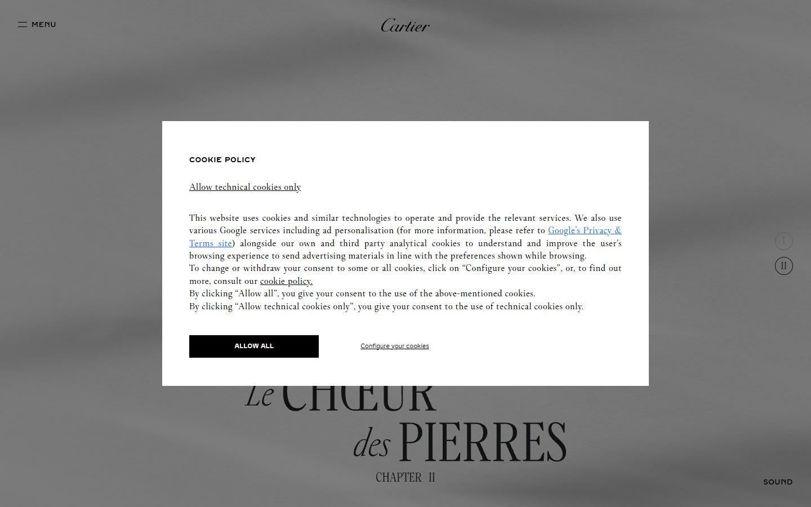</a> <a href="captures/desktop-06.jpg"></a> <a href="captures/desktop-07.jpg">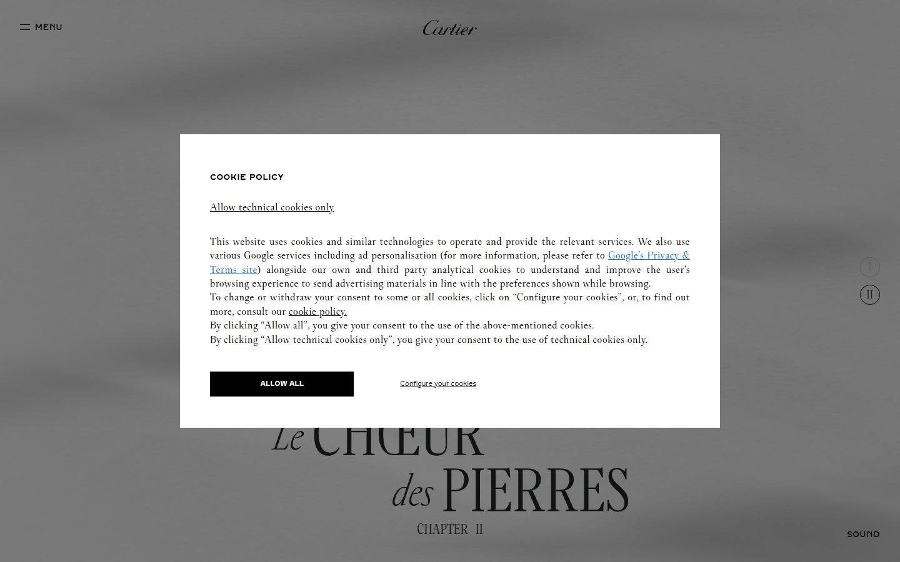</a> 

<a href="captures/page1-01.jpg"></a> <a href="captures/page1-02.jpg"></a> <a href="captures/page1-03.jpg"></a> <a href="captures/page1-04.jpg"></a> <a href="captures/page2-01.jpg"></a> <a href="captures/page2-02.jpg"></a> <a href="captures/page2-03.jpg"></a> <a href="captures/page2-04.jpg"></a> 

<a href="captures/mobile-01.jpg">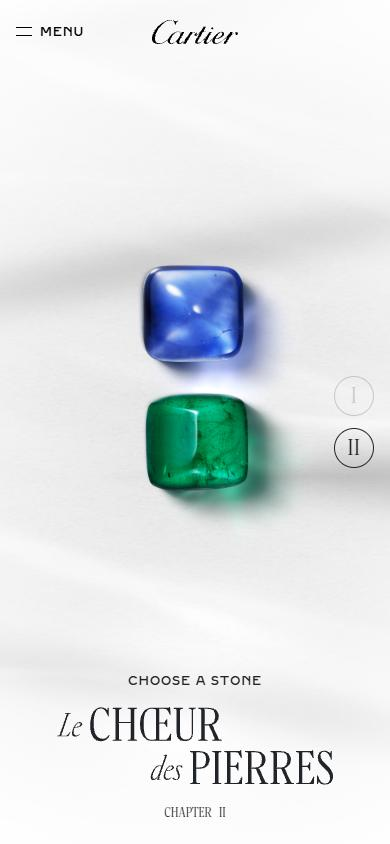</a> <a href="captures/mobile-02.jpg">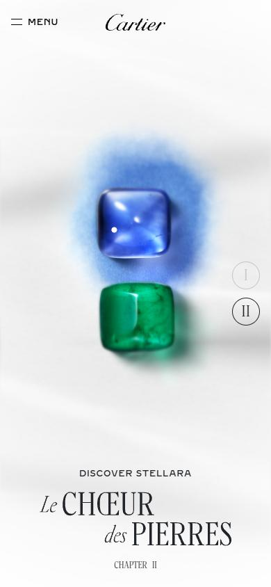</a> <a href="captures/mobile-03.jpg">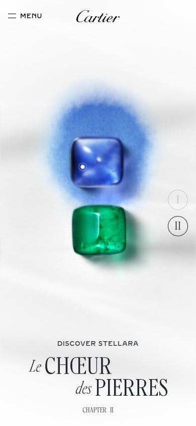</a> <a href="captures/mobile-04.jpg">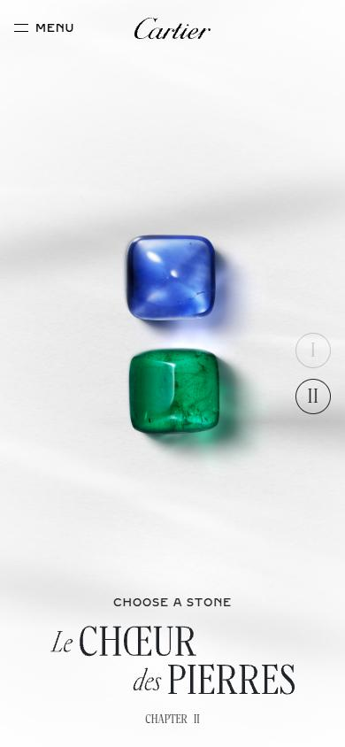</a> <a href="captures/mobile-05.jpg">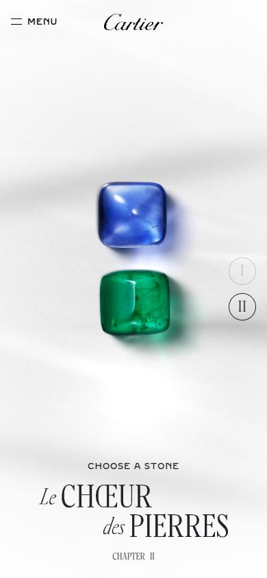</a> <a href="captures/mobile-06.jpg">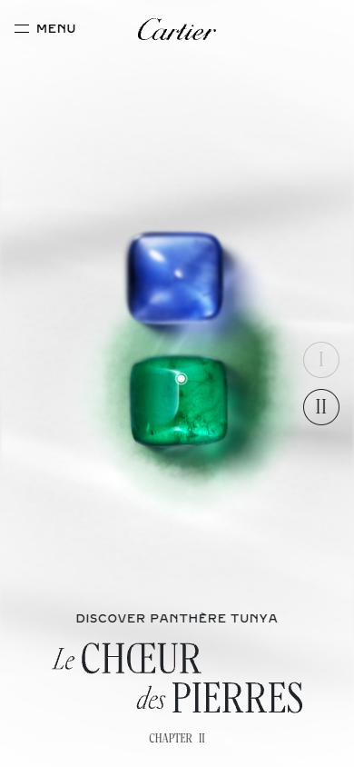</a> 

</details>

## Stack détectée
Barba.js, CMS Contentful, GSAP, Lil-GUI/Tweakpane (debug), Nuxt, React, ScrollTrigger, SplitText/SplitType, Vue, WebGL, jQuery

Versions : GSAP 3.11.0 · Three.js r?

Shaders GLSL personnalisés extraits : 40 (voir `shaders.glsl`)

## Design tokens
### Couleurs (fonds, pondérées par surface)
`#000000` · `#ffffff`
### Couleurs de texte
`#000000` · `#212529` · `#0d6efd` · `#ffffff`
### Polices utilisées (par volume de texte)
Brilliant Cut Pro Regular · Fancy Cut Pro · Brilliant Cut Pro Medium · Brilliant Cut Pro · Fancy Cut Pro Regular
### Fichiers de police chargés
- BrilliantCutPro-Regular.woff2
- BrilliantCutPro-Medium.woff2
- FancyCutPro-Regular.woff2
- BrilliantCutPro-Medium.woff2
- FancyCutPro-Light.woff2
- BrilliantCutPro-Regular.woff2
- FancyCutPro-Regular.woff2
- FancyCutCondPro-Regular.woff2
- FancyCutCondPro-Light.woff2
- HelveticaNeueRoman.otf
- BrilliantCutProRegular16505481711650548171.woff
- BrilliantCutProBold16509732341650973234.woff
- FancyCutProRegular16505488041650548804.woff
### Typographie
| Élément | Police | Taille | Graisse | Interligne | Interlettrage | Casse |
|---|---|---|---|---|---|---|
| h2 | "Brilliant Cut Pro" | 12px | 700 | 14.4px | 0.5px | uppercase |
| p | "Brilliant Cut Pro Medium" | 16px | 600 | 24px | 0.5px | uppercase |
| a | "Brilliant Cut Pro Regular", sans-serif | 12px | 400 | 18px | 0.8px | uppercase |
| button | "Brilliant Cut Pro" | 10px | 700 | 10px | normal | none |
| li | "Brilliant Cut Pro Regular", sans-serif | 12px | 400 | 18px | 0.8px | uppercase |
| body | "Fancy Cut Pro Regular" | 18px | 400 | 28px | 0.5px | none |

### Échelle des tailles de texte
12px (255) · 16px (35) · 18px (6) · 17.5px (5) · 14px (5) · 10px (4)
### Arrondis
aucun (angles droits)
### Transitions CSS fréquentes
- ease 0.3s ×10
- ease-in-out 0.15s ×7
- ease 0.2s ×3
- ease-in 0.4s ×2
- ease-in-out 1s ×1
- ease 0.5s ×1
### Points de rupture (media queries)
575.98px · 767.98px · 991.98px · 992px · 576px · 768px · 1200px · 1199.98px · 1440px · 1280px · 1279.98px · 1439.98px
### Animations CSS (@keyframes)
progress-bar-stripes, spinner-border, spinner-grow, placeholder-glow, placeholder-wave, eye-blink-red, red-sweep-down, gradient-move, spin
### Variables CSS (:root)
```css
--bs-blue: #0d6efd;
--bs-indigo: #6610f2;
--bs-purple: #6f42c1;
--bs-pink: #d63384;
--bs-red: #dc3545;
--bs-orange: #fd7e14;
--bs-yellow: #ffc107;
--bs-green: #198754;
--bs-teal: #20c997;
--bs-cyan: #0dcaf0;
--bs-black: #000;
--bs-white: #fff;
--bs-gray: #6c757d;
--bs-gray-dark: #343a40;
--bs-gray-100: #f8f9fa;
--bs-gray-200: #e9ecef;
--bs-gray-300: #dee2e6;
--bs-gray-400: #ced4da;
--bs-gray-500: #adb5bd;
--bs-gray-600: #6c757d;
--bs-gray-700: #495057;
--bs-gray-800: #343a40;
--bs-gray-900: #212529;
--bs-primary: #0d6efd;
--bs-secondary: #6c757d;
--bs-success: #198754;
--bs-info: #0dcaf0;
--bs-warning: #ffc107;
--bs-danger: #dc3545;
--bs-light: #f8f9fa;
--bs-dark: #212529;
--bs-primary-rgb: 13,110,253;
--bs-secondary-rgb: 108,117,125;
--bs-success-rgb: 25,135,84;
--bs-info-rgb: 13,202,240;
--bs-warning-rgb: 255,193,7;
--bs-danger-rgb: 220,53,69;
--bs-light-rgb: 248,249,250;
--bs-dark-rgb: 33,37,41;
--bs-primary-text-emphasis: #052c65;
--bs-secondary-text-emphasis: #2b2f32;
--bs-success-text-emphasis: #0a3622;
--bs-info-text-emphasis: #055160;
--bs-warning-text-emphasis: #664d03;
--bs-danger-text-emphasis: #58151c;
--bs-light-text-emphasis: #495057;
--bs-dark-text-emphasis: #495057;
--bs-primary-bg-subtle: #cfe2ff;
--bs-secondary-bg-subtle: #e2e3e5;
--bs-success-bg-subtle: #d1e7dd;
--bs-info-bg-subtle: #cff4fc;
--bs-warning-bg-subtle: #fff3cd;
--bs-danger-bg-subtle: #f8d7da;
--bs-light-bg-subtle: #fcfcfd;
--bs-dark-bg-subtle: #ced4da;
--bs-primary-border-subtle: #9ec5fe;
--bs-secondary-border-subtle: #c4c8cb;
--bs-success-border-subtle: #a3cfbb;
--bs-info-border-subtle: #9eeaf9;
--bs-warning-border-subtle: #ffe69c;
--bs-danger-border-subtle: #f1aeb5;
--bs-light-border-subtle: #e9ecef;
--bs-dark-border-subtle: #adb5bd;
--bs-white-rgb: 255,255,255;
--bs-black-rgb: 0,0,0;
--bs-font-sans-serif: system-ui,-apple-system,"Segoe UI",Roboto,"Helvetica Neue","Noto Sans","Liberation Sans",Arial,sans-serif,"Apple Color Emoji","Segoe UI Emoj;
--bs-font-monospace: SFMono-Regular,Menlo,Monaco,Consolas,"Liberation Mono","Courier New",monospace;
--bs-gradient: linear-gradient(180deg,hsla(0,0%,100%,.15),hsla(0,0%,100%,0));
--bs-body-font-family: var(--bs-font-sans-serif);
--bs-body-font-size: 1rem;
--bs-body-font-weight: 400;
--bs-body-line-height: 1.5;
--bs-body-color: #212529;
--bs-body-color-rgb: 33,37,41;
--bs-body-bg: #fff;
--bs-body-bg-rgb: 255,255,255;
--bs-emphasis-color: #000;
--bs-emphasis-color-rgb: 0,0,0;
--bs-secondary-color: rgba(33,37,41,.75);
--bs-secondary-color-rgb: 33,37,41;
```

## Structure de la home
Hauteur : 900 px — 3166 nœuds DOM — canvas 0, vidéos 1, images 199

| # | Bloc | Hauteur | Titre | Médias |
|---|---|---|---|---|

**Navigation :** English · English · Français · Contact us · Services · High Jewellery · Jewellery · Watches · Bags and accessories · Home & Stationery · Fragrances · The Maison · News · Le Choeur des Pierres · En Équilibre · View all · Architecture and Purity · Geometry and contrasts · Flora and Fauna · Cultural dialogues · View all Markers of Style · The Iconic Panther

**Boutons / CTA :** ALLOW ALL · Configure your cookies

## SEO
- Title : Le Choeur des Pierres
- Description : None
- Langue : en-FR — canonical : https://www.cartier.com/en-fr/lechoeurdespierres
- Open Graph : non — JSON-LD : WebPage
- H1 : 0 — images sans alt : 196/199

### Plan des titres
- H3 France
- H3 
- H3 Le Chœur des Pierres
- H3 
- H3 Panthère de Cartier
- H3 Clash de Cartier
- H3 
- H3 Panthère de Cartier
- H3 
- H3 
- H2 Cookie policy

## Performance (mesure locale, Chrome headless, connexion non bridée)
- TTFB 394 ms · LCP 2916 ms (P.paragraph) · CLS 0.003 · load 3389 ms
- 132 requêtes · 25594 Ko transférés
- Par type : Document 1 req / 36 Ko, Stylesheet 7 req / 572 Ko, Image 30 req / 10347 Ko, Script 36 req / 2442 Ko, Font 13 req / 715 Ko, Fetch 34 req / 11450 Ko, XHR 6 req / 15 Ko, Other 3 req / 15 Ko, Ping 2 req / 1 Ko
- Plus gros fichiers :
- 7578 Ko — Image — https://www.cartier.com/content/dam/car/_Megamenu/mobile-insert/2026/eoy/MOB_mm_insert_eoy26_level_0.gif
- 5588 Ko — Fetch — https://websitefactory.cartier.com/akamai-storage/videos/choeur/assets/packshot_basis-BRPtCZ-O.glb
- 2312 Ko — Fetch — https://websitefactory.cartier.com/akamai-storage/videos/choeur/assets/gouach_basis-BzIjiIF8.glb
- 1455 Ko — Fetch — https://websitefactory.cartier.com/akamai-storage/videos/choeur/assets/stone_select_basis-CA6H2D2T.glb
- 642 Ko — Fetch — https://websitefactory.cartier.com/akamai-storage/videos/choeur/assets/CARTIER_CDP_Music-Pages_S-2000-E-40000-D3hBhBzk.mp3
- 641 Ko — Fetch — https://websitefactory.cartier.com/akamai-storage/videos/choeur/assets/CARTIER_CDP_Music-Home_S-2000-E-40000-QVLOlEH-.mp3
- 507 Ko — Image — https://websitefactory.cartier.com/akamai-storage/videos/choeur/assets/hero-F8Yzid1p.avif
- 453 Ko — Image — https://websitefactory.cartier.com/akamai-storage/videos/choeur/assets/hero-CQIdHdnj.avif
- Services tiers : www.datadoghq-browser-agent.com, s.go-mpulse.net, websitefactory.cartier.com, fea-core-features.richemont.com, fonts.googleapis.com, c.go-mpulse.net, www.googletagmanager.com, cdn.trustcommander.net, undefined.cdn4.forter.com, privacy.trustcommander.net, s3.amazonaws.com, ace820ae.akstat.io

## Mobile
- H1 : None · corps : 18px · débordement horizontal : False · menu burger : True

## Fichiers
- `captures/` : arrivée, scroll desktop (1440×900), pleine page, pages internes, mobile (390×844 @2x) ; vidéo de scroll dans la release GitHub « videos » (lien en haut de fiche)
- `page.html` : DOM rendu · `styles.css` : CSS chargé · `scripts/` : JS chargé (index dans `_index.json`) · `shaders.glsl` : shaders extraits · `rea-bundle.json` : analyse REA du bundle (chunks, routes, endpoints)

## Pages internes capturées
- https://www.cartier.com/en-fr
- https://www.cartier.com/fr-fr
