# FORMAT

- Site : [https://format.obys.agency/](https://format.obys.agency/) — [aperçu statique local](apercu.html)
- Capturé le : 2026-11-02 — statut : ok
- Vidéo de scroll : [▶ ouvrir](https://github.com/t-baudry/bibliotheque-web/releases/download/videos/014-format.webm)

<a href="captures/desktop-00-arrivee.jpg">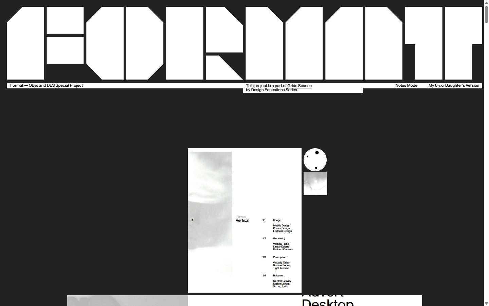</a> 

<details><summary>Toutes les captures</summary>

<a href="captures/desktop-01.jpg">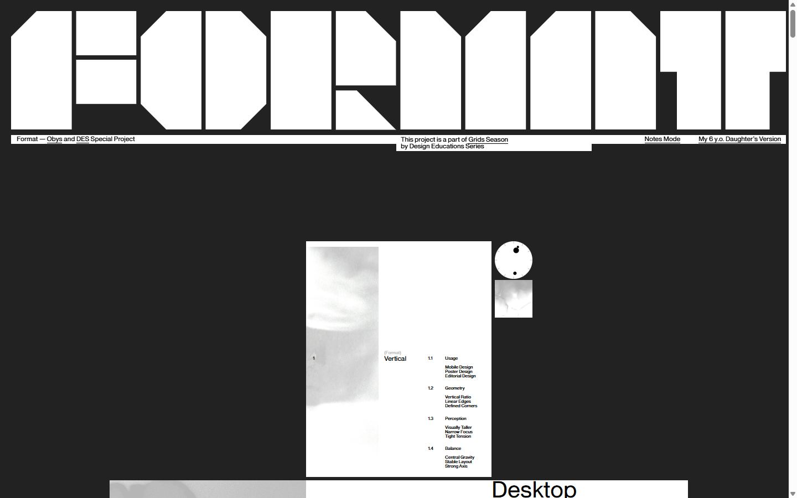</a> <a href="captures/desktop-02.jpg">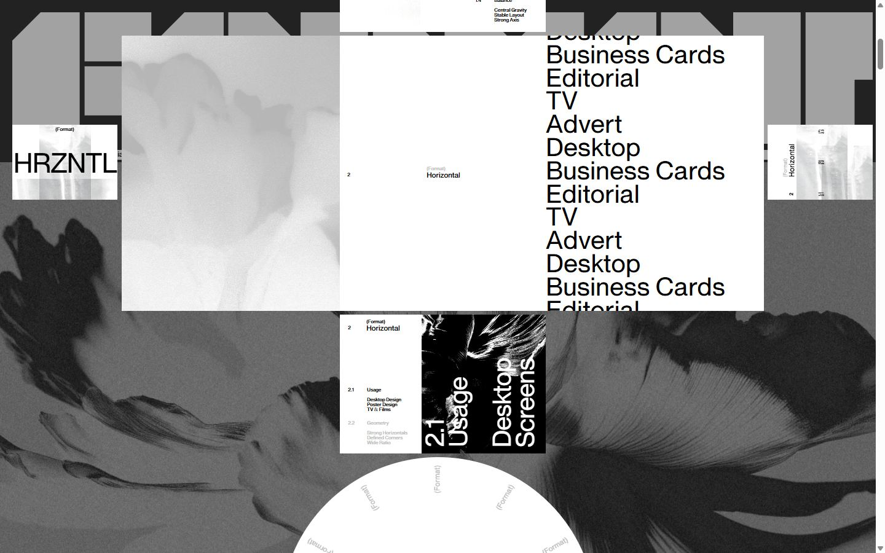</a> <a href="captures/desktop-03.jpg">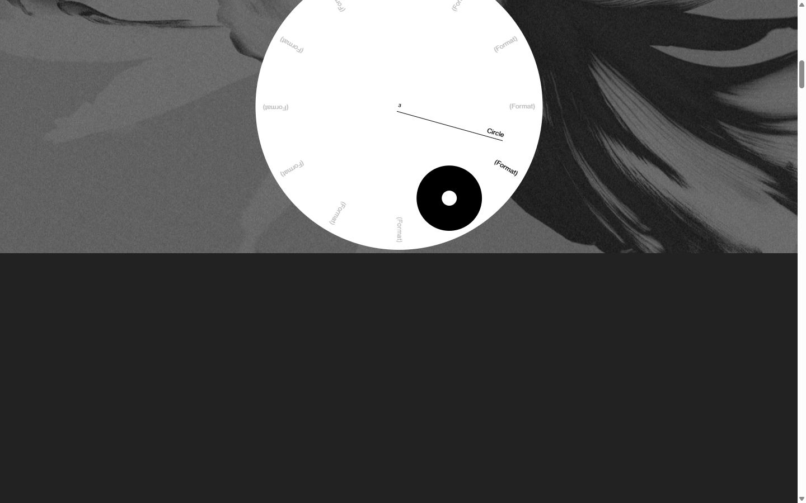</a> <a href="captures/desktop-04.jpg">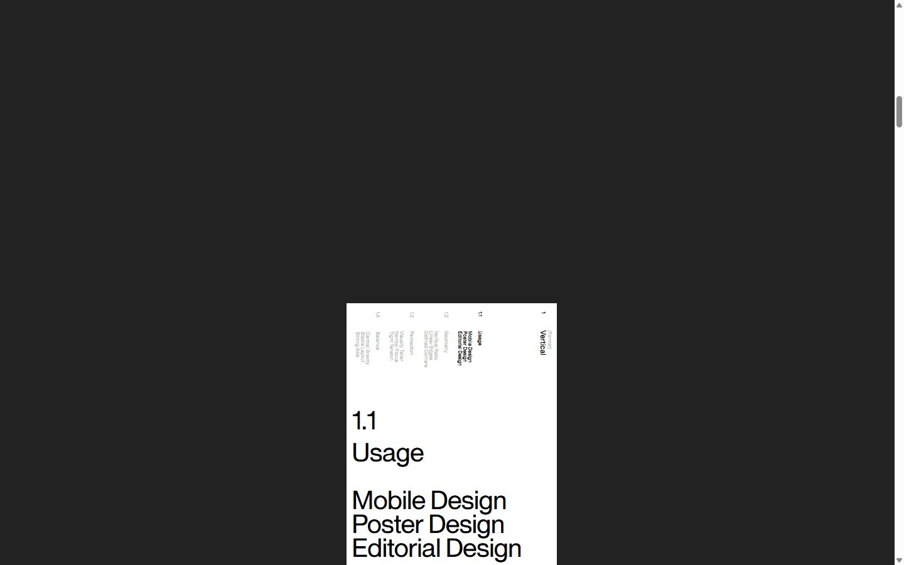</a> <a href="captures/desktop-05.jpg">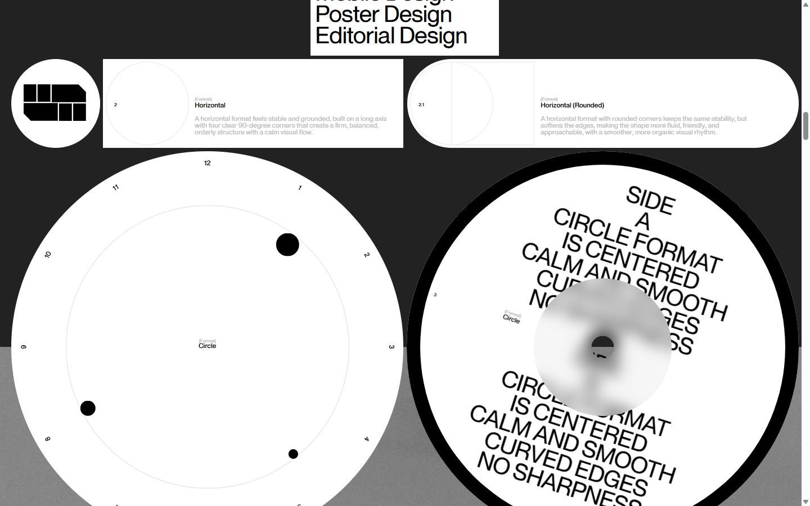</a> <a href="captures/desktop-06.jpg">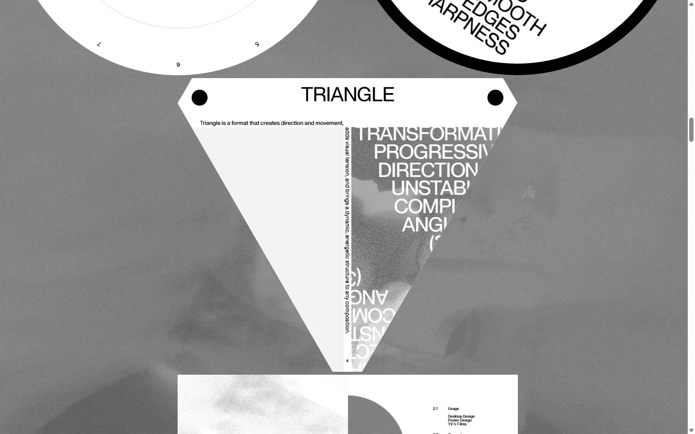</a> <a href="captures/desktop-07.jpg">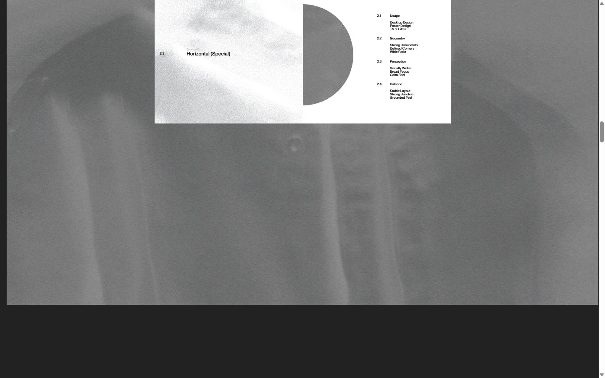</a> <a href="captures/desktop-08.jpg">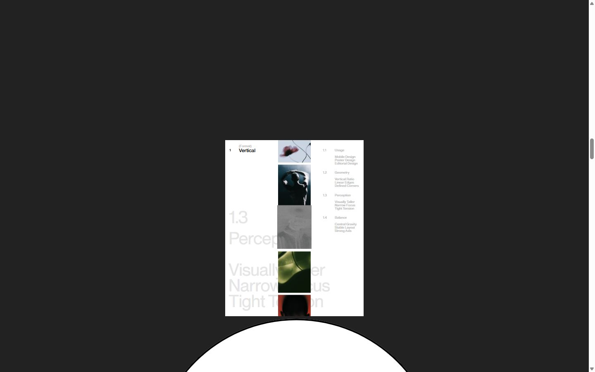</a> <a href="captures/desktop-09.jpg">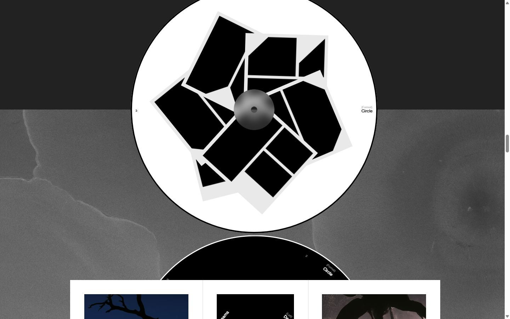</a> <a href="captures/desktop-10.jpg">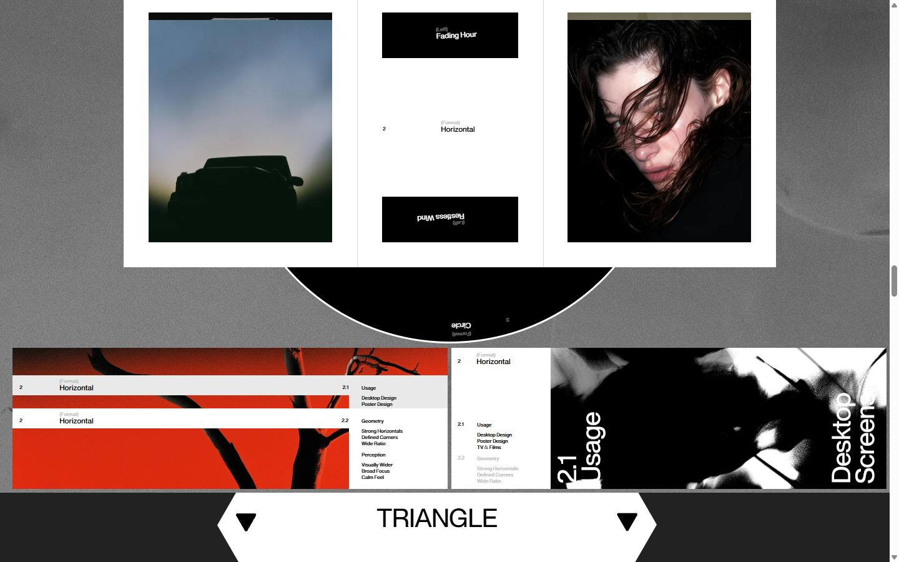</a> <a href="captures/desktop-11.jpg">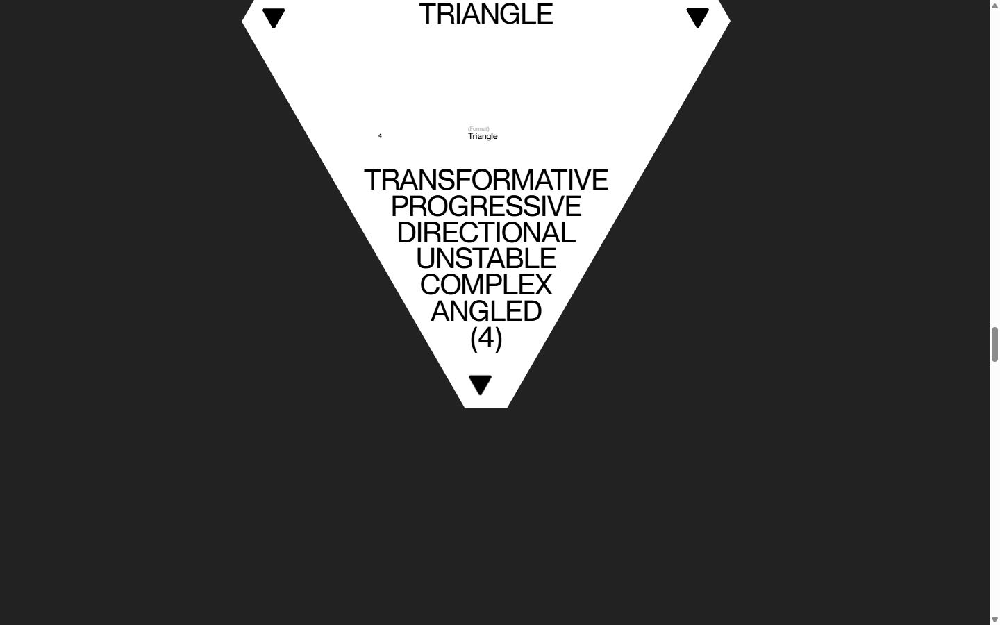</a> <a href="captures/desktop-12.jpg">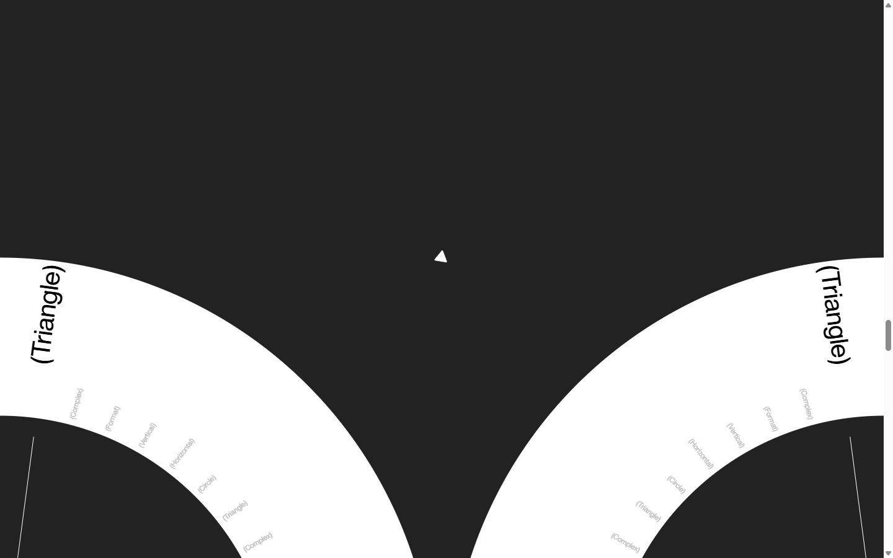</a> <a href="captures/desktop-13.jpg">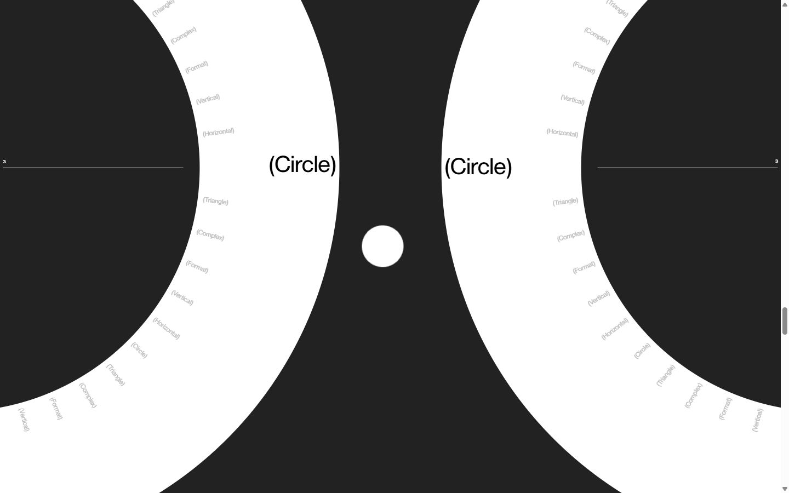</a> <a href="captures/desktop-14.jpg">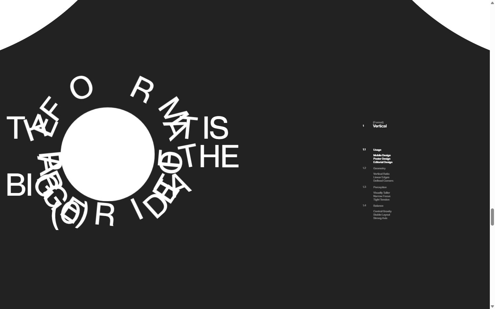</a> <a href="captures/desktop-pleine-page.jpg"></a> 


<a href="captures/mobile-01.jpg"></a> <a href="captures/mobile-02.jpg"></a> <a href="captures/mobile-03.jpg"></a> <a href="captures/mobile-04.jpg"></a> <a href="captures/mobile-05.jpg"></a> <a href="captures/mobile-06.jpg">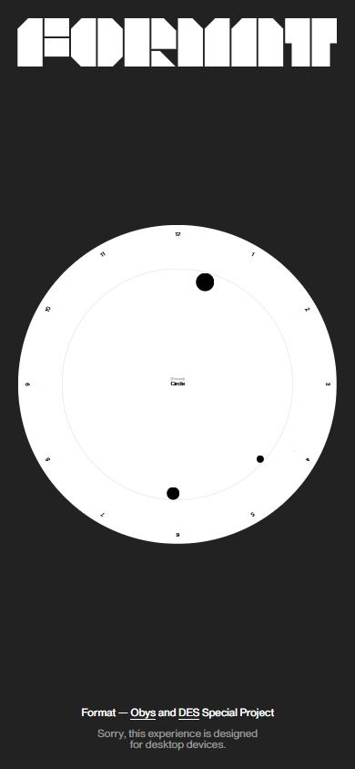</a> 

</details>

## Stack détectée
GSAP, Lenis, Matter.js, ScrollTrigger, SplitText/SplitType, Virtual scroll

Versions : GSAP 3.11.0 · Three.js r?

## Design tokens
### Couleurs (fonds, pondérées par surface)
`#ffffff` · `#222222` · `#d9d9d9` · `#000000` · `#d1d1d1` · `#e9e9e9` · `#dedede`
### Couleurs de texte
`#000000` · `#bfbfbf` · `#ffffff`
### Polices utilisées (par volume de texte)
Obys Sans
### Fichiers de police chargés
- ObysSans-Regular.woff2
### Typographie
| Élément | Police | Taille | Graisse | Interligne | Interlettrage | Casse |
|---|---|---|---|---|---|---|
| h2 | "Obys Sans", system-ui, sans-serif | 12px | 400 | 18px | normal | none |
| p | "Obys Sans", system-ui, sans-serif | 12px | 400 | 18px | normal | none |
| a | "Obys Sans", system-ui, sans-serif | 12px | 400 | 12px | normal | none |
| button | "Obys Sans", system-ui, sans-serif | 12px | 400 | 18px | normal | none |
| body | "Obys Sans", system-ui, sans-serif | 16px | 400 | normal | normal | none |

### Échelle des tailles de texte
8px (228) · 42px (179) · 12px (79) · 92px (33) · 3.50904px (13) · 5px (6) · 43.9695px (4) · 45.316px (1) · 2.33936px (1)
### Arrondis
50% · 79px
### Transitions CSS fréquentes
- cubic-bezier(0.22 0.45s ×46
- ease 0.35s ×9
- ease 0.5s ×1
### Points de rupture (media queries)
767px · 620px
### Animations CSS (@keyframes)
field-flick
### Variables CSS (:root)
```css
--s: calc(100vw / 1440);
--color-bg: #222;
--color-logo: #fff;
--color-plate: #fff;
--color-plate-ink: #000;
--color-nav-muted: #939393;
--color-dial: #fff;
--color-mark: #bfbfbf;
--color-mark-active: #000;
--color-hand: #000;
--color-dot: #000;
--color-note: #e0ddbf;
--color-note-ink: #000;
--layer-header: 0;
--layer-content: 1;
--layer-burst: 10;
--layer-curtain: 50;
--parallax: 70;
--drift: .07;
--grid-columns: 8;
--grid-margin: 20;
--grid-gutter: 20;
--content-width: 1400;
```

## Structure de la home
Hauteur : 15451 px — 1044 nœuds DOM — canvas 0, vidéos 0, images 87

| # | Bloc | Hauteur | Titre | Médias |
|---|---|---|---|---|
| 1 | div .logo-fixed | 215 |  | 0 |
| 2 | div .screen | 810 |  | 0 |
| 3 | article .block-one | 426 | Vertical | 4 |
| 4 | div .ground | 999 |  | 1 |
| 5 | article .wide | 448 | Horizontal | 2 |
| 6 | section .clock-section | 513 |  | 1 |
| 7 | div .fog | 1290 |  | 1 |
| 8 | section .deck | 426 | Vertical | 7 |
| 9 | div .seven__ground | 1701 |  | 1 |
| 10 | div .seven | 2646 | Horizontal | 28 |
| 11 | section .fan | 697 | Circle | 15 |
| 12 | section .win | 697 |  | 9 |
| 13 | section .vee | 841 | Triangle | 5 |
| 14 | section .gauge | 2050 |  | 0 |
| 15 | section .poster | 1617 | The format is Part of the Bigger idea (0) | 2 |
| 16 | section .field | 1247 |  | 0 |
| 17 | footer .footer | 273 |  | 0 |
| 18 | div .clock-spacer | 2882 |  | 0 |

**Navigation :** Obys · DES · Grids Season · Obys · DES

**Boutons / CTA :** 

## SEO
- Title : FORMAT
- Description : FORMAT is an interactive Obys × DES Special Project exploring format as a design tool. Discover how different shapes, proportions, and boundaries can change the way we think, compose, and design.
- Langue : en — canonical : None
- Open Graph : oui — JSON-LD : aucun
- H1 : 0 — images sans alt : 87/87

### Plan des titres
- H2 Vertical
- H2 Horizontal
- H2 Horizontal
- H2 Vertical
- H2 Horizontal
- H2 Horizontal (Rounded)
- H2 Circle
- H2 Circle
- H2 Triangle
- H2 Horizontal (Special)
- H2 Circle
- H2 Triangle
- H2 The format is Part of the Bigger idea (0)
- H3 Split format Into smaller (1)
- H3 Make the Edges work (2)
- H2 Circle

## Performance (mesure locale, Chrome headless, connexion non bridée)
- TTFB 528 ms · LCP 7388 ms (IMG) · CLS 0 · load 4435 ms
- 59 requêtes · 3037 Ko transférés
- Par type : Document 1 req / 23 Ko, Image 51 req / 2735 Ko, Stylesheet 1 req / 9 Ko, Font 1 req / 6 Ko, Script 2 req / 262 Ko, Other 1 req / 1 Ko, Fetch 2 req / 0 Ko
- Plus gros fichiers :
- 568 Ko — Image — https://format.obys.agency/assets/bg7-DimjdT4q.webp
- 553 Ko — Image — https://format.obys.agency/assets/hrzntl-DfNaFLW7.webp
- 474 Ko — Image — https://format.obys.agency/assets/flower-CVKgWteV.webp
- 273 Ko — Image — https://format.obys.agency/assets/tri-bg-BUX7DWVI.webp
- 178 Ko — Script — https://www.googletagmanager.com/gtag/js?id=G-R8KYY8LG8Y
- 145 Ko — Image — https://format.obys.agency/assets/horizontal-CWAIze4S.webp
- 115 Ko — Image — https://format.obys.agency/assets/rec-left-CR_1c09C.webp
- 107 Ko — Image — https://format.obys.agency/assets/special-DCkX6FsC.webp
- Services tiers : www.googletagmanager.com, region1.google-analytics.com

## Mobile
- H1 : None · corps : 16px · débordement horizontal : False · menu burger : False

## Fichiers
- `captures/` : arrivée, scroll desktop (1440×900), pleine page, pages internes, mobile (390×844 @2x) ; vidéo de scroll dans la release GitHub « videos » (lien en haut de fiche)
- `page.html` : DOM rendu · `styles.css` : CSS chargé · `scripts/` : JS chargé (index dans `_index.json`) · `shaders.glsl` : shaders extraits · `rea-bundle.json` : analyse REA du bundle (chunks, routes, endpoints)
