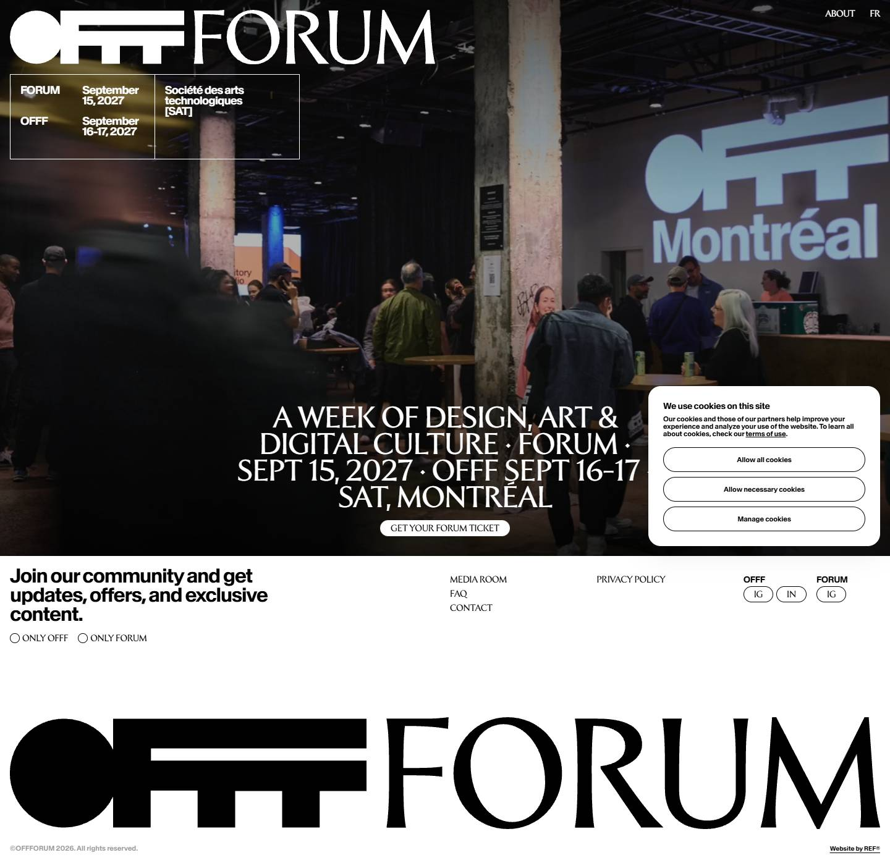
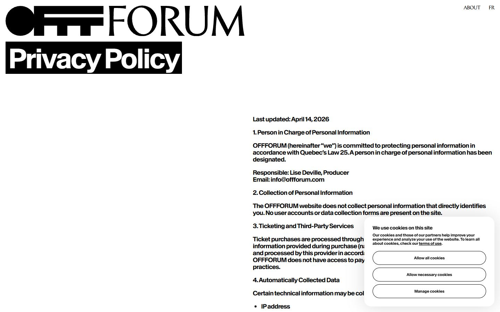
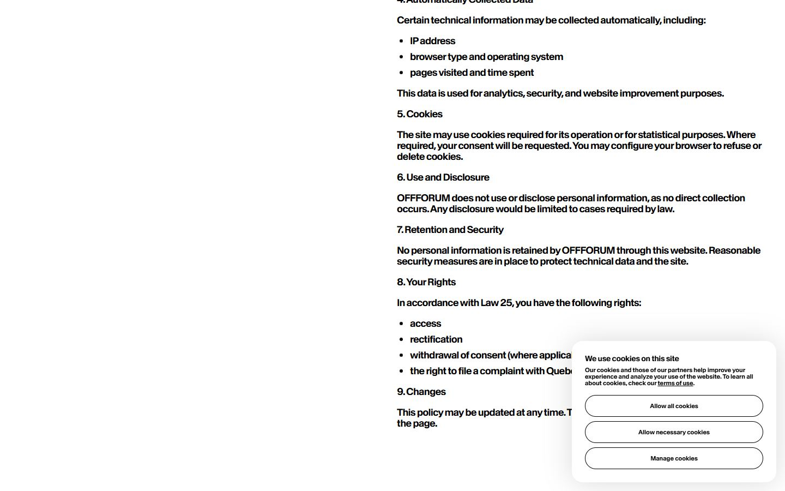
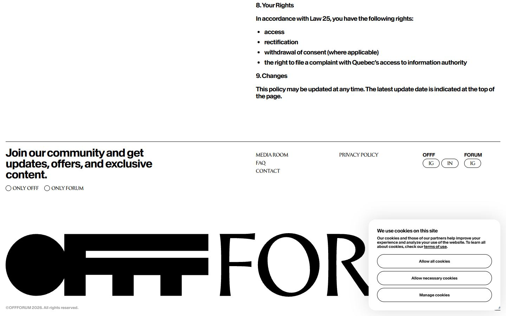
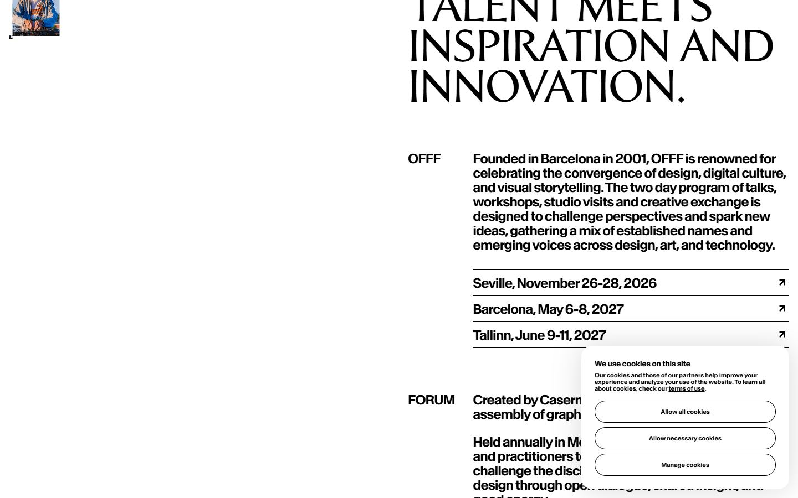
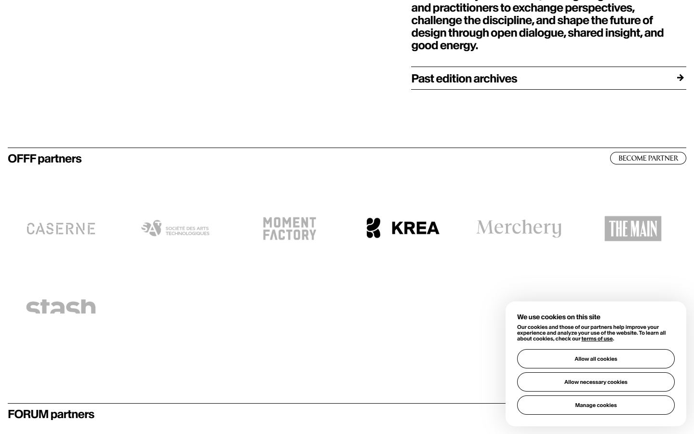
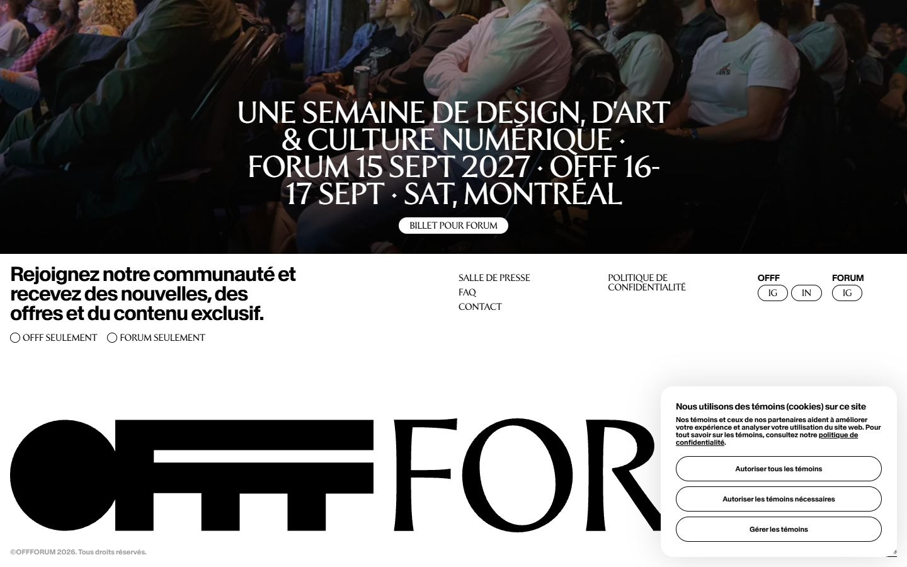
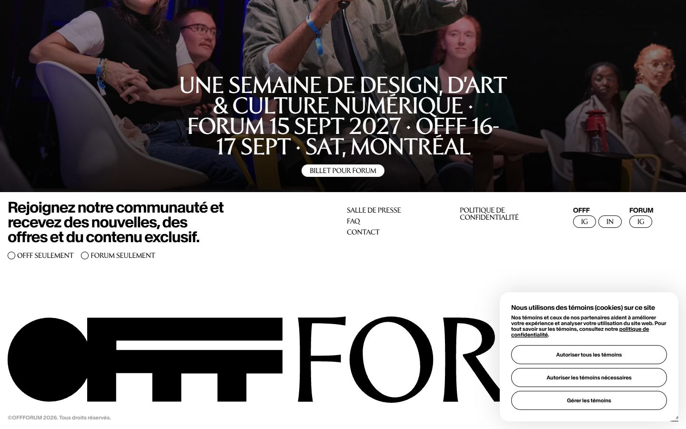
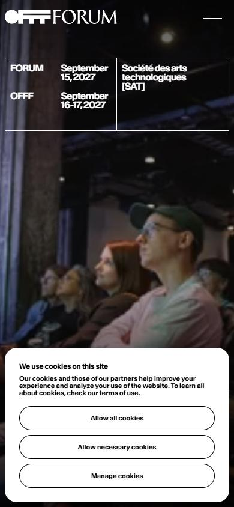

# OFFFForum

- Site : [https://www.offforum.com/](https://www.offforum.com/) — [aperçu statique local](apercu.html)
- Capturé le : 2026-11-03 — statut : ok
- Vidéo de scroll : [▶ ouvrir](https://github.com/t-baudry/bibliotheque-web/releases/download/videos/017-offfforum.webm)

<a href="captures/desktop-00-arrivee.jpg"></a> 

<details><summary>Toutes les captures</summary>

<a href="captures/desktop-01.jpg"></a> <a href="captures/desktop-02.jpg"></a> <a href="captures/desktop-03.jpg"></a> <a href="captures/desktop-pleine-page.jpg"></a> 

<a href="captures/page1-01.jpg"></a> <a href="captures/page1-02.jpg"></a> <a href="captures/page1-03.jpg"></a> <a href="captures/page2-01.jpg"></a> <a href="captures/page2-02.jpg"></a> <a href="captures/page2-03.jpg"></a> <a href="captures/page2-04.jpg"></a> <a href="captures/page3-01.jpg"></a> <a href="captures/page3-02.jpg"></a> <a href="captures/page3-03.jpg"></a> 

<a href="captures/mobile-01.jpg"></a> <a href="captures/mobile-02.jpg"></a> <a href="captures/mobile-03.jpg"></a> <a href="captures/mobile-04.jpg"></a> <a href="captures/mobile-05.jpg"></a> <a href="captures/mobile-06.jpg"></a> 

</details>

## Stack détectée
CMS Datocms, GSAP, Lenis, Nuxt, ScrollTrigger, SplitText/SplitType, Virtual scroll, Vue

Versions : GSAP 3.11.0 · Three.js r?

## Design tokens
### Couleurs (fonds, pondérées par surface)
`#ffffff` · `#000000`
### Couleurs de texte
`#000000` · `#ffffff`
### Polices utilisées (par volume de texte)
Baikal · Forvm
### Fichiers de police chargés
- Forvm-Roman.TuS1Oc1n.woff2
- Baikal-SemiBold.DigyPQ5D.woff2
### Typographie
| Élément | Police | Taille | Graisse | Interligne | Interlettrage | Casse |
|---|---|---|---|---|---|---|
| h1 | Forvm, serif | 45px | 400 | 43px | -0.9px | uppercase |
| h3 | Baikal, sans-serif | 32px | 600 | 31px | -1.28px | none |
| p | Baikal, sans-serif | 14px | 600 | 15px | -0.28px | none |
| a | Baikal, sans-serif | 11px | 600 | 12px | normal | none |
| button | Baikal, sans-serif | 11px | 600 | 12px | normal | none |
| li | Forvm, serif | 14px | 400 | 12px | -0.28px | uppercase |
| body | Baikal, sans-serif | 10px | 400 | 15px | normal | none |

### Échelle des tailles de texte
14px (19) · 11px (14) · 10px (6) · 18px (5) · 30px (4) · 45px (1) · 32px (1)
### Arrondis
3.35544e+07px · 40px · 50% · 20px
### Transitions CSS fréquentes
- cubic-bezier(0.4 0.3s ×4
- cubic-bezier(0.4 0.1s ×4
- cubic-bezier(0.32 0.3s ×1
- ease 0.5s ×1
- cubic-bezier(0.4 0.15s ×1
### Points de rupture (media queries)
64rem · 48rem · 40rem · 80rem · 90rem
### Animations CSS (@keyframes)
(aucune)
### Variables CSS (:root)
```css
--spacing: .1rem;
--font-weight-semibold: 600;
--ease-in-out: cubic-bezier(.4, 0, .2, 1);
--aspect-video: 16 / 9;
--default-transition-duration: .15s;
--default-transition-timing-function: cubic-bezier(.4, 0, .2, 1);
--font-baikal: "Baikal", sans-serif;
--font-forvm: "Forvm", serif;
--text-body-mobile: 1.8rem;
--text-body-mobile--line-height: 2rem;
--text-body-mobile--font-weight: 600;
--text-body-mobile--letter-spacing: -.04em;
--text-body-desktop: 2.4rem;
--text-body-desktop--line-height: 2.6rem;
--text-body-desktop--font-weight: 600;
--text-body-desktop--letter-spacing: -.04em;
--text-body-2-mobile: 1.4rem;
--text-body-2-mobile--line-height: 1.7rem;
--text-body-2-mobile--font-weight: 600;
--text-body-2-mobile--letter-spacing: -.02em;
--text-body-2-desktop: 1.8rem;
--text-body-2-desktop--line-height: 2rem;
--text-body-2-desktop--font-weight: 600;
--text-body-2-desktop--letter-spacing: -.04em;
--text-button-mobile: 1.1rem;
--text-button-mobile--line-height: 1.2rem;
--text-button-mobile--font-weight: 400;
--text-button-mobile--letter-spacing: -.02em;
--text-button-desktop: 1.4rem;
--text-button-desktop--line-height: 1.2rem;
--text-button-desktop--font-weight: 400;
--text-button-desktop--letter-spacing: -.02em;
--text-small: 1.1rem;
--text-small--line-height: 1.2rem;
--text-small--font-weight: 600;
--text-tag-mobile: .9rem;
--text-tag-mobile--line-height: 1rem;
--text-tag-mobile--font-weight: 400;
--text-tag-desktop: 1.1rem;
--text-tag-desktop--line-height: 1rem;
--text-tag-desktop--font-weight: 400;
--text-tag-desktop--letter-spacing: -.02em;
--text-h1-mobile-offf: 3.2rem;
--text-h1-mobile-offf--line-height: 3.1rem;
--text-h1-mobile-offf--font-weight: 600;
--text-h1-mobile-offf--letter-spacing: -.04em;
--text-h1-desktop-offf: 8rem;
--text-h1-desktop-offf--line-height: 7.7rem;
--text-h1-desktop-offf--font-weight: 600;
--text-h1-desktop-offf--letter-spacing: -.04em;
--text-h2-mobile-offf: 3.2rem;
--text-h2-mobile-offf--line-height: 3.1rem;
--text-h2-mobile-offf--font-weight: 600;
--text-h2-mobile-offf--letter-spacing: -.04em;
--text-h2-desktop-offf: 4.8rem;
--text-h2-desktop-offf--line-height: 4.6rem;
--text-h2-desktop-offf--font-weight: 600;
--text-h2-desktop-offf--letter-spacing: -.04em;
--text-h3-mobile-offf: 2.4rem;
--text-h3-mobile-offf--line-height: 2.3rem;
--text-h3-mobile-offf--font-weight: 600;
--text-h3-mobile-offf--letter-spacing: -.04em;
--text-h3-desktop-offf: 3.2rem;
--text-h3-desktop-offf--line-height: 3.1rem;
--text-h3-desktop-offf--font-weight: 600;
--text-h3-desktop-offf--letter-spacing: -.04em;
--text-h4-desktop-offf: 1.8rem;
--text-h4-desktop-offf--line-height: 1.7rem;
--text-h4-desktop-offf--font-weight: 600;
--text-h4-desktop-offf--letter-spacing: -.04em;
--text-h4-mobile-offf: 1.6rem;
--text-h4-mobile-offf--line-height: 1.5rem;
--text-h4-mobile-offf--font-weight: 600;
--text-h4-mobile-offf--letter-spacing: -.06em;
--text-h5-mobile-offf: 1.2rem;
--text-h5-mobile-offf--line-height: 1.3rem;
--text-h5-mobile-offf--font-weight: 600;
--text-h5-mobile-offf--letter-spacing: -.02em;
--text-h5-desktop-offf: 1.4rem;
--text-h5-desktop-offf--line-height: 1.5rem;
```

## Structure de la home
Hauteur : 1397 px — 287 nœuds DOM — canvas 0, vidéos 0, images 3

| # | Bloc | Hauteur | Titre | Médias |
|---|---|---|---|---|
| 1 | div .page relative | 1397 | A WEEK OF DESIGN, ART & DIGITAL CULTURE · FORUM · SEPT 15, 2027 · OFFF SEPT 16–1 | 4 |

**Navigation :** About · fr · fr · About · Media room · Contact · FAQ · fr · fr

**Boutons / CTA :** 

## SEO
- Title : A WEEK OF DESIGN, ART & DIGITAL CULTURE · FORUM · SEPT 15, 2027 · OFFF SEPT 16–17 · SAT, MONTRÉAL
- Description : A one-week festival convening designers, artists, and digital culture practitioners.
- Langue : en-CA — canonical : https://www.offforum.com/
- Open Graph : oui — JSON-LD : Organization
- H1 : 1 — images sans alt : 3/3

### Plan des titres
- H1 A WEEK OF DESIGN, ART & DIGITAL CULTURE · FORUM · SEPT 15, 2027 · OFFF SEPT 16–17 · SAT, M
- H3 Join our community and get updates, offers, and exclusive content.

## Performance (mesure locale, Chrome headless, connexion non bridée)
- TTFB 238 ms · LCP 656 ms (H1.px-gutter) · CLS 0.001 · load 792 ms
- 84 requêtes · 7268 Ko transférés
- Par type : Document 1 req / 88 Ko, Image 5 req / 491 Ko, Stylesheet 2 req / 10 Ko, Other 5 req / 83 Ko, Script 53 req / 839 Ko, Font 2 req / 38 Ko, Fetch 9 req / 412 Ko, TextTrack 1 req / 2 Ko, XHR 6 req / 5305 Ko
- Plus gros fichiers :
- 2782 Ko — XHR — https://chunk-oci-us-ashburn-1-vop1.edgemv.mux.com/v1/chunk/2cfus2FJoswScqyV1BH01N9iJvibvfJmvPWPgFfsSLfh5vUvMmtsVn2Y1vTElcWozRhg2yZqck7HJEugPg79NCkV3KFdU4MFM/1.
- 1342 Ko — XHR — https://chunk-oci-us-ashburn-1-vop1.edgemv.mux.com/v1/chunk/V01bxG2E3wcGMMjw02sVY3AogQFvsOZPrngRZpZJdXdBC02C3QZ6eks01HOiEZ1os00g1Z02kxfGQi68PSfG15b00h00tg/2.ts?
- 1174 Ko — XHR — https://chunk-oci-us-ashburn-1-vop1.edgemv.mux.com/v1/chunk/B8inz76cuUHs02xbmmH36N7vweZtYO9zwCYs8iYYROAo1uCBr02NRwMBoYqV2eNY96AQmAGL01UCe1nE02qgMzvpqsEBdkknBfxT
- 311 Ko — Image — https://image.mux.com/t2555yS2RTeMEpkc3FV2BFuQJWnl101Ot/thumbnail.jpg
- 271 Ko — Script — https://www.offforum.com/_nuxt/lXDCeS-c.js
- 181 Ko — Image — https://www.datocms-assets.com/196883/1772210668-forum-video-thumbnail.jpg?dpr=0.75&fm=webp
- 177 Ko — Script — https://www.googletagmanager.com/gtag/js?id=G-JNKM70V1FF&cx=c&gtm=4e6b20
- 131 Ko — Script — https://www.googletagmanager.com/gtm.js?id=GTM-NTVT8QWQ
- Services tiers : www.googletagmanager.com, www.gstatic.com, image.mux.com, region1.google-analytics.com, stream.mux.com, www.datocms-assets.com, manifest-oci-us-ashburn-1-vop1.edgemv.mux.com, chunk-oci-us-ashburn-1-vop1.edgemv.mux.com

## Mobile
- H1 : {'size': '30px', 'lineHeight': '29px'} · corps : 10px · débordement horizontal : False · menu burger : False

## Fichiers
- `captures/` : arrivée, scroll desktop (1440×900), pleine page, pages internes, mobile (390×844 @2x) ; vidéo de scroll dans la release GitHub « videos » (lien en haut de fiche)
- `page.html` : DOM rendu · `styles.css` : CSS chargé · `scripts/` : JS chargé (index dans `_index.json`) · `shaders.glsl` : shaders extraits · `rea-bundle.json` : analyse REA du bundle (chunks, routes, endpoints)

## Pages internes capturées
- https://www.offforum.com/privacy-policy/
- https://www.offforum.com/about/
- https://www.offforum.com/fr/
