# Huy Phan Vol.2

- Site : [https://huyml.co/](https://huyml.co/) — [aperçu statique local](apercu.html)
- Capturé le : 2026-11-03 — statut : ok
- Vidéo de scroll : [▶ ouvrir](https://github.com/t-baudry/bibliotheque-web/releases/download/videos/019-huy-phan-vol-2.webm)

<a href="captures/desktop-00-arrivee.jpg">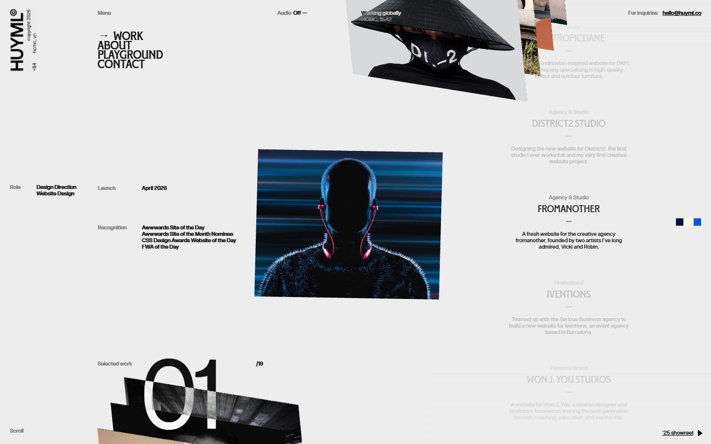</a> 

<details><summary>Toutes les captures</summary>

<a href="captures/desktop-01.jpg"></a> <a href="captures/desktop-02.jpg">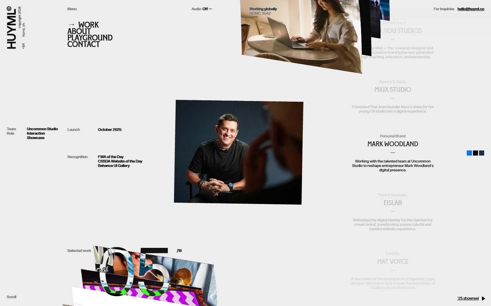</a> <a href="captures/desktop-03.jpg">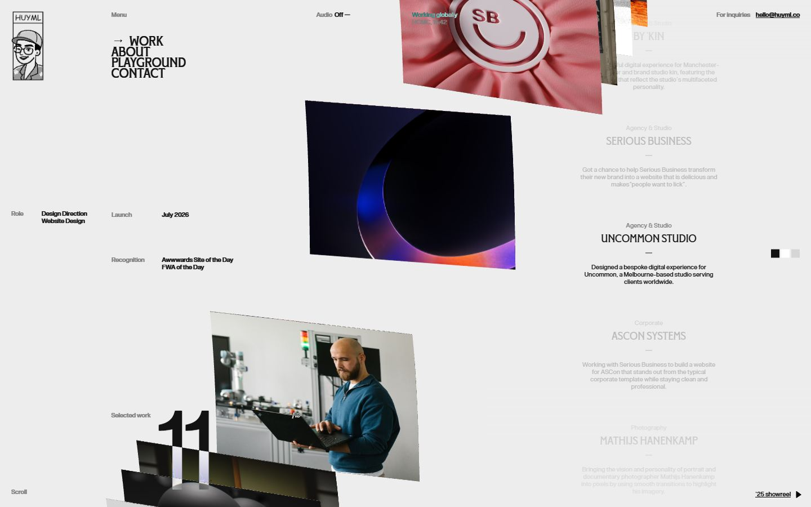</a> <a href="captures/desktop-04.jpg">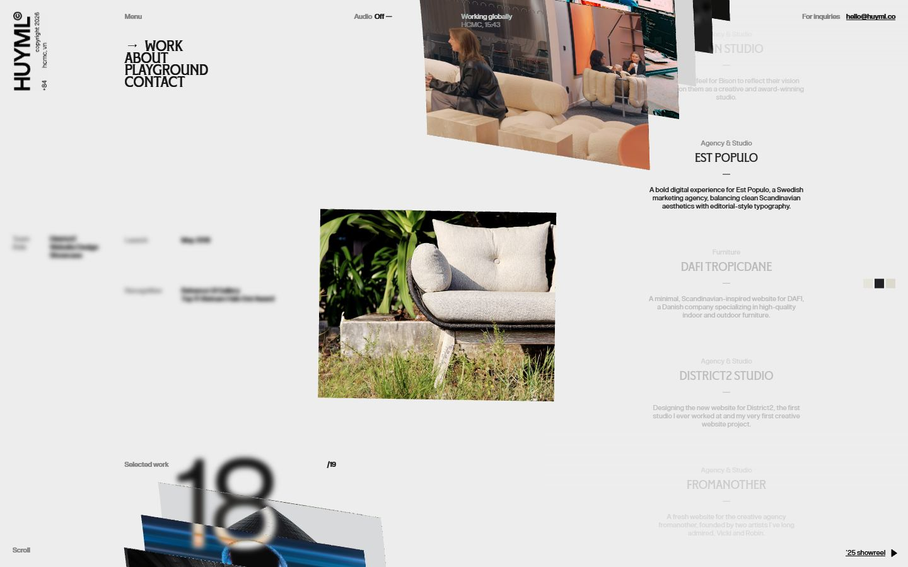</a> <a href="captures/desktop-05.jpg">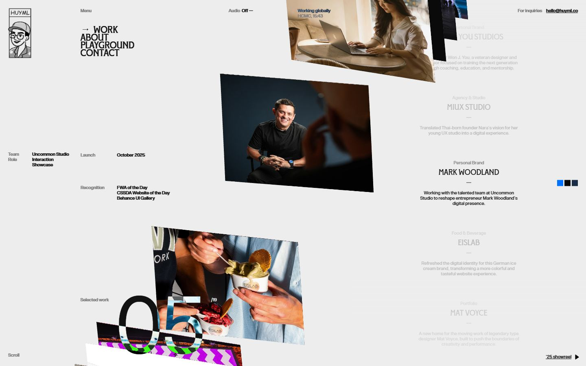</a> <a href="captures/desktop-06.jpg">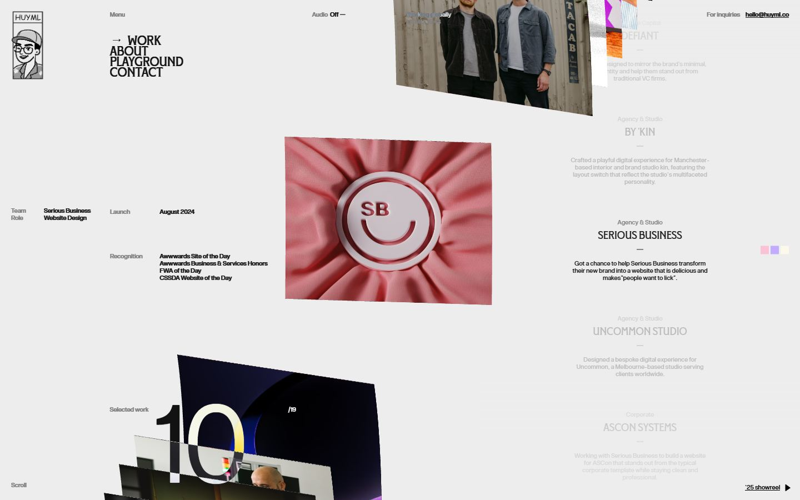</a> <a href="captures/desktop-07.jpg">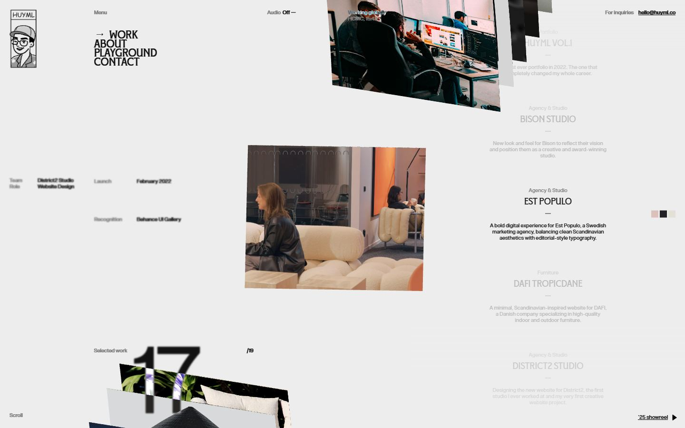</a> 

<a href="captures/page1-01.jpg">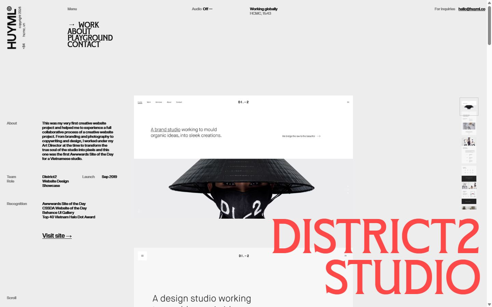</a> <a href="captures/page1-02.jpg">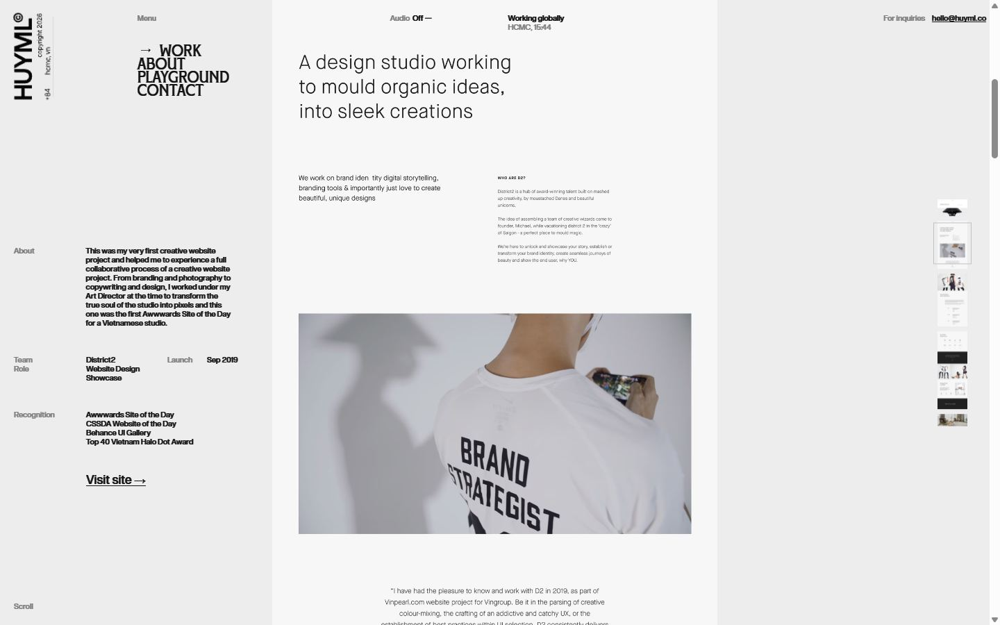</a> <a href="captures/page1-03.jpg">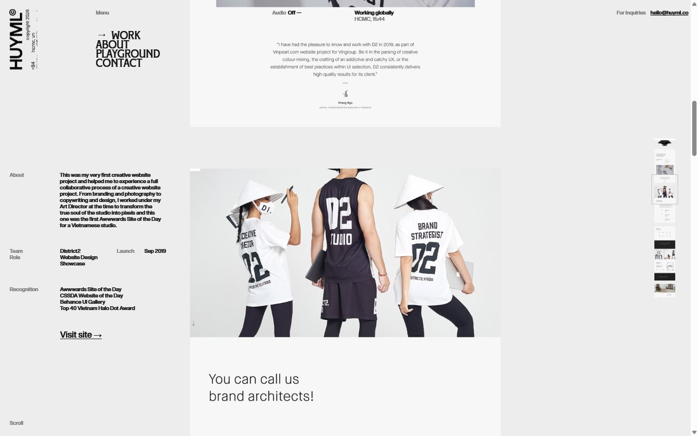</a> <a href="captures/page1-04.jpg">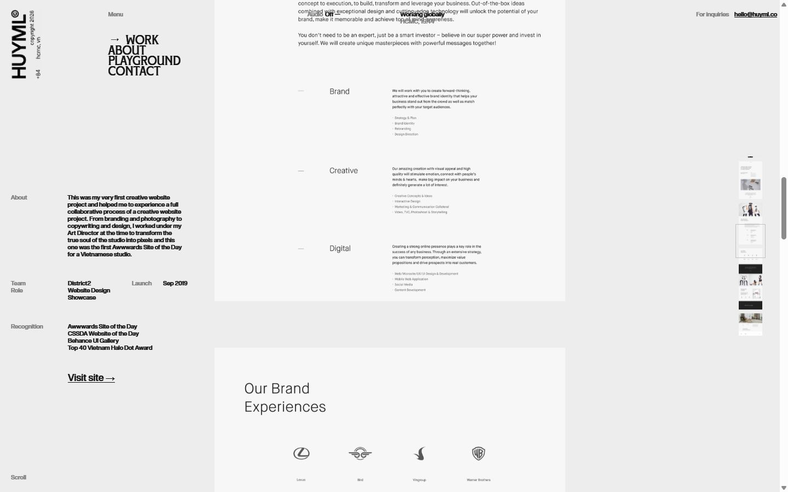</a> 

<a href="captures/mobile-01.jpg">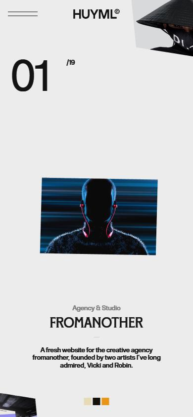</a> <a href="captures/mobile-02.jpg">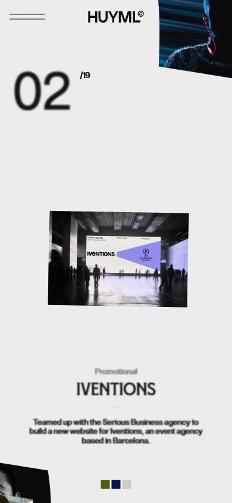</a> <a href="captures/mobile-03.jpg">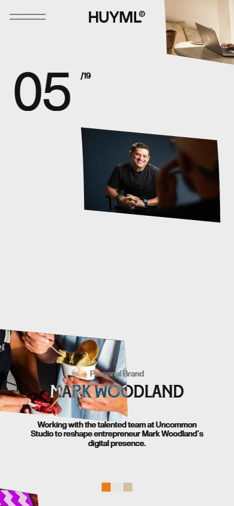</a> <a href="captures/mobile-04.jpg">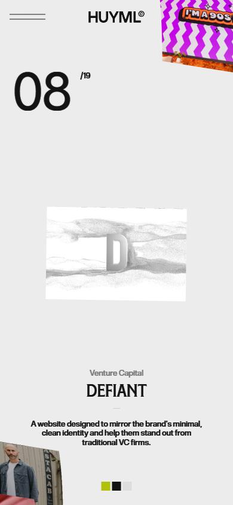</a> <a href="captures/mobile-05.jpg">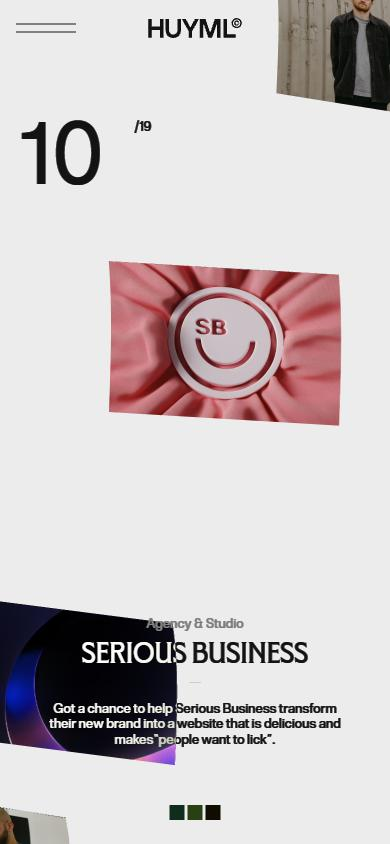</a> <a href="captures/mobile-06.jpg">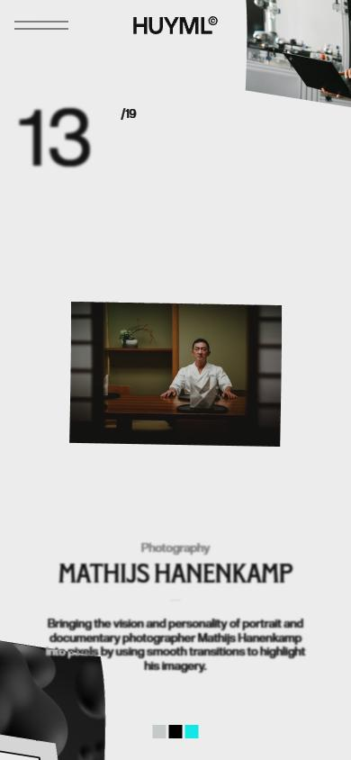</a> 

</details>

## Stack détectée
CMS Contentful, Framer, GSAP, Lenis, Lottie, React, Rive, ScrollTrigger, Three.js, WebGL

Versions : GSAP 3.13.0 · Three.js r?

Shaders GLSL personnalisés extraits : 12 (voir `shaders.glsl`)

## Design tokens
### Couleurs (fonds, pondérées par surface)
`#ececec` · `#ededed` · `#171717` · `#d4d4d4` · `#ffffff` · `#000000` · `#051236` · `#fffde2`
### Couleurs de texte
`#ffffff` · `#1e1e1e` · `#1f1f1f` · `#000000` · `#181818`
### Polices utilisées (par volume de texte)
BT Grotesk Medium · F37 Bolton Trial Regular · BT Glyphius Regular · BT Grotesk Regular
### Fichiers de police chargés
- NjDO01jId5REkpwNN1pD7i8fBLY.woff2
- pczyWZYmicHp9LhGgMJo7tnDcHo.woff2
- xirQ3g4Sv5q7MG0KvL1PiOOLLBA.woff2
- oDqinH2S9k4fMbGueYwREUmNFM.woff2
### Typographie
| Élément | Police | Taille | Graisse | Interligne | Interlettrage | Casse |
|---|---|---|---|---|---|---|
| h2 | "BT Glyphius Regular", "BT Glyphius Regular Placeh | 23px | 400 | 23px | 0.23px | uppercase |
| p | "BT Grotesk Medium", "BT Grotesk Medium Placeholde | 10px | 500 | 13px | 0.1px | none |
| a | sans-serif | 12px | 400 | normal | normal | none |
| body | sans-serif | 12px | 400 | normal | normal | none |

### Échelle des tailles de texte
10px (254) · 16px (30) · 12px (17) · 19px (4) · 23px (2) · 180px (1)
### Arrondis
8px
### Transitions CSS fréquentes
- ease 0.32s ×11
- ease 0.22s ×7
- cubic-bezier(0.22 0.45s ×4
- cubic-bezier(0.22 0.52s ×3
- cubic-bezier(0.22 0.6s ×1
### Points de rupture (media queries)
1920px · 800px · 2360px · 2199px · 1100px · 1800px · 1799px · 1099px · 1440px · 2400px · 2399.98px · 1199.98px
### Animations CSS (@keyframes)
__framer-editorbar-spinner-spin
### Variables CSS (:root)
```css
--token-0c68c7e4-90a1-4b80-b1f5-21051c127250: #fff;
--token-e93f529c-01a4-4879-a2e7-182bd1a3d9fa: #ffffff80;
--framer-will-change-override: transform;
--framer-will-change-filter-override: filter;
--overflow-clip-fallback: hidden;
--one-if-corner-shape-supported: 1;
--bt-grotesk-responsive-font-size: 14px;
```

## Structure de la home
Hauteur : 900 px — 1202 nœuds DOM — canvas 2, vidéos 0, images 27

| # | Bloc | Hauteur | Titre | Médias |
|---|---|---|---|---|
| 1 | div#main . | 900 | Come say hi | 29 |
| 2 | div . | 900 |  | 0 |

**Navigation :** 

**Boutons / CTA :** 

## SEO
- Title : Huy Phan - Award-winning designer
- Description : Huy Phan (Huyml) is an award-winning designer and art director based in Ho Chi Minh city, Vietnam.
- Langue : en — canonical : https://huyml.co/
- Open Graph : oui — JSON-LD : aucun
- H1 : 0 — images sans alt : 27/27

### Plan des titres
- H2 Come say hi
- H2 Credits

## Performance (mesure locale, Chrome headless, connexion non bridée)
- TTFB 113 ms · LCP 1312 ms (DIV) · CLS 0.735 · load 2717 ms
- 88 requêtes · 4148 Ko transférés
- Par type : Document 2 req / 35 Ko, Image 45 req / 1886 Ko, Font 4 req / 74 Ko, Script 18 req / 806 Ko, Media 9 req / 52 Ko, Fetch 8 req / 1276 Ko, Other 1 req / 18 Ko, Ping 1 req / 0 Ko
- Plus gros fichiers :
- 699 Ko — Fetch — https://unpkg.com/@rive-app/canvas@2.38.5/rive.wasm
- 512 Ko — Fetch — https://framerusercontent.com/assets/I7sDqjqViJfFWtj8WbkQgjeYP8.riv
- 308 Ko — Image — https://framerusercontent.com/images/bovi8JsQWnROEtE0WYyYwqPkiE.jpg?scale-down-to=512&lossless=1&width=1138&height=915
- 279 Ko — Image — https://framerusercontent.com/images/PbGu32LciyVQZHUuKJCNLLV2qZc.jpg?width=910&height=732
- 233 Ko — Script — https://framerusercontent.com/sites/4CUEbC1Vb07LtNCTtfjk6i/e8XHUPKsgUbD_j36i5m_YIM8UIU28O8o8aXrZlbi1A8.tux3-Cyy.mjs
- 176 Ko — Image — https://framerusercontent.com/images/75mCZ5SdSy2FaX0ameAhFh9ynE.jpg?width=1138&height=915
- 168 Ko — Script — https://www.googletagmanager.com/gtag/js?id=G-EM3JMY7NKM
- 157 Ko — Image — https://framerusercontent.com/images/ZMZlhfAKVDPaWVzDIpnuU6HVRO4.jpg?width=1138&height=915
- Services tiers : framerusercontent.com, events.framer.com, www.googletagmanager.com, framer.com, app.framerstatic.com, unpkg.com, region1.google-analytics.com

## Mobile
- H1 : None · corps : 12px · débordement horizontal : False · menu burger : True

## Fichiers
- `captures/` : arrivée, scroll desktop (1440×900), pleine page, pages internes, mobile (390×844 @2x) ; vidéo de scroll dans la release GitHub « videos » (lien en haut de fiche)
- `page.html` : DOM rendu · `styles.css` : CSS chargé · `scripts/` : JS chargé (index dans `_index.json`) · `shaders.glsl` : shaders extraits · `rea-bundle.json` : analyse REA du bundle (chunks, routes, endpoints)

## Pages internes capturées
- https://huyml.co/project/district2-studio
