# twks

- Site : [https://twks.ch/en](https://twks.ch/en) — [aperçu statique local](apercu.html)
- Capturé le : 2026-11-03 — statut : ok
- Vidéo de scroll : [▶ ouvrir](https://github.com/t-baudry/bibliotheque-web/releases/download/videos/026-twks.webm)

<a href="captures/desktop-00-arrivee.jpg">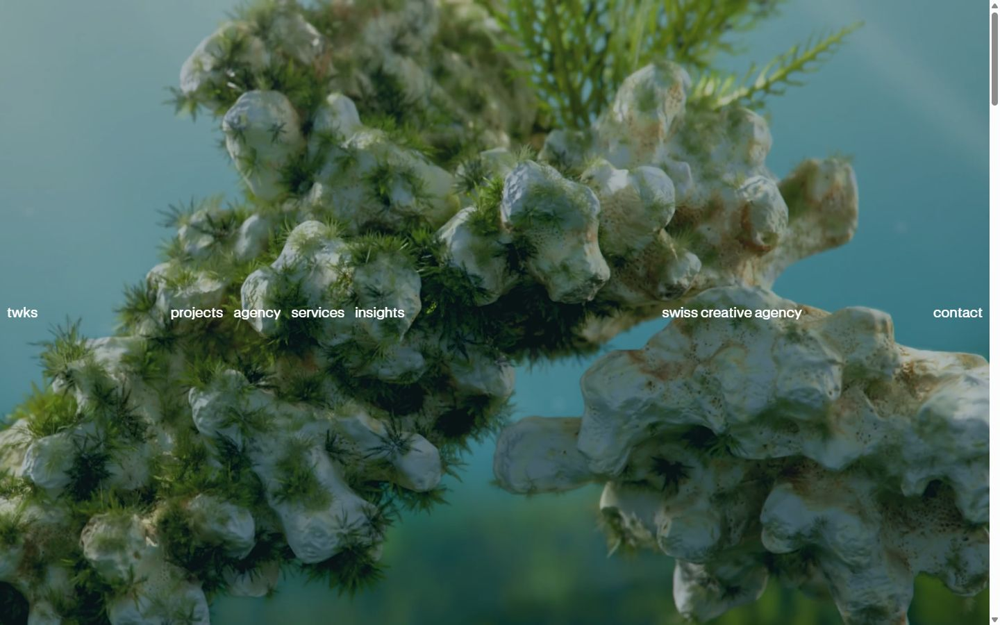</a> 

<details><summary>Toutes les captures</summary>

<a href="captures/desktop-01.jpg">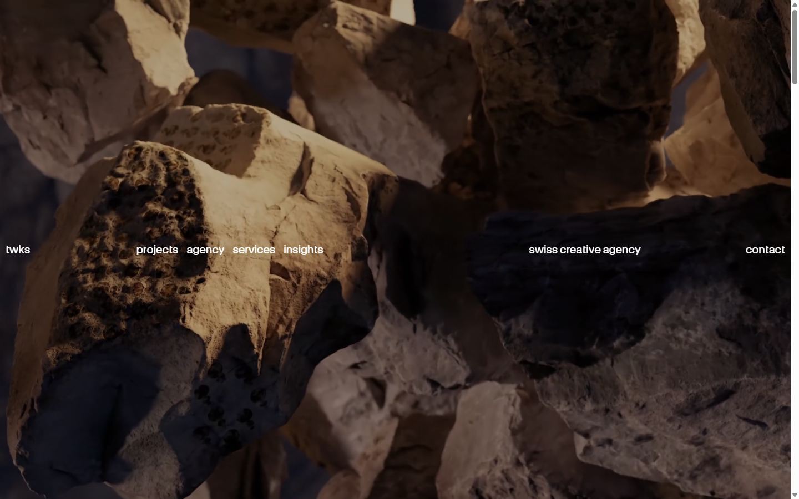</a> <a href="captures/desktop-02.jpg">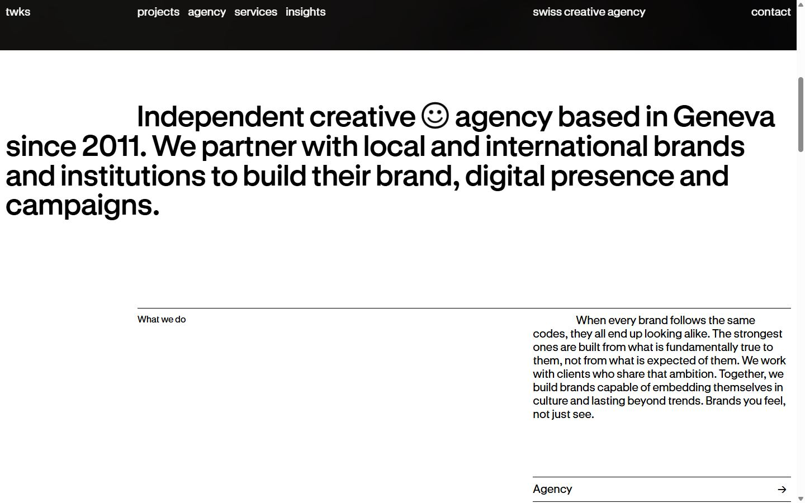</a> <a href="captures/desktop-03.jpg">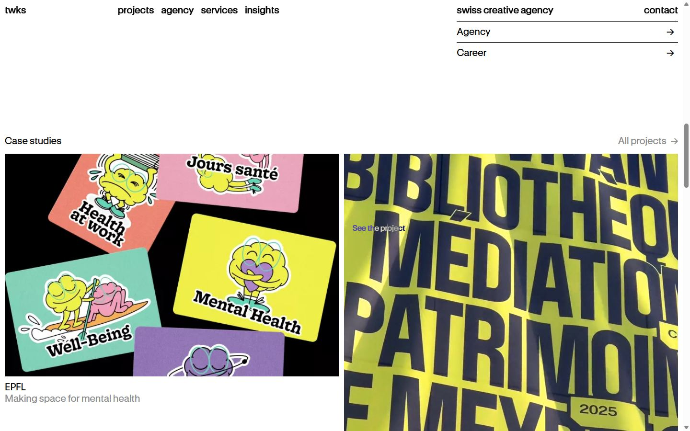</a> <a href="captures/desktop-04.jpg">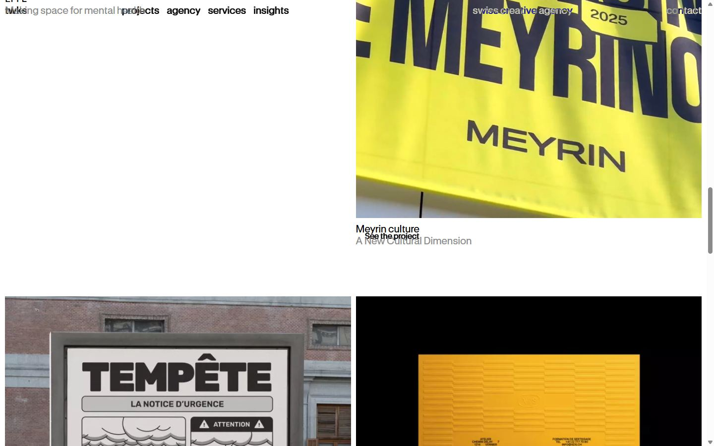</a> <a href="captures/desktop-05.jpg">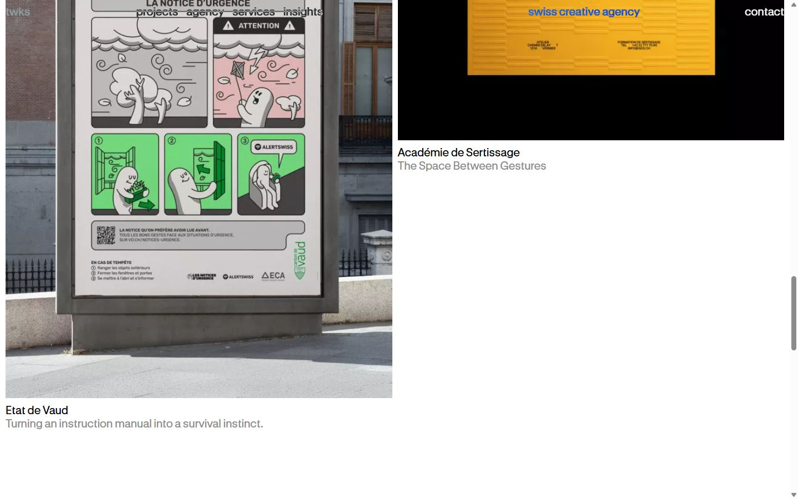</a> <a href="captures/desktop-06.jpg">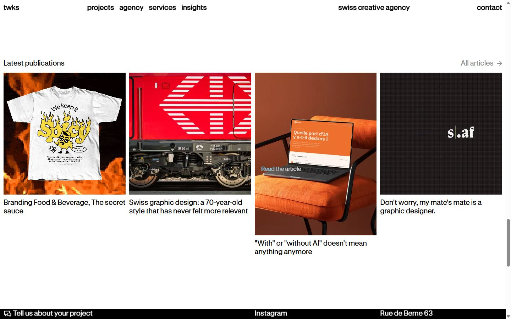</a> <a href="captures/desktop-07.jpg">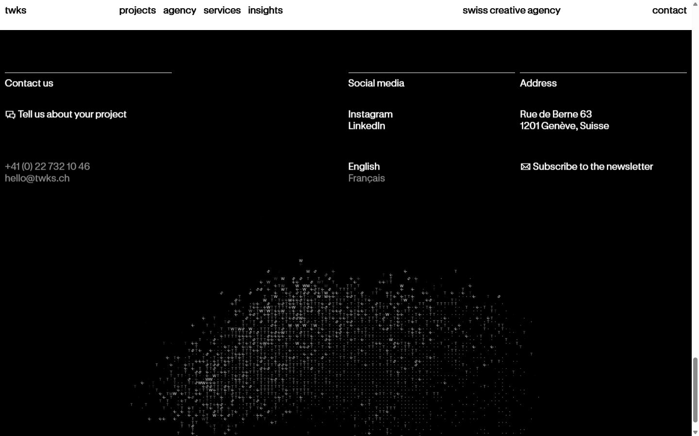</a> <a href="captures/desktop-08.jpg">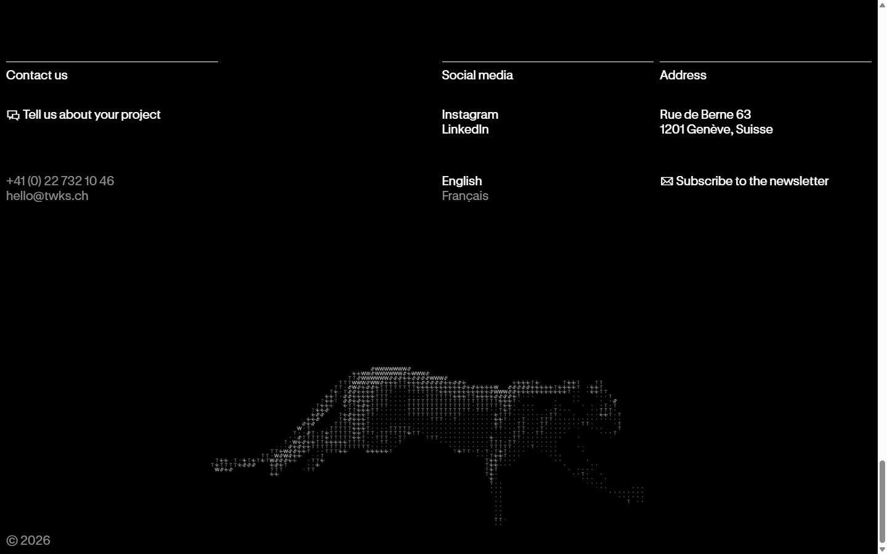</a> <a href="captures/desktop-pleine-page.jpg">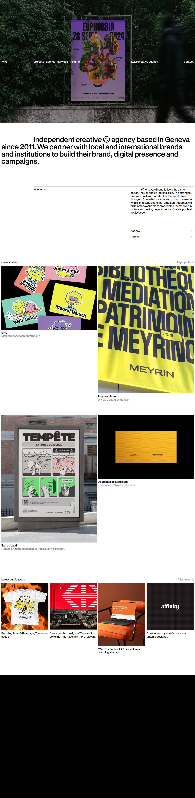</a> 

<a href="captures/page1-01.jpg">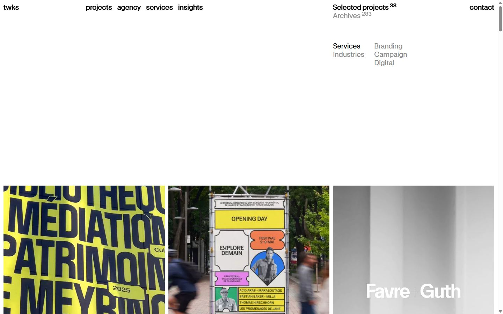</a> <a href="captures/page1-02.jpg">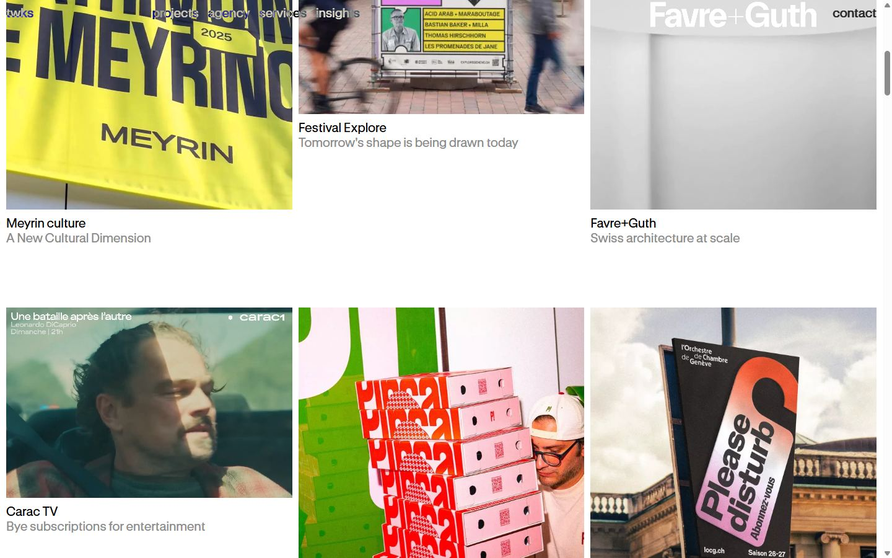</a> <a href="captures/page1-03.jpg">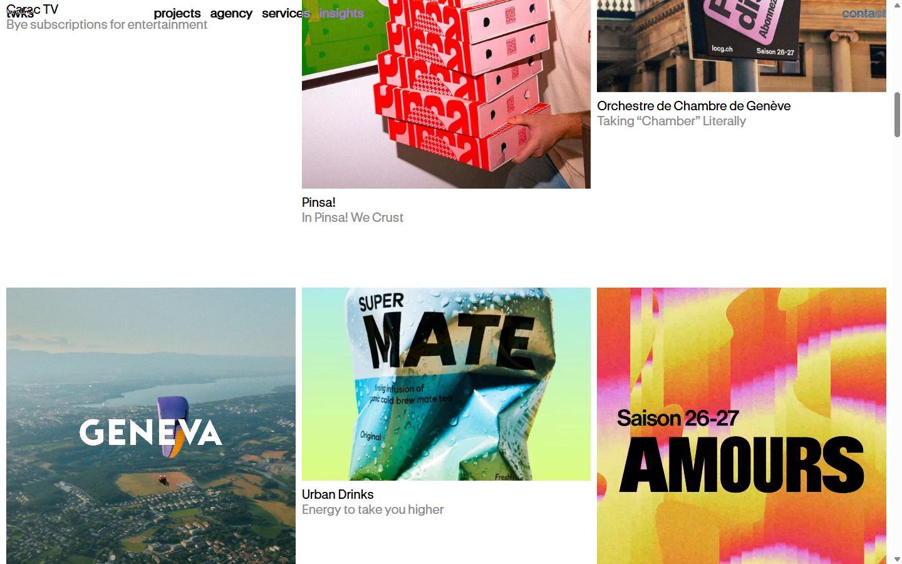</a> <a href="captures/page1-04.jpg">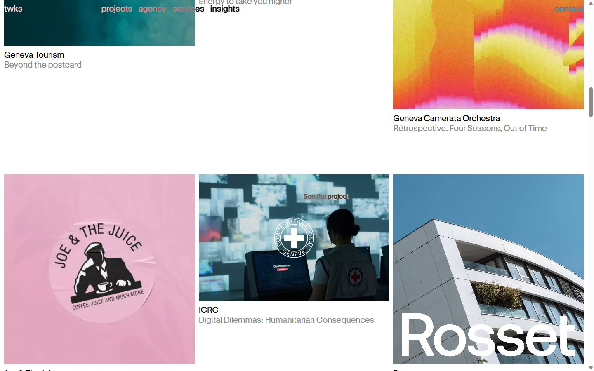</a> 

<a href="captures/mobile-01.jpg">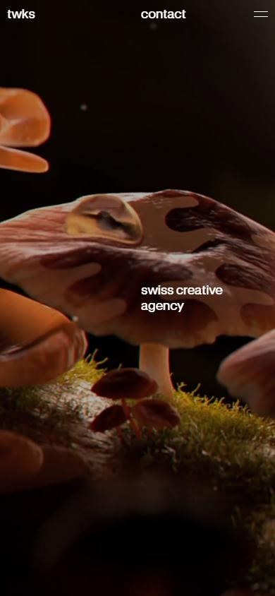</a> <a href="captures/mobile-02.jpg">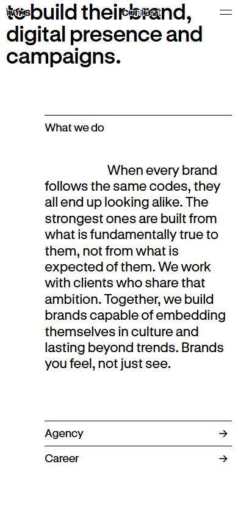</a> <a href="captures/mobile-03.jpg">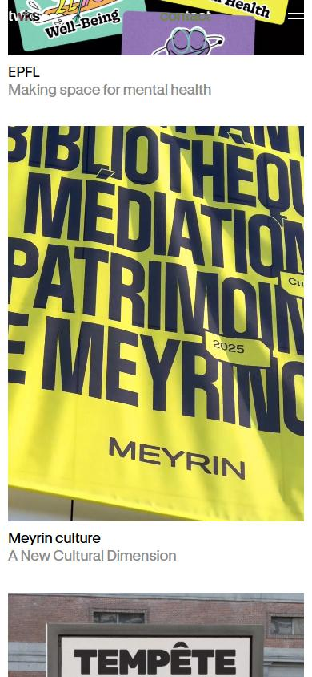</a> <a href="captures/mobile-04.jpg">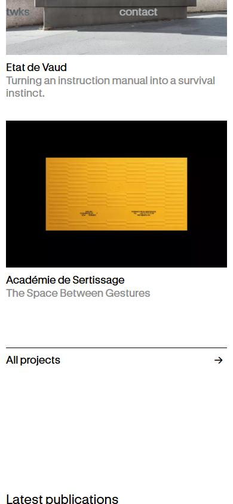</a> <a href="captures/mobile-05.jpg">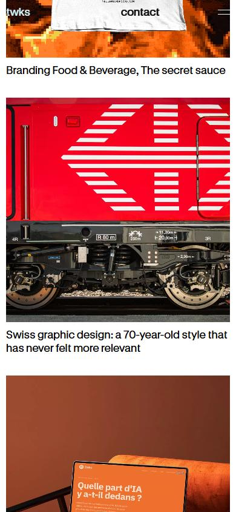</a> <a href="captures/mobile-06.jpg">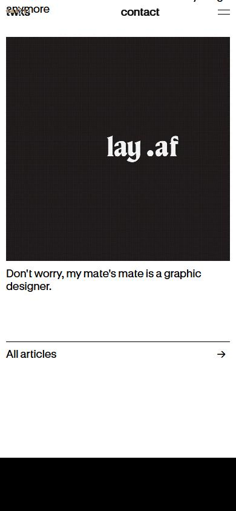</a> 

</details>

## Stack détectée
Alpine.js, GSAP, Lenis, Lottie, React Three Fiber, ScrollTrigger, Virtual scroll

Versions : GSAP 3.11.0 · Three.js r?

## Design tokens
### Couleurs (fonds, pondérées par surface)
`#ffffff` · `#000000`
### Couleurs de texte
`#000000` · `#ffffff` · `#8c8c8c`
### Polices utilisées (par volume de texte)
GT Standard
### Fichiers de police chargés
- GT-Standard-L-Standard-Medium-BDsqGhKS.woff2
- GT-Standard-L-Standard-Regular-DXTyW8mc.woff2
- GT-Standard-L-Standard-Semibold-cqzJajLp.woff2
### Typographie
| Élément | Police | Taille | Graisse | Interligne | Interlettrage | Casse |
|---|---|---|---|---|---|---|
| h1 | "GT Standard", ui-sans-serif, system-ui, sans-seri | 52.8px | 600 | 52.8px | -0.528px | none |
| h2 | "GT Standard", ui-sans-serif, system-ui, sans-seri | 20px | 400 | 24px | 0.2px | none |
| h3 | "GT Standard", ui-sans-serif, system-ui, sans-seri | 20px | 400 | 24px | 0.2px | none |
| p | "GT Standard", ui-sans-serif, system-ui, sans-seri | 16px | 400 | 19.2px | 0.16px | none |
| a | "GT Standard", ui-sans-serif, system-ui, sans-seri | 20px | 400 | 24px | 0.2px | lowercase |
| button | "GT Standard", ui-sans-serif, system-ui, sans-seri | 20px | 400 | 24px | 0.2px | lowercase |
| li | "GT Standard", ui-sans-serif, system-ui, sans-seri | 20px | 400 | 24px | 0.2px | none |
| body | "GT Standard", ui-sans-serif, system-ui, sans-seri | 20px | 400 | 24px | 0.2px | none |

### Échelle des tailles de texte
20px (131) · 16px (26) · 60px (7) · 22px (2) · 52.8px (2)
### Arrondis
aucun (angles droits)
### Transitions CSS fréquentes
- cubic-bezier(0.4 0.5s ×3
### Points de rupture (media queries)
64rem · 48rem · 120.063rem · 40rem · 80rem · 96rem · 1220px · 600px · 500px · 350px · 1800px · 44rem
### Animations CSS (@keyframes)
marquee, spin, pulse
### Variables CSS (:root)
```css
--font-sans: "GT Standard",ui-sans-serif,system-ui,sans-serif,"Apple Color Emoji","Segoe UI Emoji","Segoe UI Symbol","Noto Color Emoji";
--font-serif: ui-serif,Georgia,Cambria,"Times New Roman",Times,serif;
--font-mono: ui-monospace,SFMono-Regular,Menlo,Monaco,Consolas,"Liberation Mono","Courier New",monospace;
--color-red-50: oklch(97.1% .013 17.38);
--color-red-100: oklch(93.6% .032 17.717);
--color-red-200: oklch(88.5% .062 18.334);
--color-red-300: oklch(80.8% .114 19.571);
--color-red-400: oklch(70.4% .191 22.216);
--color-red-500: oklch(63.7% .237 25.331);
--color-red-600: oklch(57.7% .245 27.325);
--color-red-700: oklch(50.5% .213 27.518);
--color-red-800: oklch(44.4% .177 26.899);
--color-red-900: oklch(39.6% .141 25.723);
--color-red-950: oklch(25.8% .092 26.042);
--color-orange-50: oklch(98% .016 73.684);
--color-orange-100: oklch(95.4% .038 75.164);
--color-orange-200: oklch(90.1% .076 70.697);
--color-orange-300: oklch(83.7% .128 66.29);
--color-orange-400: oklch(75% .183 55.934);
--color-orange-500: oklch(70.5% .213 47.604);
--color-orange-600: oklch(64.6% .222 41.116);
--color-orange-700: oklch(55.3% .195 38.402);
--color-orange-800: oklch(47% .157 37.304);
--color-orange-900: oklch(40.8% .123 38.172);
--color-orange-950: oklch(26.6% .079 36.259);
--color-amber-50: oklch(98.7% .022 95.277);
--color-amber-100: oklch(96.2% .059 95.617);
--color-amber-200: oklch(92.4% .12 95.746);
--color-amber-300: oklch(87.9% .169 91.605);
--color-amber-400: oklch(82.8% .189 84.429);
--color-amber-500: oklch(76.9% .188 70.08);
--color-amber-600: oklch(66.6% .179 58.318);
--color-amber-700: oklch(55.5% .163 48.998);
--color-amber-800: oklch(47.3% .137 46.201);
--color-amber-900: oklch(41.4% .112 45.904);
--color-amber-950: oklch(27.9% .077 45.635);
--color-yellow-50: oklch(98.7% .026 102.212);
--color-yellow-100: oklch(97.3% .071 103.193);
--color-yellow-200: oklch(94.5% .129 101.54);
--color-yellow-300: oklch(90.5% .182 98.111);
--color-yellow-400: oklch(85.2% .199 91.936);
--color-yellow-500: oklch(79.5% .184 86.047);
--color-yellow-600: oklch(68.1% .162 75.834);
--color-yellow-700: oklch(55.4% .135 66.442);
--color-yellow-800: oklch(47.6% .114 61.907);
--color-yellow-900: oklch(42.1% .095 57.708);
--color-yellow-950: oklch(28.6% .066 53.813);
--color-lime-50: oklch(98.6% .031 120.757);
--color-lime-100: oklch(96.7% .067 122.328);
--color-lime-200: oklch(93.8% .127 124.321);
--color-lime-300: oklch(89.7% .196 126.665);
--color-lime-400: oklch(84.1% .238 128.85);
--color-lime-500: oklch(76.8% .233 130.85);
--color-lime-600: oklch(64.8% .2 131.684);
--color-lime-700: oklch(53.2% .157 131.589);
--color-lime-800: oklch(45.3% .124 130.933);
--color-lime-900: oklch(40.5% .101 131.063);
--color-lime-950: oklch(27.4% .072 132.109);
--color-green-50: oklch(98.2% .018 155.826);
--color-green-100: oklch(96.2% .044 156.743);
--color-green-200: oklch(92.5% .084 155.995);
--color-green-300: oklch(87.1% .15 154.449);
--color-green-400: oklch(79.2% .209 151.711);
--color-green-500: oklch(72.3% .219 149.579);
--color-green-600: oklch(62.7% .194 149.214);
--color-green-700: oklch(52.7% .154 150.069);
--color-green-800: oklch(44.8% .119 151.328);
--color-green-900: oklch(39.3% .095 152.535);
--color-green-950: oklch(26.6% .065 152.934);
--color-emerald-50: oklch(97.9% .021 166.113);
--color-emerald-100: oklch(95% .052 163.051);
--color-emerald-200: oklch(90.5% .093 164.15);
--color-emerald-300: oklch(84.5% .143 164.978);
--color-emerald-400: oklch(76.5% .177 163.223);
--color-emerald-500: oklch(69.6% .17 162.48);
--color-emerald-600: oklch(59.6% .145 163.225);
--color-emerald-700: oklch(50.8% .118 165.612);
--color-emerald-800: oklch(43.2% .095 166.913);
--color-emerald-900: oklch(37.8% .077 168.94);
--color-emerald-950: oklch(26.2% .051 172.552);
```

## Structure de la home
Hauteur : 5822 px — 727 nœuds DOM — canvas 0, vidéos 8, images 23

| # | Bloc | Hauteur | Titre | Médias |
|---|---|---|---|---|
| 1 | section .relative w-full h-svh overflow-hidden bg | 900 |  | 26 |
| 2 | section .px-base text-big [&_p]:indent-1/6 pt-20  | 301 | Creative communications agency in Geneva | 0 |
| 3 | section .px-base grid grid-cols-6 gap-x-2.5 mb-20 | 202 |  | 0 |
| 4 | section .px-base mt-37.5 | 2115 | Case studies | 7 |
| 5 | section .px-base mt-50 | 555 | Latest publications | 6 |

**Navigation :** twks · Projects · Agency · Branding · Campaign · Digital · Insights · Projects · Agency · Branding · Campaign · Digital · Insights · Français · twks Vol.4 - Golden Hour Frequencies · twks Vol.4 - Golden Hour Frequencies · +41 (0) 22 732 10 46 · hello@twks.ch · Instagram · LinkedIn · Rue de Berne 63 1201 Genève, Suisse

**Boutons / CTA :** 

## SEO
- Title : Creative communications agency in Geneva | twks
- Description : twks is a creative agency based in Geneva, specialising in branding, communication and web design. Since 2011, we have been shaping bold and unique brands.
- Langue : fr — canonical : https://twks.ch/en
- Open Graph : oui — JSON-LD : ProfessionalService
- H1 : 1 — images sans alt : 18/23

### Plan des titres
- H1 Creative communications agency in Geneva
- H2 Case studies
- H3 EPFL
- H3 Meyrin culture
- H3 Etat de Vaud
- H3 Académie de Sertissage
- H2 Latest publications
- H3 Branding Food & Beverage, The secret sauce
- H3 Swiss graphic design: a 70-year-old style that has never felt more relevant
- H3 "With" or "without AI" doesn't mean anything anymore
- H3 Don't worry, my mate's mate is a graphic designer.

## Performance (mesure locale, Chrome headless, connexion non bridée)
- TTFB 544 ms · LCP 1032 ms (P.mb-10) · CLS 0 · load 5503 ms
- 55 requêtes · 10896 Ko transférés
- Par type : Document 1 req / 27 Ko, Script 4 req / 114 Ko, Stylesheet 1 req / 33 Ko, Font 3 req / 186 Ko, Fetch 3 req / 468 Ko, Image 24 req / 3644 Ko, Media 18 req / 6423 Ko, Other 1 req / 1 Ko
- Plus gros fichiers :
- 2909 Ko — Media — https://twks.ch/videos/twks_panthere_explosion.mp4
- 1685 Ko — Media — https://twks.ch/storage/home_slider/twks_sps.mp4
- 1274 Ko — Image — https://twks.ch/storage/insights/branding-food-beverage-the-secret-sauce/twks_article_thumbnail.gif
- 864 Ko — Media — https://twks.ch/videos/twks_panthere_loop.mp4
- 809 Ko — Media — https://twks.ch/storage/insights/tinquiete-le-pote-de-mon-pote-est-graphiste/twks_insight_matesdesigner_thumbnail.mp4
- 465 Ko — Fetch — https://cdn.jsdelivr.net/npm/@lottiefiles/dotlottie-web@0.82.1/dist/dotlottie-player.wasm
- 301 Ko — Image — https://twks.ch/en/img/asset/aG9tZV9zbGlkZXIvdHdrc19nZWNhXzI0XzI1LmpwZw/twks_geca_24_25.jpg?p=full&s=1b4063d0596a28d421d21de8bf406b05
- 294 Ko — Image — https://twks.ch/en/img/asset/aG9tZV9zbGlkZXIvbWNrX2dlY2EyNl9sYXB0b3AuanBn/mck_geca26_laptop.jpg?p=full&s=64383aaf326b36f1d2c54dccb6f384dd
- Services tiers : cdn.jsdelivr.net, cdn.usefathom.com

## Mobile
- H1 : {'size': '36px', 'lineHeight': '36px'} · corps : 18px · débordement horizontal : False · menu burger : False

## Fichiers
- `captures/` : arrivée, scroll desktop (1440×900), pleine page, pages internes, mobile (390×844 @2x) ; vidéo de scroll dans la release GitHub « videos » (lien en haut de fiche)
- `page.html` : DOM rendu · `styles.css` : CSS chargé · `scripts/` : JS chargé (index dans `_index.json`) · `shaders.glsl` : shaders extraits · `rea-bundle.json` : analyse REA du bundle (chunks, routes, endpoints)

## Pages internes capturées
- https://twks.ch/en/projects
