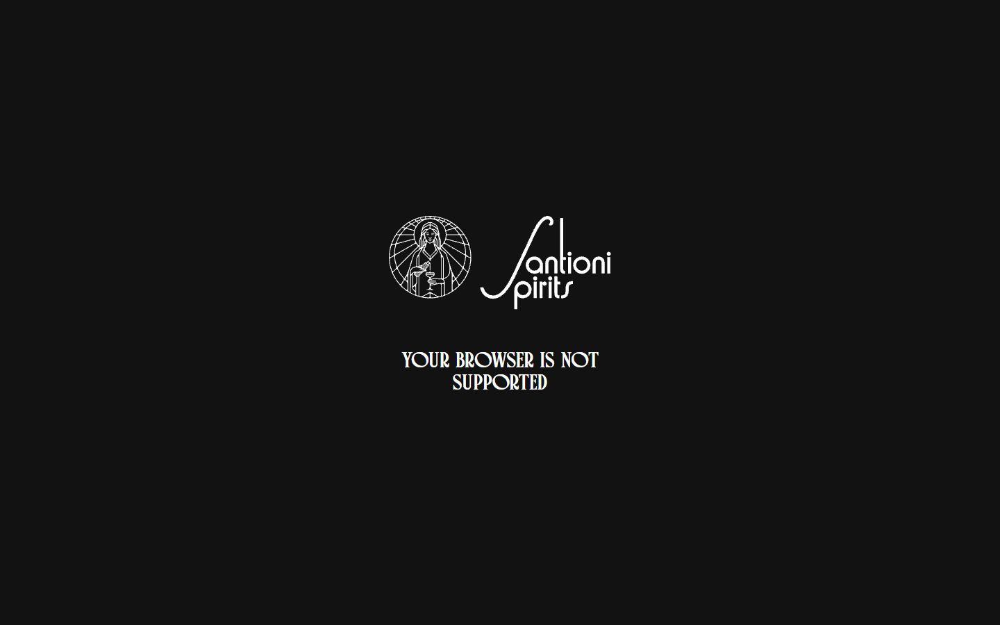
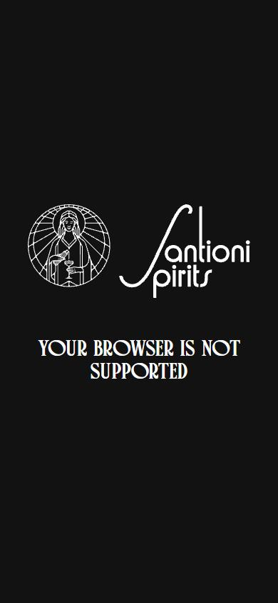

# Santioni Spirits

- Site : [https://santionispirits.com/](https://santionispirits.com/) — [aperçu statique local](apercu.html)
- Capturé le : 2026-11-02 — statut : ok
- Vidéo de scroll : [▶ ouvrir](https://github.com/t-baudry/bibliotheque-web/releases/download/videos/028-santioni-spirits.webm)

<a href="captures/desktop-00-arrivee.jpg"></a> 

<details><summary>Toutes les captures</summary>

<a href="captures/desktop-01.jpg"></a> <a href="captures/desktop-02.jpg"></a> <a href="captures/desktop-03.jpg"></a> <a href="captures/desktop-04.jpg"></a> <a href="captures/desktop-05.jpg"></a> <a href="captures/desktop-06.jpg"></a> <a href="captures/desktop-07.jpg"></a> 


<a href="captures/mobile-01.jpg"></a> <a href="captures/mobile-02.jpg"></a> <a href="captures/mobile-03.jpg"></a> <a href="captures/mobile-04.jpg"></a> <a href="captures/mobile-05.jpg"></a> <a href="captures/mobile-06.jpg"></a> 

</details>

## Stack détectée
CMS Sanity, Lottie, ScrollTrigger, SplitText/SplitType, WebGL

Shaders GLSL personnalisés extraits : 4 (voir `shaders.glsl`)

## Design tokens
### Couleurs (fonds, pondérées par surface)

### Couleurs de texte
`#ffffff`
### Polices utilisées (par volume de texte)
Charles Rosie Regular · Times New Roman
### Fichiers de police chargés
- CharlesRosie.woff2
### Typographie
| Élément | Police | Taille | Graisse | Interligne | Interlettrage | Casse |
|---|---|---|---|---|---|---|
| h1 | "Charles Rosie Regular", sans-serif | 32px | 400 | 32px | 0.16px | uppercase |
| body | "Times New Roman" | 16px | 400 | normal | normal | none |

### Échelle des tailles de texte
32px (1)
### Arrondis
aucun (angles droits)
### Transitions CSS fréquentes
- (rien relevé)
### Points de rupture (media queries)

### Animations CSS (@keyframes)
(aucune)
### Variables CSS (:root)
```css
```

## Structure de la home
Hauteur : 900 px — 37 nœuds DOM — canvas 0, vidéos 0, images 0

| # | Bloc | Hauteur | Titre | Médias |
|---|---|---|---|---|

**Navigation :** 

**Boutons / CTA :** 

## SEO
- Title : Not Supported
- Description : None
- Langue : en — canonical : None
- Open Graph : non — JSON-LD : aucun
- H1 : 1 — images sans alt : 0/0

### Plan des titres
- H1 Your browser is not supported

## Performance (mesure locale, Chrome headless, connexion non bridée)
- TTFB 77 ms · LCP 180 ms (H1) · CLS 0 · load 166 ms
- 10 requêtes · 609 Ko transférés
- Par type : Document 2 req / 25 Ko, Script 2 req / 546 Ko, Image 2 req / 0 Ko, Fetch 2 req / 0 Ko, Font 1 req / 32 Ko, Other 1 req / 7 Ko
- Plus gros fichiers :
- 369 Ko — Script — https://santionispirits.com/assets/js/app.1782836328290.js
- 178 Ko — Script — https://www.googletagmanager.com/gtag/js?id=G-L7LC5PPCFS
- 32 Ko — Font — https://santionispirits.com/assets/fonts/CharlesRosie.woff2
- 18 Ko — Document — https://santionispirits.com/unsupported
- 7 Ko — Document — https://santionispirits.com/
- 7 Ko — Other — https://santionispirits.com/favicon.ico
- 0 Ko — Image — data:image/webp;base64,UklGRhoAAABXRUJQVlA4TA0AAAAvAAAAEAcQERGIiP4HAA==
- 0 Ko — Image — data:image/avif;base64,AAAAIGZ0eXBhdmlmAAAAAGF2aWZtaWYxbWlhZk1BMUIAAADybWV0YQAAAAAAAAAoaGRscgAAAAAAAAAAcGljdAAAAAAAAAAAAAAAAGxpYmF2aWYAAAAADnBpdG0AAAAAAAEAAAAea
- Services tiers : www.googletagmanager.com, region1.google-analytics.com

## Mobile
- H1 : {'size': '32px', 'lineHeight': '32px'} · corps : 16px · débordement horizontal : False · menu burger : False

## Fichiers
- `captures/` : arrivée, scroll desktop (1440×900), pleine page, pages internes, mobile (390×844 @2x) ; vidéo de scroll dans la release GitHub « videos » (lien en haut de fiche)
- `page.html` : DOM rendu · `styles.css` : CSS chargé · `scripts/` : JS chargé (index dans `_index.json`) · `shaders.glsl` : shaders extraits · `rea-bundle.json` : analyse REA du bundle (chunks, routes, endpoints)
