# EDOLUS

- Site : [https://edolus.com/](https://edolus.com/) — [aperçu statique local](apercu.html)
- Capturé le : 2026-11-02 — statut : ok
- Vidéo de scroll : [▶ ouvrir](https://github.com/t-baudry/bibliotheque-web/releases/download/videos/029-edolus.webm)

<a href="captures/desktop-00-arrivee.jpg"></a> 

<details><summary>Toutes les captures</summary>

<a href="captures/desktop-01.jpg">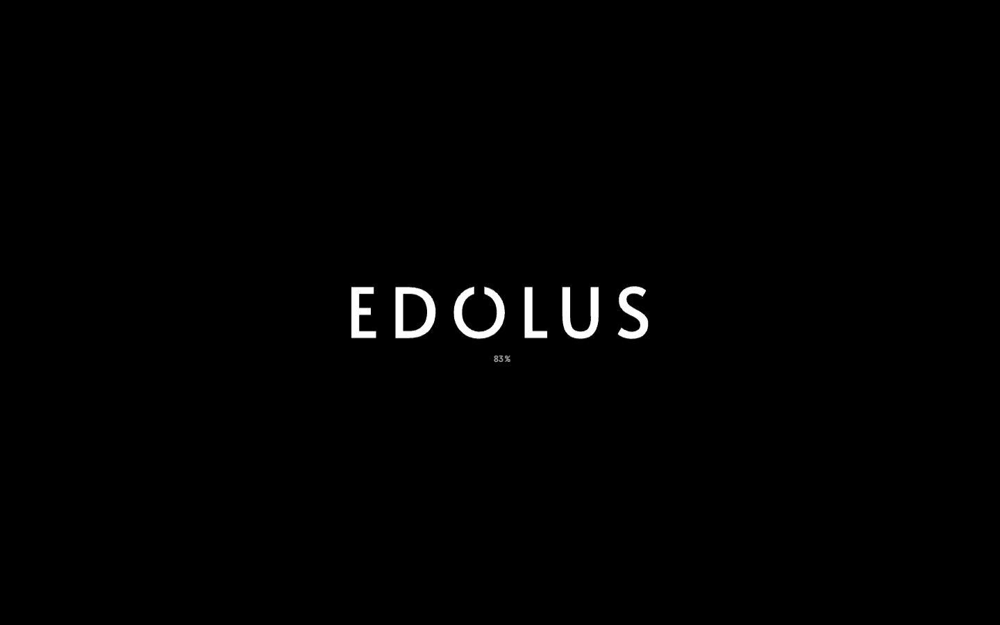</a> <a href="captures/desktop-02.jpg">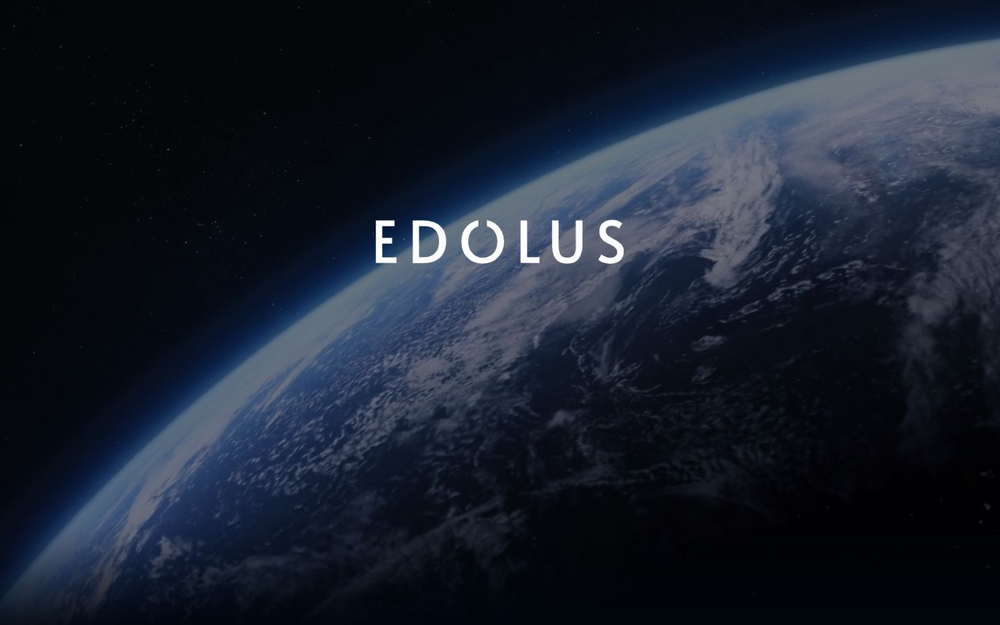</a> <a href="captures/desktop-03.jpg">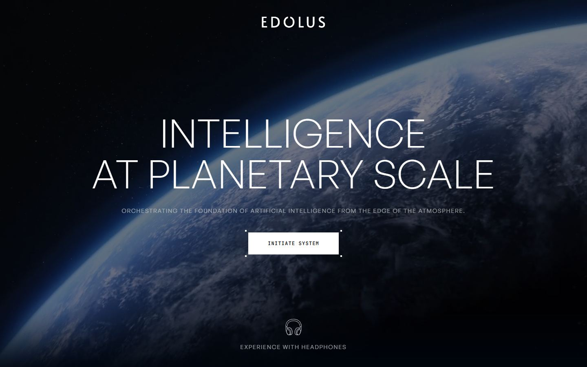</a> <a href="captures/desktop-04.jpg">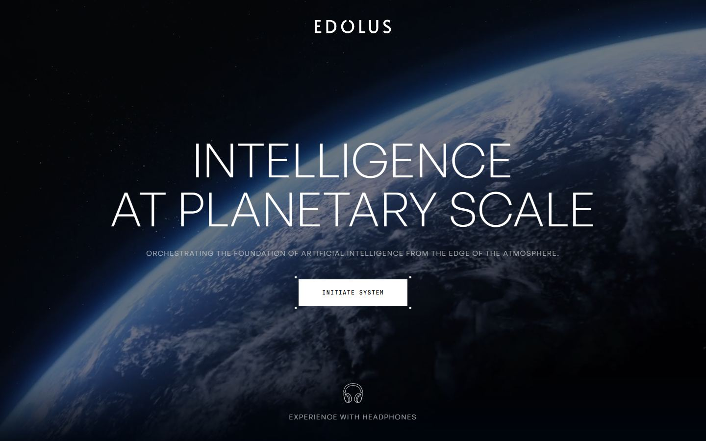</a> <a href="captures/desktop-05.jpg">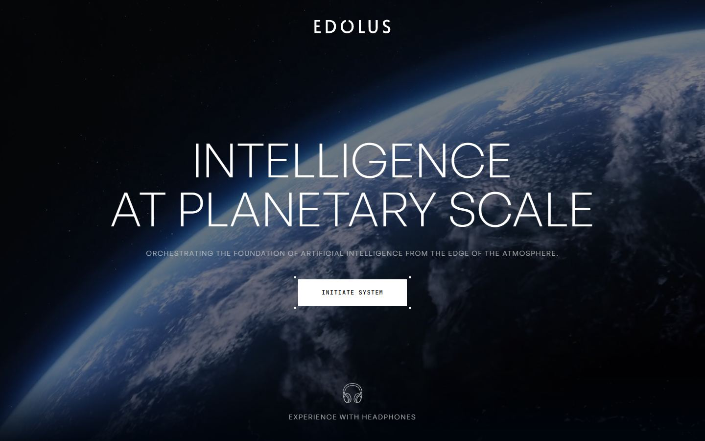</a> <a href="captures/desktop-06.jpg">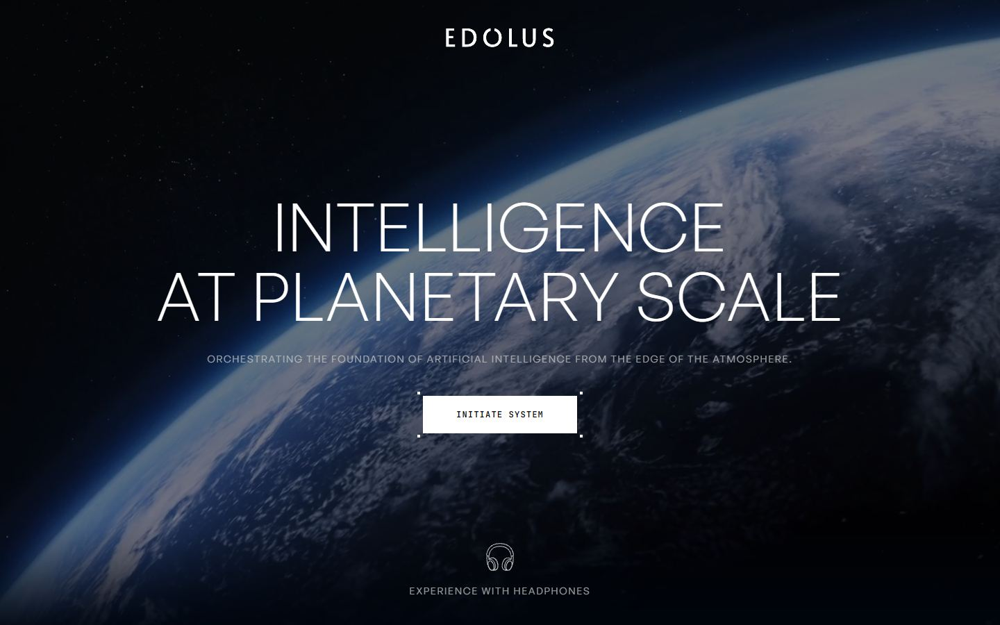</a> <a href="captures/desktop-07.jpg">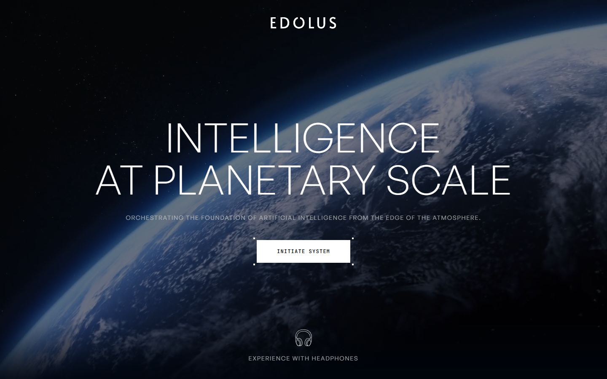</a> 


<a href="captures/mobile-01.jpg"></a> <a href="captures/mobile-02.jpg">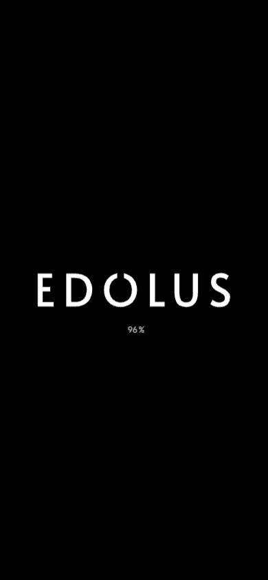</a> <a href="captures/mobile-03.jpg"></a> <a href="captures/mobile-04.jpg">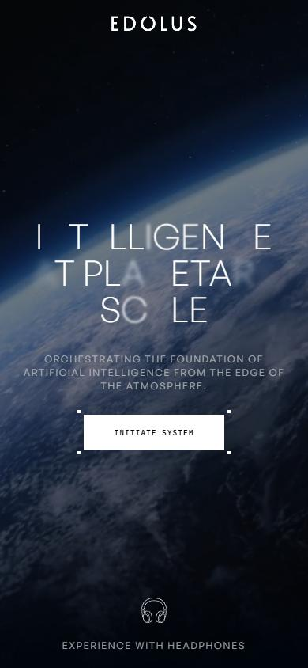</a> <a href="captures/mobile-05.jpg">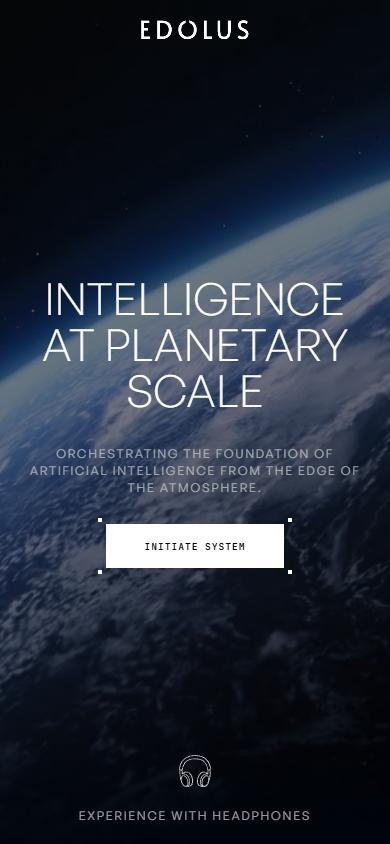</a> <a href="captures/mobile-06.jpg">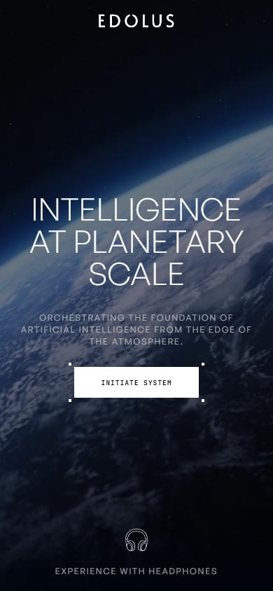</a> 

</details>

## Stack détectée
GSAP, PlayCanvas, ScrollTrigger, WebGL

Versions : GSAP 3.12.5 · Three.js r?

Shaders GLSL personnalisés extraits : 40 (voir `shaders.glsl`)

## Design tokens
### Couleurs (fonds, pondérées par surface)
`#000000`
### Couleurs de texte
`#c4c7c7` · `#ffffff` · `#000000`
### Polices utilisées (par volume de texte)
General Sans · JetBrains Mono
### Fichiers de police chargés
- tDbY2o-flEEny0FZhsfKu5WU4zr3E_BX0PnT8RD8-qxTOlOV.woff2
- 7YY3ZAAE3TRV2LANYOLXNHTPHLXVWTKH.woff2
- TW4KNQIPR4LNP4I6I6C6HKQ23B2EQAU5.woff2
- NIQ54PVBBIWVK3PFSOIOUJSXIJ5WTNDP.woff2
- SB2OEB6IKZPRR6JT4GFJ2TFT6HBB6AZN.woff2
- tDbv2o-flEEny0FZhsfKu5WU4zr3E_BX0PnT8RD8yKwBNntkaToggR7BYRbKPxDcwg.woff2
- tDbY2o-flEEny0FZhsfKu5WU4zr3E_BX0PnT8RD8yKxTOlOV.woff2
### Typographie
| Élément | Police | Taille | Graisse | Interligne | Interlettrage | Casse |
|---|---|---|---|---|---|---|
| body | Helvetica, arial, sans-serif | 16px | 400 | normal | normal | none |

### Échelle des tailles de texte
12px (7) · 14px (7) · 36px (2) · 16px (1) · 96px (1) · 48px (1)
### Arrondis
aucun (angles droits)
### Transitions CSS fréquentes
- ease 0.35s ×4
- ease 0.3s ×1
- linear 0.18s ×1
### Points de rupture (media queries)
768px
### Animations CSS (@keyframes)
ctaLabelBlink, ctaBlink, cursorOrbitSpin, pc-eq-dance, pc-o-loop
### Variables CSS (:root)
```css
```

## Structure de la home
Hauteur : 900 px — 182 nœuds DOM — canvas 1, vidéos 2, images 0

| # | Bloc | Hauteur | Titre | Médias |
|---|---|---|---|---|
| 1 | canvas#application-canvas .fill-mode-FILL_WINDOW | 900 |  | 0 |
| 2 | div#custom-splash-wrapper . | 900 |  | 0 |
| 3 | div#transition-overlay . | 900 |  | 0 |
| 4 | div#pc-overlay-root . | 900 |  | 0 |
| 5 | div . | 900 |  | 0 |

**Navigation :** 

**Boutons / CTA :** 

## SEO
- Title : EDOLUS
- Description : None
- Langue : None — canonical : None
- Open Graph : non — JSON-LD : aucun
- H1 : 0 — images sans alt : 0/0

### Plan des titres
- (rien relevé)

## Performance (mesure locale, Chrome headless, connexion non bridée)
- TTFB 145 ms · LCP 11716 ms (DIV) · CLS 0.046 · load 918 ms
- 108 requêtes · 49520 Ko transférés
- Par type : Document 1 req / 1 Ko, Script 7 req / 935 Ko, Stylesheet 8 req / 7 Ko, XHR 74 req / 36659 Ko, Font 14 req / 165 Ko, Fetch 1 req / 286 Ko, Other 1 req / 0 Ko, Media 2 req / 11467 Ko
- Plus gros fichiers :
- 7333 Ko — XHR — https://edolus.com/files/assets/295657347/1/ComputeTrayJOINED.glb?t=8ce0797c7b650df871d236a54eead989
- 7155 Ko — XHR — https://edolus.com/files/assets/298949851/1/Tesla-ready2.glb?t=2f3940419bc18acd7c2019d5206c3305
- 5909 Ko — Media — https://edolus.com/files/assets/297340642/1/Space-compressNOAUDIO-YTfullHD.mp4?t=5a0a9ec555552bb84bfa533812619b4e
- 5558 Ko — Media — https://edolus.com/files/assets/297340938/1/Seedance2-0_r2v_00002YTHD_lowbitrate.mp4?t=5f0560e47ec95621695e44389cbc520f
- 3568 Ko — XHR — https://edolus.com/files/assets/294606322/1/StarlinkV2-1.glb?t=de925792652e508f31cca5c035cb07c7
- 2427 Ko — XHR — https://edolus.com/files/assets/298350544/1/6kgfa2umfqb91-edit.webp?t=aafb654c69b180967cacaa23ea6ed927
- 1500 Ko — XHR — https://edolus.com/files/assets/297261766/1/GDX-3PODS-F2.glb?t=ab0a12f255fc890bc0fa03829ea3e56f
- 1464 Ko — XHR — https://edolus.com/files/assets/296179108/1/Solar_panelDiffuse1.basis?t=3e43c8d02b3bd044973f54ed55ee6cbd
- Services tiers : fonts.googleapis.com, cdnjs.cloudflare.com, fonts.gstatic.com, api.fontshare.com, cdn.fontshare.com

## Mobile
- H1 : None · corps : 16px · débordement horizontal : False · menu burger : False

## Fichiers
- `captures/` : arrivée, scroll desktop (1440×900), pleine page, pages internes, mobile (390×844 @2x) ; vidéo de scroll dans la release GitHub « videos » (lien en haut de fiche)
- `page.html` : DOM rendu · `styles.css` : CSS chargé · `scripts/` : JS chargé (index dans `_index.json`) · `shaders.glsl` : shaders extraits · `rea-bundle.json` : analyse REA du bundle (chunks, routes, endpoints)
