# Tengile Malamala Collection

- Site : [https://tengilemalamala.com/](https://tengilemalamala.com/) — [aperçu statique local](apercu.html)
- Capturé le : 2026-11-02 — statut : ok
- Vidéo de scroll : [▶ ouvrir](https://github.com/t-baudry/bibliotheque-web/releases/download/videos/030-tengile-malamala-collection.webm)

<a href="captures/desktop-00-arrivee.jpg">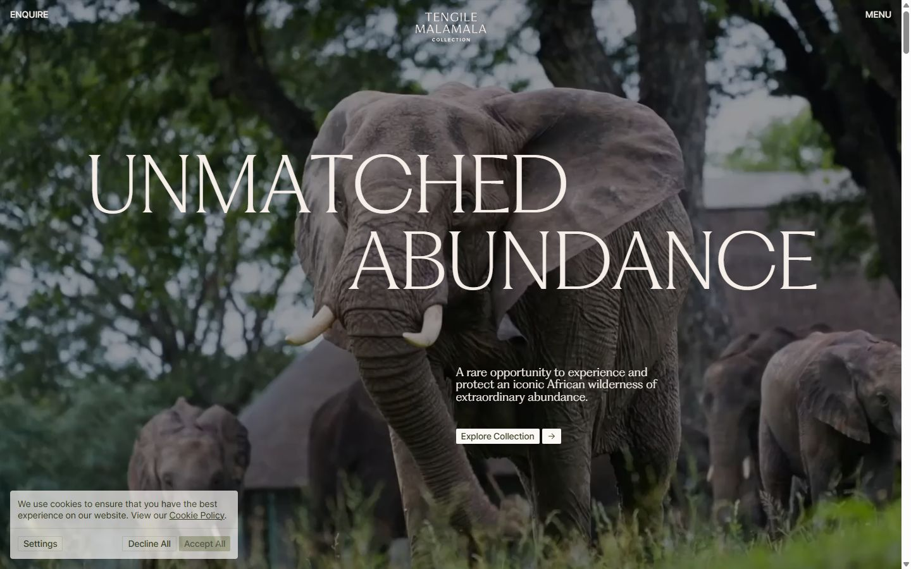</a> 

<details><summary>Toutes les captures</summary>

<a href="captures/desktop-01.jpg"></a> <a href="captures/desktop-02.jpg"></a> <a href="captures/desktop-03.jpg">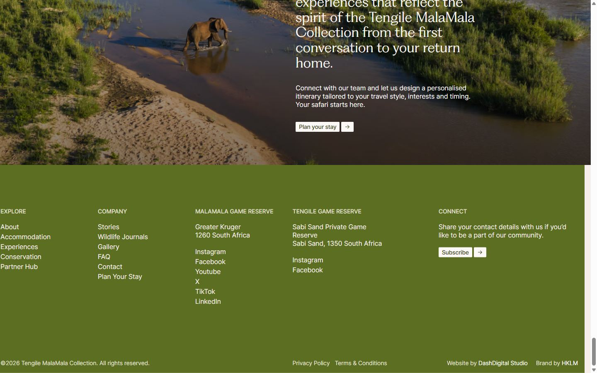</a> <a href="captures/desktop-pleine-page.jpg"></a> 

<a href="captures/page1-01.jpg">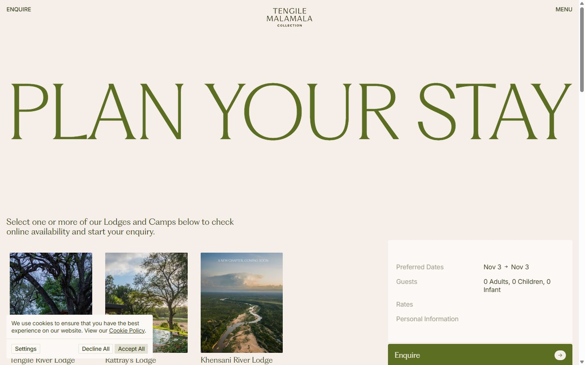</a> <a href="captures/page1-02.jpg">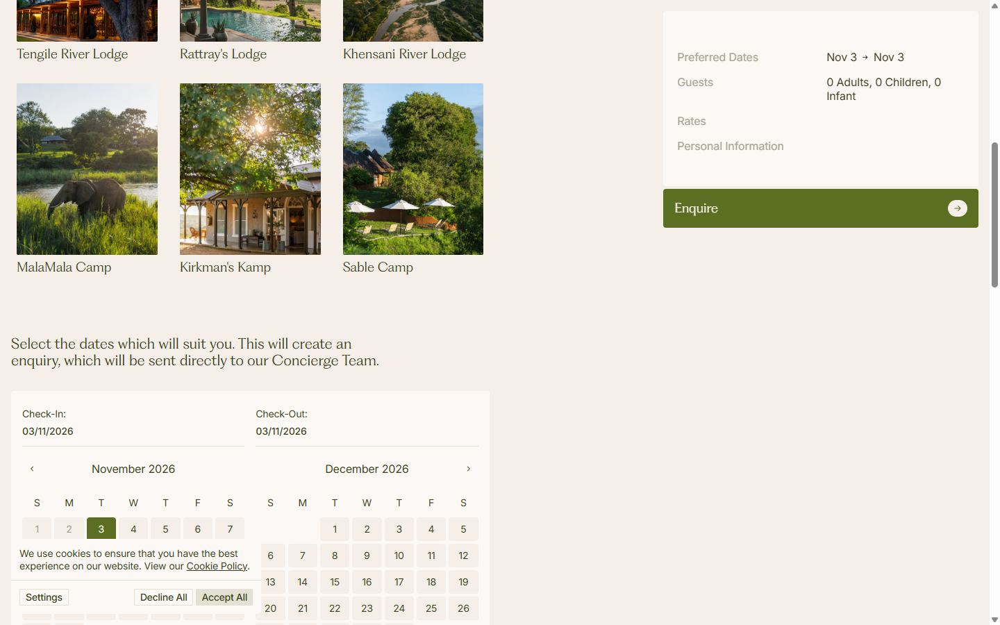</a> <a href="captures/page1-03.jpg">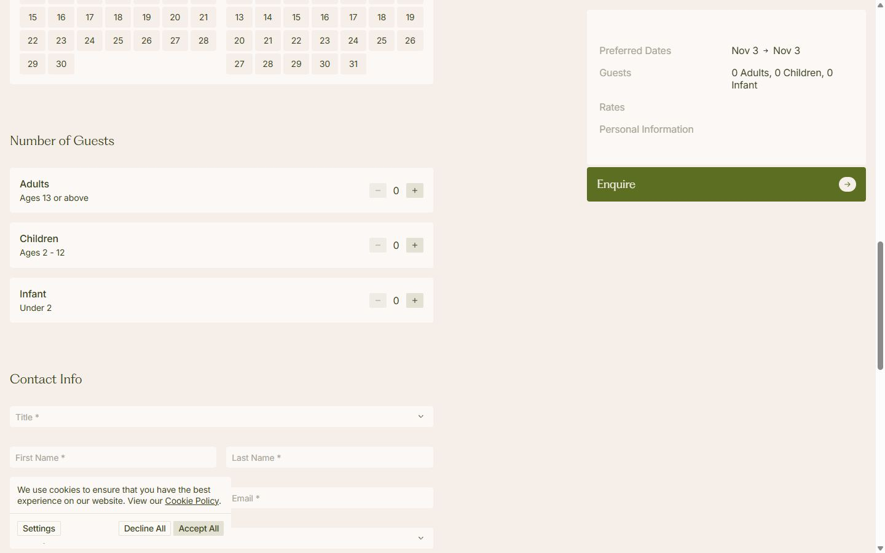</a> <a href="captures/page1-04.jpg">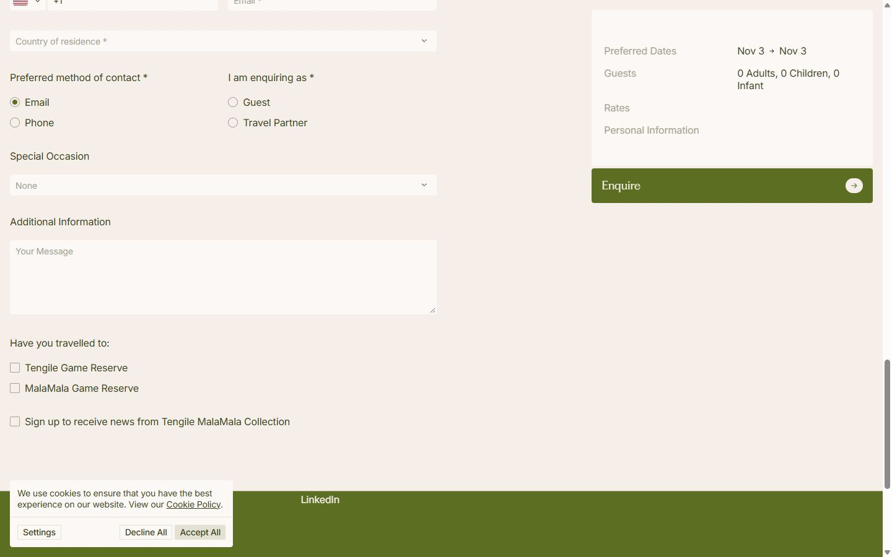</a> <a href="captures/page2-01.jpg">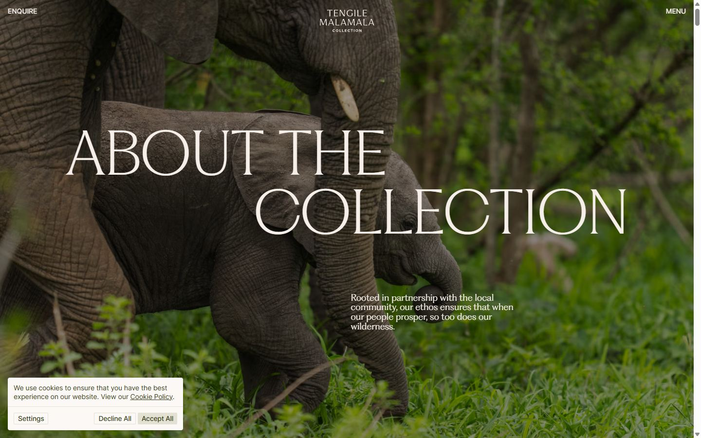</a> <a href="captures/page2-02.jpg">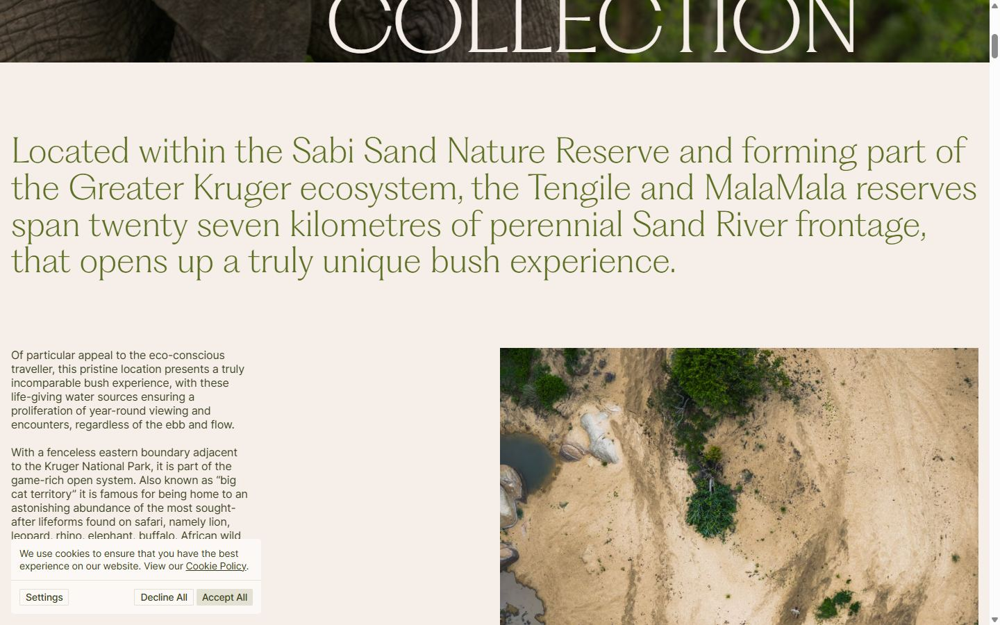</a> <a href="captures/page2-03.jpg">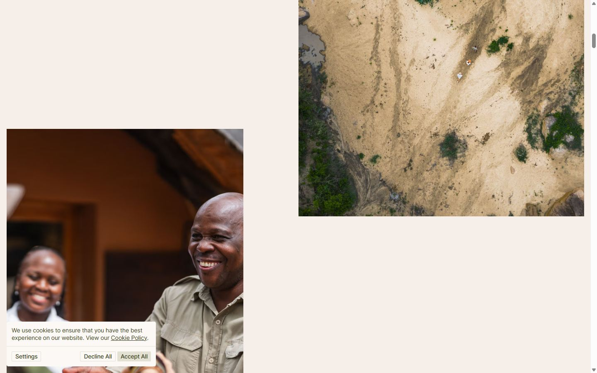</a> <a href="captures/page2-04.jpg">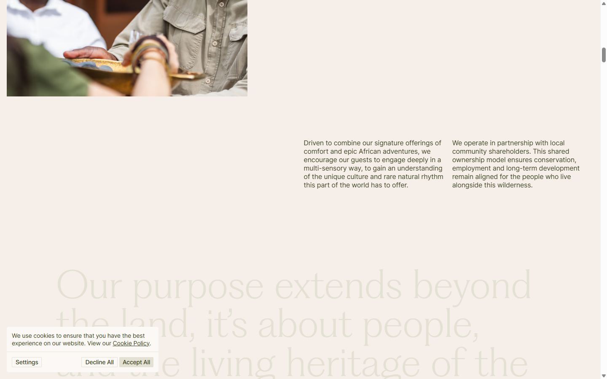</a> <a href="captures/page3-01.jpg">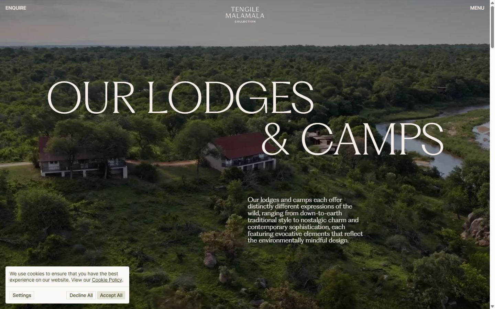</a> <a href="captures/page3-02.jpg">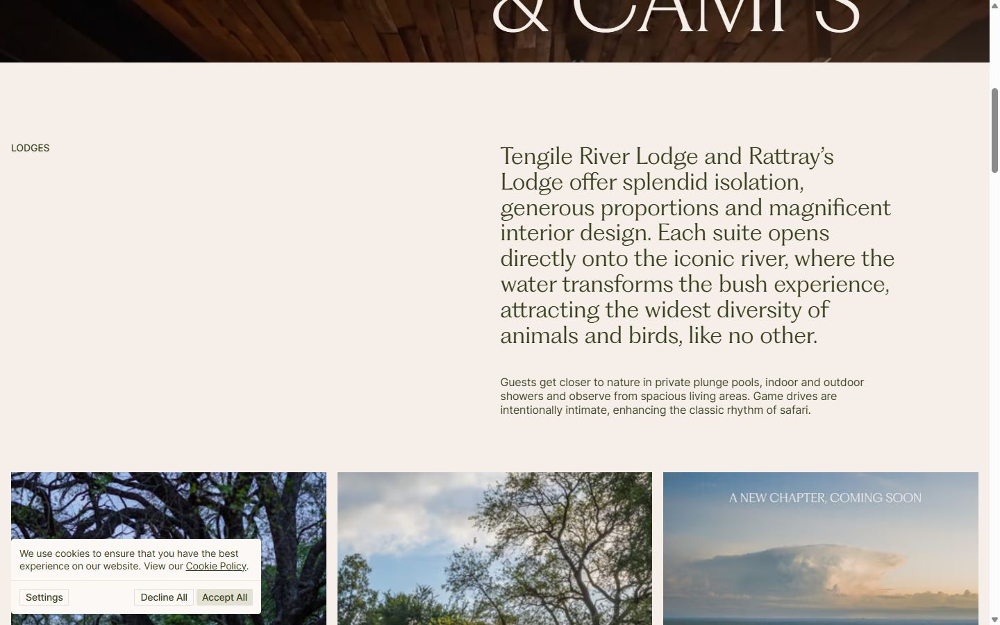</a> <a href="captures/page3-03.jpg">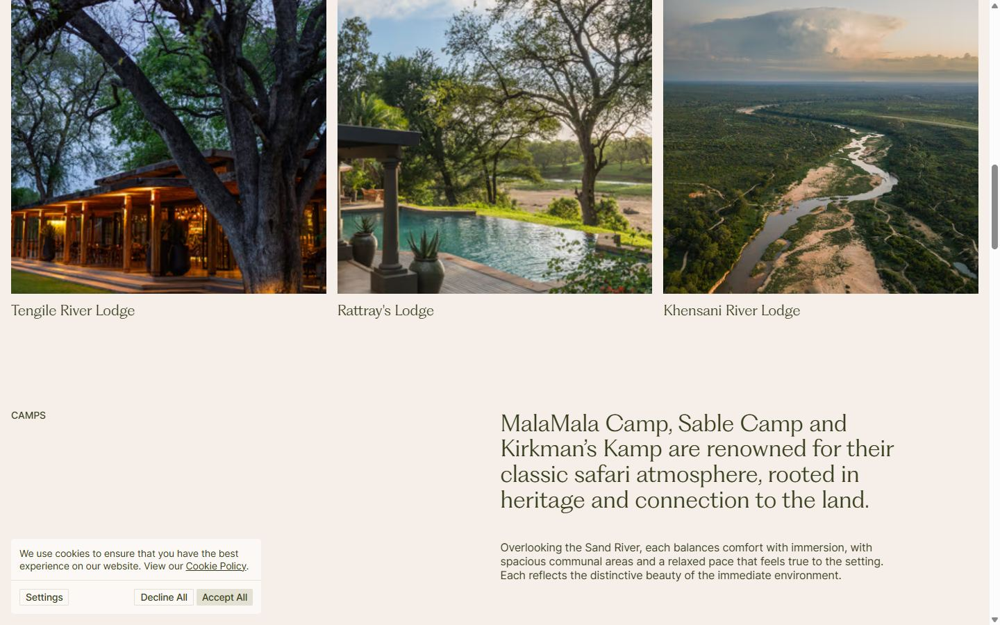</a> <a href="captures/page3-04.jpg">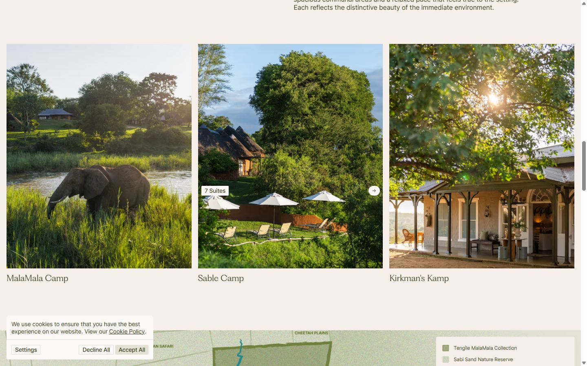</a> 

<a href="captures/mobile-01.jpg">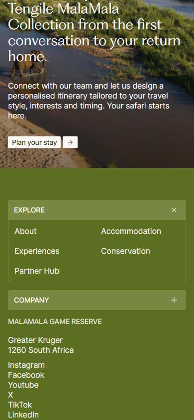</a> <a href="captures/mobile-02.jpg"></a> <a href="captures/mobile-03.jpg"></a> <a href="captures/mobile-04.jpg"></a> <a href="captures/mobile-05.jpg"></a> <a href="captures/mobile-06.jpg">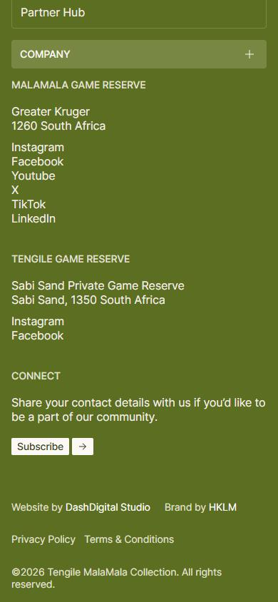</a> 

</details>

## Stack détectée
Barba.js, CMS Sanity, GSAP, Lenis, Next.js, React, ScrollTrigger, SplitText/SplitType, Virtual scroll

Versions : GSAP 3.11.0 · Three.js r?

## Design tokens
### Couleurs (fonds, pondérées par surface)
`#e3e1d4` · `#f5eee9` · `#5c6e21` · `#fbf8f6`
### Couleurs de texte
`#373f1d` · `#5c6e21` · `#f5eee9` · `#fbf8f6` · `#e3e1d4` · `#ffffff` · `#a5a593`
### Polices utilisées (par volume de texte)
Inter · PP Fragment
### Fichiers de police chargés
- inter-regular.woff2
- PPFragment-GlareVariable.woff
- inter-medium.woff2
### Typographie
| Élément | Police | Taille | Graisse | Interligne | Interlettrage | Casse |
|---|---|---|---|---|---|---|
| h1 | "PP Fragment", "Helvetica Neue", Helvetica, Arial, | 120px | 220 | 108px | -2.4px | uppercase |
| h2 | "PP Fragment", "Helvetica Neue", Helvetica, Arial, | 32px | 310 | 36.8px | normal | none |
| h3 | "PP Fragment", "Helvetica Neue", Helvetica, Arial, | 20px | 310 | 24px | normal | none |
| p | "PP Fragment", "Helvetica Neue", Helvetica, Arial, | 18px | 310 | 19.8px | normal | none |
| a | Inter, "Helvetica Neue", Helvetica, Arial, sans-se | 14px | 500 | 14px | -0.28px | none |
| button | Inter, "Helvetica Neue", Helvetica, Arial, sans-se | 14px | 500 | 14px | -0.14px | uppercase |
| li | "PP Fragment", "Helvetica Neue", Helvetica, Arial, | 40px | 220 | 40px | -0.16px | none |
| body | Inter, "Helvetica Neue", Helvetica, Arial, sans-se | 16px | 400 | 20px | -0.16px | none |

### Échelle des tailles de texte
16px (48) · 14px (42) · 120px (18) · 20px (7) · 32px (6) · 40px (5) · 48px (2) · 18px (1)
### Arrondis
2px · 4px · 24px · 50%
### Transitions CSS fréquentes
- ease 0.3s ×78
- cubic-bezier(0.19 1.6s ×18
- cubic-bezier(0.19 0.4s ×14
- cubic-bezier(0.165 0.5s ×2
- cubic-bezier(0.77 0.8s ×2
- cubic-bezier(0.25 0.3s ×1
- cubic-bezier(0.165 1s ×1
- cubic-bezier(0.19 2s ×1
### Points de rupture (media queries)
1024px · 1920px · 1023px · 486px · 640px · 639px · 480px · 390px · 768px · 767px
### Animations CSS (@keyframes)
DrawerSkeleton-module-scss-module__Zmpd7q__skeleton-fade, SectionImagesMarquee-module-scss-module__eXBUiG__marquee, plyr-progress, plyr-popup, plyr-fade-in, SectionMap-module-scss-module__xgLpBa__pinPointIddler
### Variables CSS (:root)
```css
--lvh: 1vh;
--svh: 1vh;
--size: 1920;
```

## Structure de la home
Hauteur : 11532 px — 753 nœuds DOM — canvas 0, vidéos 1, images 38

| # | Bloc | Hauteur | Titre | Médias |
|---|---|---|---|---|
| 1 | div . | 11030 | UNMATCHEDABUNDANCE | 39 |

**Navigation :** Enquire · About · Accommodation · Experiences · Conservation · Partner Hub · Stories · Wildlife Journals · Gallery · FAQ · Contact · Plan Your Stay · About · Accommodation · Experiences · Conservation · Partner Hub · Stories · Wildlife Journals · Gallery · FAQ · Contact · Plan Your Stay

**Boutons / CTA :** 

## SEO
- Title : Luxury Safari Experiences in Greater Kruger & Sabi Sand | Tengile MalaMala Collection
- Description : Discover luxury safari experiences in Greater Kruger and Sabi Sand. Wildlife, luxury accommodation and unforgettable Big Five encounters. Explore MalaMala.
- Langue : en — canonical : https://tengilemalamala.com/
- Open Graph : oui — JSON-LD : LodgingBusiness
- H1 : 1 — images sans alt : 38/38

### Plan des titres
- H1 UNMATCHEDABUNDANCE
- H2 Along one of the most wildlife-rich stretches of the Sand River in the Sabi Sand region, T
- H2 Our lodges and camps each offer a distinct expression of the wilderness, from earthy tradi
- H2 Lodges
- H3 Tengile River Lodge
- H3 Rattray's Lodge
- H3 Khensani River Lodge
- H2 Camps
- H3 MalaMala Camp
- H3 Sable Camp
- H3 Kirkman's Kamp
- H2 With roots reaching back to 1927, our story is one of stewardship, partnership and respect
- H2 Preserving Life’s Balance
- H2 Our purpose extends beyond the land – it’s about people. As one of South Africa’s few blac
- H2 Our dedicated travel specialists craft every journey with care, shaping seamless experienc
- H3 Subscribe to our newsletter
- H3 Explore
- H3 Company
- H3 Malamala Game Reserve
- H3 Tengile Game Reserve
- H3 Connect

## Performance (mesure locale, Chrome headless, connexion non bridée)
- TTFB 130 ms · LCP 468 ms (SPAN.HeroTitle-module-scss-module__Eg-KiW__text) · CLS 0.044 · load 877 ms
- 138 requêtes · 7482 Ko transférés
- Par type : Document 1 req / 32 Ko, Stylesheet 11 req / 49 Ko, Script 49 req / 1112 Ko, Media 1 req / 4860 Ko, Font 3 req / 331 Ko, Fetch 18 req / 164 Ko, Image 45 req / 922 Ko, Other 10 req / 11 Ko
- Plus gros fichiers :
- 4860 Ko — Media — https://d1z1bhj01il1nu.cloudfront.net/tmmc-home-hero-preview_1080p.mp4
- 247 Ko — Image — https://tengilemalamala.com/_next/image?url=https%3A%2F%2Fcdn.sanity.io%2Fimages%2Flbfzk6b6%2Fproduction%2F9df8d1bf98e06bd9cf3d8d1ece76b09296eb30e0-7680x6776.jp
- 177 Ko — Script — https://www.googletagmanager.com/gtag/js?id=G-61PY6JQCW1&cx=c&gtm=4e6au1
- 127 Ko — Font — https://tengilemalamala.com/fonts/PPFragment-GlareVariable.woff
- 121 Ko — Script — https://www.googletagmanager.com/gtm.js?id=GTM-MMWFT46X
- 121 Ko — Image — https://tengilemalamala.com/_next/image?url=https%3A%2F%2Fcdn.sanity.io%2Fimages%2Flbfzk6b6%2Fproduction%2F198b478bdb2519980fd7682bd68e61a8be330d40-2308x2936.jp
- 120 Ko — Image — https://tengilemalamala.com/_next/image?url=https%3A%2F%2Fcdn.sanity.io%2Fimages%2Flbfzk6b6%2Fproduction%2F8d7a933dd45f344ac9cde3552a61d232256041f8-2784x3360.jp
- 106 Ko — Font — https://tengilemalamala.com/fonts/inter-medium.woff2
- Services tiers : d1z1bhj01il1nu.cloudfront.net, cdn.sanity.io, www.googletagmanager.com, region1.google-analytics.com

## Mobile
- H1 : {'size': '48.75px', 'lineHeight': '43.875px'} · corps : 16px · débordement horizontal : False · menu burger : True

## Fichiers
- `captures/` : arrivée, scroll desktop (1440×900), pleine page, pages internes, mobile (390×844 @2x) ; vidéo de scroll dans la release GitHub « videos » (lien en haut de fiche)
- `page.html` : DOM rendu · `styles.css` : CSS chargé · `scripts/` : JS chargé (index dans `_index.json`) · `shaders.glsl` : shaders extraits · `rea-bundle.json` : analyse REA du bundle (chunks, routes, endpoints)

## Pages internes capturées
- https://tengilemalamala.com/booking
- https://tengilemalamala.com/about
- https://tengilemalamala.com/accommodation
