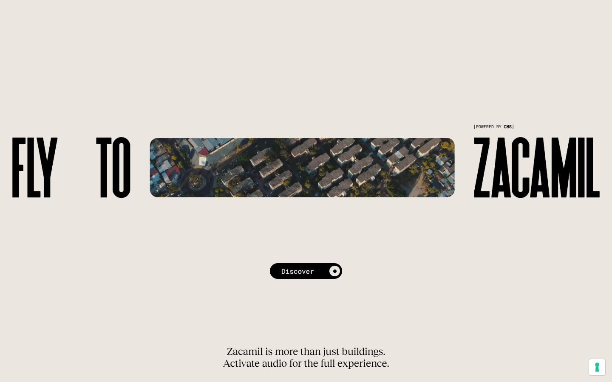
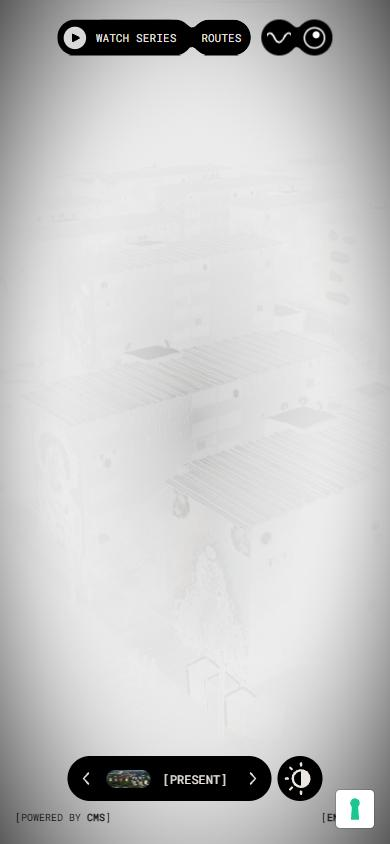
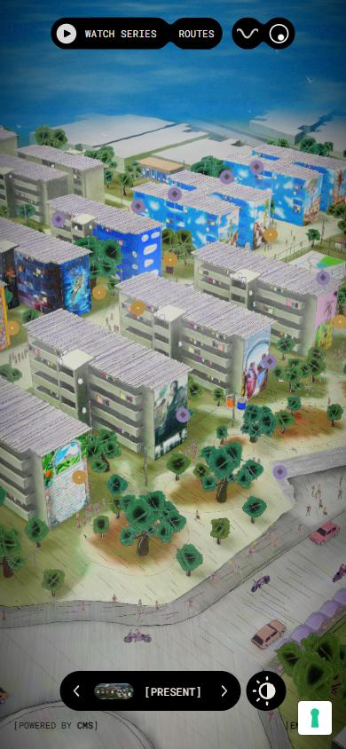

# Colonia Zacamil

- Site : [https://coloniazacamil.com/](https://coloniazacamil.com/) — [aperçu statique local](apercu.html)
- Capturé le : 2026-11-02 — statut : ok
- Vidéo de scroll : [▶ ouvrir](https://github.com/t-baudry/bibliotheque-web/releases/download/videos/032-colonia-zacamil.webm)

<a href="captures/desktop-00-arrivee.jpg"></a> 

<details><summary>Toutes les captures</summary>


<a href="captures/mobile-01.jpg"></a> <a href="captures/mobile-02.jpg"></a> 

</details>

## Stack détectée
Barba.js, DrawSVG/MorphSVG, GSAP, Lenis, Nuxt, ScrollTrigger, Three.js, Virtual scroll, Vue, WebGL

Versions : GSAP 3.13.0 · Three.js r?

Shaders GLSL personnalisés extraits : 12 (voir `shaders.glsl`)

## Design tokens
### Couleurs (fonds, pondérées par surface)
`#000000` · `#b48e46` · `#8d7cab` · `#ffffff`
### Couleurs de texte
`#000000` · `#ebe6e0`
### Polices utilisées (par volume de texte)
Roboto Mono · -apple-system
### Fichiers de police chargés
- RobotoMono-Regular.BpTYbtfY.woff2
- Heathergreen.B41LLI5X.woff2
- RecklessNeue-Regular.D-zoCqbF.woff2
### Typographie
| Élément | Police | Taille | Graisse | Interligne | Interlettrage | Casse |
|---|---|---|---|---|---|---|
| a | "Roboto Mono" | 10px | 400 | normal | normal | uppercase |
| button | -apple-system, sans-serif | 14px | 700 | 38px | normal | none |
| body | "Times New Roman" | 16px | 400 | normal | normal | none |

### Échelle des tailles de texte
14px (34) · 10px (6) · 16px (2) · 12px (1)
### Arrondis
30px · 50% · 4px
### Transitions CSS fréquentes
- cubic-bezier(0.645 0.8s ×27
- linear 0.4s ×4
- cubic-bezier(0.645 0.6s ×2
- ease-in-out 0.6s ×2
- linear 0.5s ×2
- linear 0.2s ×1
### Points de rupture (media queries)
768px · 767px · 1025px · 1024px · 640px · 992px · 920px · 639px · 991px · 300px · 480px
### Animations CSS (@keyframes)
slide-b1596730, translate-2fd2f567, scale-2fd2f567, translateY-2fd2f567, scaleScroll-2fd2f567, scalePinch-2fd2f567, pinchTranslate-2fd2f567, marquee-4b170499
### Variables CSS (:root)
```css
```

## Structure de la home
Hauteur : 900 px — 297 nœuds DOM — canvas 1, vidéos 1, images 1

| # | Bloc | Hauteur | Titre | Médias |
|---|---|---|---|---|
| 1 | div#__nuxt . | 900 |  | 4 |

**Navigation :** 

**Boutons / CTA :** 

## SEO
- Title : Colonia Zacamil
- Description : Colonia Zacamil
- Langue : None — canonical : None
- Open Graph : non — JSON-LD : aucun
- H1 : 0 — images sans alt : 1/1

### Plan des titres
- (rien relevé)

## Performance (mesure locale, Chrome headless, connexion non bridée)
- TTFB 93 ms · LCP 8144 ms (SPAN) · CLS 0 · load 887 ms
- 84 requêtes · 6425 Ko transférés
- Par type : Document 1 req / 19 Ko, Script 8 req / 621 Ko, Other 6 req / 7 Ko, Stylesheet 2 req / 17 Ko, Image 20 req / 374 Ko, Font 3 req / 119 Ko, Fetch 42 req / 5266 Ko, XHR 2 req / 1 Ko
- Plus gros fichiers :
- 1861 Ko — Fetch — https://coloniazacamil.com/models/compressed/model.glb
- 1029 Ko — Fetch — https://coloniazacamil.com/audio/main.mp3
- 1004 Ko — Fetch — https://coloniazacamil.com/textures/Murales_1.webp
- 340 Ko — Image — https://cdn.adoratorio.app/zacamil/images/loader/background.jpg
- 282 Ko — Script — https://coloniazacamil.com/_nuxt/DkhZ0TVB.js
- 261 Ko — Fetch — https://coloniazacamil.com/textures/Murales_2.webp
- 239 Ko — Fetch — https://coloniazacamil.com/textures/Murales_4.webp
- 229 Ko — Fetch — https://coloniazacamil.com/textures/modes/before-day-buildings.webp
- Services tiers : embeds.iubenda.com, cdn.adoratorio.app, www.googletagmanager.com, cdn.iubenda.com, idb.iubenda.com, cpl.iubenda.com, region1.google-analytics.com

## Mobile
- H1 : None · corps : 16px · débordement horizontal : False · menu burger : False

## Fichiers
- `captures/` : arrivée, scroll desktop (1440×900), pleine page, pages internes, mobile (390×844 @2x) ; vidéo de scroll dans la release GitHub « videos » (lien en haut de fiche)
- `page.html` : DOM rendu · `styles.css` : CSS chargé · `scripts/` : JS chargé (index dans `_index.json`) · `shaders.glsl` : shaders extraits · `rea-bundle.json` : analyse REA du bundle (chunks, routes, endpoints)
