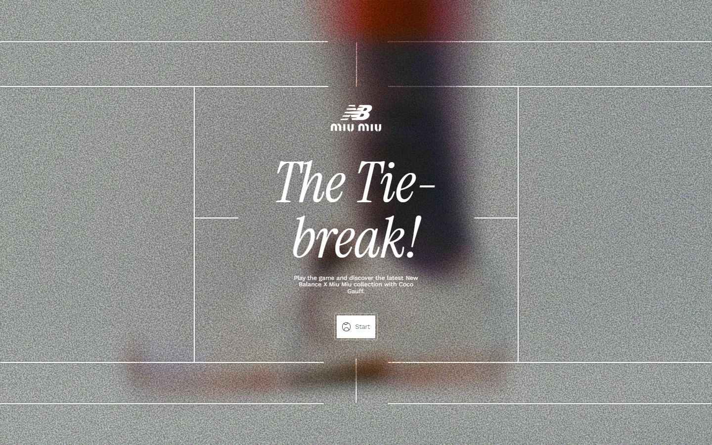
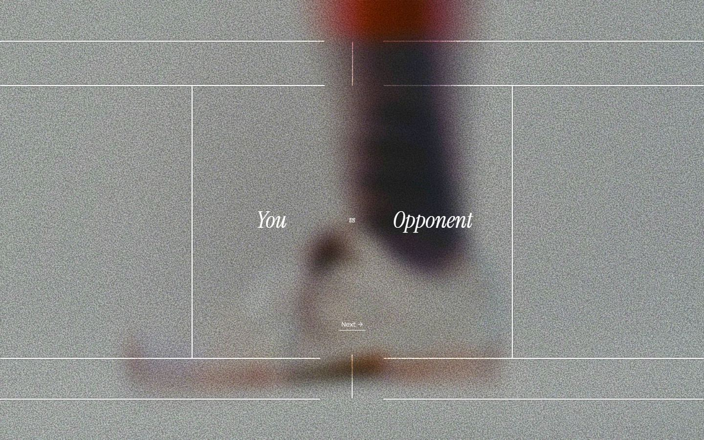
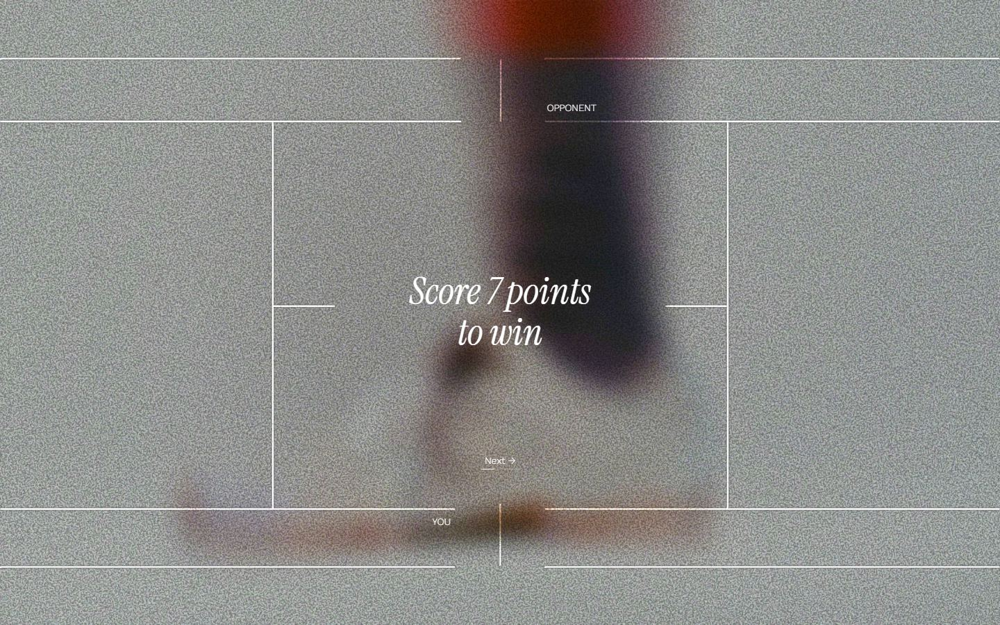
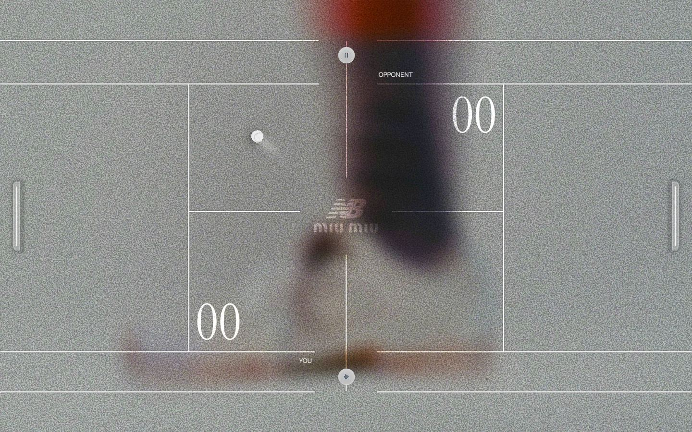
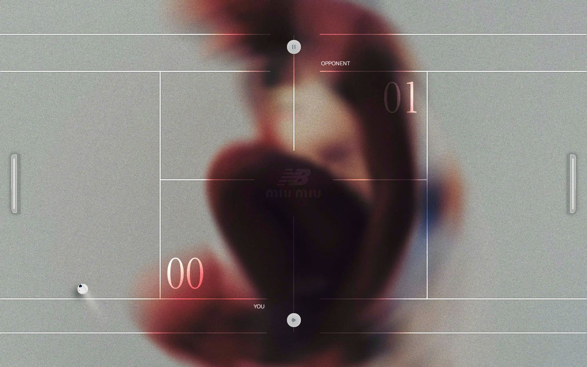
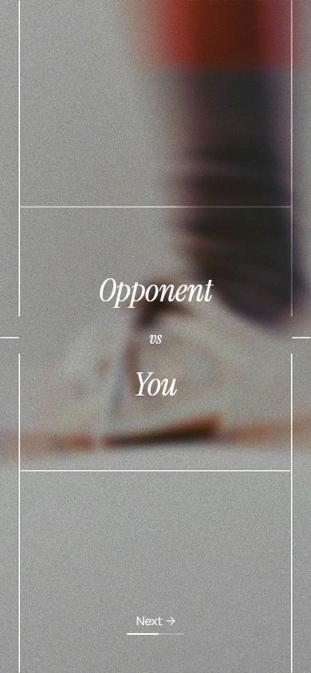
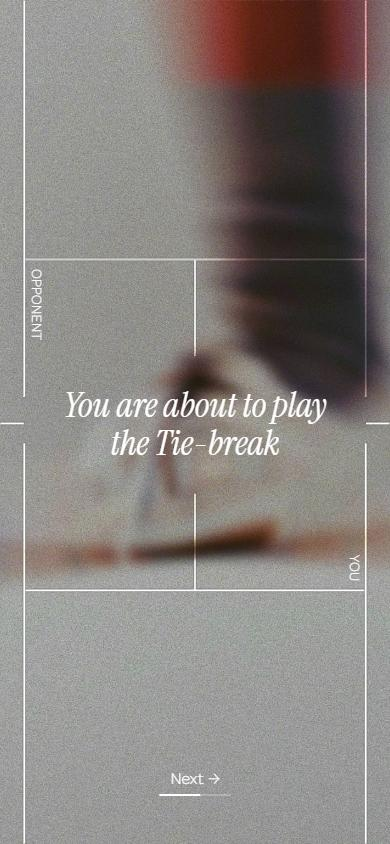

# The Tie-break

- Site : [https://thetiebreak.merci-michel.com/](https://thetiebreak.merci-michel.com/) — [aperçu statique local](apercu.html)
- Capturé le : 2026-11-02 — statut : ok
- Vidéo de scroll : [▶ ouvrir](https://github.com/t-baudry/bibliotheque-web/releases/download/videos/038-the-tie-break.webm)

<a href="captures/desktop-00-arrivee.jpg"></a> 

<details><summary>Toutes les captures</summary>

<a href="captures/desktop-01.jpg"></a> <a href="captures/desktop-02.jpg"></a> <a href="captures/desktop-03.jpg"></a> <a href="captures/desktop-04.jpg"></a> <a href="captures/desktop-05.jpg"></a> <a href="captures/desktop-06.jpg"></a> <a href="captures/desktop-07.jpg"></a> 


<a href="captures/mobile-01.jpg"></a> <a href="captures/mobile-02.jpg"></a> <a href="captures/mobile-03.jpg"></a> <a href="captures/mobile-04.jpg"></a> <a href="captures/mobile-05.jpg"></a> <a href="captures/mobile-06.jpg"></a> 

</details>

## Stack détectée
Three.js, Vue, WebGL

Shaders GLSL personnalisés extraits : 20 (voir `shaders.glsl`)

## Design tokens
### Couleurs (fonds, pondérées par surface)
`#ffffff`
### Couleurs de texte
`#ffffff`
### Polices utilisées (par volume de texte)
Instrument · WorkSans
### Fichiers de police chargés
- WorkSans-Regular.B9ExyInW6b4d5903.woff2
- WorkSans-Light.BJoAFi_B6b4d5903.woff2
- InstrumentSerif-Italic.Cg4-EJUh6b4d5903.woff2
### Typographie
| Élément | Police | Taille | Graisse | Interligne | Interlettrage | Casse |
|---|---|---|---|---|---|---|
| button | WorkSans, sans-serif | 7.5px | 400 | 8.25px | normal | none |
| body | WorkSans, sans-serif | 7.5px | 400 | 8.25px | normal | none |

### Échelle des tailles de texte
7.5px (3) · 46.5px (2) · 14px (2) · 16.5px (1)
### Arrondis
0.75px
### Transitions CSS fréquentes
- ease 0.3s ×1
### Points de rupture (media queries)
1080px
### Animations CSS (@keyframes)
joystick-y-3b1265d4, quick-flick-3b1265d4, circular-spin-3b1265d4, bounceAnim, squishAnim, shadowAnim, shake1, jitter-subtle, jitter-subtle-rtl, ken-burns, join-shimmer-9301a5af
### Variables CSS (:root)
```css
--base-text: 10px;
--padding: max(6px, calc(var(--base-text) * .15));
--ui-bps: xs:400px / s:640px / sm:768px / md:1024px / lg:1200px / xl:1600px / xxl:1920px;
--ui-colors: bg-primary:#000 / primary:#fff / blue:#142a48 / primary-hover:#fff302;
--ui-color-bg-primary: #000;
--ui-color-primary: #fff;
--ui-color-blue: #142a48;
--ui-color-primary-hover: #fff302;
--miumiu-header: 1.5em;
```

## Structure de la home
Hauteur : 900 px — 116 nœuds DOM — canvas 1, vidéos 0, images 0

| # | Bloc | Hauteur | Titre | Médias |
|---|---|---|---|---|
| 1 | section .view view-game | 900 |  | 0 |

**Navigation :** 

**Boutons / CTA :** 

## SEO
- Title : The Tie-break!
- Description : Play the game and discover the latest New Balance X Miu Miu collection with Coco Gauff.
- Langue : en — canonical : https://miumiu-wimbledon.web.app/eu/en/
- Open Graph : oui — JSON-LD : aucun
- H1 : 0 — images sans alt : 0/0

### Plan des titres
- (rien relevé)

## Performance (mesure locale, Chrome headless, connexion non bridée)
- TTFB 20 ms · LCP 7758 ms (H1.home__title) · CLS 0 · load 1776 ms
- 46 requêtes · 8274 Ko transférés
- Par type : Document 2 req / 12 Ko, Stylesheet 3 req / 5 Ko, Image 12 req / 1736 Ko, Script 7 req / 268 Ko, Fetch 15 req / 4682 Ko, XHR 2 req / 1411 Ko, Other 2 req / 2 Ko, Font 3 req / 158 Ko
- Plus gros fichiers :
- 1643 Ko — Image — https://thetiebreak.merci-michel.com/b/VNsb28kHH4Zp.jpg
- 1032 Ko — XHR — https://thetiebreak.merci-michel.com/b/dIkpG95Tjxla.m4a
- 668 Ko — Fetch — https://thetiebreak.merci-michel.com/b/ybvR7AvSY6Yk.ktx2
- 642 Ko — Fetch — https://thetiebreak.merci-michel.com/b/yU_3lfBASO8K.ktx2
- 638 Ko — Fetch — https://thetiebreak.merci-michel.com/b/K-pGx3149FXG.ktx2
- 636 Ko — Fetch — https://thetiebreak.merci-michel.com/b/yncPfz5HVhUP.ktx2
- 547 Ko — Fetch — https://thetiebreak.merci-michel.com/b/XrE0yQu9MN6F.ktx2
- 506 Ko — Fetch — https://thetiebreak.merci-michel.com/b/jXqL9owD7VRN.ktx2
- Services tiers : tags.tiqcdn.com

## Mobile
- H1 : None · corps : 9.70149px · débordement horizontal : False · menu burger : False

## Fichiers
- `captures/` : arrivée, scroll desktop (1440×900), pleine page, pages internes, mobile (390×844 @2x) ; vidéo de scroll dans la release GitHub « videos » (lien en haut de fiche)
- `page.html` : DOM rendu · `styles.css` : CSS chargé · `scripts/` : JS chargé (index dans `_index.json`) · `shaders.glsl` : shaders extraits · `rea-bundle.json` : analyse REA du bundle (chunks, routes, endpoints)
