# Sobha Privy Collection

- Site : [https://sobha-privy-collection.com/](https://sobha-privy-collection.com/) — [aperçu statique local](apercu.html)
- Capturé le : 2026-11-02 — statut : ok
- Vidéo de scroll : [▶ ouvrir](https://github.com/t-baudry/bibliotheque-web/releases/download/videos/040-sobha-privy-collection.webm)

<a href="captures/desktop-00-arrivee.jpg">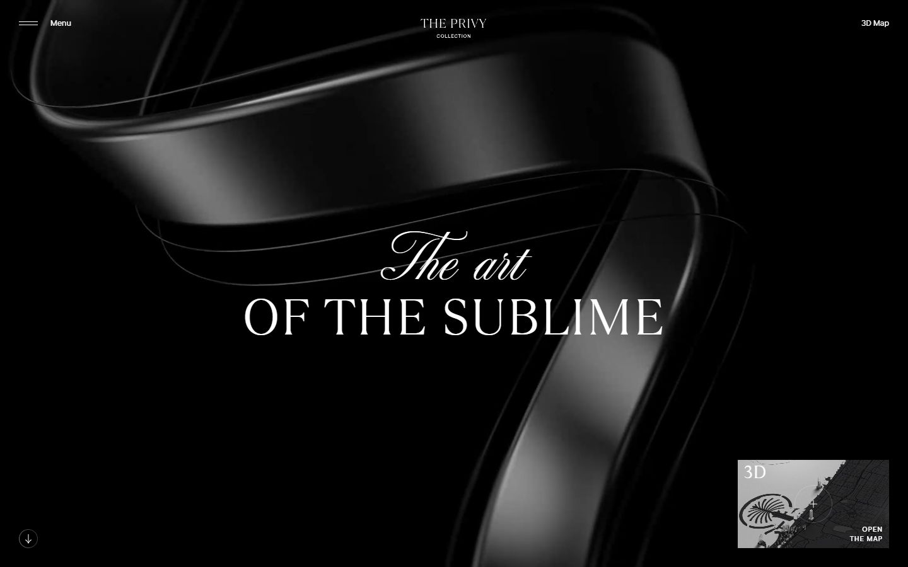</a> 

<details><summary>Toutes les captures</summary>

<a href="captures/desktop-01.jpg">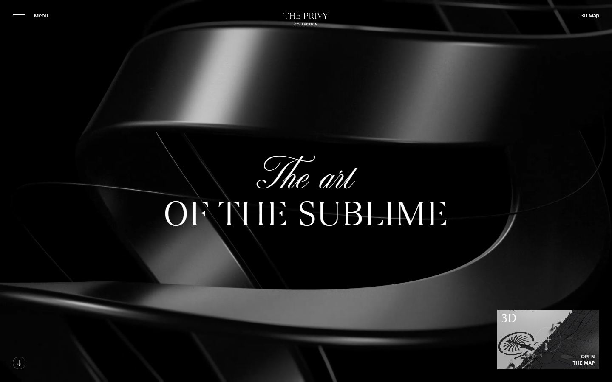</a> <a href="captures/desktop-02.jpg">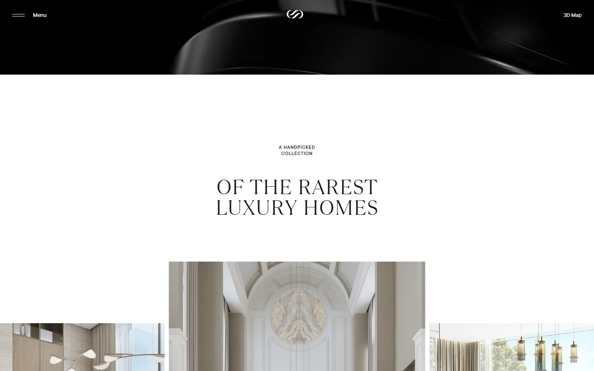</a> <a href="captures/desktop-03.jpg">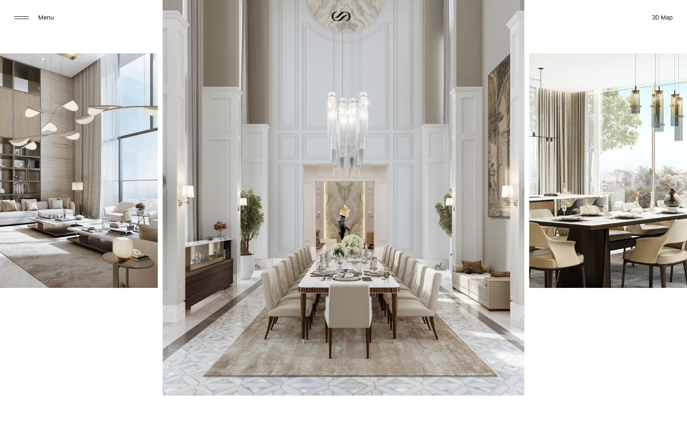</a> <a href="captures/desktop-04.jpg">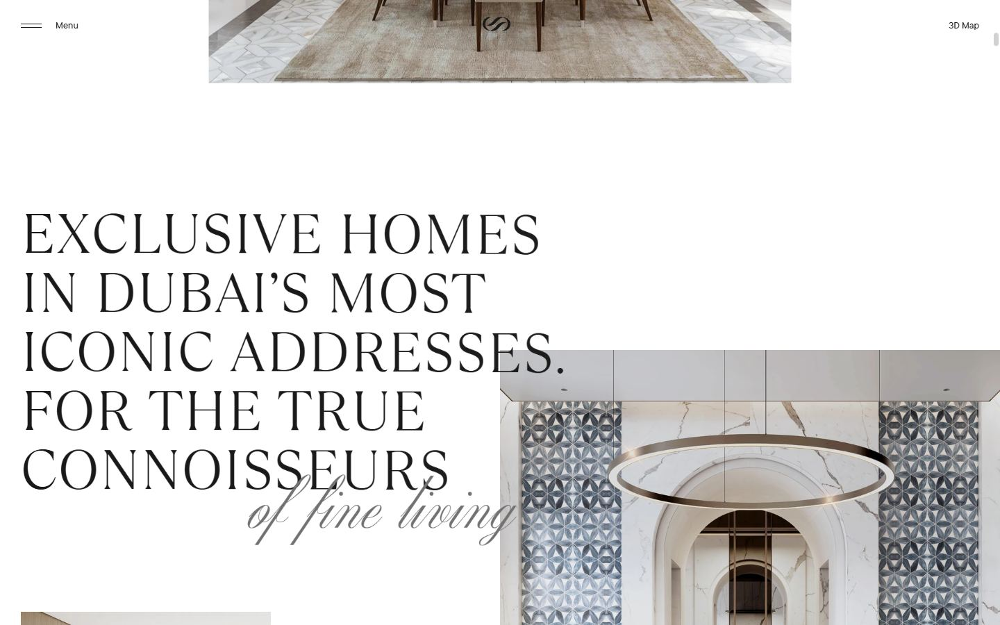</a> <a href="captures/desktop-05.jpg">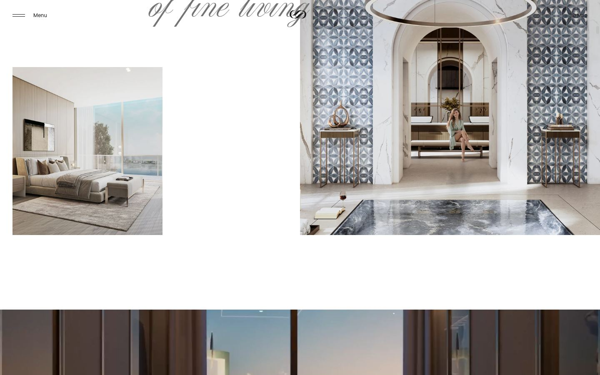</a> <a href="captures/desktop-06.jpg">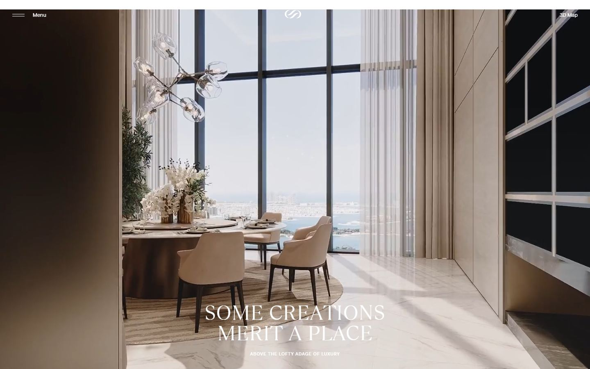</a> <a href="captures/desktop-07.jpg">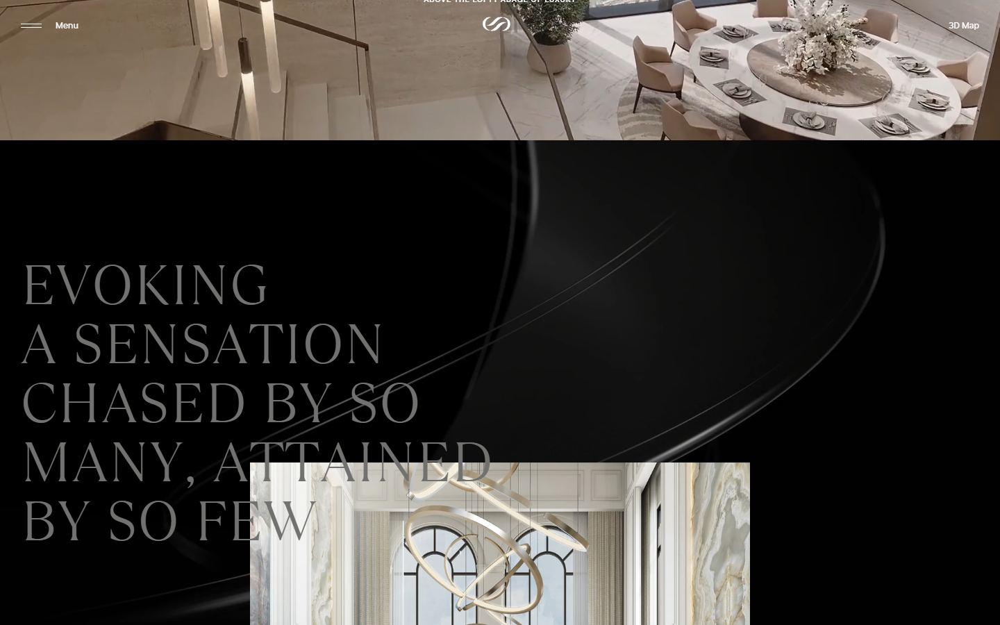</a> 

<a href="captures/page1-01.jpg">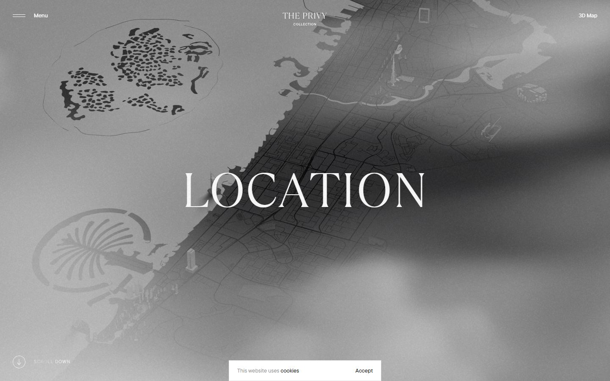</a> <a href="captures/page1-02.jpg">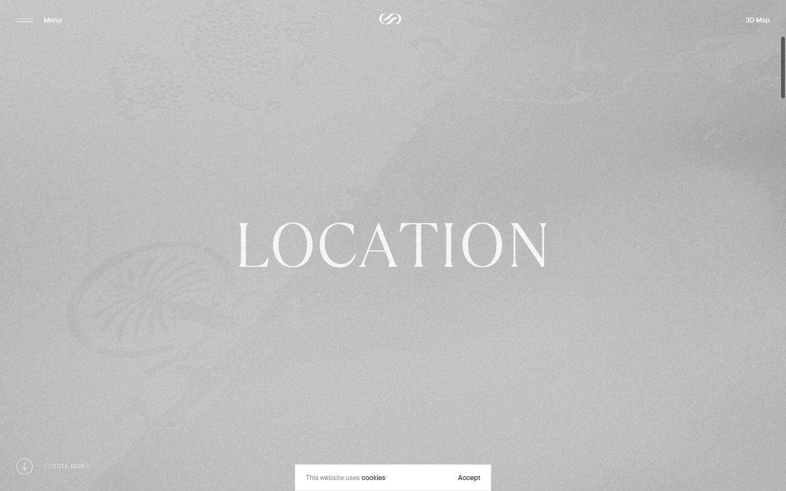</a> <a href="captures/page1-03.jpg">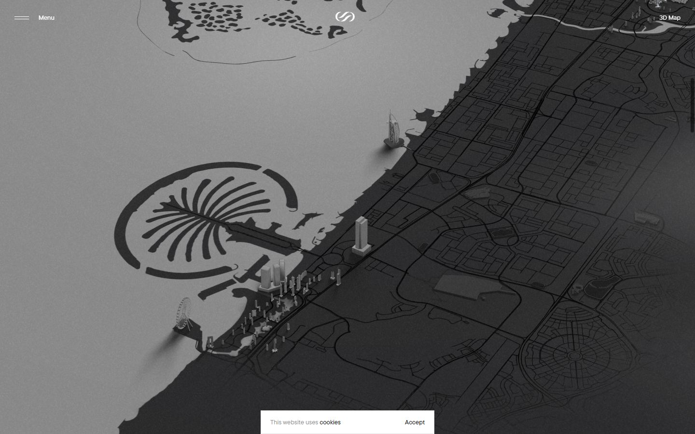</a> <a href="captures/page1-04.jpg">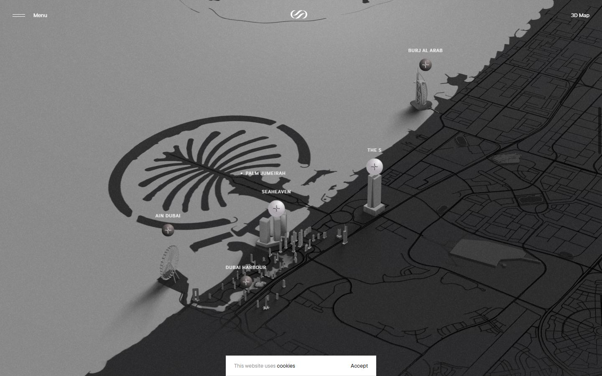</a> 

<a href="captures/mobile-01.jpg">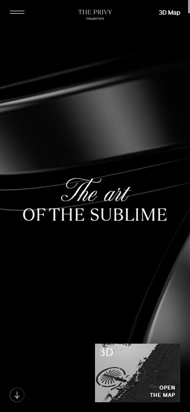</a> <a href="captures/mobile-02.jpg">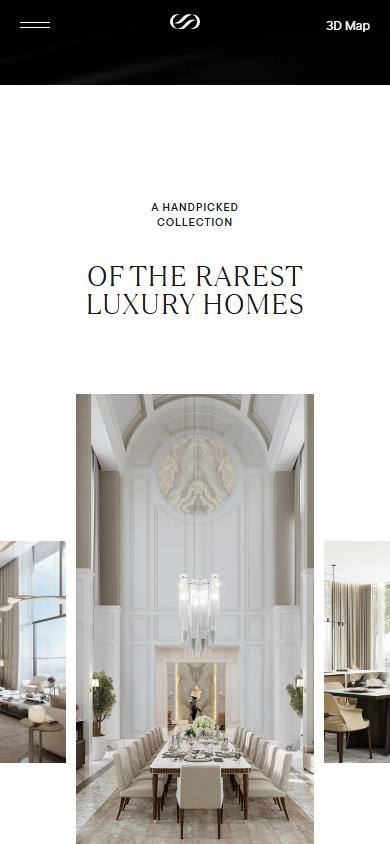</a> <a href="captures/mobile-03.jpg">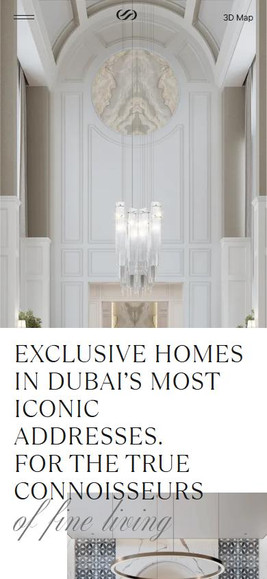</a> <a href="captures/mobile-04.jpg">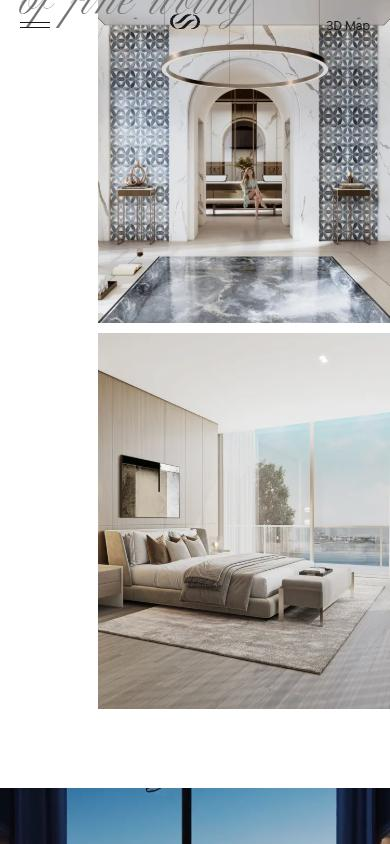</a> <a href="captures/mobile-05.jpg">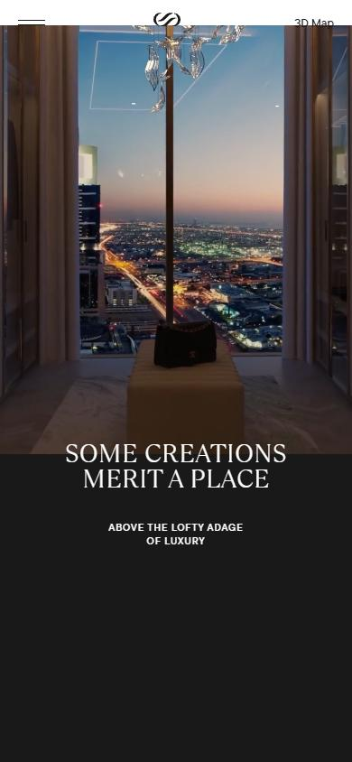</a> <a href="captures/mobile-06.jpg">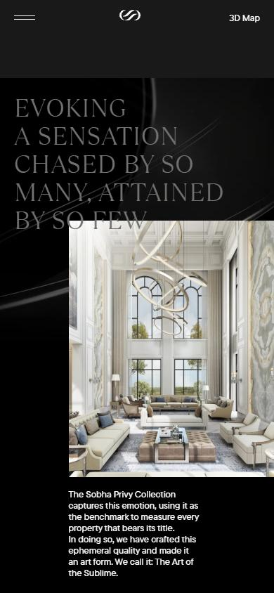</a> 

</details>

## Stack détectée
Barba.js, Keen slider, Locomotive Scroll, ScrollTrigger, SplitText/SplitType, Three.js, jQuery

## Design tokens
### Couleurs (fonds, pondérées par surface)
`#ffffff` · `#1a1919` · `#000000`
### Couleurs de texte
`#1a1919` · `#ffffff` · `#717170` · `#8c8c8c`
### Polices utilisées (par volume de texte)
TT Commons Pro · TT Ramillas · altesse-std-64pt
### Fichiers de police chargés
- TTCommonsPro-Md.woff2
- TTRamillas-Light.woff2
- TTCommonsPro-Db.woff2
- l
### Typographie
| Élément | Police | Taille | Graisse | Interligne | Interlettrage | Casse |
|---|---|---|---|---|---|---|
| h1 | "TT Ramillas", Helvetica, Arial, sans-serif | 80px | 300 | 85px | 1.6px | uppercase |
| h2 | "TT Ramillas", Helvetica, Arial, sans-serif | 50px | 300 | 50px | 1px | uppercase |
| h3 | "TT Ramillas", Helvetica, Arial, sans-serif | 114px | 300 | 110px | 2.28px | uppercase |
| p | "TT Commons Pro", Helvetica, Arial, sans-serif | 11px | 600 | 15px | 0.88px | uppercase |
| a | "TT Commons Pro", Helvetica, Arial, sans-serif | 13px | 500 | 16px | normal | none |
| body | "TT Commons Pro", Helvetica, Arial, sans-serif | 13px | 500 | 16px | normal | none |

### Échelle des tailles de texte
13px (76) · 11px (37) · 80px (34) · 100px (16) · 28px (13) · 114px (6) · 50px (3) · 342px (1) · 39px (1)
### Arrondis
15px · 30px · 10px
### Transitions CSS fréquentes
- cubic-bezier(0.7 0.4s ×12
- cubic-bezier(0.7 1s ×4
- cubic-bezier(0.6 0.4s ×1
- cubic-bezier(0.7 1.6s ×1
### Points de rupture (media queries)
668px · 667px · 980px · 568px · 416px · 1440px · 979px · 700px · 567px · 1px · 415px · 1439px
### Animations CSS (@keyframes)
move-left, logoGradient, footerText, gradient-flow
### Variables CSS (:root)
```css
--fos: -0.175em;
--foe: -0.125em;
--lh: var(--xxxl,1.25em) var(--n-xxxl,1.23077em);
--scale-px: max(0.5px,min(1px,calc(0.5px + 0.5 * ((var(--vw100) - 980px) / 220))));
--scale-rem: max(0.5rem,min(1rem,calc(0.5rem + 5 * ((var(--vw100) - 980px) / 220))));
--scale-em: 1em;
--scale-text-px: max(0.7px,min(1px,calc(0.7px + 0.3 * ((var(--vw100) - 980px) / 220))));
--scale-text-rem: max(0.7rem,min(1rem,calc(0.7rem + 3 * ((var(--vw100) - 980px) / 220))));
--scale-text-em: 1em;
--spacing: var(--xxxxl,calc(var(--scale-px) * 40)) var(--n-xxxxl,var(--xxl,calc(var(--scale-px) * 30)) var(--n-xxl,calc(var(--scale-px) * 20)));
--sm: initial;
--n-sm: ;
--md: initial;
--n-md: ;
--lg: initial;
--n-lg: ;
--xl: initial;
--n-xl: ;
--xxl: initial;
--n-xxl: ;
--xxxl: initial;
--n-xxxl: ;
--xxxxl: initial;
--n-xxxxl: ;
--vw: 1vw;
--vw100: 100vw;
--c-total-black: #000;
--c-total-black-rgb: 0,0,0;
--c-brand-black: #1a1919;
--c-brand-black-rgb: 26,25,25;
--c-gray: #717170;
--c-gray-rgb: 113,113,112;
--c-white: #fff;
--c-white-rgb: 255,255,255;
--c-error: #930000;
--c-error-rgb: 147,0,0;
--t-background: #fff;
--t-background-rgb: var(--c-white-rgb);
--t-background-alt: var(--c-white);
--t-background-alt-rgb: var(--c-white-rgb);
--t-line: #666;
--t-line-rgb: var(--c-brand-black-rgb);
--t-line-alt: rgba(var(--c-brand-black-rgb),0.1);
--t-line-alt-rgb: var(--c-brand-black-rgb);
--t-small: #666;
--t-small-rgb: var(--c-brand-black-rgb);
--t-text: #000;
--t-text-rgb: var(--c-brand-black-rgb);
--t-heading: #000;
--t-heading-rgb: var(--c-brand-black-rgb);
--t-primary: var(--t-turquoise);
--t-primary-rgb: var(--t-turquoise-rgb);
--t-primary-alt: var(--c-gray);
--t-primary-alt-rgb: var(--c-gray-rgb);
--t-button-primary-text: var(--t-background);
--t-button-primary-text-rgb: var(--t-background-rgb);
--t-button-primary-background: var(--t-heading);
--t-button-primary-background-rgb: var(--t-heading-rgb);
--t-button-primary-hover-text: var(--t-background);
--t-button-primary-hover-text-rgb: var(--t-background-rgb);
--t-button-primary-hover-background: var(--t-primary);
--t-button-primary-hover-background-rgb: var(--t-primary-rgb);
--t-button-primary-active-text: var(--t-background);
--t-button-primary-active-text-rgb: var(--t-background-rgb);
--t-button-primary-active-background: var(--t-primary);
--t-button-primary-active-background-rgb: var(--t-primary-rgb);
--t-button-primary-disabled-text: var(--t-background);
--t-button-primary-disabled-text-rgb: var(--t-background-rgb);
--t-button-primary-disabled-background: rgba(var(--t-primary-rgb),0.4);
--t-button-primary-disabled-background-rgb: var(--t-primary-rgb);
--t-button-primary-active-hover-text: var(--t-background);
--t-button-primary-active-hover-text-rgb: var(--t-background-rgb);
--t-button-primary-active-hover-background: var(--t-heading);
--t-button-primary-active-hover-background-rgb: var(--t-heading-rgb);
--t-button-outline-text: var(--t-heading);
--t-button-outline-text-rgb: var(--t-heading-rgb);
--t-button-outline-background: transparent;
--t-button-outline-border: var(--t-heading);
--t-button-outline-border-rgb: var(--t-heading-rgb);
--t-button-outline-hover-text: var(--t-heading);
```

## Structure de la home
Hauteur : 900 px — 1028 nœuds DOM — canvas 0, vidéos 12, images 55

| # | Bloc | Hauteur | Titre | Médias |
|---|---|---|---|---|
| 1 | section .section section--top section--full-heigh | 901 | The art of the sublime | 6 |
| 2 | section#about .section ui-light ui-background | 2724 | of the rarestluxury homes | 10 |
| 3 | section .section section--full-height ui-dark ui- | 900 | SOME CREATIONSMERIT A PLACE | 3 |
| 4 | section .section section--no-overflow ui-dark ui- | 1424 | EVOKINGA SENSATIONCHASED BY SOMANY, ATTAINEDBY SO FEW | 4 |
| 5 | section#sublime .section section--full-height section--to | 900 |  | 2 |
| 6 | section#collection .section section--no-overflow-clip ui-dar | 4772 | The three worlds | 2 |
| 7 | section#tenets .section section--no-overflow-clip ui-lig | 2700 |  | 2 |
| 8 | section .section ui-light l-expansive-section | 16284 | Tenets | 58 |
| 9 | section#selection .section ui-dark ui-background | 2760 |  | 0 |
| 10 | section#locations .section ui-dark ui-background-alt l-loca | 5850 | Projects location | 9 |
| 11 | section#the-idea .section section--no-overflow-clip ui-lig | 3711 |  | 4 |
| 12 | section#contact .section section--no-overflow-clip regist | 1081 |  | 2 |

**Navigation :** Menu Close · 3D Map · 3d map · Chapter 1 About · Chapter 2 Collection · Chapter 3 Tenets · Chapter 4 Selection · Chapter 5 Locations · Chapter 6 The idea · 3d open the map

**Boutons / CTA :** 

## SEO
- Title : Sobha Privy Collection – Luxury Villas & Penthouses in Dubai
- Description : Sobha Privy Collection: a handpicked selection of Dubai's rarest luxury villas, mansions and penthouses at the city's most iconic addresses.
- Langue : en — canonical : https://sobha-privy-collection.com/
- Open Graph : oui — JSON-LD : Organization
- H1 : 1 — images sans alt : 52/55

### Plan des titres
- H1 The art of the sublime
- H2 of the rarestluxury homes
- H2 SOME CREATIONSMERIT A PLACE
- H2 EVOKINGA SENSATIONCHASED BY SOMANY, ATTAINEDBY SO FEW
- H2 The three worlds
- H2 Tenets
- H3 Expansive Spaces
- H3 Iconic Addresses
- H3 Uncompromising Finesse
- H3 Exclusive Amenities
- H3 Exceptional service
- H3 Extraordinary Privacy
- H3 A cut Above
- H2 Projects location

## Performance (mesure locale, Chrome headless, connexion non bridée)
- TTFB 117 ms · LCP 436 ms (P.preloader__content__cover) · CLS 0.01 · load 1776 ms
- 123 requêtes · 26104 Ko transférés
- Par type : Document 1 req / 40 Ko, Stylesheet 4 req / 35 Ko, Image 82 req / 5391 Ko, Other 3 req / 39 Ko, Script 3 req / 173 Ko, Font 4 req / 231 Ko, Media 26 req / 20195 Ko
- Plus gros fichiers :
- 5831 Ko — Media — https://sobha-privy-collection.com/uploads/privacy.mp4
- 5263 Ko — Media — https://sobha-privy-collection.com/uploads/expensive_spaces.mp4
- 3876 Ko — Media — https://sobha-privy-collection.com/uploads/teaser.mp4
- 2787 Ko — Media — https://sobha-privy-collection.com/uploads/ribbons.mp4
- 1314 Ko — Media — https://sobha-privy-collection.com/uploads/a_place_above.mp4
- 584 Ko — Image — https://sobha-privy-collection.com/assets/images/media/landing/12.register/background@xxl.webp
- 502 Ko — Image — https://sobha-privy-collection.com/assets/images/media/landing/7.tenets/background@xxl.webp
- 481 Ko — Media — https://sobha-privy-collection.com/uploads/space-table.mp4
- Services tiers : use.typekit.net, p.typekit.net

## Mobile
- H1 : {'size': '36px', 'lineHeight': '40px'} · corps : 13px · débordement horizontal : False · menu burger : True

## Fichiers
- `captures/` : arrivée, scroll desktop (1440×900), pleine page, pages internes, mobile (390×844 @2x) ; vidéo de scroll dans la release GitHub « videos » (lien en haut de fiche)
- `page.html` : DOM rendu · `styles.css` : CSS chargé · `scripts/` : JS chargé (index dans `_index.json`) · `shaders.glsl` : shaders extraits · `rea-bundle.json` : analyse REA du bundle (chunks, routes, endpoints)

## Pages internes capturées
- https://sobha-privy-collection.com/location
