# Boc.Studio

- Site : [https://boc.studio/](https://boc.studio/) — [aperçu statique local](apercu.html)
- Capturé le : 2026-11-02 — statut : ok
- Vidéo de scroll : [▶ ouvrir](https://github.com/t-baudry/bibliotheque-web/releases/download/videos/044-boc-studio.webm)

<a href="captures/desktop-00-arrivee.jpg">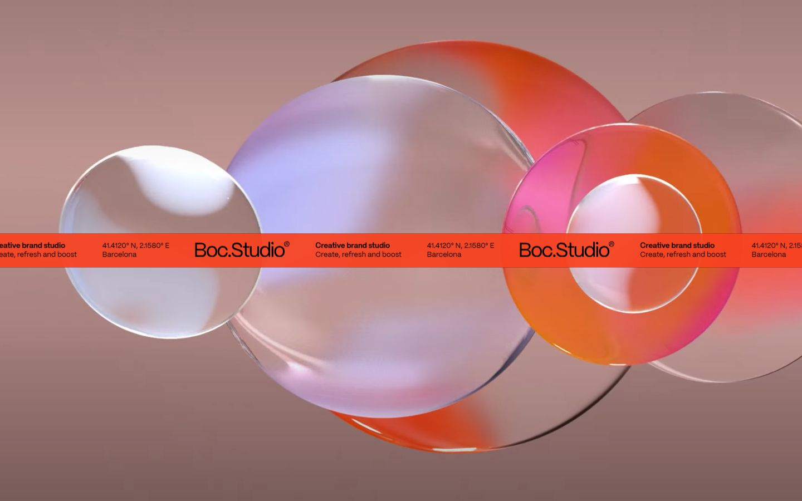</a> 

<details><summary>Toutes les captures</summary>

<a href="captures/desktop-01.jpg">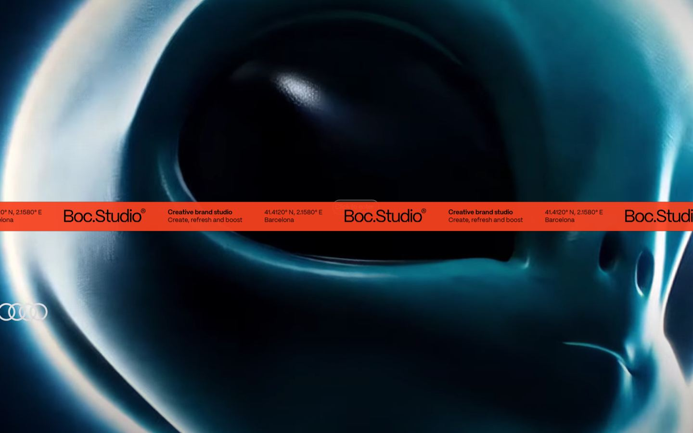</a> <a href="captures/desktop-02.jpg">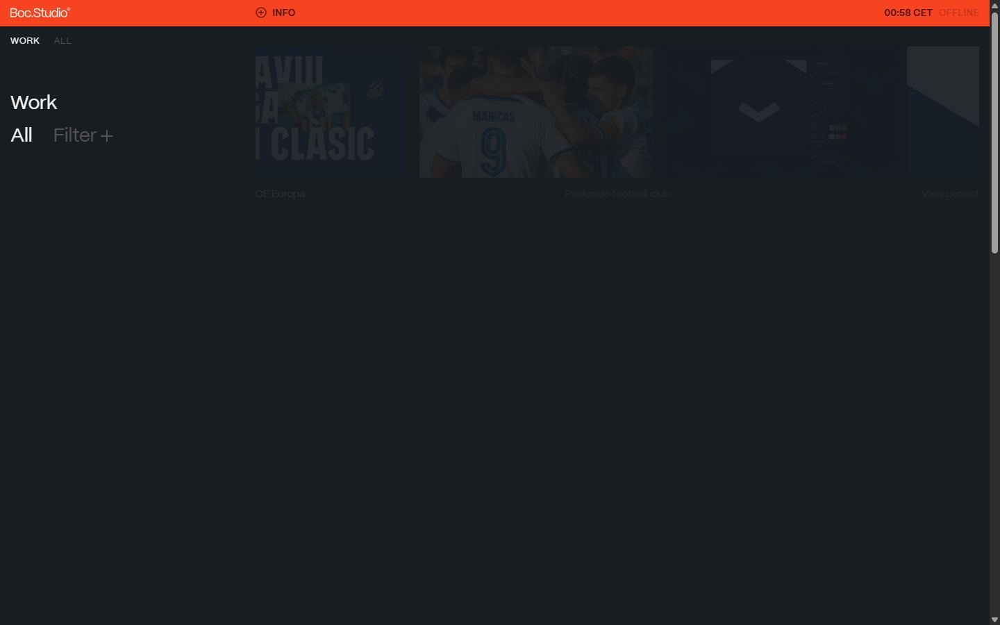</a> <a href="captures/desktop-03.jpg">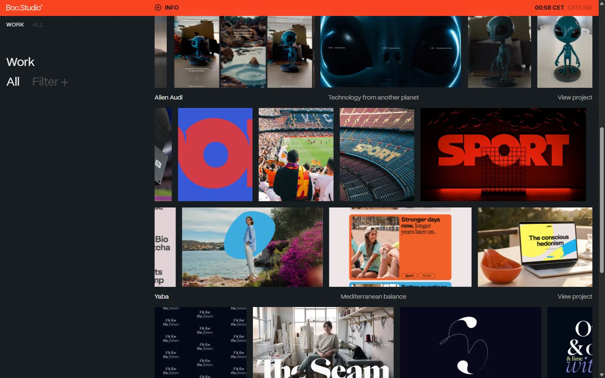</a> <a href="captures/desktop-04.jpg">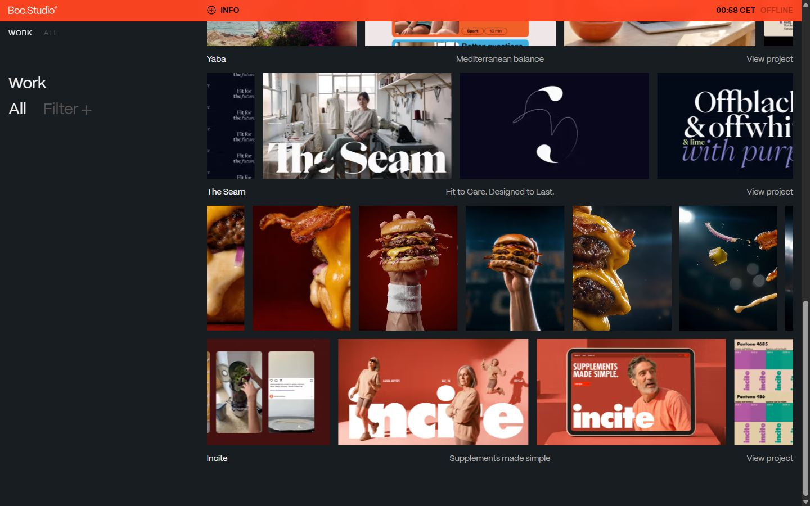</a> <a href="captures/desktop-pleine-page.jpg">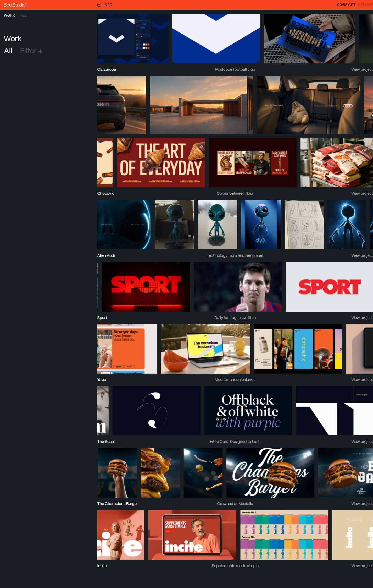</a> 

<a href="captures/page1-01.jpg">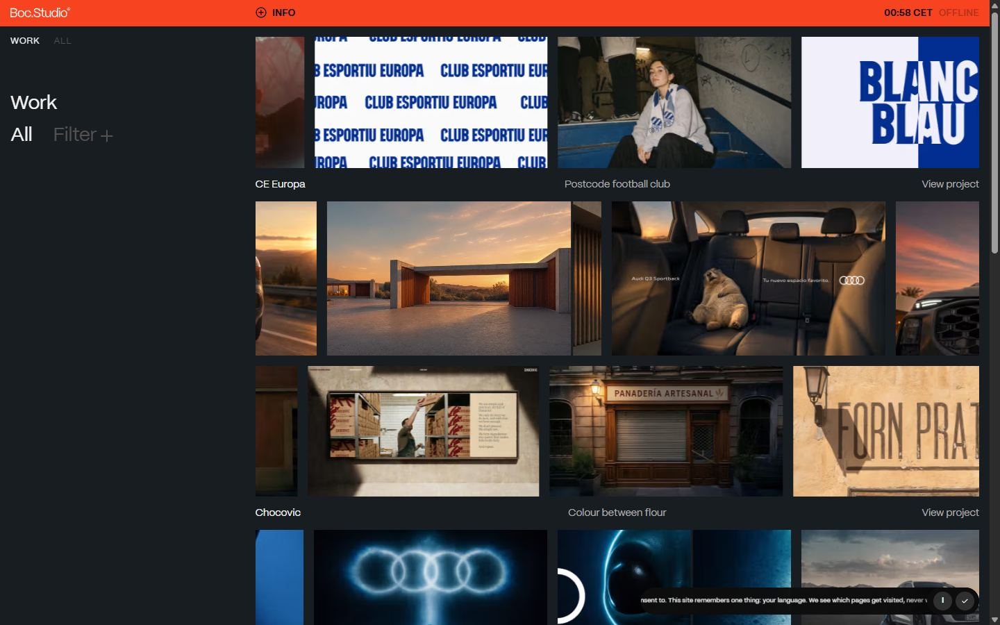</a> <a href="captures/page1-02.jpg">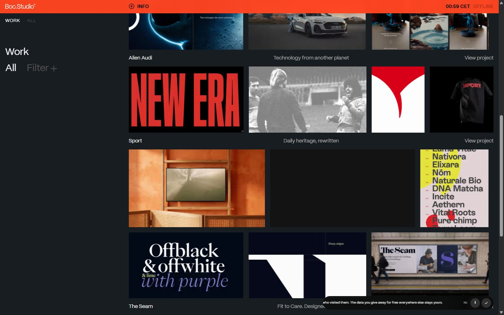</a> <a href="captures/page1-03.jpg">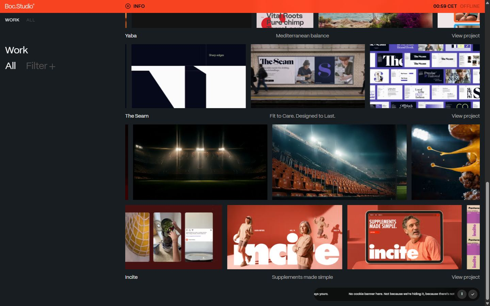</a> 

<a href="captures/mobile-01.jpg">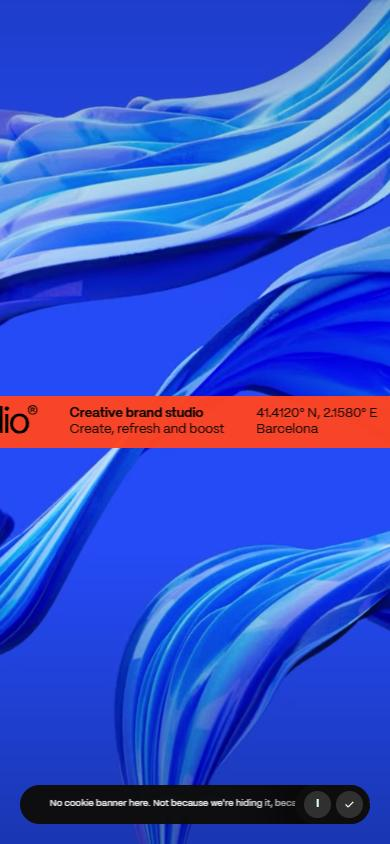</a> <a href="captures/mobile-02.jpg">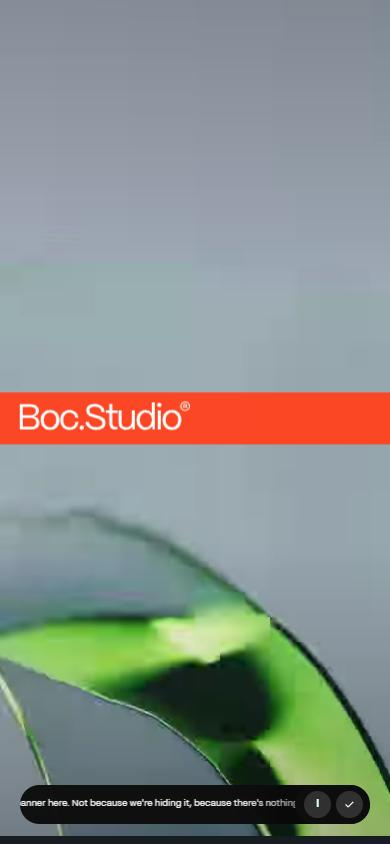</a> <a href="captures/mobile-03.jpg">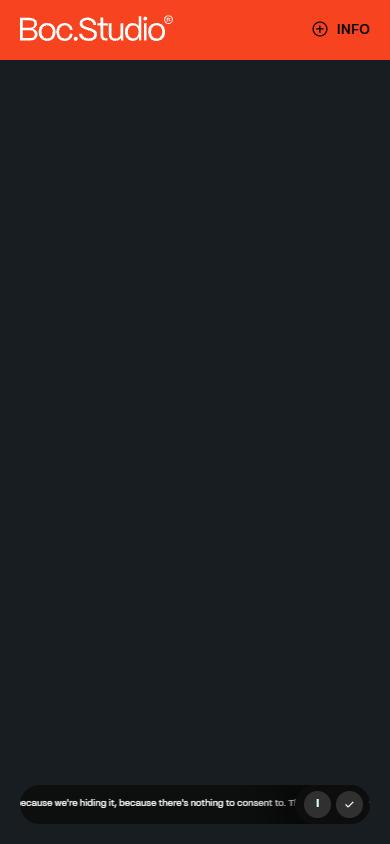</a> <a href="captures/mobile-04.jpg">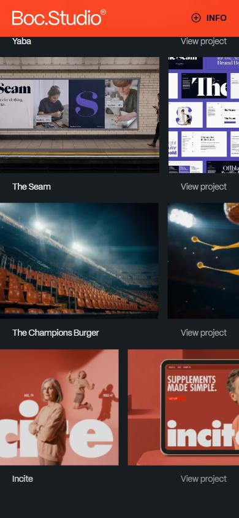</a> <a href="captures/mobile-05.jpg">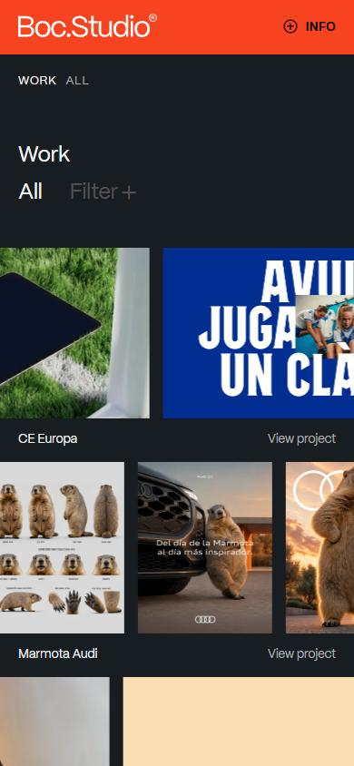</a> <a href="captures/mobile-06.jpg">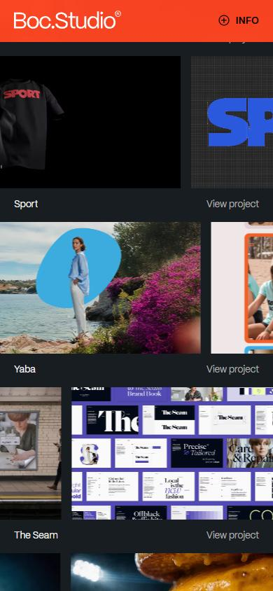</a> 

</details>

## Stack détectée
CMS Contentful, CMS Sanity, GSAP, Lenis, Next.js, React, ScrollTrigger, SplitText/SplitType, Virtual scroll, WebGL

Shaders GLSL personnalisés extraits : 8 (voir `shaders.glsl`)

## Design tokens
### Couleurs (fonds, pondérées par surface)
`#181d21` · `#545151` · `#ff4421`
### Couleurs de texte
`#adadad` · `#545151` · `#f3f3f3` · `#000000`
### Polices utilisées (par volume de texte)
ppMori
### Fichiers de police chargés
- PPMori_Regular-s.p.17eq0qxy1kc8k.woff2
- PPMori_SemiBold-s.p.0jstn4ve9kbmu.woff2
### Typographie
| Élément | Police | Taille | Graisse | Interligne | Interlettrage | Casse |
|---|---|---|---|---|---|---|
| h1 | ppMori, "ppMori Fallback", system-ui, -apple-syste | 28.259px | 400 | 28.259px | -0.56518px | none |
| a | ppMori, "ppMori Fallback", system-ui, -apple-syste | 16px | 400 | 24px | normal | none |
| button | ppMori, "ppMori Fallback", system-ui, -apple-syste | 16px | 400 | 24px | normal | uppercase |
| li | ppMori, "ppMori Fallback", system-ui, -apple-syste | 28.26px | 400 | 33.912px | -0.5652px | none |
| body | ppMori, "ppMori Fallback", system-ui, -apple-syste | 16px | 400 | 24px | normal | none |

### Échelle des tailles de texte
16px (104) · 13px (36) · 15px (27) · 28.26px (8) · 28.259px (3)
### Arrondis
aucun (angles droits)
### Transitions CSS fréquentes
- cubic-bezier(1 0.4s ×415
- cubic-bezier(0.4 0.15s ×11
- cubic-bezier(0.4 0.4s ×2
### Points de rupture (media queries)
1024px · 48rem · 64rem · 1550px · 40rem · 80rem · 96rem
### Animations CSS (@keyframes)
boc-bump-left, boc-bump-arrow, egg-wave, egg-scatter, boc-marquee, boc-404-marquee, boc-404-back-marquee, bocBarFadeIn, bocMarqueeIn, boc-arrow-shot-mobile, boc-arrow-shot-desktop
### Variables CSS (:root)
```css
--font-sans: var(--font-pp-mori), system-ui, -apple-system, BlinkMacSystemFont, "Segoe UI", Roboto, sans-serif;
--font-mono: ui-monospace, SFMono-Regular, Menlo, Monaco, Consolas, "Liberation Mono", "Courier New", monospace;
--color-black: #000;
--color-white: #fff;
--spacing: .25rem;
--text-xs: .75rem;
--text-xs--line-height: calc(1 / .75);
--text-sm: .875rem;
--text-sm--line-height: calc(1.25 / .875);
--text-base: 1rem;
--text-base--line-height: calc(1.5 / 1);
--text-2xl: 1.5rem;
--text-2xl--line-height: calc(2 / 1.5);
--text-3xl: 1.875rem;
--text-3xl--line-height: calc(2.25 / 1.875);
--text-4xl: 2.25rem;
--text-4xl--line-height: calc(2.5 / 2.25);
--text-5xl: 3rem;
--text-5xl--line-height: 1;
--text-7xl: 4.5rem;
--text-7xl--line-height: 1;
--font-weight-normal: 400;
--font-weight-medium: 500;
--font-weight-semibold: 600;
--tracking-tight: -.025em;
--tracking-widest: .1em;
--ease-in: cubic-bezier(.4, 0, 1, 1);
--ease-out: cubic-bezier(0, 0, .2, 1);
--default-transition-duration: .15s;
--default-transition-timing-function: cubic-bezier(.4, 0, .2, 1);
--default-font-family: var(--font-sans);
--default-mono-font-family: var(--font-mono);
--color-boc-orange: #ff4421;
--color-boc-canvas: #181d21;
--color-boc-text-on-orange: #000;
--color-boc-text-on-canvas: #f3f3f3;
--color-boc-muted: #adadad;
--color-boc-gray: #afabab;
--color-boc-muted-2: #545151;
--color-boc-rule: #181d21;
--color-boc-online: #b53219;
--color-boc-muted-on-orange: #b53219;
--color-boc-info-shade: #b62f17;
--color-boc-info-label: #85210f;
--color-boc-offblack: #181d21;
--color-boc-black: #111314;
--grid-gutter: 15px;
--boc-page-px: 15px;
--boc-image-radius: 0px;
--boc-sidebar-w: min(calc((100% - 135px) / 4 + 45px), 390.75px);
--ease-boc-brisk: cubic-bezier(.4, 0, .2, 1);
--ease-boc-grow: cubic-bezier(1, 0, .47, 1.25);
--ease-boc-reveal: cubic-bezier(.25, .1, .25, 1);
--color-boc-btn-grey: #2a3137;
--color-boc-btn-grey-hover: #21272c;
--lightningcss-light: ;
--lightningcss-dark: initial;
```

## Structure de la home
Hauteur : 2267 px — 1891 nœuds DOM — canvas 1, vidéos 1, images 406

| # | Bloc | Hauteur | Titre | Médias |
|---|---|---|---|---|
| 1 | article .flex flex-col | 2206 | Work | 406 |
| 2 | section .bg-boc-canvas fixed inset-0 z-40 h-[100s | 900 |  | 1 |

**Navigation :** 

**Boutons / CTA :** 

## SEO
- Title : Boc.Studio — Creative brand studio in Barcelona
- Description : A Barcelona creative brand studio. We create, refresh and boost brands through identity, creative direction, motion design and AI production.
- Langue : en — canonical : https://boc.studio/
- Open Graph : oui — JSON-LD : Organization, WebSite
- H1 : 1 — images sans alt : 203/406

### Plan des titres
- H1 Work

## Performance (mesure locale, Chrome headless, connexion non bridée)
- TTFB 18 ms · LCP 976 ms (IMG.object-cover) · CLS 0.005 · load 2218 ms
- 2825 requêtes · 19536 Ko transférés
- Par type : Document 2 req / 518 Ko, Stylesheet 2 req / 11 Ko, Image 778 req / 1617 Ko, Script 40 req / 327 Ko, Media 28 req / 16864 Ko, Font 4 req / 73 Ko, Fetch 37 req / 29 Ko, Other 1934 req / 96 Ko
- Plus gros fichiers :
- 2453 Ko — Media — https://stream.mux.com/1s8r6u7NYws8ETAaQ88WbVwUMUIwMqnzIJIXpu2nJoo/480p.mp4
- 2426 Ko — Media — https://stream.mux.com/Vl2wKX8vMZ3XqHPcq6l6rtCpK29gzirQQYYhh800pxO4/480p.mp4
- 1376 Ko — Media — https://stream.mux.com/g3uhWvuiHK02fXIE39QPVbXJW01R8BAGE4iqXFasz48q8/480p.mp4
- 1286 Ko — Media — https://stream.mux.com/9hJmxz52q3YDpy9RtIL39kml4D7GSP7F2kAuev95F01g/480p.mp4
- 1057 Ko — Media — https://stream.mux.com/DGcCqpKooDeSKjxI1EIXLkGef1iK8tn2G00XC5qYYoBo/480p.mp4
- 1056 Ko — Media — https://stream.mux.com/WTA00BYkIrv00vfUqq40001W7KSWeTJfH8I3kXSQ2KGTBGk/480p.mp4
- 1048 Ko — Media — https://stream.mux.com/mteCrIL5o11WMGFzqpQsTjoUCmXPOufPUs8I28GsPLc/480p.mp4
- 966 Ko — Media — https://stream.mux.com/E1lCsA00jVGa7nxkTaOUiMfgZrEDsSXg901fGQ3mTh6JY/480p.mp4
- Services tiers : cdn.sanity.io, stream.mux.com

## Mobile
- H1 : {'size': '23.95px', 'lineHeight': '23.95px'} · corps : 16px · débordement horizontal : False · menu burger : False

## Fichiers
- `captures/` : arrivée, scroll desktop (1440×900), pleine page, pages internes, mobile (390×844 @2x) ; vidéo de scroll dans la release GitHub « videos » (lien en haut de fiche)
- `page.html` : DOM rendu · `styles.css` : CSS chargé · `scripts/` : JS chargé (index dans `_index.json`) · `shaders.glsl` : shaders extraits · `rea-bundle.json` : analyse REA du bundle (chunks, routes, endpoints)

## Incidents de capture
- goto load: page.goto: Timeout 60000ms exceeded.

## Pages internes capturées
- https://boc.studio/work
