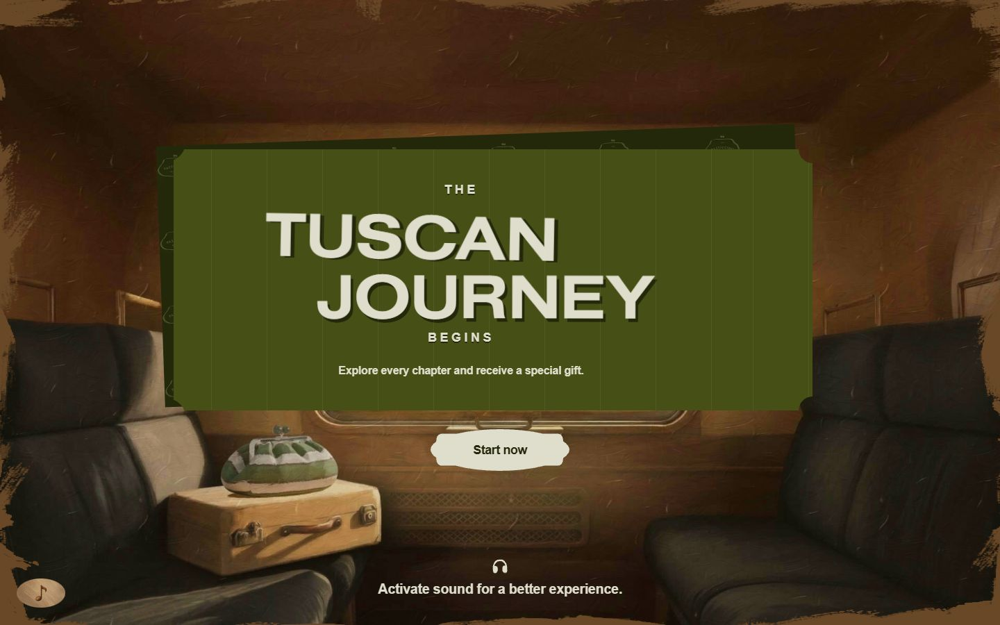
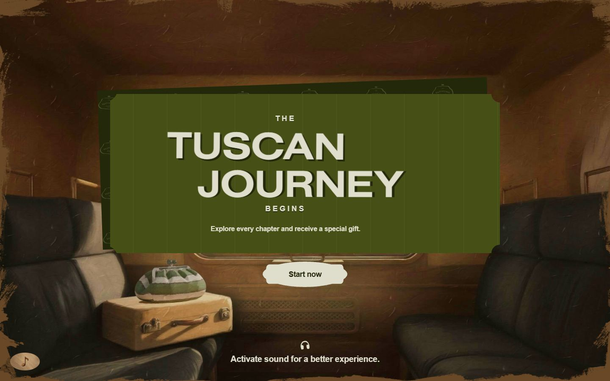
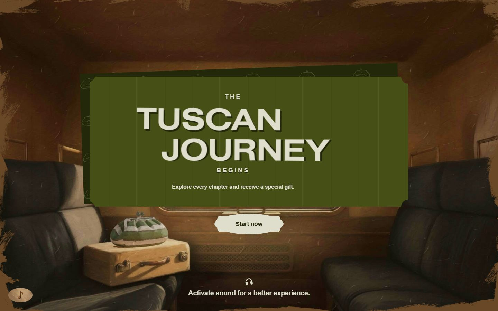
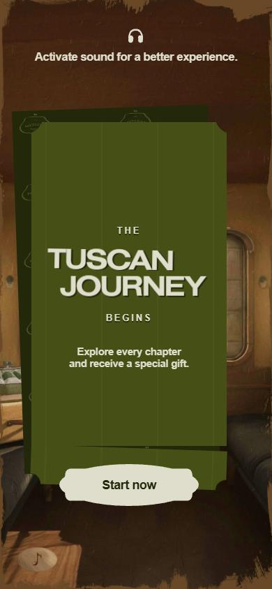
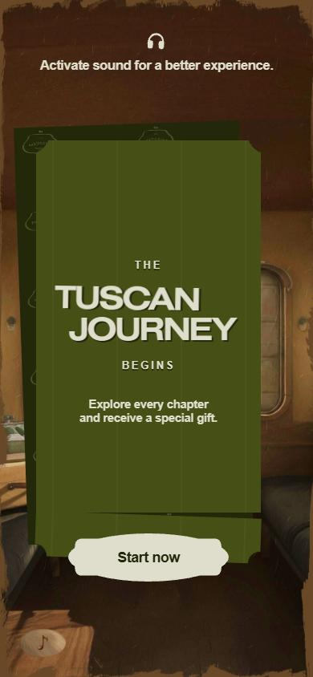
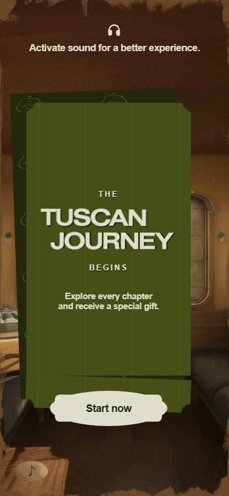
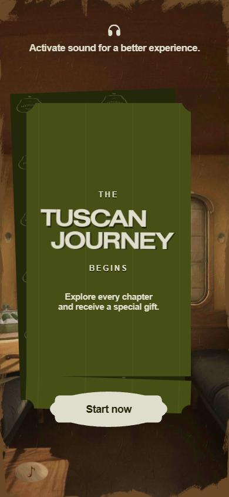

# The Tuscan Journey Begins

- Site : [https://weekend-mm-2026-pasticcino-bag-master.monogrid.io/en/](https://weekend-mm-2026-pasticcino-bag-master.monogrid.io/en/) — [aperçu statique local](apercu.html)
- Capturé le : 2026-11-03 — statut : ok
- Vidéo de scroll : [▶ ouvrir](https://github.com/t-baudry/bibliotheque-web/releases/download/videos/050-the-tuscan-journey-begins.webm)

<a href="captures/desktop-00-arrivee.jpg"></a> 

<details><summary>Toutes les captures</summary>

<a href="captures/desktop-01.jpg"></a> <a href="captures/desktop-02.jpg"></a> <a href="captures/desktop-03.jpg"></a> <a href="captures/desktop-04.jpg"></a> <a href="captures/desktop-05.jpg"></a> <a href="captures/desktop-06.jpg"></a> <a href="captures/desktop-07.jpg"></a> 


<a href="captures/mobile-01.jpg"></a> <a href="captures/mobile-02.jpg"></a> <a href="captures/mobile-03.jpg"></a> <a href="captures/mobile-04.jpg"></a> <a href="captures/mobile-05.jpg"></a> <a href="captures/mobile-06.jpg"></a> 

</details>

## Stack détectée
CMS Contentful, GSAP, Howler (audio), Lottie, ScrollTrigger, SplitText/SplitType, Three.js, Vue, WebGL, jQuery

Shaders GLSL personnalisés extraits : 9 (voir `shaders.glsl`)

## Design tokens
### Couleurs (fonds, pondérées par surface)
`#ffffff` · `#465016`
### Couleurs de texte
`#dfddcb` · `#ffffff` · `#23280b`
### Polices utilisées (par volume de texte)
NimbusSans · NimbusSansExtd · Nimbus · Nimbus Sans L
### Fichiers de police chargés
- NimbusSanL-Reg-2eITmUn-.woff2
- NimbusSanExtD-Bol-7i44fy56.woff2
- NimbusSanL-Bol-DJVDeZYY.woff2
### Typographie
| Élément | Police | Taille | Graisse | Interligne | Interlettrage | Casse |
|---|---|---|---|---|---|---|
| h2 | NimbusSansExtd, sans-serif | 92px | 700 | 85.56px | -0.828px | uppercase |
| p | NimbusSans, sans-serif | 20.25px | 700 | 24.3px | -0.5625px | none |
| button | Nimbus | 16px | 400 | 24px | normal | none |
| body | Nimbus | 16px | 400 | 24px | normal | none |

### Échelle des tailles de texte
16px (6) · 18.0044px (2) · 92px (2) · 20.25px (1) · 27px (1) · 18px (1)
### Arrondis
50% · 8px · 15px
### Transitions CSS fréquentes
- cubic-bezier(0.55 0.6s ×4
- ease 0.3s ×2
### Points de rupture (media queries)
48rem · 639px · 0.1px · 640px · 768px · 80rem · 40rem · 64rem · 90rem · 120rem · 1023px
### Animations CSS (@keyframes)
vue-boost-marquee-b09415cb, vue-boost-marquee-reset-b09415cb, vue-boost-marquee-reverse-b09415cb, vue-boost-marquee-vertical-b09415cb, vue-boost-marquee-vertical-reverse-b09415cb, vue-boost-marquee-rtl-b09415cb, vue-boost-marquee-rtl-reverse-b09415cb, vue-boost-marquee-rtl-vertical-reverse-b09415cb, spinner-rotate-ff76210b, spinner-dash-ff76210b
### Variables CSS (:root)
```css
--un-text-opacity: 1;
```

## Structure de la home
Hauteur : 900 px — 183 nœuds DOM — canvas 1, vidéos 1, images 1

| # | Bloc | Hauteur | Titre | Médias |
|---|---|---|---|---|
| 1 | div#app . | 900 |  | 2 |
| 2 | div .modal-root fixed inset-0 z-5 flex items- | 900 | TUSCAN JOURNEY | 0 |

**Navigation :** 

**Boutons / CTA :** 

## SEO
- Title : Intro | Pasticcino Bag World Tour 2026
- Description : intro-description
- Langue : en — canonical : https://weekend-mm-2026-pasticcino-bag-master.monogrid.io/
- Open Graph : oui — JSON-LD : aucun
- H1 : 0 — images sans alt : 1/1

### Plan des titres
- H2 TUSCAN JOURNEY

## Performance (mesure locale, Chrome headless, connexion non bridée)
- TTFB 209 ms · LCP 5644 ms (DIV.absolute) · CLS 0 · load 1147 ms
- 171 requêtes · 15557 Ko transférés
- Par type : Document 1 req / 4 Ko, Stylesheet 9 req / 18 Ko, Script 39 req / 1099 Ko, XHR 5 req / 121 Ko, Image 10 req / 255 Ko, Other 89 req / 300 Ko, Ping 1 req / 0 Ko, Font 3 req / 98 Ko, Fetch 13 req / 13660 Ko, Media 1 req / 0 Ko
- Plus gros fichiers :
- 9706 Ko — Fetch — https://weekend-mm-2026-pasticcino-bag-master.monogrid.io/static/stanza_tessuti_v2_15fps_1280p_ionly-B-C9vGfG.mp4
- 1988 Ko — Fetch — https://weekend-mm-2026-pasticcino-bag-master.monogrid.io/static/treno_loop_v1_15fps-CHz8_3np.mp4
- 512 Ko — Fetch — https://weekend-mm-2026-pasticcino-bag-master.monogrid.io/static/diffuse-tessuti-8kOGqr1g.ktx2
- 353 Ko — Script — https://weekend-mm-2026-pasticcino-bag-master.monogrid.io/static/AppLayout-Cvr_wOOM.js
- 304 Ko — Fetch — https://weekend-mm-2026-pasticcino-bag-master.monogrid.io/static/normal-overlay-oorSCCGY.ktx2
- 298 Ko — Fetch — https://weekend-mm-2026-pasticcino-bag-master.monogrid.io/static/diffuse-train-XYks5T_N.ktx2
- 287 Ko — Fetch — https://weekend-mm-2026-pasticcino-bag-master.monogrid.io/static/bump-overlay-DPipPg9f.ktx2
- 241 Ko — Fetch — https://weekend-mm-2026-pasticcino-bag-master.monogrid.io/libs/basis/basis_transcoder.wasm
- Services tiers : tags.tiqcdn.com, cdn.iubenda.com, www.googletagmanager.com, region1.google-analytics.com

## Mobile
- H1 : None · corps : 16px · débordement horizontal : False · menu burger : False

## Fichiers
- `captures/` : arrivée, scroll desktop (1440×900), pleine page, pages internes, mobile (390×844 @2x) ; vidéo de scroll dans la release GitHub « videos » (lien en haut de fiche)
- `page.html` : DOM rendu · `styles.css` : CSS chargé · `scripts/` : JS chargé (index dans `_index.json`) · `shaders.glsl` : shaders extraits · `rea-bundle.json` : analyse REA du bundle (chunks, routes, endpoints)
