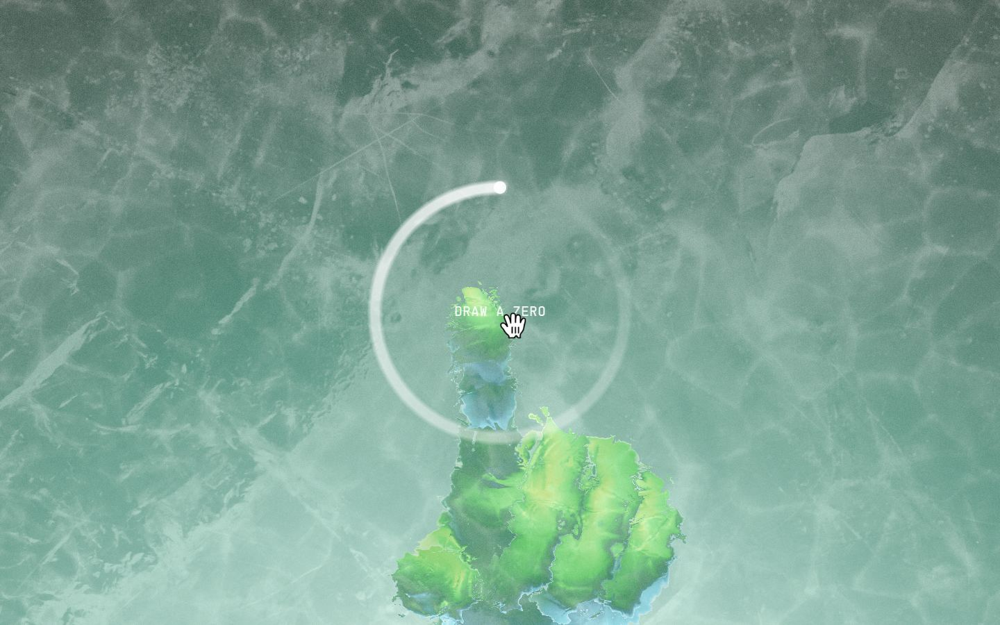
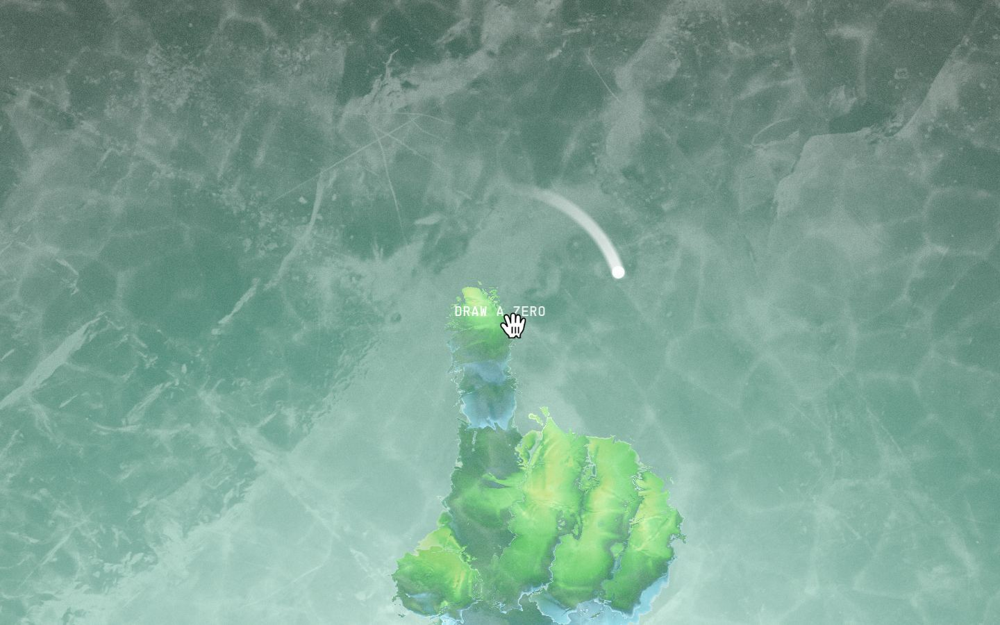
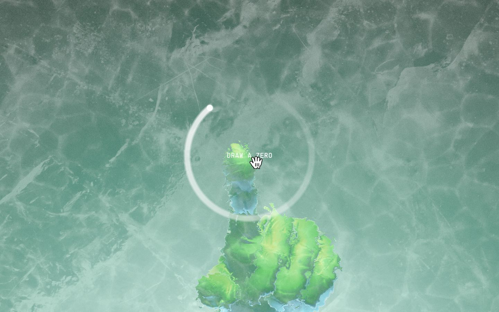
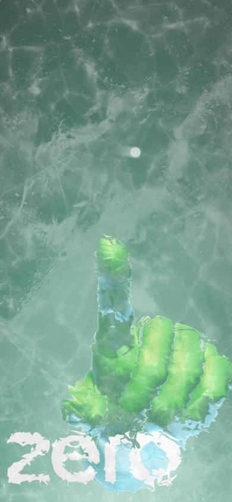
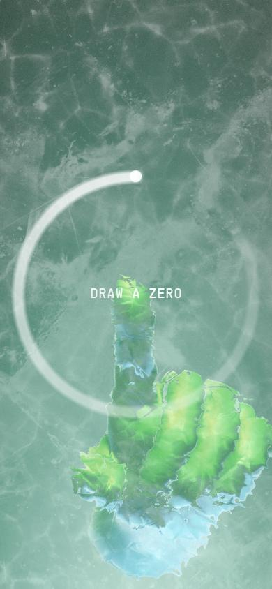
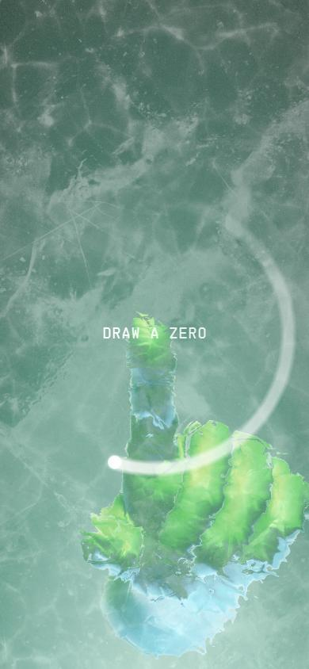
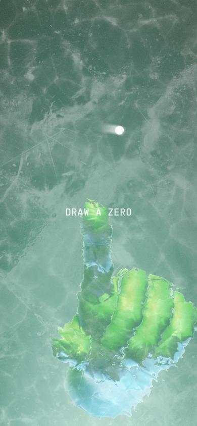
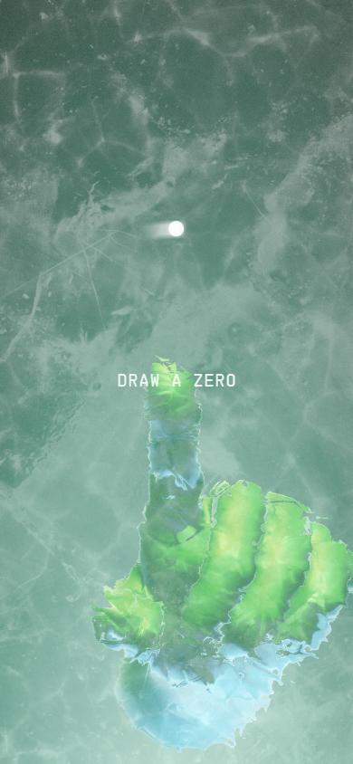

# Why Zero

- Site : [https://why.zero.university/](https://why.zero.university/) — [aperçu statique local](apercu.html)
- Capturé le : 2026-11-03 — statut : ok
- Vidéo de scroll : [▶ ouvrir](https://github.com/t-baudry/bibliotheque-web/releases/download/videos/056-why-zero.webm)

<a href="captures/desktop-00-arrivee.jpg"></a> 

<details><summary>Toutes les captures</summary>

<a href="captures/desktop-01.jpg"></a> <a href="captures/desktop-02.jpg"></a> <a href="captures/desktop-03.jpg"></a> <a href="captures/desktop-04.jpg"></a> <a href="captures/desktop-05.jpg"></a> <a href="captures/desktop-06.jpg"></a> <a href="captures/desktop-07.jpg"></a> 


<a href="captures/mobile-01.jpg"></a> <a href="captures/mobile-02.jpg"></a> <a href="captures/mobile-03.jpg"></a> <a href="captures/mobile-04.jpg"></a> <a href="captures/mobile-05.jpg"></a> <a href="captures/mobile-06.jpg"></a> 

</details>

## Stack détectée
GSAP, Howler (audio), Lil-GUI/Tweakpane (debug), Postprocessing, ScrollTrigger, SplitText/SplitType, Stats.js, Three.js, WebGL

Shaders GLSL personnalisés extraits : 40 (voir `shaders.glsl`)

## Design tokens
### Couleurs (fonds, pondérées par surface)
`#1c4839` · `#d4d4d4` · `#201d1d` · `#ffffff`
### Couleurs de texte
`#ffffff`
### Polices utilisées (par volume de texte)
PP Supply Mono · Supply Sans
### Fichiers de police chargés
- PPSupplySans-Regular.otf
- PPSupplyMono-Regular.otf
### Typographie
| Élément | Police | Taille | Graisse | Interligne | Interlettrage | Casse |
|---|---|---|---|---|---|---|
| button | "PP Supply Mono", "Supply Sans", monospace | 10px | 400 | normal | 1.2px | uppercase |
| body | "Times New Roman" | 16px | 400 | normal | normal | none |

### Échelle des tailles de texte
12px (5) · 10px (5) · 16px (2) · 150.003px (1) · 14.4px (1) · 20px (1) · 16.8px (1)
### Arrondis
999px · 50%
### Transitions CSS fréquentes
- ease 0.4s ×140
- ease 0.2s ×10
- ease 0.35s ×2
- ease 0.25s ×1
- ease 0.5s ×1
### Points de rupture (media queries)
768px · 767px
### Animations CSS (@keyframes)
xpStrokeGlow, xpFlashWhite, xpFlashBlack, next-btn-ripple, scroll-indicator-bob, hud-status-shimmer, hud-status-chevron-bounce, scroll-ruler-nav-spin
### Variables CSS (:root)
```css
--lightningcss-light: initial;
--lightningcss-dark: ;
```

## Structure de la home
Hauteur : 900 px — 397 nœuds DOM — canvas 1, vidéos 2, images 2

| # | Bloc | Hauteur | Titre | Médias |
|---|---|---|---|---|
| 1 | div#bg-gradient . | 900 |  | 0 |
| 2 | canvas#webgl . | 900 |  | 0 |
| 3 | div#ui-container . | 900 |  | 2 |

**Navigation :** 

**Boutons / CTA :** 

## SEO
- Title : Zero — Human Infrastructure to Get Hired
- Description : Zero is building human infrastructure for the AI era. Learn, build, and get hired through immersive, AI-native experiences designed by reverse-engineering real jobs.
- Langue : en — canonical : https://why.zero.university/
- Open Graph : oui — JSON-LD : aucun
- H1 : 0 — images sans alt : 0/2

### Plan des titres
- (rien relevé)

## Performance (mesure locale, Chrome headless, connexion non bridée)
- TTFB 235 ms · LCP 452 ms (DIV) · CLS 0 · load 818 ms
- 59 requêtes · 6298 Ko transférés
- Par type : Document 1 req / 3 Ko, Stylesheet 2 req / 8 Ko, Script 2 req / 507 Ko, Font 2 req / 41 Ko, Image 4 req / 10 Ko, Fetch 30 req / 4297 Ko, Other 2 req / 160 Ko, Media 2 req / 294 Ko, XHR 14 req / 978 Ko
- Plus gros fichiers :
- 948 Ko — Fetch — https://why.zero.university/assets/atlases/human_hands.ktx2
- 528 Ko — Fetch — https://why.zero.university/assets/atlases/texts.ktx2
- 378 Ko — Fetch — https://why.zero.university/assets/models/fancy_hand_2.glb
- 345 Ko — Fetch — https://why.zero.university/assets/models/human_hand_1.glb
- 330 Ko — Script — https://why.zero.university/assets/main-BYq3OzcY.js
- 328 Ko — XHR — https://why.zero.university/assets/audio/amb_stage4-5.mp3
- 303 Ko — Fetch — https://why.zero.university/assets/models/stage2_glass-shatter.glb
- 294 Ko — Media — https://why.zero.university/assets/videos/stage2_background_video-desktop.mp4
- Services tiers : fonts.googleapis.com, www.googletagmanager.com, region1.google-analytics.com

## Mobile
- H1 : None · corps : 16px · débordement horizontal : False · menu burger : False

## Fichiers
- `captures/` : arrivée, scroll desktop (1440×900), pleine page, pages internes, mobile (390×844 @2x) ; vidéo de scroll dans la release GitHub « videos » (lien en haut de fiche)
- `page.html` : DOM rendu · `styles.css` : CSS chargé · `scripts/` : JS chargé (index dans `_index.json`) · `shaders.glsl` : shaders extraits · `rea-bundle.json` : analyse REA du bundle (chunks, routes, endpoints)
