# Illoca

- Site : [https://illoca.unseen.co/](https://illoca.unseen.co/) — [aperçu statique local](apercu.html)
- Capturé le : 2026-11-03 — statut : ok
- Vidéo de scroll : [▶ ouvrir](https://github.com/t-baudry/bibliotheque-web/releases/download/videos/059-illoca.webm)

<a href="captures/desktop-00-arrivee.jpg">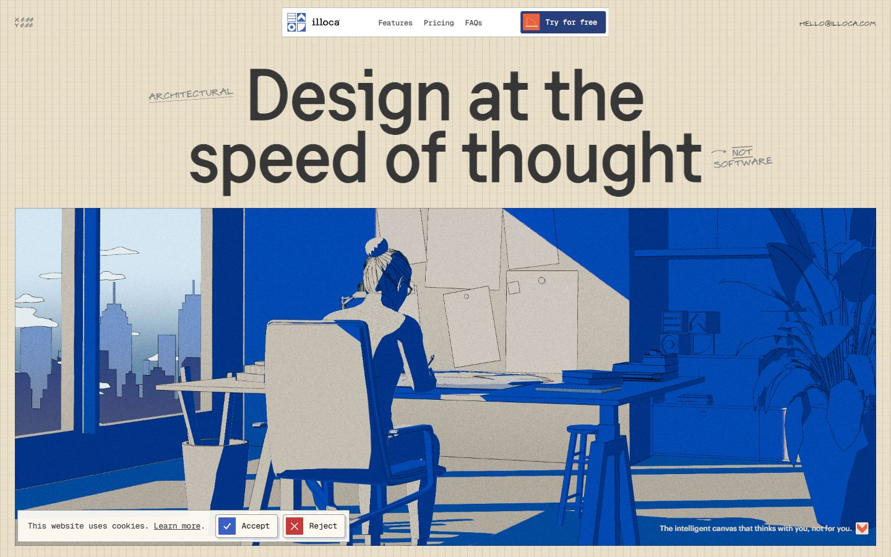</a> 

<details><summary>Toutes les captures</summary>

<a href="captures/desktop-01.jpg">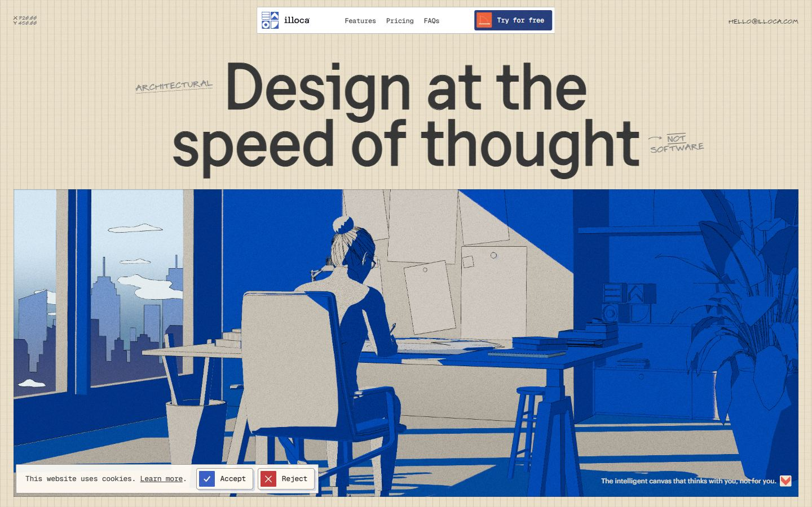</a> <a href="captures/desktop-02.jpg">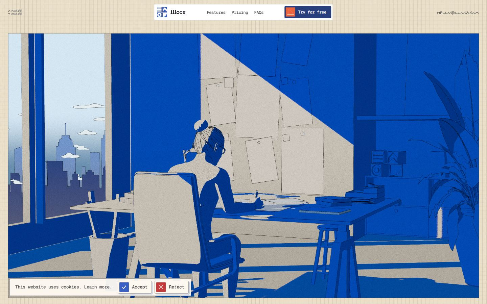</a> <a href="captures/desktop-03.jpg">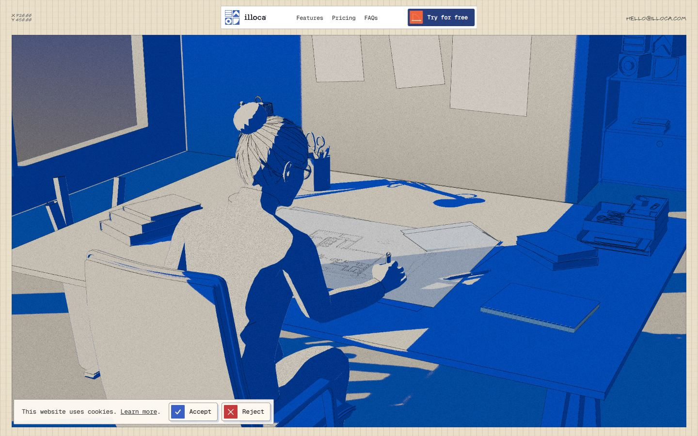</a> <a href="captures/desktop-04.jpg">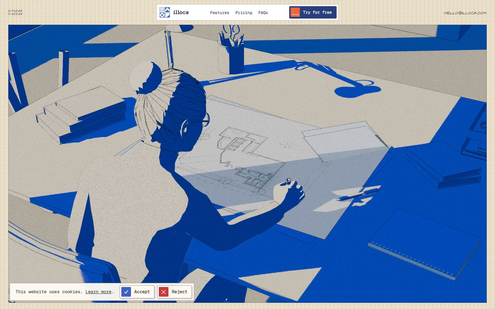</a> <a href="captures/desktop-05.jpg">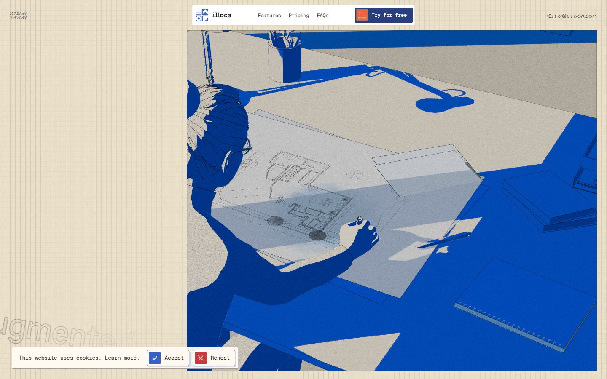</a> <a href="captures/desktop-06.jpg">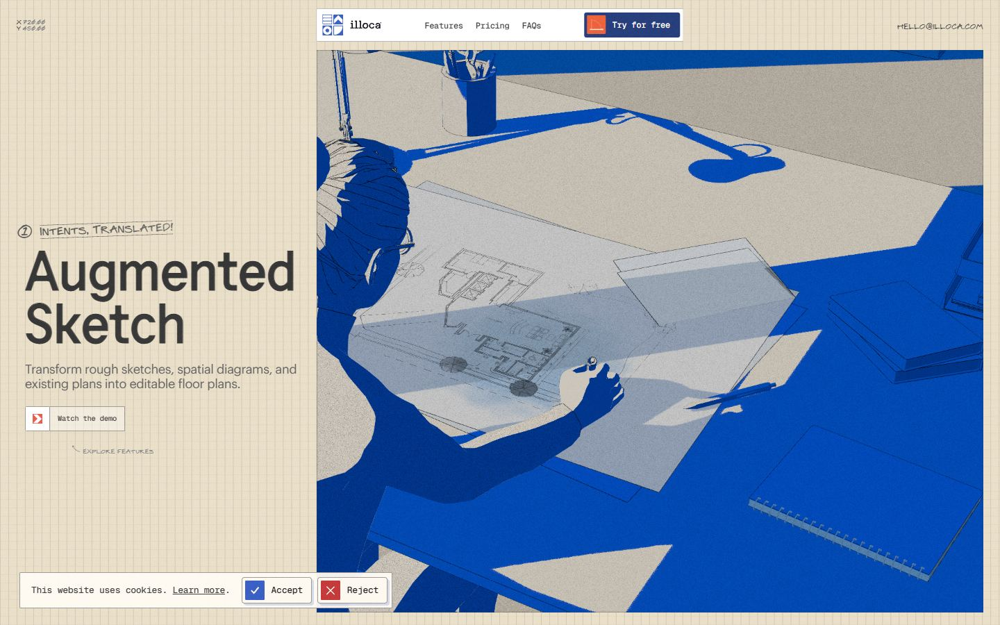</a> <a href="captures/desktop-07.jpg">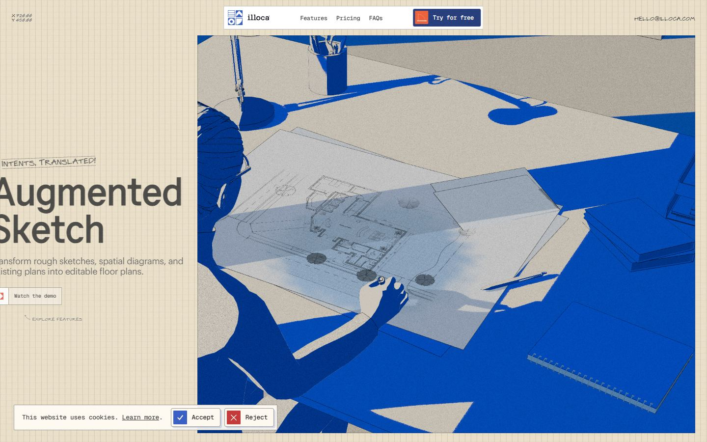</a> 

<a href="captures/page1-01.jpg">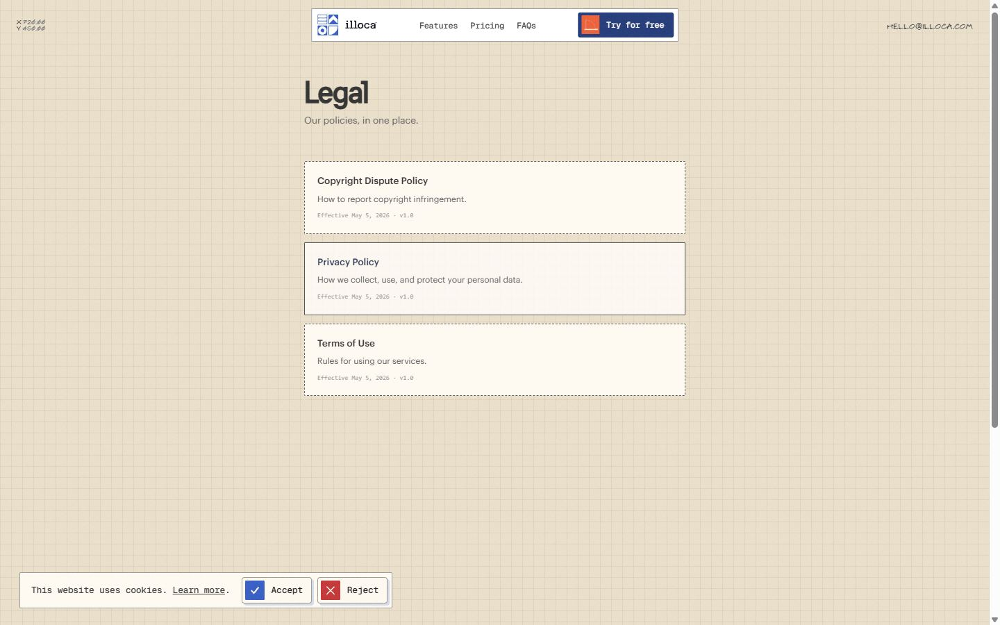</a> <a href="captures/page1-02.jpg">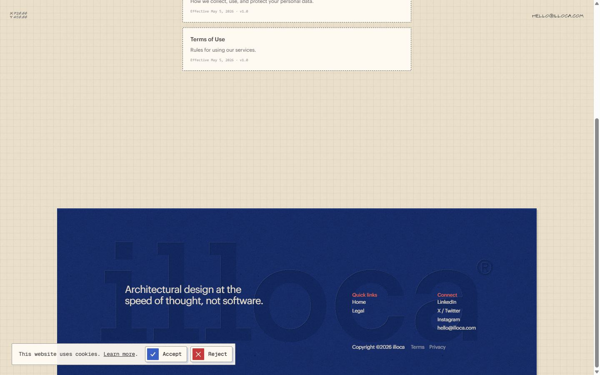</a> <a href="captures/page1-03.jpg"></a> 

<a href="captures/mobile-01.jpg">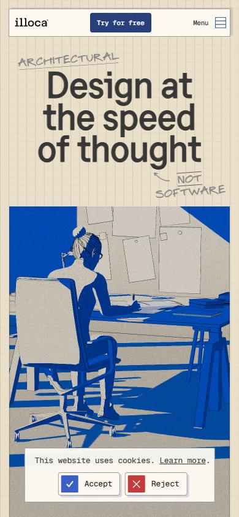</a> <a href="captures/mobile-02.jpg"></a> <a href="captures/mobile-03.jpg"></a> <a href="captures/mobile-04.jpg"></a> <a href="captures/mobile-05.jpg"></a> <a href="captures/mobile-06.jpg"></a> 

</details>

## Stack détectée
GSAP, Lenis, Nuxt, Postprocessing, ScrollTrigger, SplitText/SplitType, Theatre.js, Three.js, Virtual scroll, Vue, WebGL

Versions : GSAP 3.11.0 · Three.js r?

Shaders GLSL personnalisés extraits : 19 (voir `shaders.glsl`)

## Design tokens
### Couleurs (fonds, pondérées par surface)
`#eadfc9` · `#283f7d` · `#fdf8f0` · `#fffbf3` · `#ffffff` · `#e5d6bc` · `#5b5b5b` · `#000000`
### Couleurs de texte
`#373737` · `#fef9f1` · `#eadfc9` · `#9a9393` · `#414141` · `#212121` · `#e0d7c5` · `#000000`
### Polices utilisées (par volume de texte)
Graphik Web · Geist Mono · F37 Analog · Architect Pro · ui-sans-serif · Architect Pro Symbols
### Fichiers de police chargés
- Graphik-Medium-Web.woff2
- ArchitectProSymbols.woff2
- Graphik-Regular-Web.woff2
- ArchitectProMarkerCap.woff2
- F37Analog-Medium.woff2
- or3yQ6H-1_WfwkMZI_qYPLs1a-t7PU0AbeEPKK5U5Ck.woff2
### Typographie
| Élément | Police | Taille | Graisse | Interligne | Interlettrage | Casse |
|---|---|---|---|---|---|---|
| h1 | "F37 Analog", sans-serif | 111px | 500 | 99.9px | normal | none |
| h2 | "F37 Analog", sans-serif | 76.5px | 400 | 76.5px | normal | none |
| h3 | "Graphik Web", sans-serif | 24px | 500 | 24px | -0.48px | none |
| p | "Graphik Web", sans-serif | 15px | 400 | 16.5px | -0.45px | none |
| a | "Geist Mono", monospace | 12px | 500 | 12px | -0.24px | none |
| button | "Graphik Web", sans-serif | 18px | 500 | 21.6px | -0.36px | none |
| li | "Geist Mono", monospace | 12px | 500 | 12px | -0.24px | none |
| body | ui-sans-serif, system-ui, sans-serif, "Apple Color | 12px | 400 | 18px | normal | none |

### Échelle des tailles de texte
18px (208) · 76.5px (139) · 12px (87) · 111px (51) · 72px (34) · 10.5px (27) · 13.5px (21) · 15px (7) · 9px (6) · 24px (6) · 13px (4) · 27px (3) · 7.5px (1)
### Arrondis
1.5px · 3px · 4px · 2px · 10px
### Transitions CSS fréquentes
- cubic-bezier(0.4 0.5s ×5
- cubic-bezier(0.4 0.2s ×2
- cubic-bezier(0.4 0.15s ×2
### Points de rupture (media queries)
1080px · 1921px · 768px · 1024px · 2400px · 480px · 1536px · 3840px · 580px
### Animations CSS (@keyframes)
(aucune)
### Variables CSS (:root)
```css
--font-sans: ui-sans-serif,system-ui,sans-serif,"Apple Color Emoji","Segoe UI Emoji","Segoe UI Symbol","Noto Color Emoji";
--font-mono: ui-monospace,SFMono-Regular,Menlo,Monaco,Consolas,"Liberation Mono","Courier New",monospace;
--color-gray-500: oklch(55.1% .027 264.364);
--color-black: #373737;
--color-white: #fff;
--spacing: .0625rem;
--container-sm: 24rem;
--text-sm: .875rem;
--text-sm--line-height: 1.42857;
--font-weight-medium: 500;
--font-weight-semibold: 600;
--font-weight-bold: 700;
--font-weight-extrabold: 800;
--tracking-tight: -.025em;
--tracking-widest: .1em;
--leading-snug: 1.375;
--radius-xl: .75rem;
--ease-in-out: cubic-bezier(.4,0,.2,1);
--default-transition-duration: .15s;
--default-transition-timing-function: cubic-bezier(.4,0,.2,1);
--default-font-family: var(--font-sans);
--default-mono-font-family: var(--font-mono);
--text-10: .625rem;
--text-12: .75rem;
--text-14: .875rem;
--text-16: 1rem;
--text-18: 1.125rem;
--text-20: 1.25rem;
--text-24: 1.5rem;
--text-32: 2rem;
--text-36: 2.25rem;
--text-40: 2.5rem;
--text-56: 3.5rem;
--text-64: 4rem;
--text-72: 4.5rem;
--text-96: 6rem;
--text-102: 6.375rem;
--text-148: 9.25rem;
--leading-0.9: .9;
--leading-1: 1;
--leading-1.1: 1.1;
--leading-1.15: 1.15;
--leading-1.2: 1.2;
--leading-1.3: 1.3;
--leading-1.4: 1.4;
--tracking-2: .02em;
--tracking-3: .03em;
--tracking-5: .05em;
--font-weight-400: 400;
--font-weight-500: 500;
--font-weight-600: 600;
--font-weight-700: 700;
--font-f37: "F37 Analog",sans-serif;
--font-graphik: "Graphik Web",sans-serif;
--font-architect: "Architect Pro",sans-serif;
--font-symbols: "Architect Pro Symbols",sans-serif;
--font-geist: "Geist Mono",monospace;
--color-scrollbar: #000;
--color-light-grey: #9aa0a6;
--color-error: #e60076;
--color-nav: #fffbf3f2;
--color-hole-border: #3f3f3f;
--color-body: #636363;
--color-primary: #283f7d;
--color-orange: #ec633d;
--color-border: #424242;
--radius-2: .125rem;
--radius-4: .25rem;
--breakpoint-ipadpro: (hover:none) and (pointer:coarse) and (min-width:1024px);
--breakpoint-touch: (pointer:coarse);
--breakpoint-nottouch: (hover:hover) and (pointer:fine);
--breakpoint-portrait: (orientation:portrait);
```

## Structure de la home
Hauteur : 900 px — 1217 nœuds DOM — canvas 1, vidéos 0, images 0

| # | Bloc | Hauteur | Titre | Médias |
|---|---|---|---|---|
| 1 | div#__nuxt . | 900 | Design at the speed of thoughtDesign at the speed of thoughtDesign at the speed  | 1 |
| 2 | div .fixed top-0 right-0 h-full w-8 md:w-[20p | 900 |  | 0 |

**Navigation :** Features Features · Pricing Pricing · FAQs FAQs · Try for free Try for free

**Boutons / CTA :** Try for free Try for free · Sign up Sign up · Join waitlist Join waitlist · Contact us Contact us · hello@illoca.com hello@illoca.com · Accept · Reject

## SEO
- Title : illoca – Architectural design at the speed of thought
- Description : illoca is an AI-native design engine built for professional architects. Explore, refine, and move from first ideas to editable 2D and 3D designs with more speed and control.
- Langue : en — canonical : https://illoca.unseen.co/
- Open Graph : oui — JSON-LD : Organization, WebSite, WebPage
- H1 : 1 — images sans alt : 0/0

### Plan des titres
- H1 Design at the speed of thoughtDesign at the speed of thoughtDesign at the speed of thought
- H2 Augmented SketchAugmented Sketch
- H2 Adaptive MassingAdaptive Massing
- H2 Prompted PlansPrompted Plans
- H2 Agentic RefinementAgentic Refinement
- H2 Instant FacadesInstant Facades
- H2 An Open LetterAn Open Letter
- H2 Pricing
- H3 Get 1,000 starter credits when you sign up today.
- H2 Explore
- H3 $29.99 / person / month
- H2 Team
- H3 $59.99+ / team / month
- H2 Enterprise
- H3 Custom pricing
- H2 FAQs
- H3 Frequently Asked Questions
- H3 Quick links
- H3 Connect

## Performance (mesure locale, Chrome headless, connexion non bridée)
- TTFB 280 ms · LCP 844 ms (image) · CLS 0 · load 1235 ms
- 99 requêtes · 8367 Ko transférés
- Par type : Document 1 req / 17 Ko, Image 61 req / 1138 Ko, Stylesheet 5 req / 16 Ko, Other 4 req / 6 Ko, Script 6 req / 624 Ko, Font 6 req / 195 Ko, Fetch 16 req / 6371 Ko
- Plus gros fichiers :
- 3712 Ko — Fetch — https://illoca.unseen.co/webgl/models/building.glb
- 1283 Ko — Fetch — https://illoca.unseen.co/webgl/models/scene.glb
- 540 Ko — Script — https://illoca.unseen.co/_nuxt/DGk6hhCZ.js
- 426 Ko — Fetch — https://illoca.unseen.co/webgl/textures/voronoi.ktx2
- 226 Ko — Fetch — https://illoca.unseen.co/basis/basis_transcoder.wasm
- 187 Ko — Fetch — https://illoca.unseen.co/webgl/textures/facades.ktx2
- 127 Ko — Image — https://illoca.unseen.co/images/grain-400.jpg
- 113 Ko — Fetch — https://illoca.unseen.co/webgl/textures/floorplan-ai.ktx2
- Services tiers : fonts.googleapis.com, fonts.gstatic.com

## Mobile
- H1 : {'size': '57.7777px', 'lineHeight': '52px'} · corps : 14.4444px · débordement horizontal : False · menu burger : False

## Fichiers
- `captures/` : arrivée, scroll desktop (1440×900), pleine page, pages internes, mobile (390×844 @2x) ; vidéo de scroll dans la release GitHub « videos » (lien en haut de fiche)
- `page.html` : DOM rendu · `styles.css` : CSS chargé · `scripts/` : JS chargé (index dans `_index.json`) · `shaders.glsl` : shaders extraits · `rea-bundle.json` : analyse REA du bundle (chunks, routes, endpoints)

## Pages internes capturées
- https://illoca.unseen.co/legal
