# Squarespace Foundations

- Site : [https://brand.squarespace.com/](https://brand.squarespace.com/) — [aperçu statique local](apercu.html)
- Capturé le : 2026-11-03 — statut : ok
- Vidéo de scroll : [▶ ouvrir](https://github.com/t-baudry/bibliotheque-web/releases/download/videos/062-squarespace-foundations.webm)

<a href="captures/desktop-00-arrivee.jpg">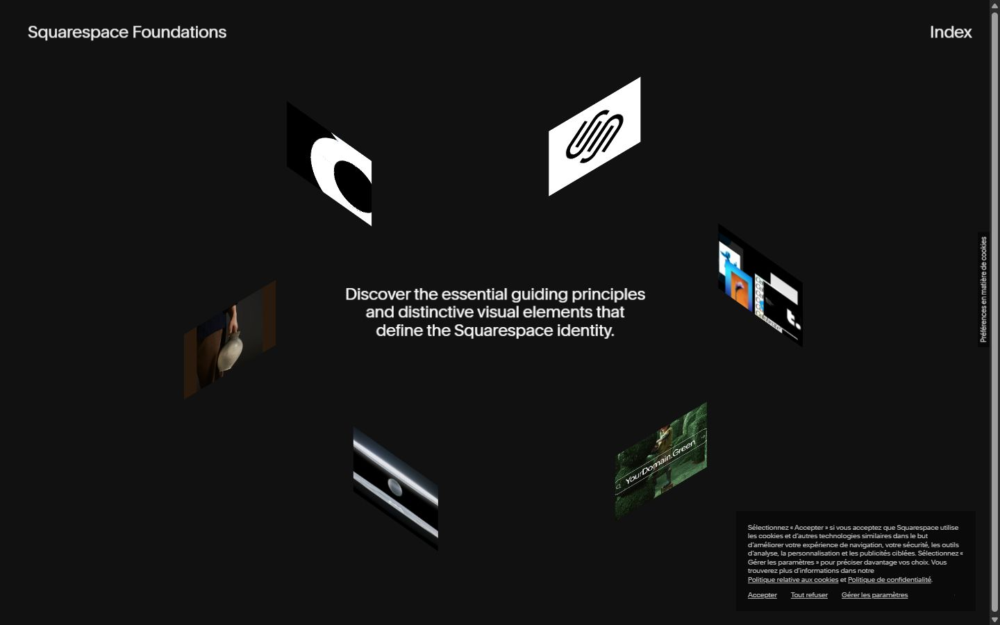</a> 

<details><summary>Toutes les captures</summary>

<a href="captures/desktop-01.jpg">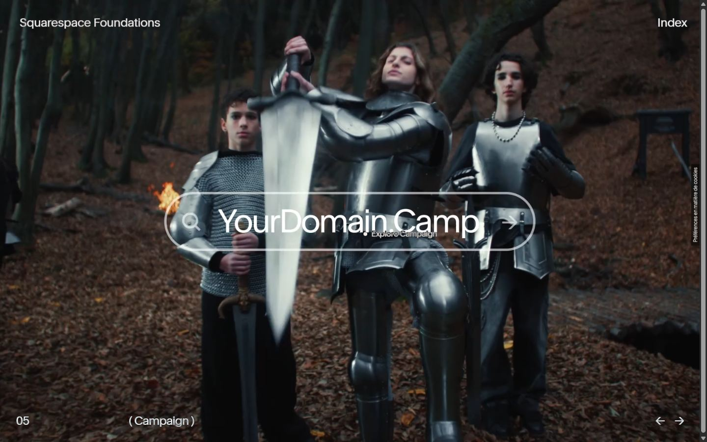</a> <a href="captures/desktop-02.jpg">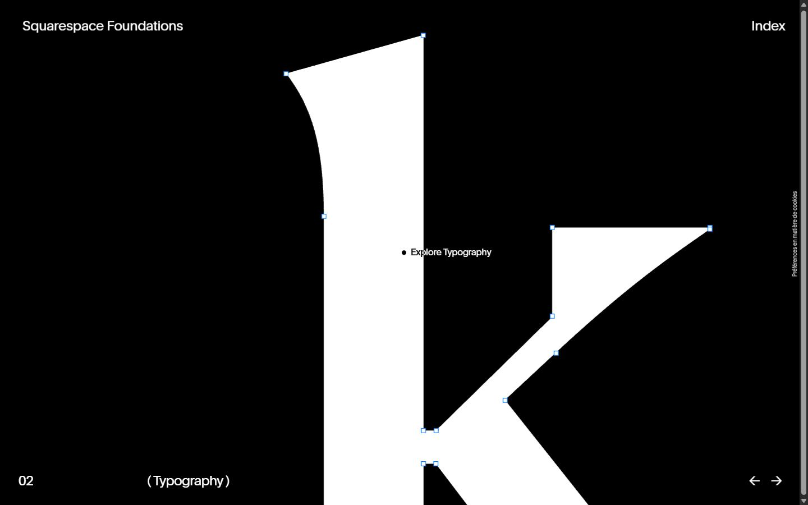</a> <a href="captures/desktop-03.jpg">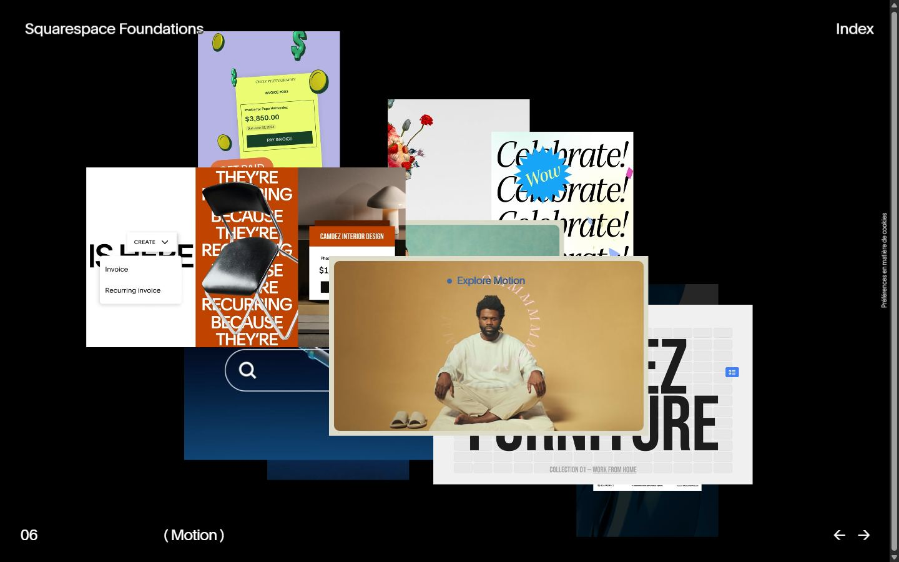</a> <a href="captures/desktop-04.jpg">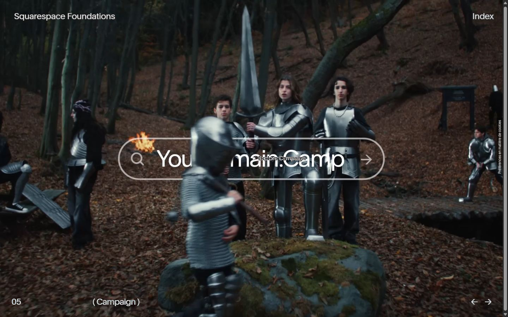</a> <a href="captures/desktop-05.jpg">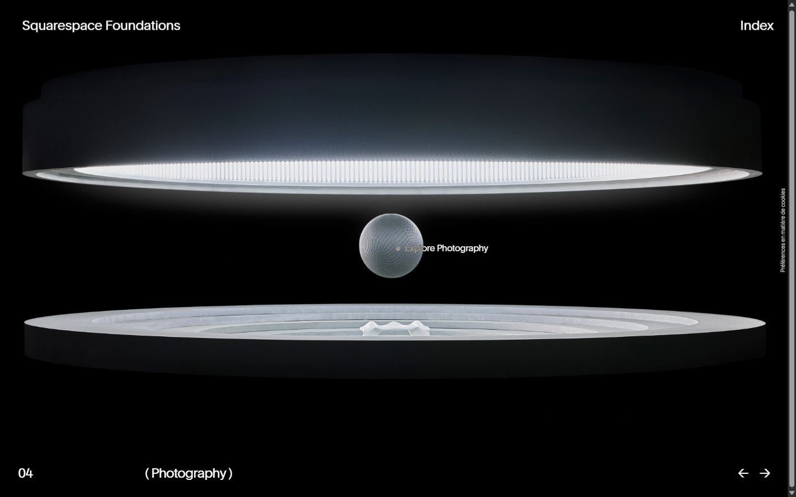</a> <a href="captures/desktop-06.jpg">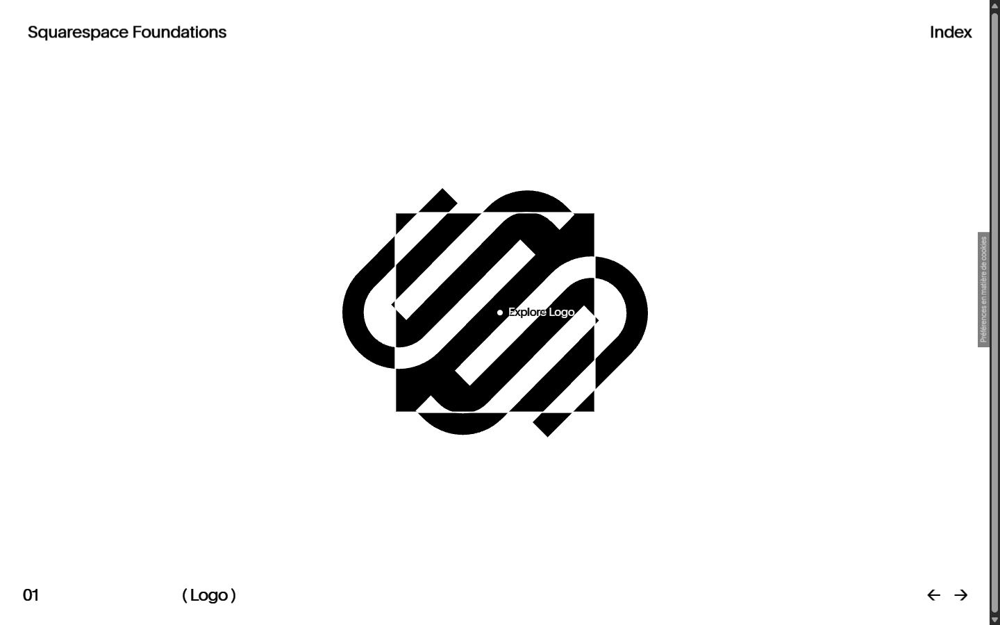</a> <a href="captures/desktop-07.jpg">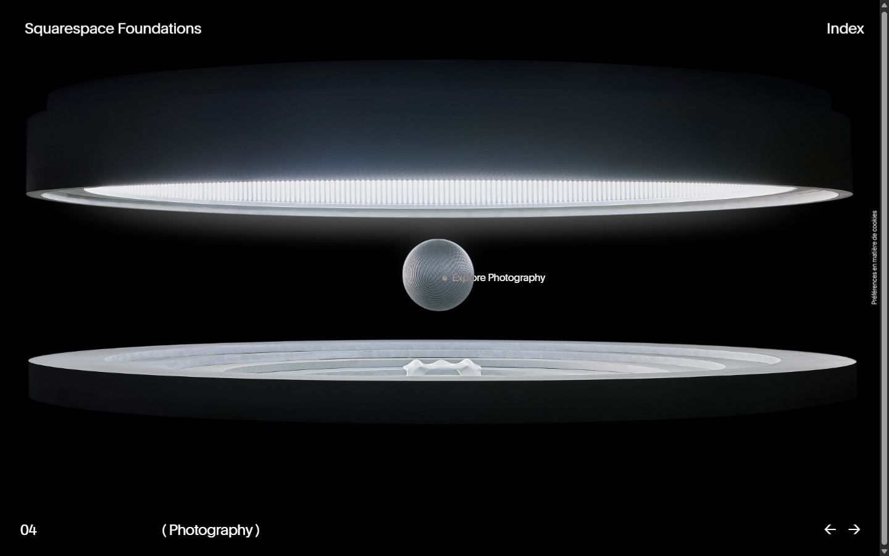</a> 


<a href="captures/mobile-01.jpg">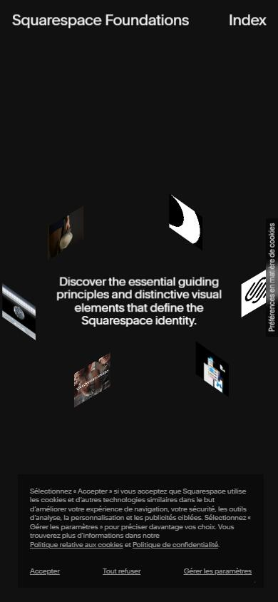</a> <a href="captures/mobile-02.jpg">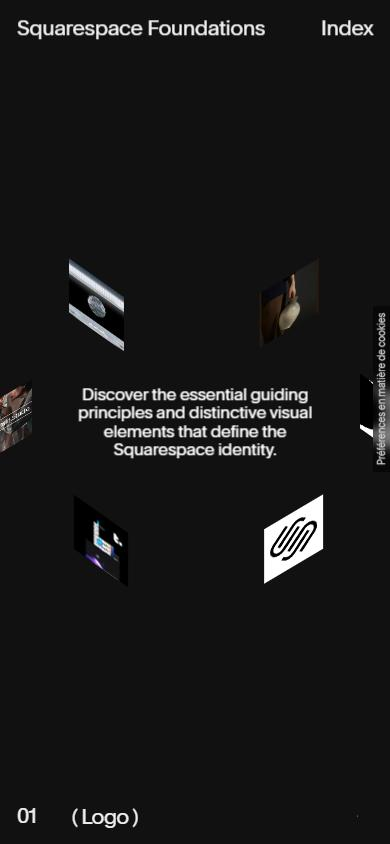</a> <a href="captures/mobile-03.jpg">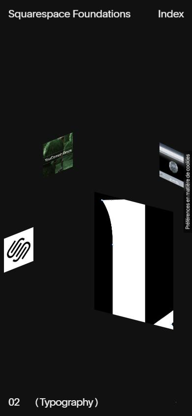</a> <a href="captures/mobile-04.jpg">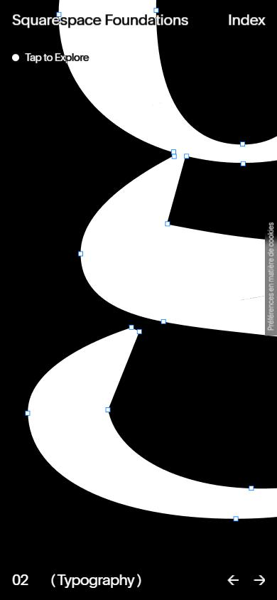</a> <a href="captures/mobile-05.jpg">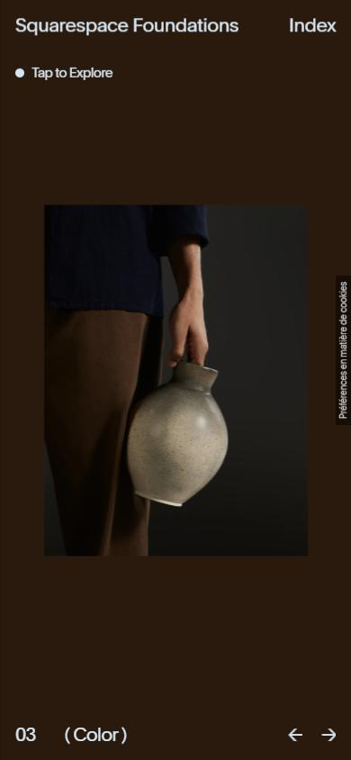</a> <a href="captures/mobile-06.jpg">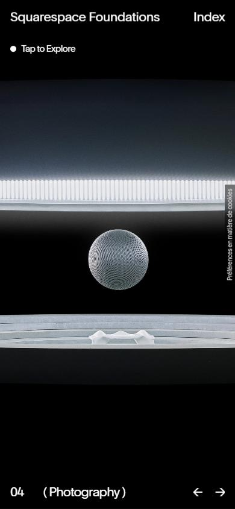</a> 

</details>

## Stack détectée
Barba.js, GSAP, Lenis, Lil-GUI/Tweakpane (debug), Nuxt, Rive, ScrollTrigger, Shopify, SplitText/SplitType, Squarespace, Three.js, Virtual scroll, Vue, WebGL

Versions : GSAP 3.11.0 · Three.js r?

Shaders GLSL personnalisés extraits : 8 (voir `shaders.glsl`)

## Design tokens
### Couleurs (fonds, pondérées par surface)
`#111111` · `#000000` · `#ffffff` · `#2a1a0d`
### Couleurs de texte
`#ffffff` · `#cfcfcf`
### Polices utilisées (par volume de texte)
Clarkson
### Fichiers de police chargés
- ClarksonSerifTT-LightItalic.ttf
- Clarkson-BookProduct.woff2
- Clarkson-Light.woff2
- Clarkson-Medium.woff2
- Clarkson-Bold.woff2
- Clarkson-Semibold.woff2
- get
### Typographie
| Élément | Police | Taille | Graisse | Interligne | Interlettrage | Casse |
|---|---|---|---|---|---|---|
| h1 | Clarkson | 80px | 400 | 64px | -3.2px | none |
| p | Clarkson | 24px | 400 | 26.4px | -0.48px | none |
| a | Clarkson | 20px | 400 | 22px | -0.8px | none |
| button | Clarkson | 20px | 400 | 22px | -0.8px | none |
| li | Clarkson | 85px | 400 | normal | -3.4px | none |
| body | sans-serif | 15px | 400 | normal | normal | none |

### Échelle des tailles de texte
15px (24) · 24px (17) · 9.6px (8) · 85px (6) · 20px (4) · 200px (2) · 80px (2) · 16px (1)
### Arrondis
50%
### Transitions CSS fréquentes
- ease 0.3s ×3
- cubic-bezier(0.645 2s ×2
- ease 0.5s ×2
- cubic-bezier(0.39 0.6s ×1
### Points de rupture (media queries)
901px · 900px · 1024px · 500px · 420px · 421px · 768px
### Animations CSS (@keyframes)
(aucune)
### Variables CSS (:root)
```css
--textColor: var(--overrideTextColor,var(--color-white));
--bgColor: var(--overrideBg);
--mediaBgColor: hsl(from var(--bgColor) h s calc(l + 2) );
--scss-breakpoint: "desktop";
--color-black: #000;
--color-blackBg: #111;
--color-white: #fff;
--color-lightGray: #f6f6f6;
--color-grey: #e1e1e1;
--color-blue: #1823bc;
--color-orange: #d2593b;
--color-gold: #c59d3d;
--arrowGap: 2rem;
--sideMargin: 4rem;
--bottomMargin: 3.6rem;
--columns: 12;
--columnGap: 2rem;
--columnWidth: 9.5rem;
--headerHeight: 8.8rem;
--safari-ui-block-height: 100px;
```

## Structure de la home
Hauteur : 901 px — 665 nœuds DOM — canvas 1, vidéos 19, images 63

| # | Bloc | Hauteur | Titre | Médias |
|---|---|---|---|---|

**Navigation :** 

**Boutons / CTA :** 

## SEO
- Title : Squarespace Foundations | Squarespace Foundations
- Description : Discover the essential guiding principles and distinctive visual elements that define the Squarespace identity.
- Langue : en — canonical : None
- Open Graph : oui — JSON-LD : aucun
- H1 : 1 — images sans alt : 63/63

### Plan des titres
- H1 Squarespace Foundations

## Performance (mesure locale, Chrome headless, connexion non bridée)
- TTFB 438 ms · LCP 948 ms (P.pageLoader__text) · CLS 0.001 · load 619 ms
- 294 requêtes · 56674 Ko transférés
- Par type : Document 7 req / 5 Ko, Stylesheet 16 req / 19 Ko, Other 5 req / 17 Ko, Script 75 req / 2392 Ko, Font 7 req / 364 Ko, Fetch 57 req / 629 Ko, Image 77 req / 40514 Ko, Media 35 req / 12727 Ko, Preflight 4 req / 0 Ko, XHR 8 req / 5 Ko, Ping 3 req / 1 Ko
- Plus gros fichiers :
- 12378 Ko — Media — https://brand.squarespace.com/pages/home/campaign/01@lg.mp4
- 3134 Ko — Image — https://brand.squarespace.com/pages/home/photography/v2/set-6-bg-desktop@lg.webp
- 3102 Ko — Image — https://brand.squarespace.com/pages/home/photography/v2/set-2-bg-desktop@lg.webp
- 2952 Ko — Image — https://brand.squarespace.com/pages/home/photography/v2/set-9-bg-desktop@lg.webp
- 2526 Ko — Image — https://brand.squarespace.com/pages/home/photography/v2/set-3-bg-desktop@lg.webp
- 2388 Ko — Image — https://brand.squarespace.com/pages/home/photography/v2/set-8-bg-desktop@lg.webp
- 1764 Ko — Image — https://brand.squarespace.com/pages/home/photography/v2/set-7-bg-desktop@lg.webp
- 1222 Ko — Image — https://brand.squarespace.com/pages/home/photography/v2/set-7-3@lg.webp
- Services tiers : consent.trustarc.com, unpkg.com, www.googletagmanager.com, c.amazon-adsystem.com, pixel.byspotify.com, bat.bing.com, www.redditstatic.com, utt.impactcdn.com, connect.facebook.net, insight.adsrvr.org, cdn.mgln.ai, c.hrzn-nxt.com, s.pinimg.com, p.teads.tv, d34r8q7sht0t9k.cloudfront.net, js.adsrvr.org, bzrcdn.openai.com, pixels.spotify.com, pixel-config.reddit.com, l.hrzn-nxt.com, alb.reddit.com, squarespace.syuh.net, mgln.ai, www.googleadservices.com, aax-eu.amazon-adsystem.com, 17880935.fls.doubleclick.net, www.google.fr, ipv4.pdscrb.com, www.google.com, googleads.g.doubleclick.net, ad.doubleclick.net, stats.g.doubleclick.net, region1.analytics.google.com, ct.pinterest.com, us.mgln.ai, bzr.openai.com, www.facebook.com, verifi.pdscrb.com

## Mobile
- H1 : {'size': '41.6px', 'lineHeight': '33.28px'} · corps : 15.6px · débordement horizontal : False · menu burger : True

## Fichiers
- `captures/` : arrivée, scroll desktop (1440×900), pleine page, pages internes, mobile (390×844 @2x) ; vidéo de scroll dans la release GitHub « videos » (lien en haut de fiche)
- `page.html` : DOM rendu · `styles.css` : CSS chargé · `scripts/` : JS chargé (index dans `_index.json`) · `shaders.glsl` : shaders extraits · `rea-bundle.json` : analyse REA du bundle (chunks, routes, endpoints)
