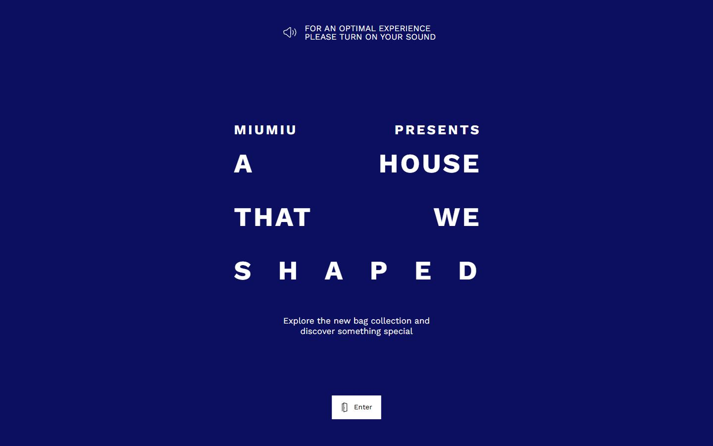
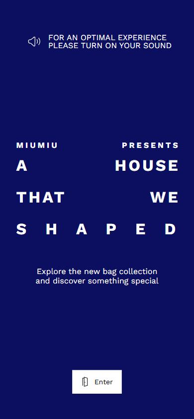

# MIU MIU A House that we shaped

- Site : [https://immersivebags.miumiu.com/](https://immersivebags.miumiu.com/) — [aperçu statique local](apercu.html)
- Capturé le : 2026-11-03 — statut : ok
- Vidéo de scroll : [▶ ouvrir](https://github.com/t-baudry/bibliotheque-web/releases/download/videos/069-miu-miu-a-house-that-we-shaped.webm)

<a href="captures/desktop-00-arrivee.jpg"></a> 

<details><summary>Toutes les captures</summary>

<a href="captures/desktop-01.jpg"></a> <a href="captures/desktop-02.jpg"></a> <a href="captures/desktop-03.jpg"></a> <a href="captures/desktop-04.jpg"></a> <a href="captures/desktop-05.jpg"></a> <a href="captures/desktop-06.jpg"></a> <a href="captures/desktop-07.jpg"></a> 


<a href="captures/mobile-01.jpg"></a> <a href="captures/mobile-02.jpg"></a> <a href="captures/mobile-03.jpg"></a> <a href="captures/mobile-04.jpg"></a> <a href="captures/mobile-05.jpg"></a> <a href="captures/mobile-06.jpg"></a> 

</details>

## Stack détectée
Three.js, Vue, WebGL

Shaders GLSL personnalisés extraits : 9 (voir `shaders.glsl`)

## Design tokens
### Couleurs (fonds, pondérées par surface)
`#ffffff`
### Couleurs de texte
`#ffffff` · `#000000`
### Polices utilisées (par volume de texte)
WorkSans
### Fichiers de police chargés
- WorkSans-Regular.B9ExyInWb24d0b8d.woff2
- WorkSans-Bold.CHhifYYlb24d0b8d.woff2
### Typographie
| Élément | Police | Taille | Graisse | Interligne | Interlettrage | Casse |
|---|---|---|---|---|---|---|
| body | WorkSans, sans-serif | 10px | 400 | 11px | normal | none |

### Échelle des tailles de texte
54px (10) · 10px (3) · 17.1px (2) · 27px (2) · 14px (1)
### Arrondis
4px
### Transitions CSS fréquentes
- ease-in-out 0.55s ×3
- ease-in-out 0.65s ×2
- cubic-bezier(0.25 0.4s ×2
- cubic-bezier(0.785 0.65s ×1
- ease 0.3s ×1
### Points de rupture (media queries)
768px · 639px · 1199px · 399px · 1023px · 640px · 769px · 767px · 1200px · 1025px · 1440px · 1899px
### Animations CSS (@keyframes)
preloader-spinner, shake1, jitter-subtle, jitter-subtle-rtl, ken-burns, underline-expand-56ee19ba, counterEnter-edcb2055, counterLeave-edcb2055, counterReturn-edcb2055, hotspotLoadingSpin-d83d10c7, pulseMiddleOutCircle-d83d10c7, wiggle-a373ba30
### Variables CSS (:root)
```css
--bg-color: #000;
--base-text: calc((15px) * var(--h-demult, 1));
--padding: max(6px, calc(var(--base-text) * .15));
--ui-bps: xs:400px / s:640px / sm:768px / md:1024px / lg:1200px / xl:1600px / xxl:1920px;
--ui-colors: bg-primary:#0c0f60 / primary-hover:#000 / primary:#fff / yellow:#ffe100 / white:#fff / black:#000 / paper:#ffedd9 / beige:#fcf5e6 / blue:#26;
--ui-color-bg-primary: #0c0f60;
--ui-color-primary-hover: #000;
--ui-color-primary: #fff;
--ui-color-yellow: #ffe100;
--ui-color-white: #fff;
--ui-color-black: #000;
--ui-color-paper: #ffedd9;
--ui-color-beige: #fcf5e6;
--ui-color-blue: #265adf;
--ui-color-red: #c60000;
--ui-color-viewmaster-red: #d81219;
--ui-color-viewmaster-beige: #eee2b7;
--ui-color-phone-beige: #d7c8b1;
--miumiu-header: 1.5em;
```

## Structure de la home
Hauteur : 900 px — 195 nœuds DOM — canvas 1, vidéos 0, images 0

| # | Bloc | Hauteur | Titre | Médias |
|---|---|---|---|---|

**Navigation :** 

**Boutons / CTA :** 

## SEO
- Title : Miu Miu - 2026 Bag Campaign
- Description : Explore the new bag collection and discover something special
- Langue : en — canonical : https://immersivebags.miumiu.com/en/
- Open Graph : oui — JSON-LD : aucun
- H1 : 0 — images sans alt : 0/0

### Plan des titres
- (rien relevé)

## Performance (mesure locale, Chrome headless, connexion non bridée)
- TTFB 34 ms · LCP 2032 ms (SPAN) · CLS 0.001 · load 475 ms
- 36 requêtes · 6002 Ko transférés
- Par type : Document 2 req / 27 Ko, Stylesheet 4 req / 10 Ko, Script 8 req / 264 Ko, Font 2 req / 130 Ko, Image 6 req / 508 Ko, Fetch 11 req / 4183 Ko, XHR 2 req / 880 Ko, Other 1 req / 1 Ko
- Plus gros fichiers :
- 1193 Ko — Fetch — https://immersivebags.miumiu.com/b/9OJepvNLm586.ktx2
- 1143 Ko — Fetch — https://immersivebags.miumiu.com/b/f8qfD5bque5r.ktx2
- 1021 Ko — Fetch — https://immersivebags.miumiu.com/b/nZ5p62zkmn1s.ktx2
- 717 Ko — XHR — https://immersivebags.miumiu.com/b/xyzyLaquYzY8.m4a
- 333 Ko — Image — https://immersivebags.miumiu.com/b/fSA2a2f_pCXi.webp
- 325 Ko — Fetch — https://immersivebags.miumiu.com/b/nbJflwtvYtv5.ktx2
- 204 Ko — Fetch — https://immersivebags.miumiu.com/b/IleJCHdJk2cx.ktx2
- 201 Ko — Fetch — https://immersivebags.miumiu.com/vendors/basis/basis_transcoder.wasm
- Services tiers : tags.tiqcdn.com

## Mobile
- H1 : None · corps : 10px · débordement horizontal : False · menu burger : False

## Fichiers
- `captures/` : arrivée, scroll desktop (1440×900), pleine page, pages internes, mobile (390×844 @2x) ; vidéo de scroll dans la release GitHub « videos » (lien en haut de fiche)
- `page.html` : DOM rendu · `styles.css` : CSS chargé · `scripts/` : JS chargé (index dans `_index.json`) · `shaders.glsl` : shaders extraits · `rea-bundle.json` : analyse REA du bundle (chunks, routes, endpoints)
