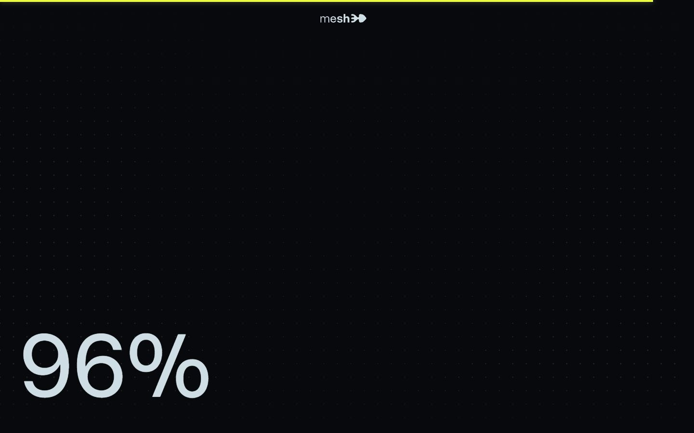
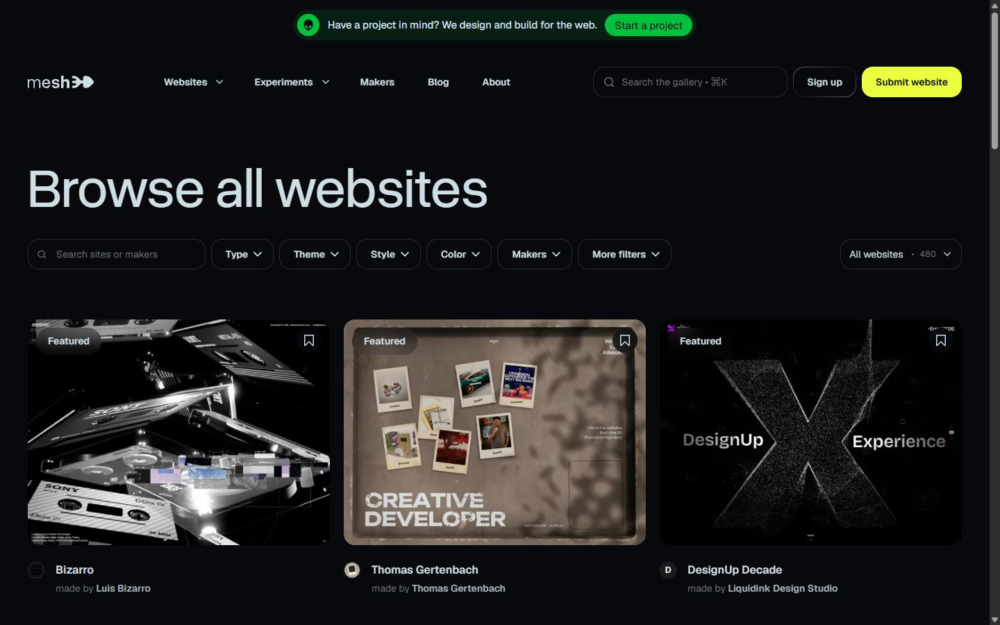
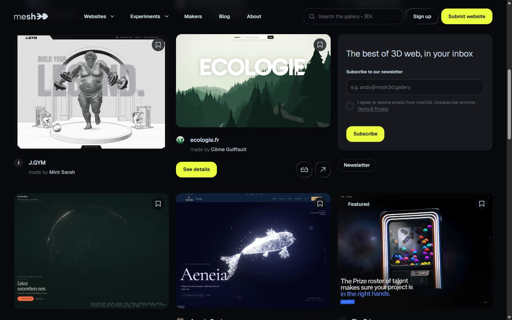
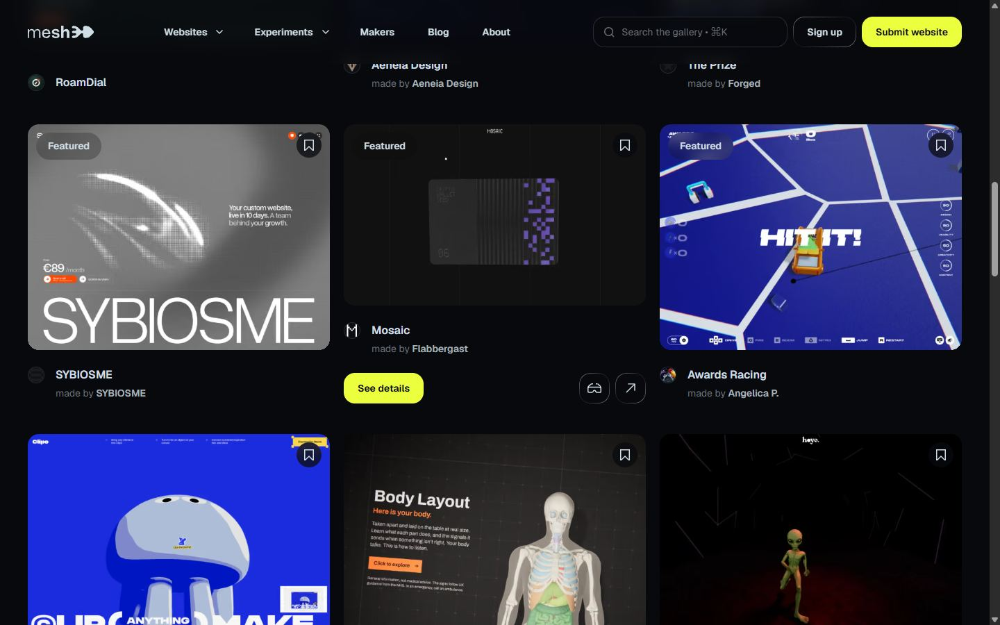
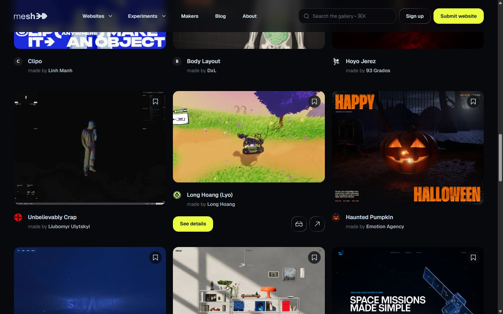
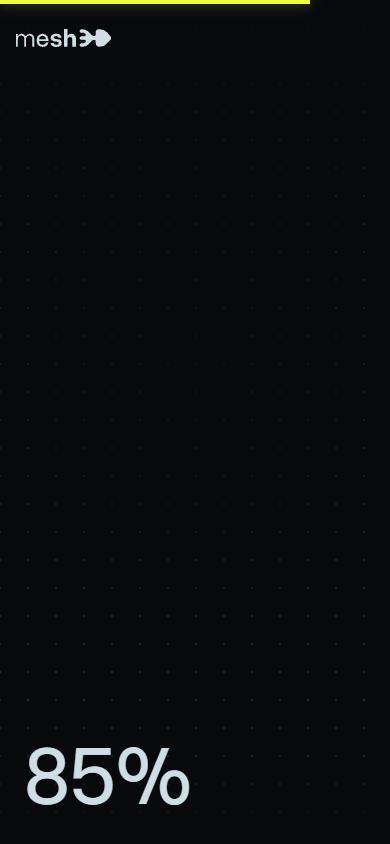
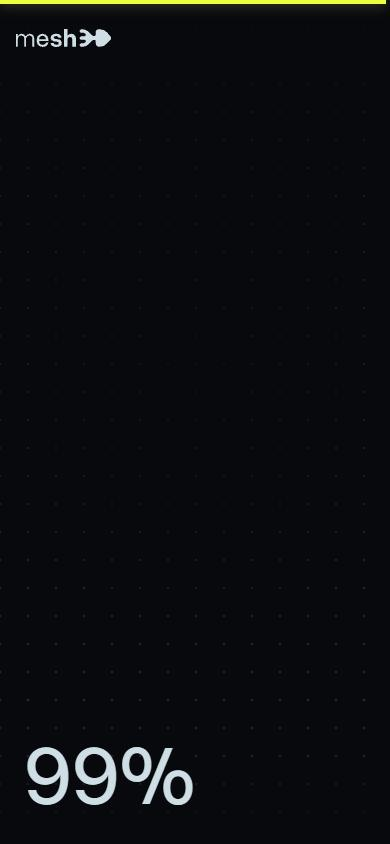

# The state of the gallery

- Site : [https://mesh3d.gallery/the-state-of-the-gallery](https://mesh3d.gallery/the-state-of-the-gallery) — [aperçu statique local](apercu.html)
- Capturé le : 2026-11-03 — statut : ok
- Vidéo de scroll : [▶ ouvrir](https://github.com/t-baudry/bibliotheque-web/releases/download/videos/072-the-state-of-the-gallery.webm)

<a href="captures/desktop-00-arrivee.jpg"></a> 

<details><summary>Toutes les captures</summary>


<a href="captures/page1-01.jpg"></a> <a href="captures/page1-02.jpg"></a> <a href="captures/page1-03.jpg"></a> <a href="captures/page1-04.jpg"></a> 

<a href="captures/mobile-01.jpg"></a> <a href="captures/mobile-02.jpg"></a> 

</details>

## Stack détectée
CMS Contentful, Lottie, Next.js, Rapier/Cannon (physique), React, ScrollTrigger, Svelte, Three.js, WebGL

Shaders GLSL personnalisés extraits : 39 (voir `shaders.glsl`)

## Design tokens
### Couleurs (fonds, pondérées par surface)
`#08090d` · `#ecff3e` · `#cfdee5`
### Couleurs de texte
`#cfdee5` · `#08090d` · `#ffffff`
### Polices utilisées (par volume de texte)
overusedGrotesk · Geist
### Fichiers de police chargés
- 797e433ab948586e-s.p.0r6juujl39pe6.woff2
- OverusedGrotesk_Roman-s.p.0gue6lbcd8qie.woff2
- caa3a2e1cccd8315-s.p.0wgildi0cnwt9.woff2
### Typographie
| Élément | Police | Taille | Graisse | Interligne | Interlettrage | Casse |
|---|---|---|---|---|---|---|
| p | overusedGrotesk, "overusedGrotesk Fallback" | 14px | 400 | 14px | 0.28px | uppercase |
| a | Geist, "Geist Fallback" | 14px | 600 | 21px | normal | none |
| button | overusedGrotesk, "overusedGrotesk Fallback" | 14px | 400 | 14px | 0.28px | uppercase |
| body | Geist, "Geist Fallback" | 16px | 400 | 24px | normal | none |

### Échelle des tailles de texte
18px (151) · 114px (105) · 36.48px (77) · 14px (45) · 171px (20) · 16px (9) · 200px (1)
### Arrondis
19px
### Transitions CSS fréquentes
- cubic-bezier(0.22 0.32s ×25
- cubic-bezier(0.4 0.15s ×1
- linear 0.7s ×1
- cubic-bezier(0.33 0.18s ×1
### Points de rupture (media queries)
768px · 40rem · 48rem · 64rem · 80rem · 96rem · 600px
### Animations CSS (@keyframes)
count-in, accordion-down, accordion-up, collapsible-down, collapsible-up, nav-from-left, nav-from-right, nav-viewport-in, nav-viewport-out, ring-text-rotate, spin, pulse, enter, exit, swipe-out-left, swipe-out-right, swipe-out-up, swipe-out-down, sonner-fade-in, sonner-fade-out, sonner-spin, inReviewEq1, inReviewEq2, inReviewEq3
### Variables CSS (:root)
```css
--font-sans: -apple-system, BlinkMacSystemFont, "Segoe UI", Roboto, "Helvetica Neue", "Noto Sans", Arial, sans-serif, "Apple Color Emoji", "Segoe UI Emoj;
--font-mono: ui-monospace, SFMono-Regular, Menlo, Monaco, Consolas, "Liberation Mono", "Courier New", monospace;
--color-red-200: lab(86.017% 19.8815 7.75869);
--color-red-400: lab(63.7053% 60.745 31.3109);
--color-red-500: lab(55.4814% 75.0732 48.8528);
--color-amber-200: lab(91.7203% -.505269 49.9084);
--color-amber-400: lab(80.1641% 16.6016 99.2089);
--color-amber-500: lab(72.7183% 31.8672 97.9407);
--color-amber-600: lab(60.3514% 40.5624 87.1228);
--color-green-400: lab(78.503% -64.9265 39.7492);
--color-emerald-200: lab(90.2247% -31.039 9.47084);
--color-emerald-300: lab(83.9203% -48.7124 13.8849);
--color-emerald-400: lab(75.0771% -60.7313 19.4147);
--color-emerald-500: lab(66.9756% -58.27 19.5419);
--color-sky-200: lab(88.6983% -11.3978 -16.8488);
--color-sky-500: lab(63.3038% -18.433 -51.0407);
--color-blue-50: lab(96.492% -1.14644 -5.11479);
--color-blue-100: lab(92.0301% -2.24757 -11.6453);
--color-blue-600: lab(44.0605% 29.0279 -86.0352);
--color-purple-50: lab(97.1627% 2.99937 -4.13398);
--color-rose-200: lab(86.806% 19.1909 4.07754);
--color-rose-300: lab(76.6339% 38.3549 9.68835);
--color-rose-500: lab(56.101% 79.4328 31.4532);
--color-gray-500: lab(47.7841% -.393182 -10.0268);
--color-gray-600: lab(35.6337% -1.58697 -10.8425);
--color-neutral-800: lab(15.204% 0 -.00000596046);
--color-neutral-900: lab(7.78201% -.0000149012 0);
--color-black: #000;
--color-white: #fff;
--spacing: .25rem;
--container-sm: 24rem;
--container-md: 28rem;
--container-lg: 32rem;
--container-2xl: 42rem;
--container-3xl: 48rem;
--text-xs: .75rem;
--text-xs--line-height: calc(1 / .75);
--text-sm: .875rem;
--text-sm--line-height: calc(1.25 / .875);
--text-lg: 1.125rem;
--text-lg--line-height: calc(1.75 / 1.125);
--text-xl: 1.25rem;
--text-xl--line-height: calc(1.75 / 1.25);
--text-2xl: 1.5rem;
--text-2xl--line-height: calc(2 / 1.5);
--text-3xl: 1.875rem;
--text-3xl--line-height: calc(2.25 / 1.875);
--font-weight-normal: 400;
--font-weight-medium: 500;
--font-weight-semibold: 600;
--font-weight-bold: 700;
--tracking-wide: .025em;
--tracking-wider: .05em;
--tracking-widest: .1em;
--leading-relaxed: 1.625;
--radius-xs: .125rem;
--radius-sm: calc(.5rem - 4px);
--radius-md: calc(.5rem - 2px);
--radius-lg: .5rem;
--radius-xl: .75rem;
--radius-2xl: 1rem;
--radius-3xl: 1.5rem;
--ease-in: cubic-bezier(.4, 0, 1, 1);
--ease-out: cubic-bezier(0, 0, .2, 1);
--ease-in-out: cubic-bezier(.4, 0, .2, 1);
--animate-spin: spin 1s linear infinite;
--animate-pulse: pulse 2s cubic-bezier(.4, 0, .6, 1) infinite;
--blur-xs: 4px;
--blur-md: 12px;
--blur-xl: 24px;
--aspect-video: 16 / 9;
--default-transition-duration: .15s;
--default-transition-timing-function: cubic-bezier(.4, 0, .2, 1);
--default-font-family: var(--font-sans);
--default-mono-font-family: var(--font-mono);
--animate-accordion-down: accordion-down .32s cubic-bezier(.4, 0, .2, 1);
--animate-accordion-up: accordion-up .32s cubic-bezier(.4, 0, .2, 1);
--animate-collapsible-down: collapsible-down .24s cubic-bezier(.4, 0, .2, 1);
--animate-collapsible-up: collapsible-up .2s cubic-bezier(.4, 0, .2, 1);
--animate-nav-from-left: nav-from-left .16s cubic-bezier(.4, 0, .2, 1);
```

## Structure de la home
Hauteur : 900 px — 1131 nœuds DOM — canvas 2, vidéos 0, images 1

| # | Bloc | Hauteur | Titre | Médias |
|---|---|---|---|---|
| 1 | div .relative w-full overflow-hidden bg-base | 900 |  | 2 |

**Navigation :** 

**Boutons / CTA :** Browse the gallery

## SEO
- Title : The state of the gallery | mesh3d
- Description : A Three.js showcase for the current state of the mesh3d gallery.
- Langue : en — canonical : https://mesh3d.gallery/the-state-of-the-gallery
- Open Graph : oui — JSON-LD : aucun
- H1 : 0 — images sans alt : 0/1

### Plan des titres
- (rien relevé)

## Performance (mesure locale, Chrome headless, connexion non bridée)
- TTFB 544 ms · LCP 2544 ms (P.in-review-loader-pct) · CLS 0.034 · load 913 ms
- 49 requêtes · 20916 Ko transférés
- Par type : Document 1 req / 8 Ko, Stylesheet 2 req / 25 Ko, Image 2 req / 12 Ko, Script 30 req / 718 Ko, Font 3 req / 113 Ko, Other 1 req / 2 Ko, Preflight 1 req / 0 Ko, Fetch 4 req / 10 Ko, Media 5 req / 20027 Ko
- Plus gros fichiers :
- 19994 Ko — Media — https://cdn.mesh3d.gallery/videos/1768394623120-ygq9vqt-1768308726303-igloo.mp4
- 132 Ko — Script — https://mesh3d.gallery/_next/static/chunks/1-d8y95fs809a.js?dpl=075ac813a8bfa09e138de3ea296d84d9435af007
- 114 Ko — Script — https://mesh3d.gallery/_next/static/chunks/273dnss41l5us.js?dpl=075ac813a8bfa09e138de3ea296d84d9435af007
- 83 Ko — Script — https://mesh3d.gallery/_next/static/chunks/3x89wwxetptzk.js?dpl=075ac813a8bfa09e138de3ea296d84d9435af007
- 67 Ko — Script — https://mesh3d.gallery/_next/static/chunks/2qmyz175xge-i.js?dpl=075ac813a8bfa09e138de3ea296d84d9435af007
- 62 Ko — Script — https://mesh3d.gallery/_next/static/chunks/0o2p9sr872c1k.js?dpl=075ac813a8bfa09e138de3ea296d84d9435af007
- 61 Ko — Font — https://mesh3d.gallery/_next/static/media/OverusedGrotesk_Roman-s.p.0gue6lbcd8qie.woff2?dpl=075ac813a8bfa09e138de3ea296d84d9435af007
- 44 Ko — Script — https://mesh3d.gallery/_next/static/chunks/3lhgmfmikhmb6.js?dpl=075ac813a8bfa09e138de3ea296d84d9435af007
- Services tiers : umami.mesh3d.gallery, o4510732891389952.ingest.de.sentry.io, cdn.mesh3d.gallery

## Mobile
- H1 : None · corps : 16px · débordement horizontal : False · menu burger : False

## Fichiers
- `captures/` : arrivée, scroll desktop (1440×900), pleine page, pages internes, mobile (390×844 @2x) ; vidéo de scroll dans la release GitHub « videos » (lien en haut de fiche)
- `page.html` : DOM rendu · `styles.css` : CSS chargé · `scripts/` : JS chargé (index dans `_index.json`) · `shaders.glsl` : shaders extraits · `rea-bundle.json` : analyse REA du bundle (chunks, routes, endpoints)

## Pages internes capturées
- https://mesh3d.gallery/websites
