# LIKOVA

- Site : [https://likova.space/](https://likova.space/) — [aperçu statique local](apercu.html)
- Capturé le : 2026-11-03 — statut : ok
- Vidéo de scroll : [▶ ouvrir](https://github.com/t-baudry/bibliotheque-web/releases/download/videos/075-likova.webm)

<a href="captures/desktop-00-arrivee.jpg"></a> 

<details><summary>Toutes les captures</summary>

<a href="captures/desktop-01.jpg">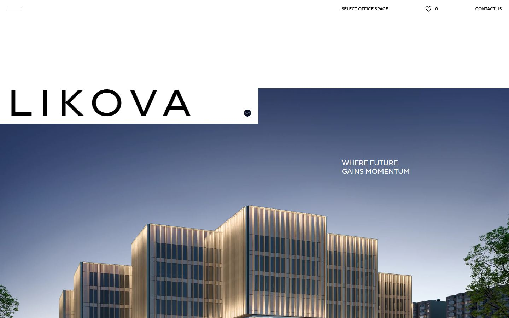</a> <a href="captures/desktop-02.jpg">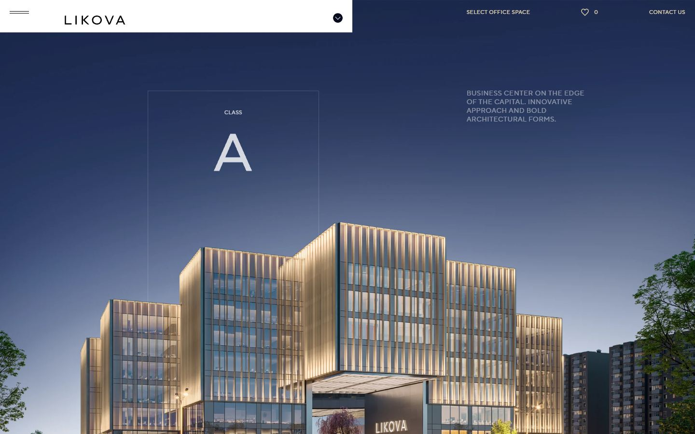</a> <a href="captures/desktop-03.jpg">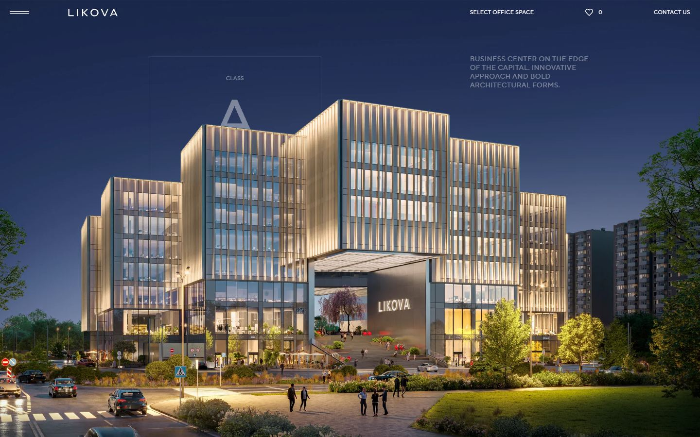</a> <a href="captures/desktop-04.jpg">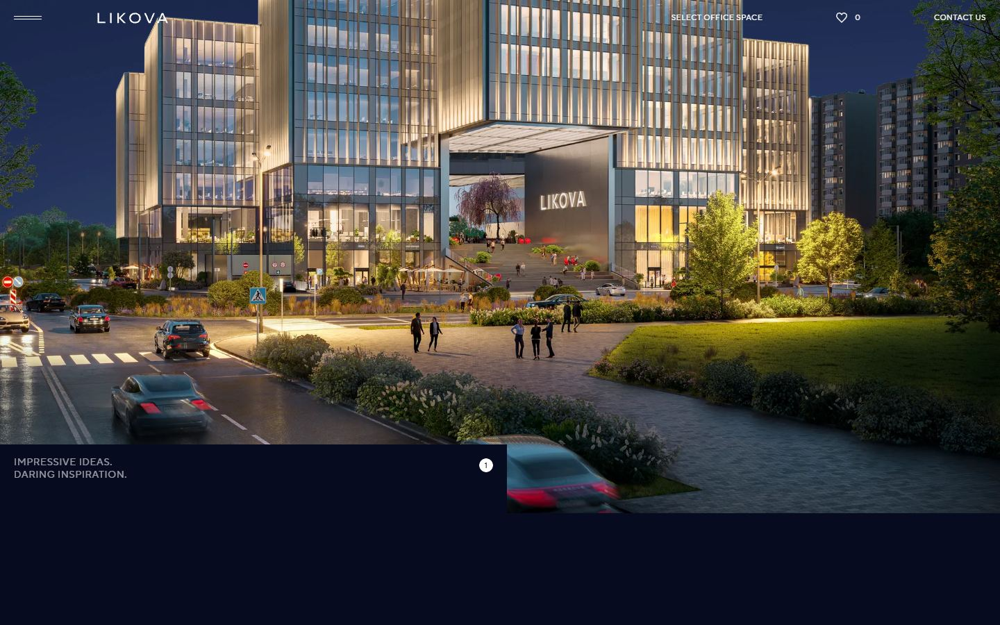</a> <a href="captures/desktop-05.jpg">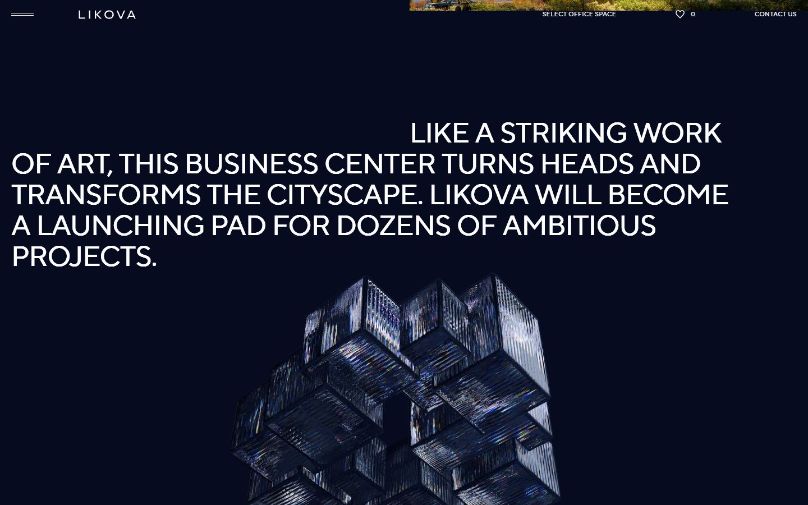</a> <a href="captures/desktop-06.jpg">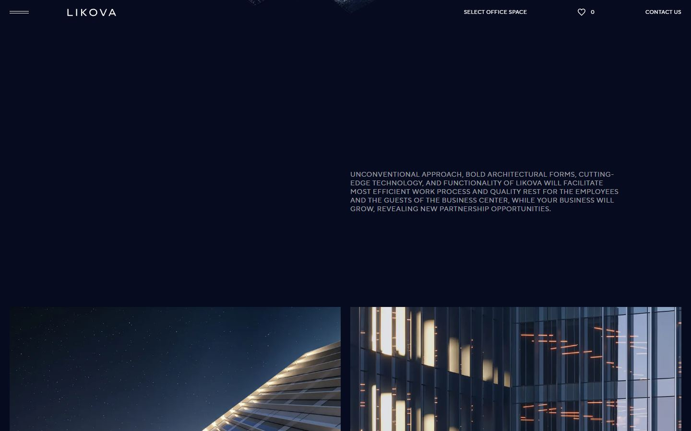</a> <a href="captures/desktop-07.jpg">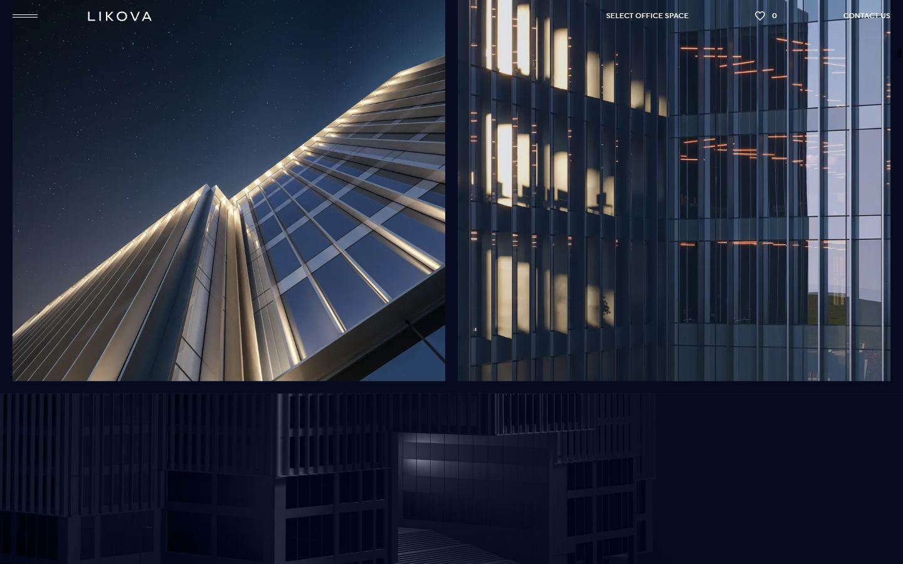</a> 

<a href="captures/page1-01.jpg">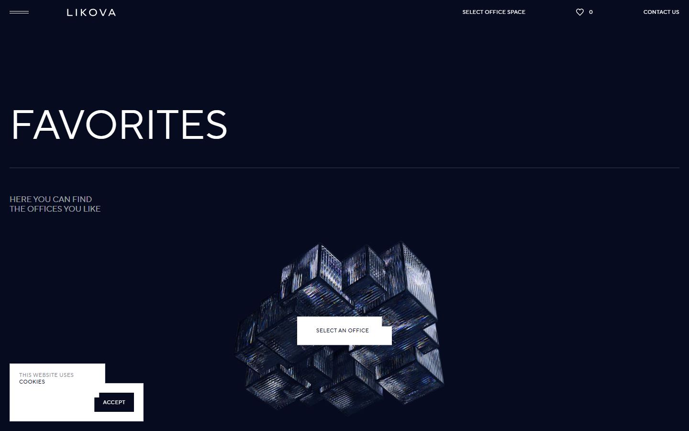</a> <a href="captures/page1-02.jpg"></a> <a href="captures/page1-03.jpg"></a> <a href="captures/page1-04.jpg">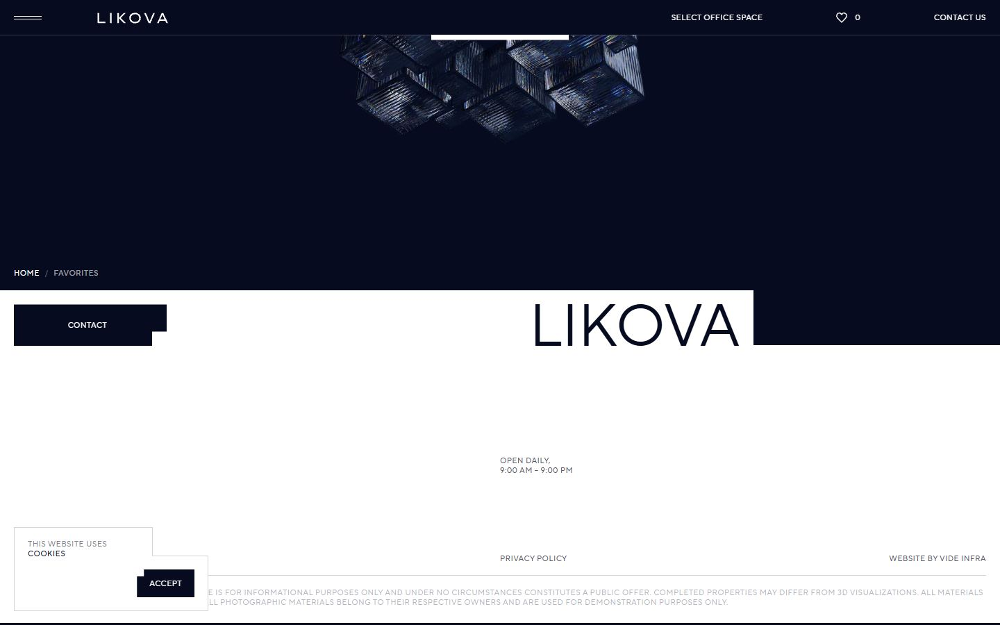</a> 

<a href="captures/mobile-01.jpg">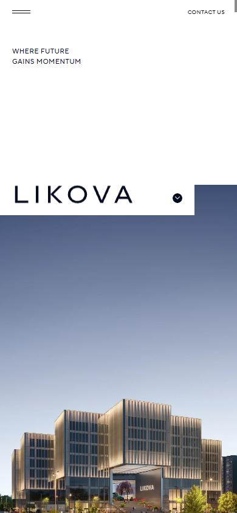</a> <a href="captures/mobile-02.jpg">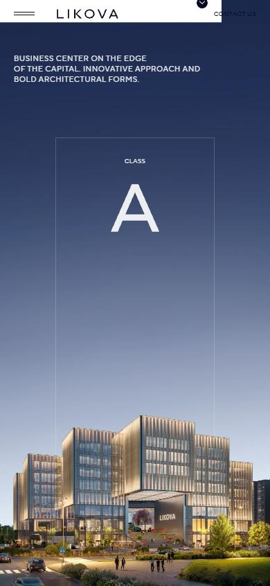</a> <a href="captures/mobile-03.jpg">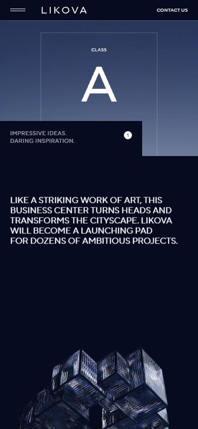</a> <a href="captures/mobile-04.jpg">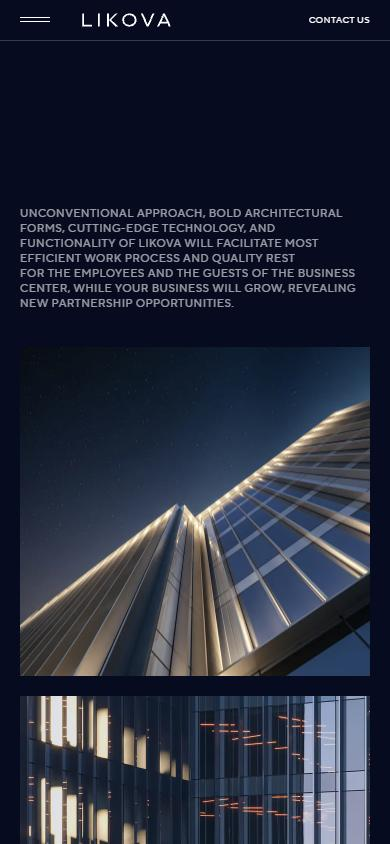</a> <a href="captures/mobile-05.jpg">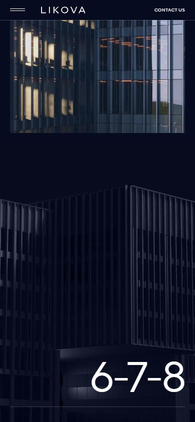</a> <a href="captures/mobile-06.jpg">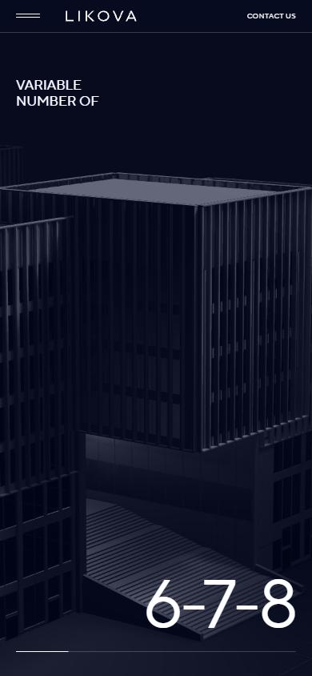</a> 

</details>

## Stack détectée
Barba.js, Highway, Keen slider, Lil-GUI/Tweakpane (debug), Locomotive Scroll, SplitText/SplitType, Three.js, WebGL, jQuery

Shaders GLSL personnalisés extraits : 6 (voir `shaders.glsl`)

## Design tokens
### Couleurs (fonds, pondérées par surface)
`#070b20` · `#ffffff` · `#e3e6eb` · `#0e1224` · `#000000`
### Couleurs de texte
`#ffffff` · `#070b20` · `#57566a` · `#232739`
### Polices utilisées (par volume de texte)
TT Norms Pro
### Fichiers de police chargés
- tt-norms-pro-regular.woff2
- tt-norms-pro-normal.woff2
### Typographie
| Élément | Police | Taille | Graisse | Interligne | Interlettrage | Casse |
|---|---|---|---|---|---|---|
| h1 | "TT Norms Pro", Helvetica, Arial, sans-serif | 143px | 400 | 150px | -5.72px | uppercase |
| h2 | "TT Norms Pro", Helvetica, Arial, sans-serif | 14px | 450 | 17.9999px | 0.56px | uppercase |
| p | "TT Norms Pro", Helvetica, Arial, sans-serif | 20px | 450 | 24px | -0.2px | uppercase |
| a | "TT Norms Pro", Helvetica, Arial, sans-serif | 14px | 450 | 17.9999px | 0.56px | uppercase |
| button | "TT Norms Pro", Helvetica, Arial, sans-serif | 14px | 450 | 17.9999px | 0.56px | uppercase |
| li | "TT Norms Pro", Helvetica, Arial, sans-serif | 14px | 450 | 17.9999px | 0.56px | uppercase |
| body | "TT Norms Pro", Helvetica, Arial, sans-serif | 14px | 450 | 17.9999px | 0.56px | uppercase |

### Échelle des tailles de texte
14px (189) · 11px (166) · 20px (62) · 143px (17) · 50px (17) · 85px (17)
### Arrondis
10px
### Transitions CSS fréquentes
- cubic-bezier(0.7 0.5s ×58
- cubic-bezier(0.7 1s ×2
### Points de rupture (media queries)
668px · 667px · 980px · 700px · 568px · 416px · 979px · 1920px · 1440px · 567px · 415px · 2400px
### Animations CSS (@keyframes)
arrowDown, loader
### Variables CSS (:root)
```css
--fos: -0.11em;
--foe: -0.19em;
--lh: var(--xxxxl,1.2em) var(--n-xxxxl,var(--xxxl,1.17647em) var(--n-xxxl,var(--xxl,1.28571em) var(--n-xxl,1.36364em)));
--scale-px: max(0.5px,min(1px,calc(0.5px + 0.5 * ((var(--vw100) - 980px) / 220))));
--scale-rem: max(0.5rem,min(1rem,calc(0.5rem + 5 * ((var(--vw100) - 980px) / 220))));
--scale-em: 1em;
--scale-text-px: max(0.7px,min(1px,calc(0.7px + 0.3 * ((var(--vw100) - 980px) / 220))));
--scale-text-rem: max(0.7rem,min(1rem,calc(0.7rem + 3 * ((var(--vw100) - 980px) / 220))));
--scale-text-em: 1em;
--spacing: var(--xxxl,calc(var(--scale-px) * 60)) var(--n-xxxl,var(--md,calc(var(--scale-px) * 40)) var(--n-md,calc(var(--scale-px) * 20)));
--spacing-layout: var(--xxxl,calc(var(--scale-px) * 30)) var(--n-xxxl,calc(var(--scale-px) * 20));
--sm: initial;
--n-sm: ;
--md: initial;
--n-md: ;
--lg: initial;
--n-lg: ;
--xl: initial;
--n-xl: ;
--xxl: initial;
--n-xxl: ;
--xxxl: initial;
--n-xxxl: ;
--xxxxl: initial;
--n-xxxxl: ;
--vw: 1vw;
--vw100: 100vw;
--c-white: #fff;
--c-white-rgb: 255,255,255;
--c-blue-gray: #070b20;
--c-blue-gray-rgb: 7,11,32;
--c-blue-dark: #232739;
--c-blue-dark-rgb: 35,39,57;
--c-blue-deep: #57566a;
--c-blue-deep-rgb: 87,86,106;
--c-gray: #bdbec4;
--c-gray-rgb: 189,190,196;
--c-gray-light: #e3e6eb;
--c-gray-light-rgb: 227,230,235;
--c-border: #393c4d;
--c-border-rgb: 57,60,77;
--c-metal: linear-gradient(180deg,#c7cbd4,#5a5f65);
--c-tap-highlight: rgba(0,0,0,.2);
--c-tap-highlight-rgb: 0,0,0;
--c-error: #ce1d20;
--c-error-rgb: 206,29,32;
--t-background: var(--c-white);
--t-background-rgb: var(--c-white-rgb);
--t-background-alternative: var(--c-gray-light);
--t-background-alternative-rgb: var(--c-gray-light-rgb);
--t-line: rgba(var(--c-blue-dark-rgb),0.2);
--t-line-rgb: var(--c-blue-dark-rgb);
--t-small: var(--c-blue-deep);
--t-small-rgb: var(--c-blue-deep-rgb);
--t-small-transparent: rgba(var(--c-blue-dark-rgb),0.6);
--t-small-transparent-rgb: var(--c-blue-dark-rgb);
--t-text: var(--c-blue-gray);
--t-text-rgb: var(--c-blue-gray-rgb);
--t-heading: var(--c-blue-dark);
--t-heading-rgb: var(--c-blue-dark-rgb);
--t-primary: var(--c-blue-gray);
--t-primary-rgb: var(--c-blue-gray-rgb);
--t-secondary: var(--c-blue-gray);
--t-secondary-rgb: var(--c-blue-gray-rgb);
--t-button-bitten-corner-text: var(--t-background);
--t-button-bitten-corner-text-rgb: var(--t-background-rgb);
--t-button-bitten-corner-background: var(--t-primary);
--t-button-bitten-corner-background-rgb: var(--t-primary-rgb);
--t-button-bitten-corner-hover-text: var(--t-background);
--t-button-bitten-corner-hover-text-rgb: var(--t-background-rgb);
--t-button-bitten-corner-hover-background: var(--t-primary);
--t-button-bitten-corner-hover-background-rgb: var(--t-primary-rgb);
--t-button-bitten-corner-active-text: var(--t-background);
--t-button-bitten-corner-active-text-rgb: var(--t-background-rgb);
--t-button-bitten-corner-active-background: var(--t-primary);
--t-button-bitten-corner-active-background-rgb: var(--t-primary-rgb);
--t-button-bitten-corner-disabled-text: var(--t-background);
--t-button-bitten-corner-disabled-text-rgb: var(--t-background-rgb);
--t-button-bitten-corner-disabled-background: rgba(var(--t-primary-rgb),0.4);
--t-button-bitten-corner-disabled-background-rgb: var(--t-primary-rgb);
```

## Structure de la home
Hauteur : 900 px — 3274 nœuds DOM — canvas 1, vidéos 4, images 96

| # | Bloc | Hauteur | Titre | Médias |
|---|---|---|---|---|
| 1 | section .intro section ui-dark ui-background | 3800 | LIKOVA — Where future gains momentum | 6 |
| 2 | section#about .idea section section--top ui-dark  | 2101 | Impressive ideas. Daring inspiration. | 6 |
| 3 | section .information section ui-dark ui-backgroun | 5400 | Информация | 1 |
| 4 | section#location .location section ui-dark ui-background | 7650 | Location | 14 |
| 5 | section .accessibility section ui-light ui-backgr | 7650 | Reach your goals with excellent transport connectivity | 16 |
| 6 | section .environment section ui-dark ui-backgroun | 5400 | Exciting environment for those who are always on the move | 24 |
| 7 | section#genplan .general-plan section ui-light ui-backgro | 2097 | The Master Plan | 4 |
| 8 | section#architecture .architecture section ui-dark ui-backgrou | 7947 | Architecture | 26 |
| 9 | section#lobby .lobby section ui-dark ui-background | 5595 | Lobby | 26 |
| 10 | section#offices .offices section ui-dark ui-background | 5247 | Offices | 22 |
| 11 | section .section section--top-2 ui-light ui-backg | 1255 | Priceless ideas are born in comfort. | 0 |
| 12 | section#engineering .engineering section section--top ui-dark | 3486 | Technology | 3 |
| 13 | section#infrastructure .infrastructure section ui-dark ui-backgr | 7998 | Infrastructure | 32 |
| 14 | section#team .team section section--top ui-light ui-ba | 900 | Our Team | 6 |

**Navigation :** Select office space · 0 · Contact US · Select office space · 0 · Contact US · Contact US · Select office space · 0 · Contact US · Contact US

**Boutons / CTA :** 

## SEO
- Title : Class A Business Center
- Description : Conveniently located, with flexible office layouts, extensive amenities, and spacious parking. Learn more.
- Langue : en — canonical : https://likova.space/en/
- Open Graph : oui — JSON-LD : Organization, WebSite, BreadcrumbList, WebPage
- H1 : 1 — images sans alt : 95/96

### Plan des titres
- H1 LIKOVA — Where future gains momentum
- H2 Impressive ideas. Daring inspiration.
- H2 Информация
- H2 Location
- H2 Reach your goals with excellent transport connectivity
- H2 Exciting environment for those who are always on the move
- H2 The Master Plan
- H2 Architecture
- H2 Lobby
- H2 Offices
- H2 Priceless ideas are born in comfort.
- H2 Technology
- H2 Infrastructure
- H2 Our Team

## Performance (mesure locale, Chrome headless, connexion non bridée)
- TTFB 243 ms · LCP 540 ms (P.preloader__content__cover) · CLS 0.007 · load 606 ms
- 129 requêtes · 17356 Ko transférés
- Par type : Document 1 req / 49 Ko, Stylesheet 2 req / 64 Ko, Image 103 req / 8607 Ko, Script 5 req / 408 Ko, Other 3 req / 13 Ko, Font 2 req / 197 Ko, Fetch 11 req / 2645 Ko, Media 2 req / 5373 Ko
- Plus gros fichiers :
- 4201 Ko — Media — https://likova.space/uploads/video/landing/5.accessibility.mp4
- 2572 Ko — Fetch — https://likova.space/assets/webgl-dark/dark.glb
- 1172 Ko — Media — https://likova.space/uploads/video/landing/7.general-plan.mp4
- 537 Ko — Image — https://likova.space/assets/images/media/landing/8.architecture/slider-1@xxl.webp?v=1782384571
- 496 Ko — Image — https://likova.space/assets/images/media/landing/8.architecture/slider-3@xxl.webp?v=1782384571
- 494 Ko — Image — https://likova.space/assets/images/media/landing/1.intro/building-lights@xxl.webp?v=1782384571
- 455 Ko — Image — https://likova.space/assets/images/media/landing/1.intro/building@xxl.webp?v=1782384571
- 447 Ko — Image — https://likova.space/assets/images/media/landing/13.infrastructure/slider-2@xxl.webp?v=1782384571
- Services tiers : unpkg.com

## Mobile
- H1 : {'size': '86px', 'lineHeight': '89.9999px'} · corps : 11px · débordement horizontal : False · menu burger : True

## Fichiers
- `captures/` : arrivée, scroll desktop (1440×900), pleine page, pages internes, mobile (390×844 @2x) ; vidéo de scroll dans la release GitHub « videos » (lien en haut de fiche)
- `page.html` : DOM rendu · `styles.css` : CSS chargé · `scripts/` : JS chargé (index dans `_index.json`) · `shaders.glsl` : shaders extraits · `rea-bundle.json` : analyse REA du bundle (chunks, routes, endpoints)

## Pages internes capturées
- https://likova.space/en/favourites
