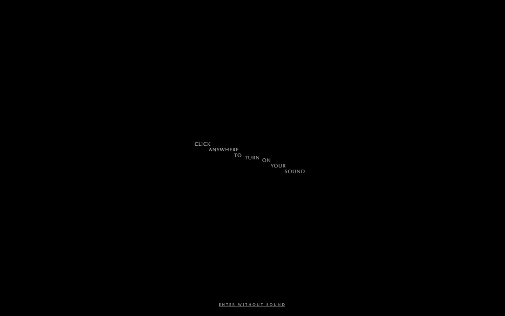
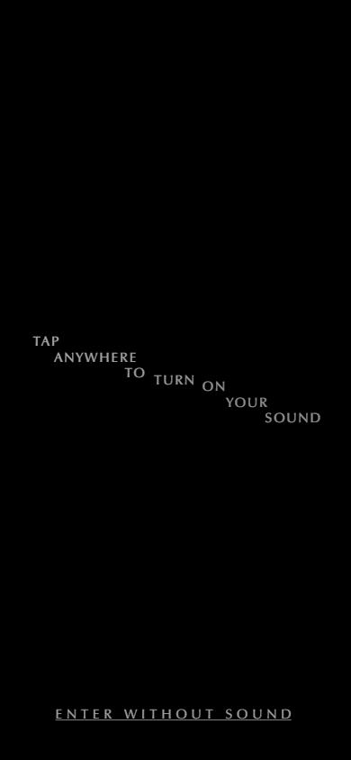

# Michael Gatt

- Site : [https://michaelgatt.com/](https://michaelgatt.com/) — [aperçu statique local](apercu.html)
- Capturé le : 2026-11-03 — statut : ok
- Vidéo de scroll : [▶ ouvrir](https://github.com/t-baudry/bibliotheque-web/releases/download/videos/076-michael-gatt.webm)

<a href="captures/desktop-00-arrivee.jpg"></a> 

<details><summary>Toutes les captures</summary>

<a href="captures/desktop-01.jpg"></a> <a href="captures/desktop-02.jpg"></a> <a href="captures/desktop-03.jpg"></a> <a href="captures/desktop-04.jpg"></a> <a href="captures/desktop-05.jpg"></a> <a href="captures/desktop-06.jpg"></a> <a href="captures/desktop-07.jpg"></a> 

<a href="captures/page1-01.jpg"></a> <a href="captures/page1-02.jpg"></a> <a href="captures/page1-03.jpg"></a> <a href="captures/page1-04.jpg"></a> <a href="captures/page2-01.jpg"></a> <a href="captures/page2-02.jpg"></a> <a href="captures/page2-03.jpg"></a> <a href="captures/page2-04.jpg"></a> <a href="captures/page3-01.jpg"></a> <a href="captures/page3-02.jpg"></a> <a href="captures/page3-03.jpg"></a> <a href="captures/page3-04.jpg"></a> 

<a href="captures/mobile-01.jpg"></a> <a href="captures/mobile-02.jpg"></a> <a href="captures/mobile-03.jpg"></a> <a href="captures/mobile-04.jpg"></a> <a href="captures/mobile-05.jpg"></a> <a href="captures/mobile-06.jpg"></a> 

</details>

## Stack détectée
CMS Contentful, CMS Prismic, GSAP, Lenis, Nuxt, Postprocessing, ScrollTrigger, SplitText/SplitType, Swiper, Three.js, Virtual scroll, Vue, WebGL

Versions : GSAP 3.15.0 · Three.js r?

Shaders GLSL personnalisés extraits : 12 (voir `shaders.glsl`)

## Design tokens
### Couleurs (fonds, pondérées par surface)
`#000000`
### Couleurs de texte
`#ffffff` · `#c5c5c5` · `#000000` · `#969da0`
### Polices utilisées (par volume de texte)
Zapf-Humanist-Demi
### Fichiers de police chargés
- ZapfHumanist601BT-Demi.woff2
### Typographie
| Élément | Police | Taille | Graisse | Interligne | Interlettrage | Casse |
|---|---|---|---|---|---|---|
| p | Zapf-Humanist-Demi | 13.5px | 400 | 16.875px | 2.025px | uppercase |
| a | Zapf-Humanist-Demi | 17.9995px | 400 | 22.4994px | 6.29984px | uppercase |
| body | Zapf-Humanist-Demi | 13.5px | 400 | 20.25px | normal | none |

### Échelle des tailles de texte
13.5px (14) · 14.9999px (9) · 10.4895px (5) · 17.9995px (3) · 11.988px (1)
### Arrondis
aucun (angles droits)
### Transitions CSS fréquentes
- cubic-bezier(0.4 0.5s ×5
### Points de rupture (media queries)
1024px · 768px · 640px · 1280px · 1536px · 0px · 375px · 1600px · 639px · 900px
### Animations CSS (@keyframes)
spin-d7aabb08
### Variables CSS (:root)
```css
--zapf-bumanist-font: "Zapf-Humanist-Demi",sans-serif;
--tw-bg-opacity: 1;
```

## Structure de la home
Hauteur : 900 px — 223 nœuds DOM — canvas 1, vidéos 0, images 0

| # | Bloc | Hauteur | Titre | Médias |
|---|---|---|---|---|
| 1 | div .w-full h-full fixed top-0 left-0 z-10 bg | 900 |  | 1 |

**Navigation :** 

**Boutons / CTA :** 

## SEO
- Title : Michael Gatt | Music Composer for Film and Television
- Description : Welcome to Michael Gatt’s universe of Film + TV shows and games music composing
- Langue : en — canonical : None
- Open Graph : oui — JSON-LD : aucun
- H1 : 0 — images sans alt : 0/0

### Plan des titres
- (rien relevé)

## Performance (mesure locale, Chrome headless, connexion non bridée)
- TTFB 300 ms · LCP 516 ms (DIV.block) · CLS 0 · load 607 ms
- 216 requêtes · 2792 Ko transférés
- Par type : Document 1 req / 37 Ko, Script 96 req / 662 Ko, Other 5 req / 553 Ko, Font 1 req / 14 Ko, Stylesheet 16 req / 12 Ko, Fetch 3 req / 1 Ko, Image 93 req / 1513 Ko, Media 1 req / 0 Ko
- Plus gros fichiers :
- 541 Ko — Other — https://michaelgatt.com/_nuxt/CYtiSaOr.js
- 310 Ko — Script — https://michaelgatt.com/_nuxt/CaSYcmUf.js
- 225 Ko — Image — https://michael-gatt-website.cachely.io/michael-gatt-website/Z5oXoZbqstJ99_KL_DnD-Album-News-1.png?auto=format,compress
- 208 Ko — Image — https://michael-gatt-website.cachely.io/michael-gatt-website/Z6N4rpbqstJ9-Qd9_DnD-Album-News-FI-scaled.png?auto=format,compress
- 178 Ko — Script — https://www.googletagmanager.com/gtag/js?id=G-7PQLZVDF62
- 92 Ko — Image — https://michael-gatt-website.cachely.io/michael-gatt-website/ZzBqu68jQArT0qMF_Tiamat.JPG?auto=format,compress
- 37 Ko — Document — https://michaelgatt.com/
- 36 Ko — Image — https://michael-gatt-website.cachely.io/michael-gatt-website/Zzd2iK8jQArT07KW_Maskgroup.png?auto=format,compress
- Services tiers : www.googletagmanager.com, michael-gatt-website.cachely.io, region1.google-analytics.com

## Mobile
- H1 : None · corps : 21.9375px · débordement horizontal : False · menu burger : True

## Fichiers
- `captures/` : arrivée, scroll desktop (1440×900), pleine page, pages internes, mobile (390×844 @2x) ; vidéo de scroll dans la release GitHub « videos » (lien en haut de fiche)
- `page.html` : DOM rendu · `styles.css` : CSS chargé · `scripts/` : JS chargé (index dans `_index.json`) · `shaders.glsl` : shaders extraits · `rea-bundle.json` : analyse REA du bundle (chunks, routes, endpoints)

## Pages internes capturées
- https://michaelgatt.com/projects
- https://michaelgatt.com/about
- https://michaelgatt.com/contact
