# Mosbys Files

- Site : [https://www.mosbyfiles.com/](https://www.mosbyfiles.com/) — [aperçu statique local](apercu.html)
- Capturé le : 2026-11-03 — statut : ok
- Vidéo de scroll : [▶ ouvrir](https://github.com/t-baudry/bibliotheque-web/releases/download/videos/081-mosbys-files.webm)

<a href="captures/desktop-00-arrivee.jpg">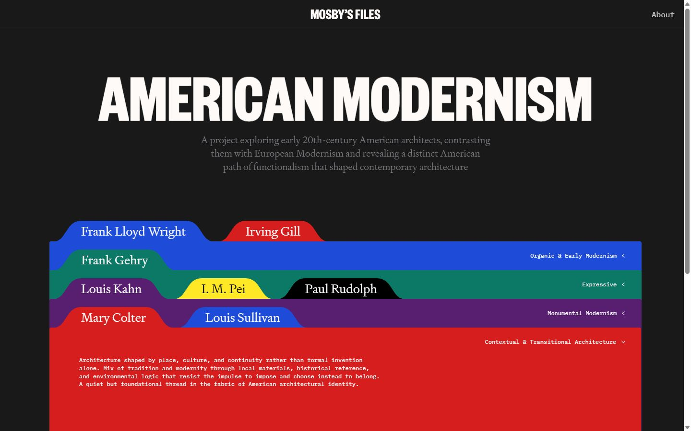</a> 

<details><summary>Toutes les captures</summary>

<a href="captures/desktop-01.jpg"></a> <a href="captures/desktop-02.jpg"></a> <a href="captures/desktop-03.jpg">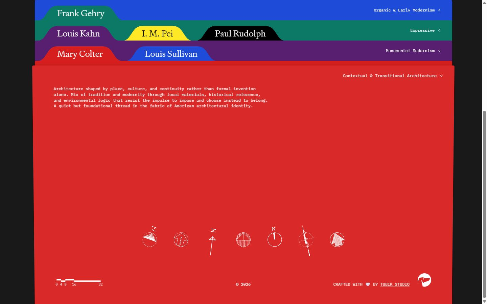</a> <a href="captures/desktop-pleine-page.jpg">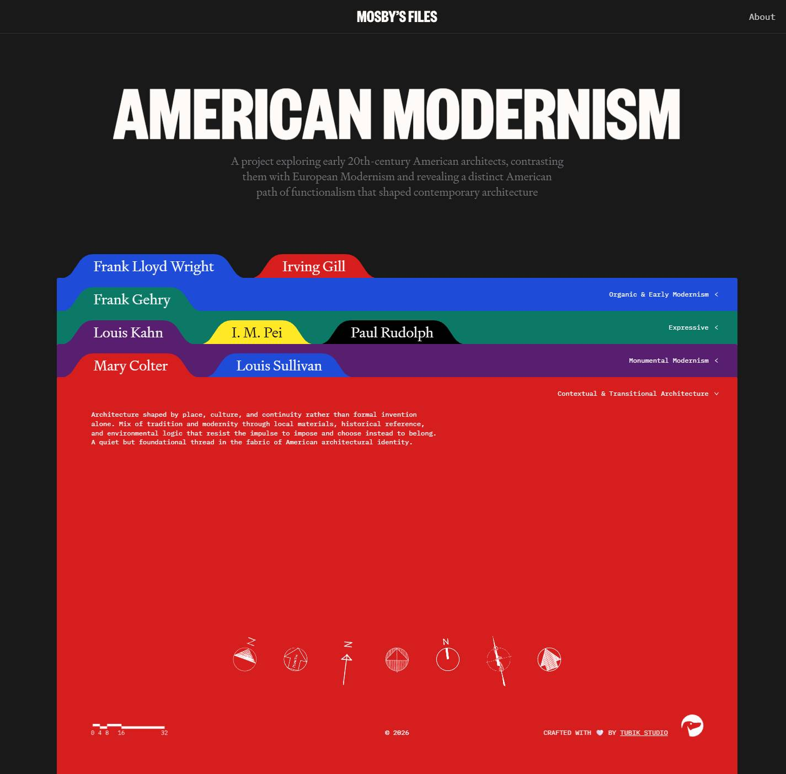</a> 

<a href="captures/page1-01.jpg">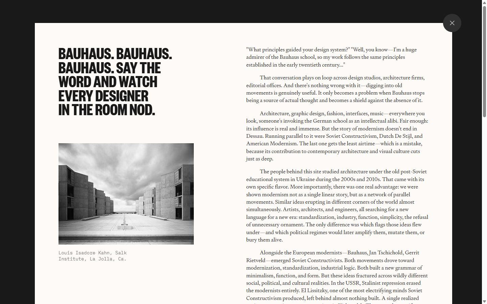</a> <a href="captures/page1-02.jpg">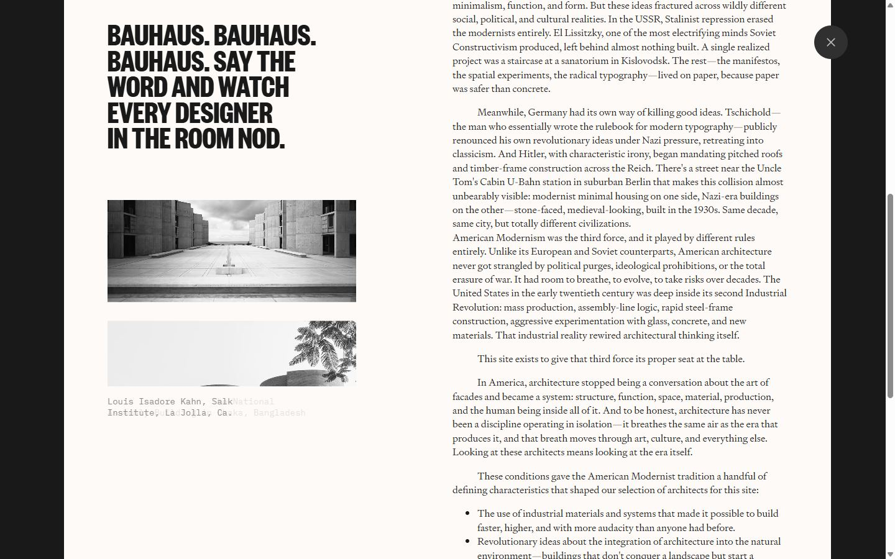</a> <a href="captures/page1-03.jpg">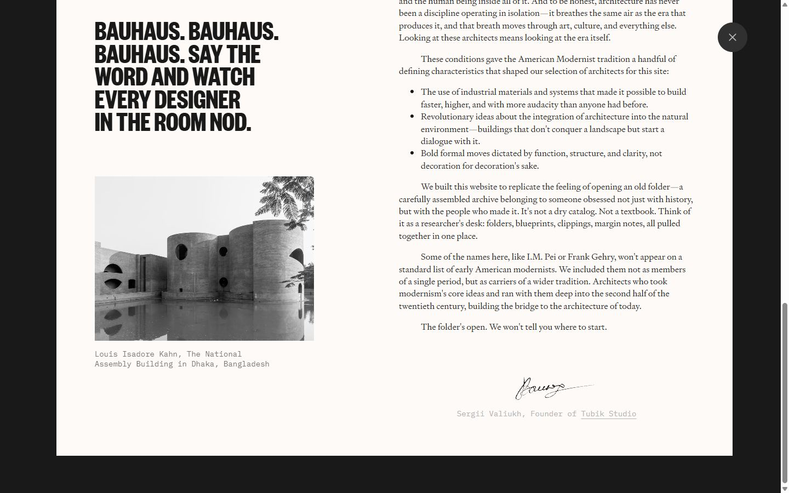</a> <a href="captures/page2-01.jpg">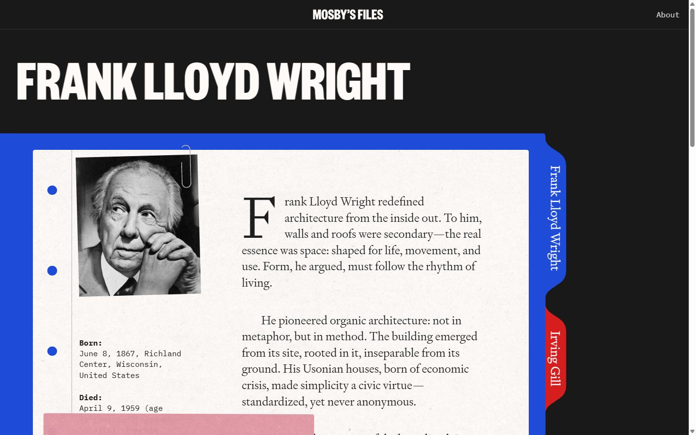</a> <a href="captures/page2-02.jpg">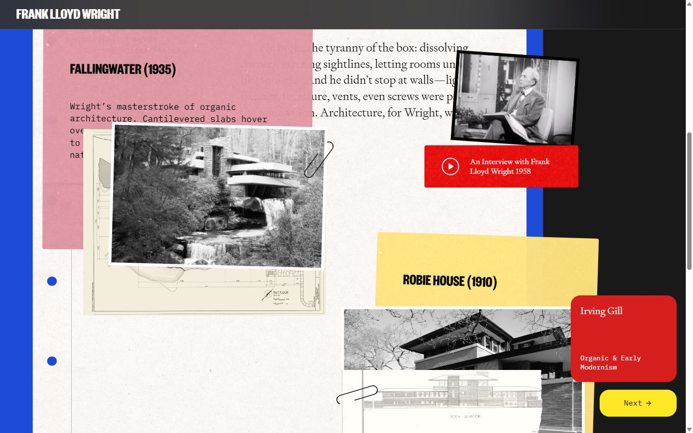</a> <a href="captures/page2-03.jpg">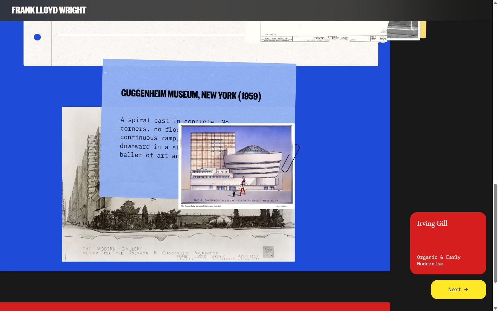</a> <a href="captures/page2-04.jpg">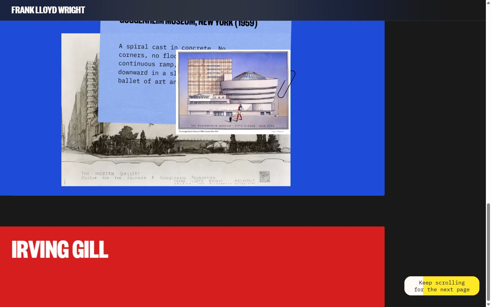</a> 

<a href="captures/mobile-01.jpg">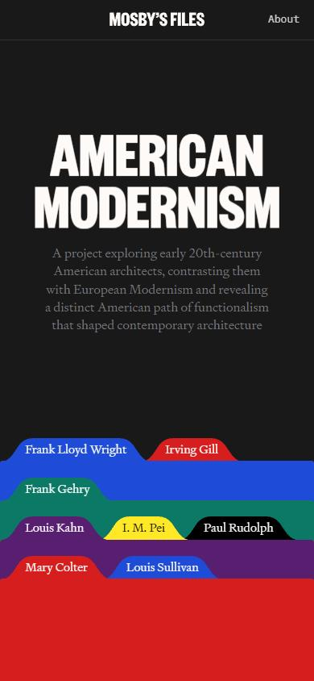</a> <a href="captures/mobile-02.jpg"></a> <a href="captures/mobile-03.jpg"></a> <a href="captures/mobile-04.jpg"></a> <a href="captures/mobile-05.jpg">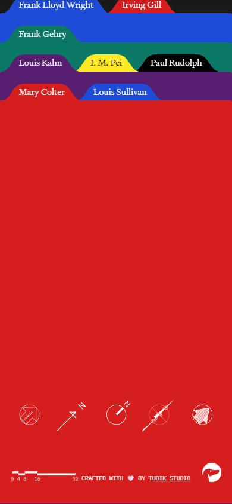</a> <a href="captures/mobile-06.jpg"></a> 

</details>

## Stack détectée
CMS Storyblok, GSAP, Lenis, Nuxt, ScrollTrigger, SplitText/SplitType, Swiper, Virtual scroll, Vue

Versions : GSAP 3.11.0 · Three.js r?

## Design tokens
### Couleurs (fonds, pondérées par surface)
`#1e4bd7` · `#d71e1e` · `#0c7866` · `#581e70` · `#ffe927` · `#000000` · `#191919`
### Couleurs de texte
`#ffffff` · `#787a7f` · `#fdfaf7` · `#000000`
### Polices utilisées (par volume de texte)
IBM Plex Mono · Signifier · Founders Grotesk
### Fichiers de police chargés
- signifier-light.woff2
- founders-grotesk-x-condensed-bold.woff2
- -F63fjptAgt5VM-kVkqdyU8n1i8q1w.woff2
### Typographie
| Élément | Police | Taille | Graisse | Interligne | Interlettrage | Casse |
|---|---|---|---|---|---|---|
| h1 | "Founders Grotesk", sans-serif | 144.06px | 700 | 115.248px | normal | uppercase |
| p | Signifier, serif | 20px | 400 | 28px | normal | none |
| a | "IBM Plex Mono", sans-serif | 16px | 400 | 32px | normal | none |
| body | Signifier, serif | 16px | 400 | 20px | normal | none |

### Échelle des tailles de texte
26px (18) · 144.06px (17) · 12px (11) · 16px (3) · 20px (1)
### Arrondis
4px
### Transitions CSS fréquentes
- cubic-bezier(0.33 0.65s ×22
- ease 0.65s ×1
### Points de rupture (media queries)
1024px · 480px · 768px · 1025px · 900px · 320px · 1440px · 1920px
### Animations CSS (@keyframes)
plyr-progress, plyr-popup, plyr-fade-in
### Variables CSS (:root)
```css
--stack-border-radius: 4px;
--stack-group-height-sm: 15vh;
--stack-group-height-lg: 80vh;
--stack-group-offset: 3.75rem;
--stack-perspective: 3000px;
--stack-rotation-angle: -3deg;
--stack-rotation-offset: 1rem;
--stack-shadow: 0 -1px 8px rgba(0,0,0,.15);
--folder-shadow: 1px 0 8px rgba(0,0,0,.15);
--folder-offset: 65vh;
--tag-height: 2.25rem;
--tag-aspect-ratio: 1.409;
--case-content-width: calc(var(--container-size) - var(--tag-height));
--color-light: #fdfaf7;
--color-gray: #787a7f;
--color-dark: #191919;
--color-primary: var(--color-dark);
--color-contrast: var(--color-light);
--container-size: calc(100vw - var(--container-offset)*2);
--container-offset: 18px;
```

## Structure de la home
Hauteur : 1404 px — 331 nœuds DOM — canvas 0, vidéos 0, images 9

| # | Bloc | Hauteur | Titre | Médias |
|---|---|---|---|---|
| 1 | section#hero .section-hero container | 900 | American modernism | 0 |
| 2 | div .page-home__stack container | 504 |  | 9 |

**Navigation :** About

**Boutons / CTA :** 

## SEO
- Title : Mosby’s Files—American Modernist Architecture
- Description : A research-driven archive exploring the architects who built American Modernism—independently of Europe, and on their own radical terms.
- Langue : en_US — canonical : None
- Open Graph : oui — JSON-LD : aucun
- H1 : 1 — images sans alt : 7/9

### Plan des titres
- H1 American modernism

## Performance (mesure locale, Chrome headless, connexion non bridée)
- TTFB 172 ms · LCP 2264 ms (P.section-hero__desc) · CLS 0 · load 839 ms
- 41 requêtes · 1538 Ko transférés
- Par type : Document 1 req / 67 Ko, Script 11 req / 1026 Ko, Stylesheet 9 req / 19 Ko, Image 9 req / 287 Ko, Font 3 req / 79 Ko, Other 1 req / 15 Ko, Preflight 3 req / 0 Ko, Fetch 4 req / 45 Ko
- Plus gros fichiers :
- 1010 Ko — Script — https://www.mosbyfiles.com/_nuxt/DwAQhwlc.js
- 83 Ko — Image — https://a.storyblok.com/f/290489675855311/1000x1000/468e4bf99e/f-1.png
- 67 Ko — Document — https://www.mosbyfiles.com/
- 52 Ko — Font — https://www.mosbyfiles.com/fonts/signifier-light.woff2
- 51 Ko — Image — https://a.storyblok.com/f/290489675855311/1000x1000/8b5a7398ab/f-5.png
- 45 Ko — Image — https://a.storyblok.com/f/290489675855311/600x600/34412f0df3/f-6.avif
- 43 Ko — Fetch — https://api.storyblok.com/v2/cdn/stories/global?cv=1786438017&resolve_level=2&resolve_relations=stack-group.cases&token=WdeDlX0eomdlf8mnDLcSYQtt&version=publish
- 42 Ko — Image — https://a.storyblok.com/f/290489675855311/1000x1000/d95be3fd6c/f-3.png
- Services tiers : a.storyblok.com, fonts.googleapis.com, fonts.gstatic.com, api.storyblok.com

## Mobile
- H1 : {'size': '81.42px', 'lineHeight': '65.136px'} · corps : 13px · débordement horizontal : False · menu burger : False

## Fichiers
- `captures/` : arrivée, scroll desktop (1440×900), pleine page, pages internes, mobile (390×844 @2x) ; vidéo de scroll dans la release GitHub « videos » (lien en haut de fiche)
- `page.html` : DOM rendu · `styles.css` : CSS chargé · `scripts/` : JS chargé (index dans `_index.json`) · `shaders.glsl` : shaders extraits · `rea-bundle.json` : analyse REA du bundle (chunks, routes, endpoints)

## Pages internes capturées
- https://www.mosbyfiles.com/about
- https://www.mosbyfiles.com/cases/frank-lloyd-wright
