# Studio K95

- Site : [https://k95.it/](https://k95.it/) — [aperçu statique local](apercu.html)
- Capturé le : 2026-11-03 — statut : ok
- Vidéo de scroll : [▶ ouvrir](https://github.com/t-baudry/bibliotheque-web/releases/download/videos/083-studio-k95.webm)

<a href="captures/desktop-00-arrivee.jpg">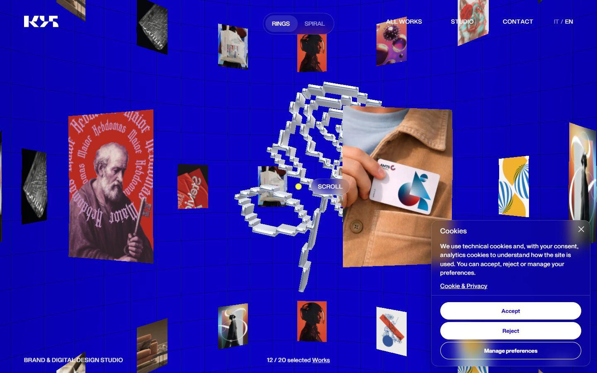</a> 

<details><summary>Toutes les captures</summary>

<a href="captures/desktop-01.jpg">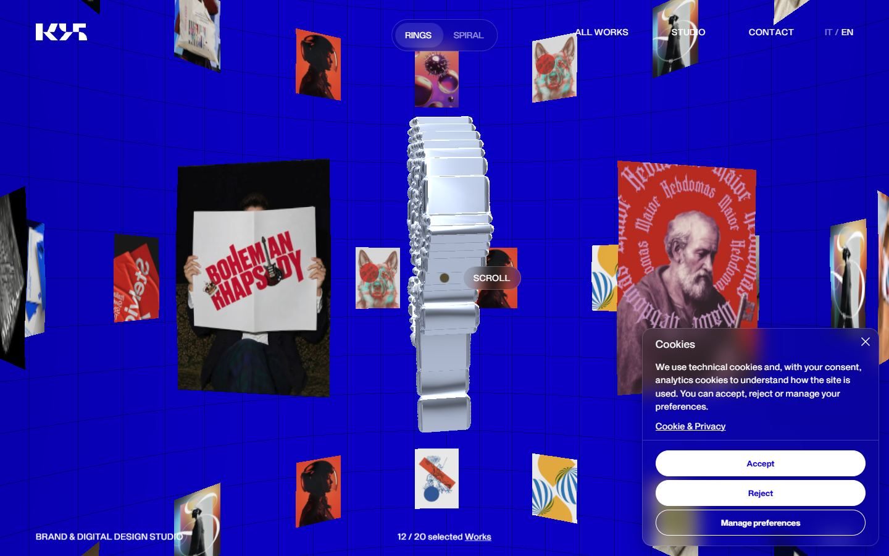</a> <a href="captures/desktop-02.jpg">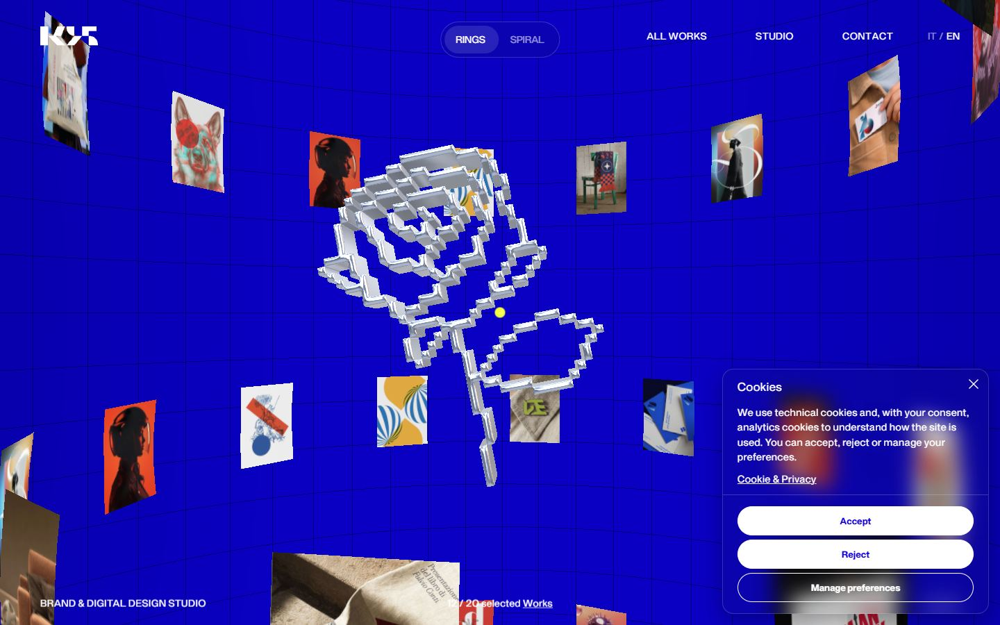</a> <a href="captures/desktop-03.jpg">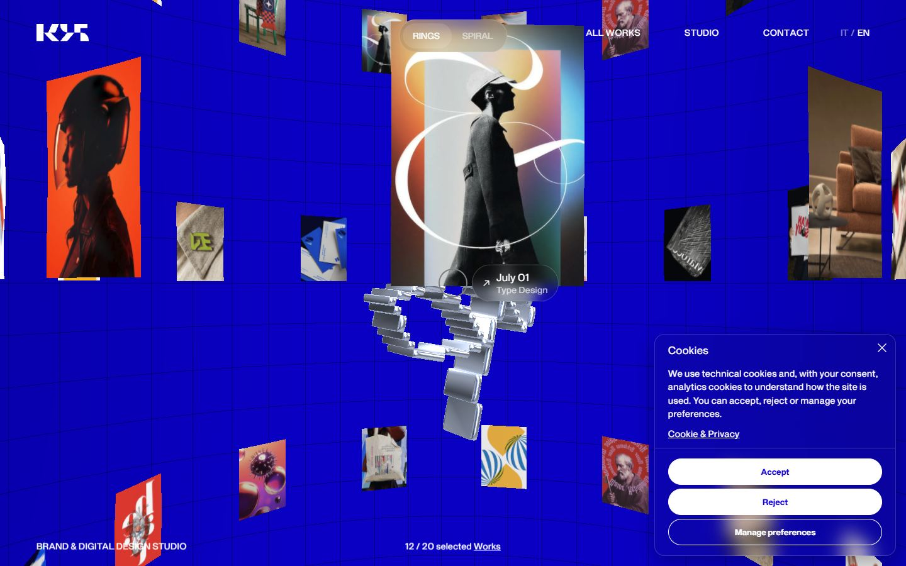</a> <a href="captures/desktop-04.jpg">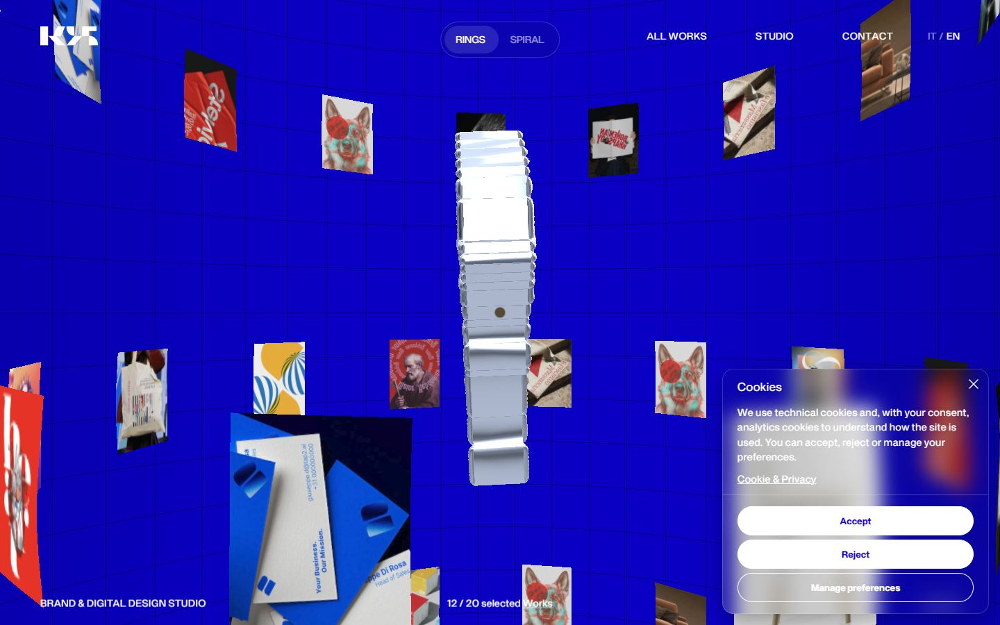</a> <a href="captures/desktop-05.jpg">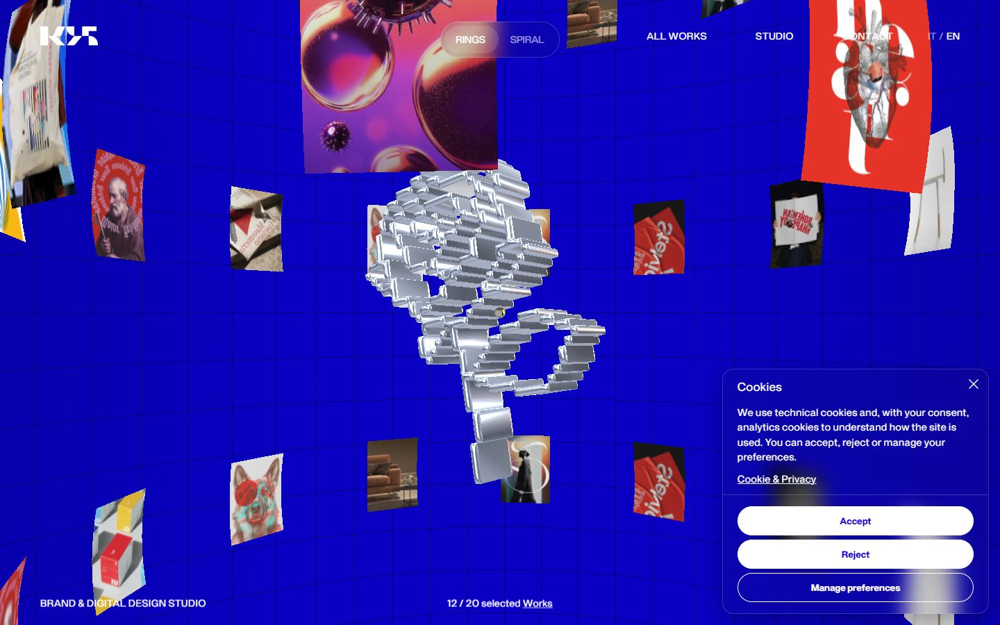</a> <a href="captures/desktop-06.jpg">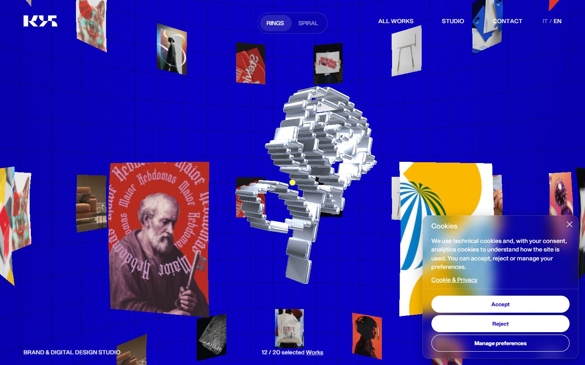</a> <a href="captures/desktop-07.jpg">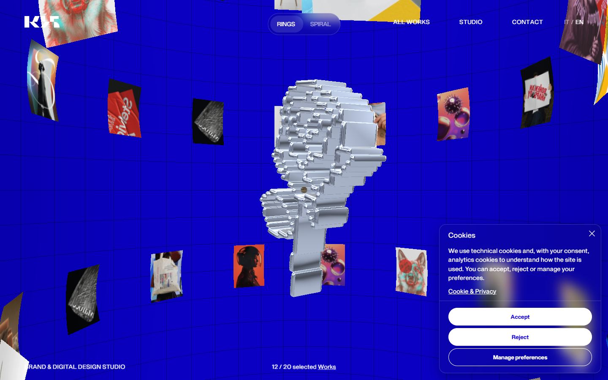</a> 

<a href="captures/page1-01.jpg">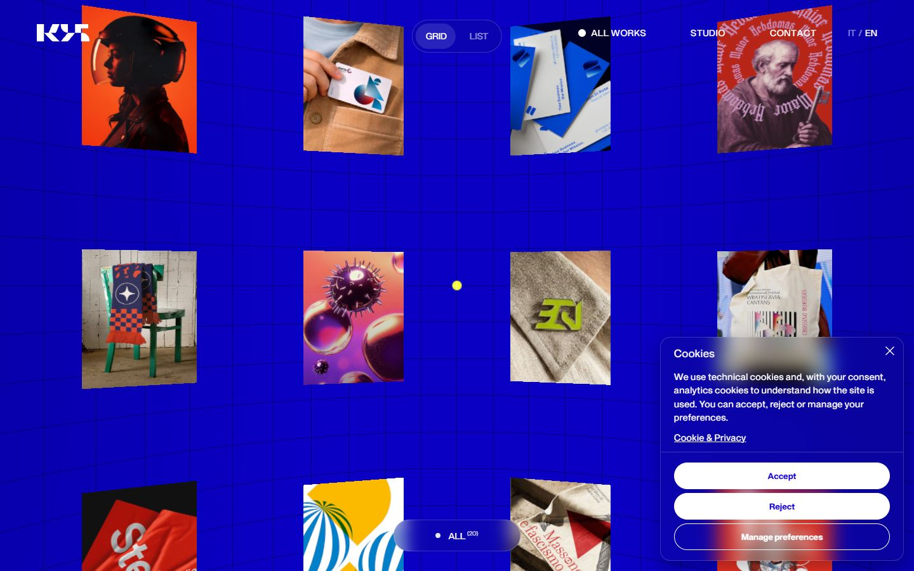</a> <a href="captures/page1-02.jpg">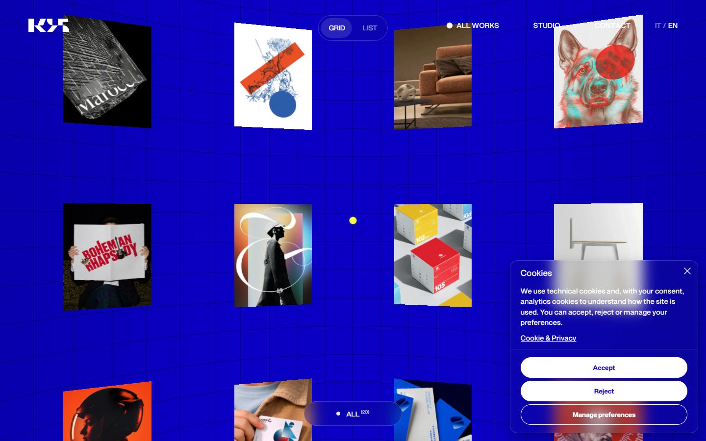</a> <a href="captures/page1-03.jpg">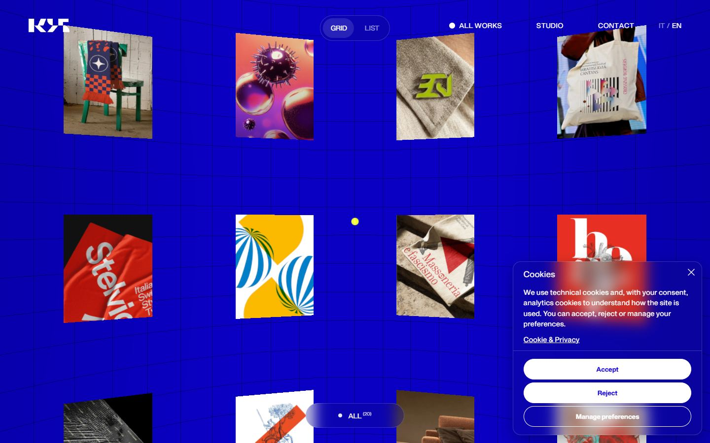</a> <a href="captures/page1-04.jpg">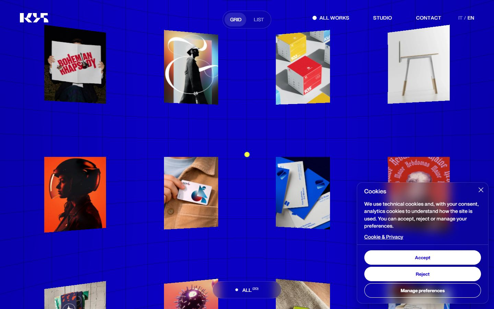</a> 

<a href="captures/mobile-01.jpg">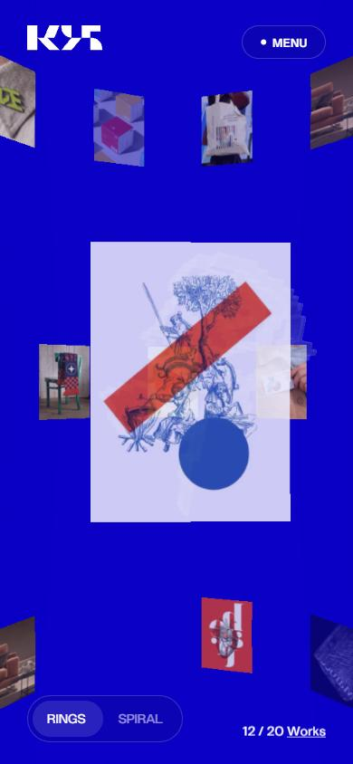</a> <a href="captures/mobile-02.jpg">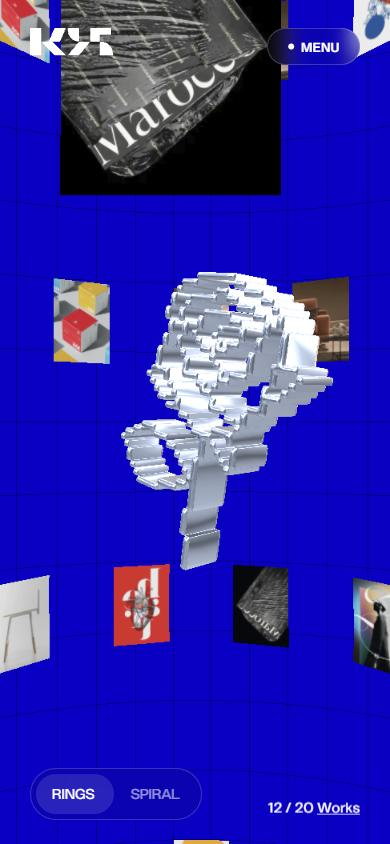</a> <a href="captures/mobile-03.jpg">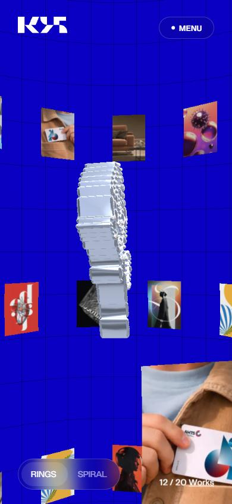</a> <a href="captures/mobile-04.jpg">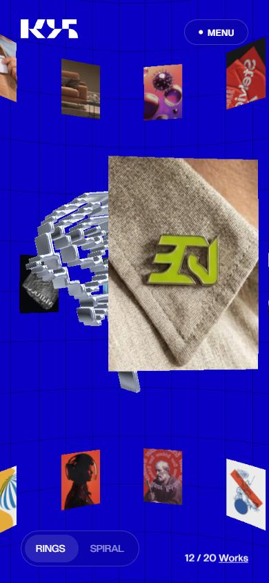</a> <a href="captures/mobile-05.jpg">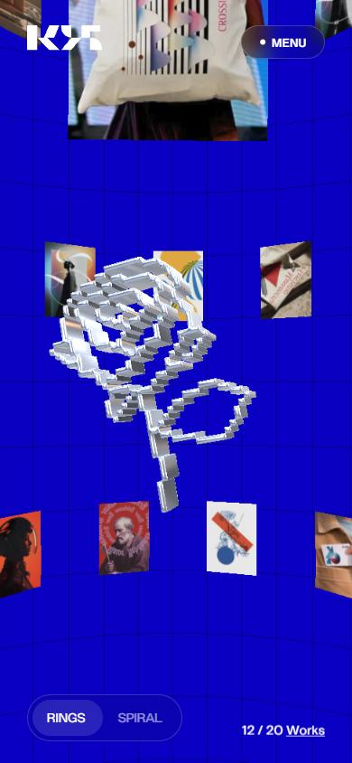</a> <a href="captures/mobile-06.jpg">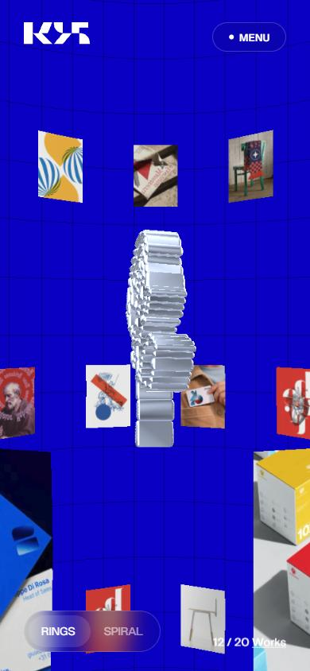</a> 

</details>

## Stack détectée
CMS Strapi, GSAP, Lenis, Nuxt, ScrollTrigger, Three.js, Virtual scroll, Vue, WebGL

Shaders GLSL personnalisés extraits : 23 (voir `shaders.glsl`)

## Design tokens
### Couleurs (fonds, pondérées par surface)
`#1500e1` · `#000000` · `#1c1c1c` · `#ffffff`
### Couleurs de texte
`#ffffff` · `#1500e1`
### Polices utilisées (par volume de texte)
adaptive
### Fichiers de police chargés
- adaptive.BWbb4rbN.woff2
### Typographie
| Élément | Police | Taille | Graisse | Interligne | Interlettrage | Casse |
|---|---|---|---|---|---|---|
| h1 | adaptive, system-ui, sans-serif | 32px | 700 | normal | 0.5px | none |
| h2 | adaptive, system-ui, sans-serif | 16.8px | 600 | 19.32px | 0.5px | none |
| p | adaptive, system-ui, sans-serif | 14.4px | 400 | 21.6px | 0.5px | none |
| a | adaptive, system-ui, sans-serif | 14px | 400 | normal | 0.5px | uppercase |
| button | adaptive, system-ui, sans-serif | 14px | 400 | normal | normal | uppercase |
| li | adaptive, system-ui, sans-serif | 16px | 400 | normal | 0.5px | none |
| body | adaptive, system-ui, sans-serif | 16px | 400 | normal | 0.5px | none |

### Échelle des tailles de texte
14px (54) · 13.3333px (11) · 14.4px (7) · 13.12px (6) · 16px (5) · 15.2px (3) · 32px (1) · 16.8px (1) · 13.68px (1)
### Arrondis
999px · 100px · 50% · 16px
### Transitions CSS fréquentes
- cubic-bezier(0.4 0.35s ×44
- ease 0.15s ×5
- ease 0.3s ×4
- cubic-bezier(0.16 0.95s ×3
- ease 0.2s ×2
- ease 0.7s ×2
- ease 0.22s ×2
- ease 0.25s ×2
### Points de rupture (media queries)
767px · 768px · 1023px · 640px · 1300px · 1024px
### Animations CSS (@keyframes)
mobileCharIn, mobileCharIn-5fd1d236
### Variables CSS (:root)
```css
--color-bg: #1500e1;
--color-white: #fff;
--color-glass: rgba(28,28,28,.1);
--color-glass-border: hsla(0,0%,100%,.2);
--margin-big: 40px;
--margin: 40px;
--col: calc(8.33333vw - var(--margin)*2/12);
--gap: calc(var(--col)*.25);
--spaceHigh: 160px;
--spaceMedium: 80px;
--spaceMin: 60px;
--tpyesize-35: 2.188em;
--tpyesize-28: 1.75em;
--tpyesize-25: 1.563em;
--tpyesize-20: 1.25em;
--tpyesize-18: 1.125em;
--tpyesize-16: 1em;
--tpyesize-14: .875em;
--cc-font-family: -apple-system,BlinkMacSystemFont,"Segoe UI",Roboto,Helvetica,Arial,sans-serif,"Apple Color Emoji","Segoe UI Emoji","Segoe UI Symbol";
--cc-modal-border-radius: .5rem;
--cc-btn-border-radius: .4rem;
--cc-modal-transition-duration: .25s;
--cc-link-color: var(--cc-btn-primary-bg);
--cc-modal-margin: 1rem;
--cc-z-index: 2147483647;
--cc-bg: #fff;
--cc-primary-color: #2c2f31;
--cc-secondary-color: #5e6266;
--cc-btn-primary-bg: #30363c;
--cc-btn-primary-color: #fff;
--cc-btn-primary-border-color: var(--cc-btn-primary-bg);
--cc-btn-primary-hover-bg: #000;
--cc-btn-primary-hover-color: #fff;
--cc-btn-primary-hover-border-color: var(--cc-btn-primary-hover-bg);
--cc-btn-secondary-bg: #eaeff2;
--cc-btn-secondary-color: var(--cc-primary-color);
--cc-btn-secondary-border-color: var(--cc-btn-secondary-bg);
--cc-btn-secondary-hover-bg: #d4dae0;
--cc-btn-secondary-hover-color: #000;
--cc-btn-secondary-hover-border-color: #d4dae0;
--cc-separator-border-color: #f0f4f7;
--cc-toggle-on-bg: var(--cc-btn-primary-bg);
--cc-toggle-off-bg: #667481;
--cc-toggle-on-knob-bg: #fff;
--cc-toggle-off-knob-bg: var(--cc-toggle-on-knob-bg);
--cc-toggle-enabled-icon-color: var(--cc-bg);
--cc-toggle-disabled-icon-color: var(--cc-bg);
--cc-toggle-readonly-bg: #d5dee2;
--cc-toggle-readonly-knob-bg: #fff;
--cc-toggle-readonly-knob-icon-color: var(--cc-toggle-readonly-bg);
--cc-section-category-border: var(--cc-cookie-category-block-bg);
--cc-cookie-category-block-bg: #f0f4f7;
--cc-cookie-category-block-border: #f0f4f7;
--cc-cookie-category-block-hover-bg: #e9eff4;
--cc-cookie-category-block-hover-border: #e9eff4;
--cc-cookie-category-expanded-block-bg: transparent;
--cc-cookie-category-expanded-block-hover-bg: #dee4e9;
--cc-overlay-bg: rgba(0,0,0,.65);
--cc-webkit-scrollbar-bg: var(--cc-section-category-border);
--cc-webkit-scrollbar-hover-bg: var(--cc-btn-primary-hover-bg);
--cc-footer-bg: var(--cc-btn-secondary-bg);
--cc-footer-color: var(--cc-secondary-color);
--cc-footer-border-color: #e4eaed;
--cc-pm-toggle-border-radius: 4em;
```

## Structure de la home
Hauteur : 900 px — 355 nœuds DOM — canvas 2, vidéos 0, images 23

| # | Bloc | Hauteur | Titre | Médias |
|---|---|---|---|---|
| 1 | canvas .webgl is-revealed | 900 |  | 0 |

**Navigation :** AAllll WWoorrkkss · SSttuuddiioo · CCoonnttaacctt

**Boutons / CTA :** Accept · Reject · Necessary cookies · Analytics cookies · Accept all · Reject all · Save preferences

## SEO
- Title : Studio K95 | Brand & Digital Design Studio based in Italy
- Description : K95 is an Italian brand and digital design studio creating brand identities, UX/UI systems, and high-performance websites for growth-focused companies.
- Langue : en-US — canonical : https://k95.it/en
- Open Graph : oui — JSON-LD : Organization, ProfessionalService, WebSite
- H1 : 1 — images sans alt : 8/23

### Plan des titres
- H1 K95 — Brand & Digital Design Studio
- H2 Cookies
- H2 Cookie preferences

## Performance (mesure locale, Chrome headless, connexion non bridée)
- TTFB 140 ms · LCP 7392 ms (P.cm__desc) · CLS 0 · load 196 ms
- 93 requêtes · 2272 Ko transférés
- Par type : Document 2 req / 17 Ko, Stylesheet 8 req / 20 Ko, Script 22 req / 553 Ko, Other 4 req / 8 Ko, Font 2 req / 78 Ko, Image 48 req / 1589 Ko, Fetch 7 req / 7 Ko
- Plus gros fichiers :
- 182 Ko — Script — https://k95.it/_nuxt/C64vahhe.js
- 173 Ko — Image — https://cdn.k95.it/large_cover_6cc5e46bed.jpg
- 160 Ko — Script — https://www.googletagmanager.com/gtag/js?id=G-LMDD97N85N
- 120 Ko — Script — https://k95.it/_nuxt/Cx6gWqY_.js
- 111 Ko — Image — https://cdn.k95.it/large_Frame_62_fd64a2478f.webp
- 104 Ko — Image — https://cdn.k95.it/large_cover_f3fc78436b.webp
- 92 Ko — Image — https://cdn.k95.it/large_Frame_67_cf6bf1ed7b.webp
- 87 Ko — Image — https://cdn.k95.it/large_Frame_54_result_cb2c59b7b4.webp
- Services tiers : cdn.k95.it, www.googletagmanager.com, region1.google-analytics.com

## Mobile
- H1 : {'size': '32px', 'lineHeight': 'normal'} · corps : 16px · débordement horizontal : False · menu burger : True

## Fichiers
- `captures/` : arrivée, scroll desktop (1440×900), pleine page, pages internes, mobile (390×844 @2x) ; vidéo de scroll dans la release GitHub « videos » (lien en haut de fiche)
- `page.html` : DOM rendu · `styles.css` : CSS chargé · `scripts/` : JS chargé (index dans `_index.json`) · `shaders.glsl` : shaders extraits · `rea-bundle.json` : analyse REA du bundle (chunks, routes, endpoints)

## Pages internes capturées
- https://k95.it/en/works
