# Serotoninn

- Site : [https://serotoninn.com/](https://serotoninn.com/) — [aperçu statique local](apercu.html)
- Capturé le : 2026-11-03 — statut : ok
- Vidéo de scroll : [▶ ouvrir](https://github.com/t-baudry/bibliotheque-web/releases/download/videos/090-serotoninn.webm)

<a href="captures/desktop-00-arrivee.jpg">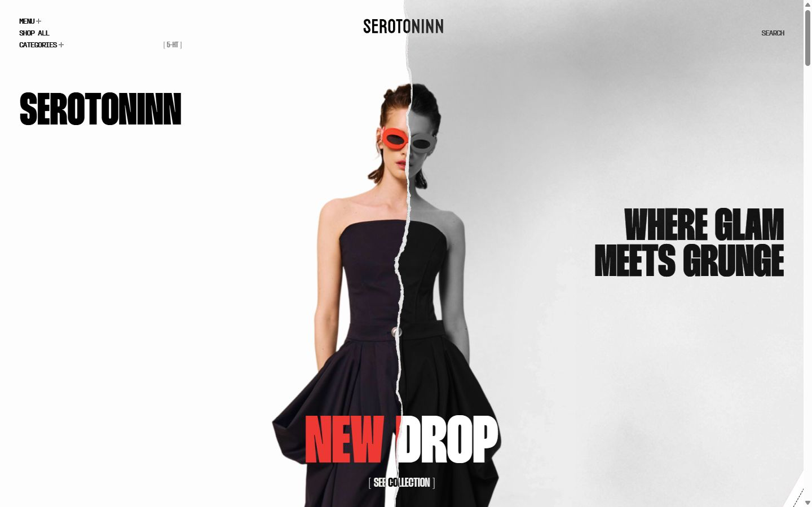</a> 

<details><summary>Toutes les captures</summary>

<a href="captures/desktop-01.jpg">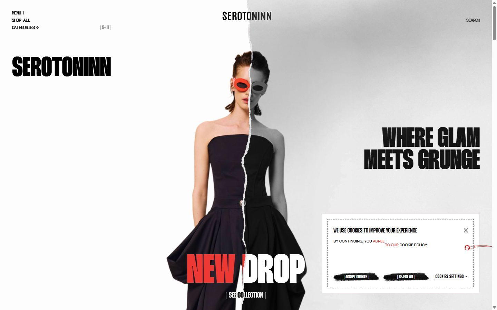</a> <a href="captures/desktop-02.jpg">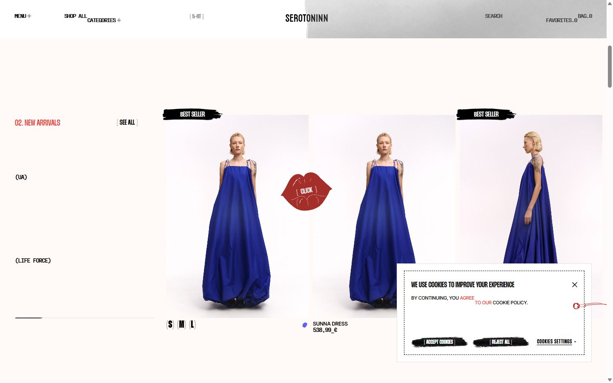</a> <a href="captures/desktop-03.jpg">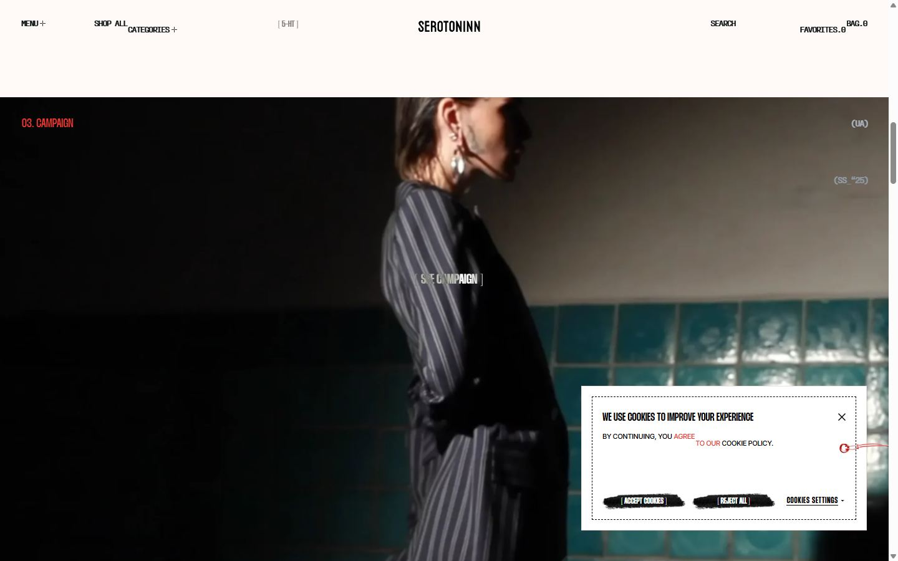</a> <a href="captures/desktop-04.jpg">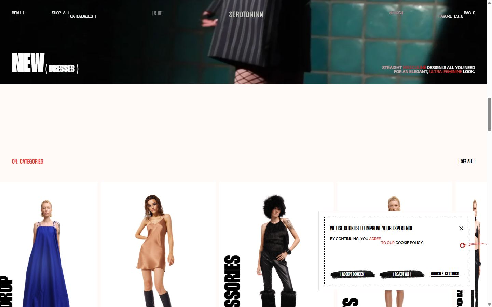</a> <a href="captures/desktop-05.jpg">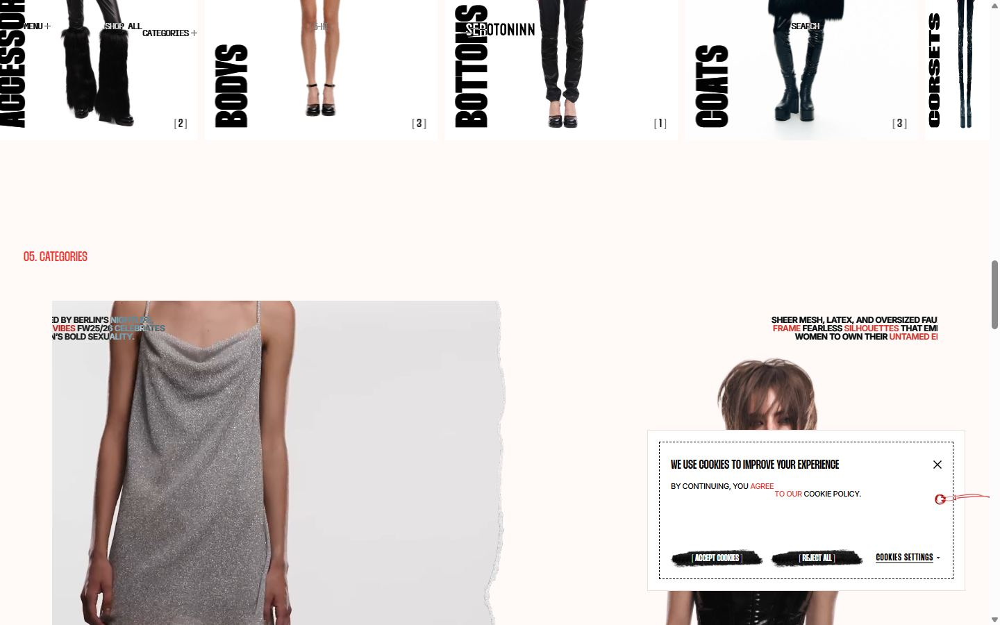</a> <a href="captures/desktop-06.jpg">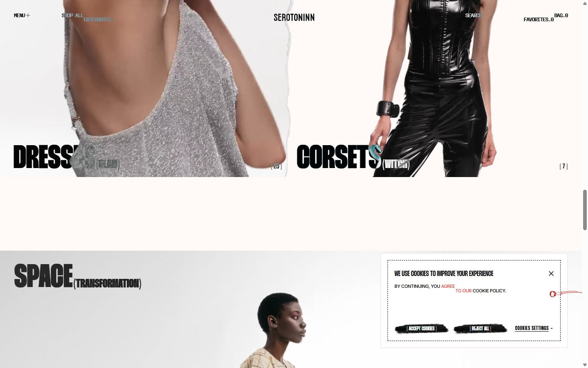</a> <a href="captures/desktop-07.jpg">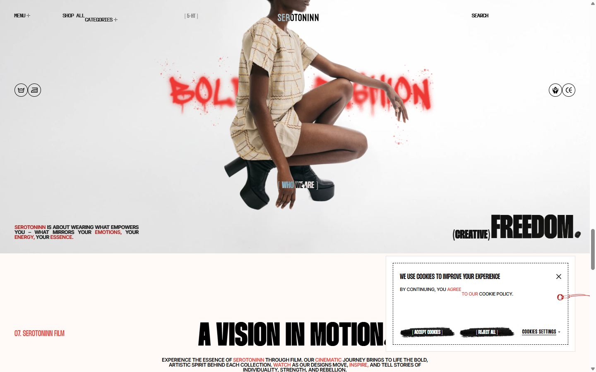</a> <a href="captures/desktop-08.jpg">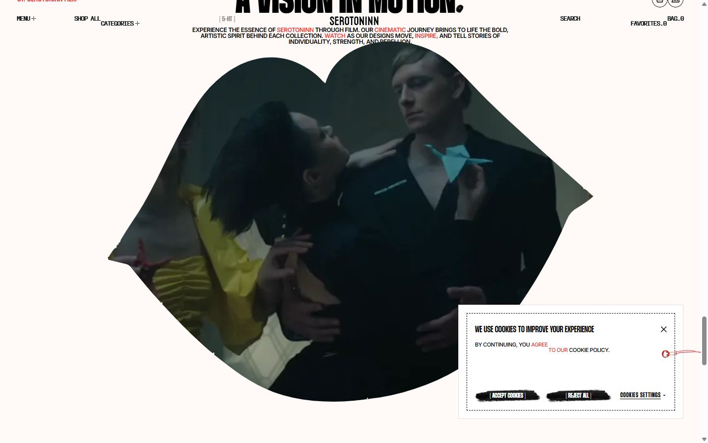</a> <a href="captures/desktop-09.jpg">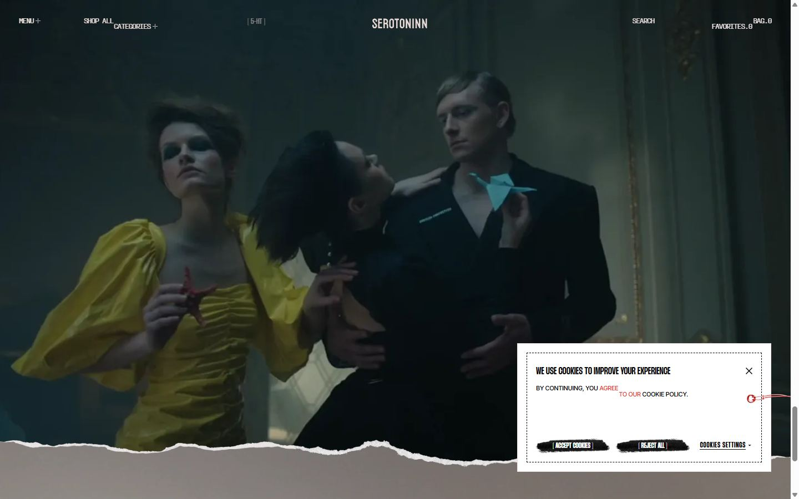</a> <a href="captures/desktop-10.jpg">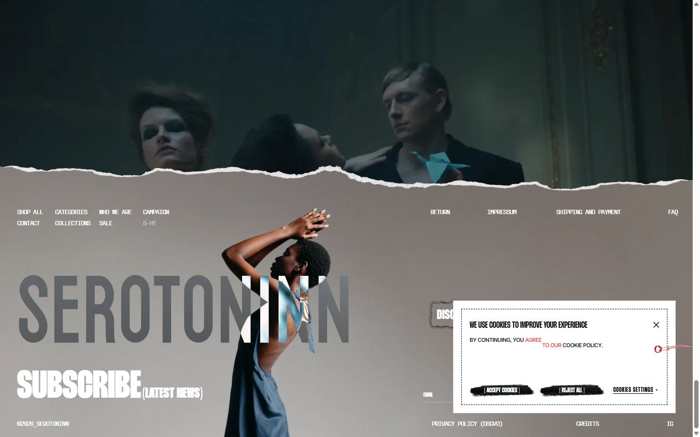</a> <a href="captures/desktop-pleine-page.jpg">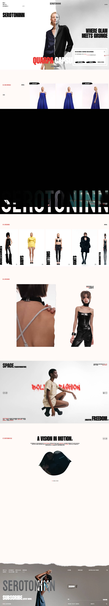</a> 

<a href="captures/page1-01.jpg"></a> <a href="captures/page1-02.jpg">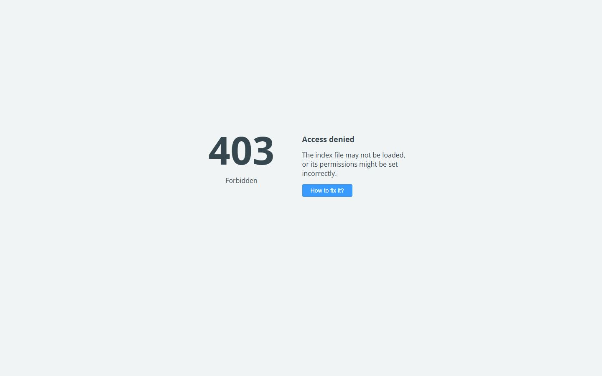</a> <a href="captures/page1-03.jpg"></a> <a href="captures/page1-04.jpg"></a> <a href="captures/page2-01.jpg"></a> <a href="captures/page2-02.jpg"></a> <a href="captures/page2-03.jpg"></a> <a href="captures/page2-04.jpg"></a> <a href="captures/page3-01.jpg"></a> <a href="captures/page3-02.jpg"></a> <a href="captures/page3-03.jpg"></a> <a href="captures/page3-04.jpg"></a> 

<a href="captures/mobile-01.jpg">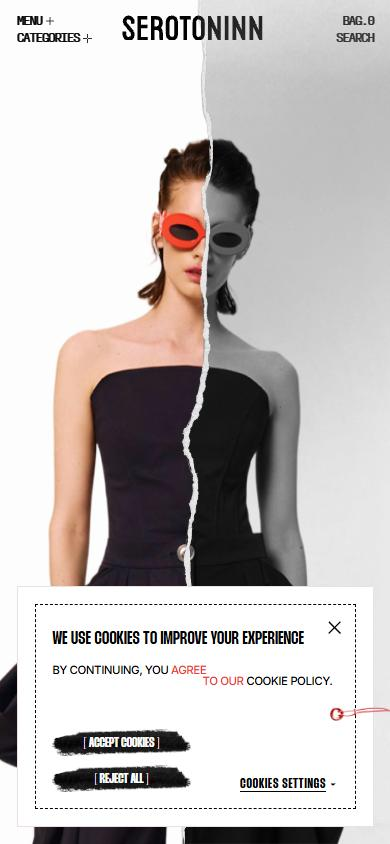</a> <a href="captures/mobile-02.jpg">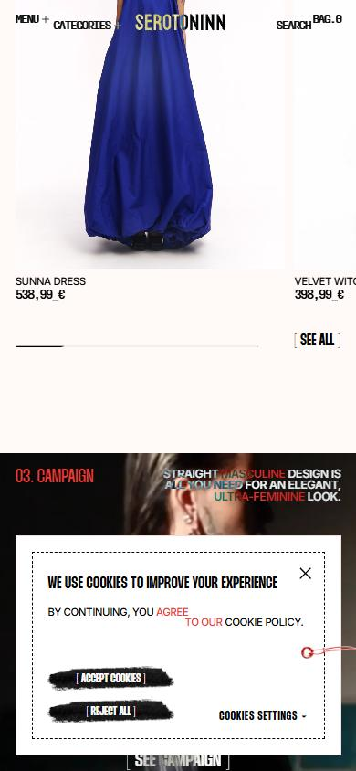</a> <a href="captures/mobile-03.jpg">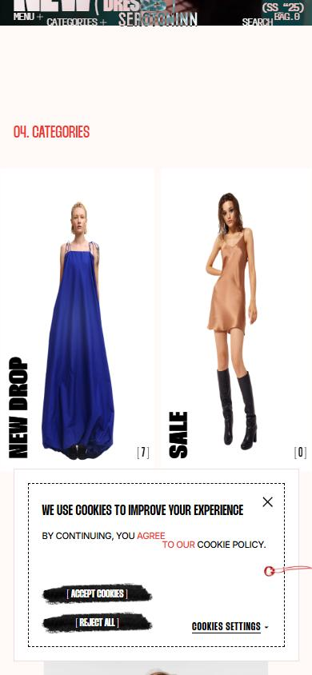</a> <a href="captures/mobile-04.jpg">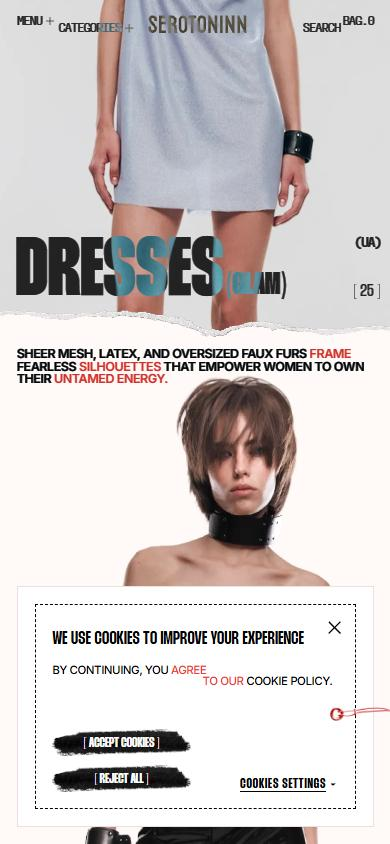</a> <a href="captures/mobile-05.jpg">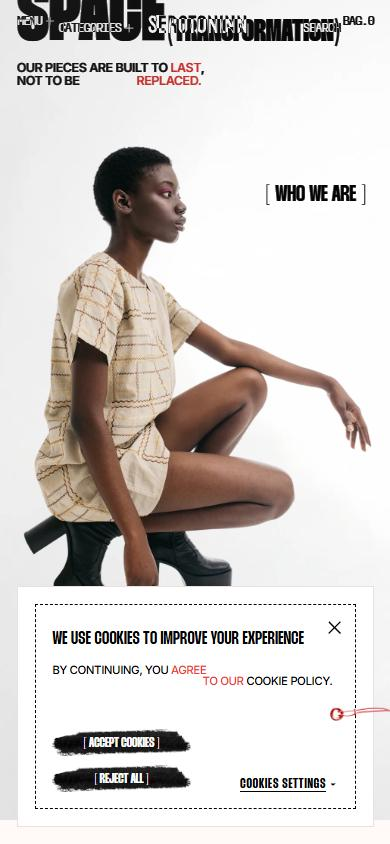</a> <a href="captures/mobile-06.jpg">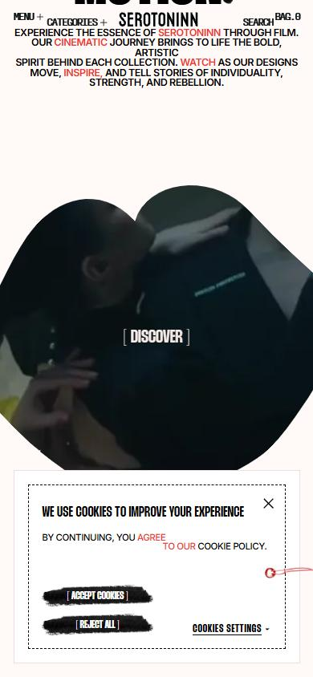</a> 

</details>

## Stack détectée
Barba.js, GSAP, Lenis, Lottie, ScrollTrigger, SplitText/SplitType, Swiper, Virtual scroll, WordPress, jQuery

Versions : GSAP 3.14.2 · Three.js r?

## Design tokens
### Couleurs (fonds, pondérées par surface)
`#fff9f7` · `#000000` · `#ffffff`
### Couleurs de texte
`#000000` · `#ffffff` · `#ed3833`
### Polices utilisées (par volume de texte)
Thunder · Inter · PP Fraktion Mono
### Fichiers de police chargés
- UcCo3FwrK3iLTcviYwY.woff2
- PPFraktionMono-Regular-BF675904a6a1564.otf
- Thunder-ThinLC.woff2
- Thunder-LC.woff2
- Thunder-ExtraBoldLC.woff2
- Thunder-MediumLC.woff2
- Thunder-LightLC.woff2
- Thunder-SemiBoldLC.woff2
- Thunder-ExtraLightLC.woff2
- Thunder-BoldLC.woff2
- Thunder-BlackLC.woff2
- PPFraktionMono-Bold-BF675904a6c4c6e.otf
### Typographie
| Élément | Police | Taille | Graisse | Interligne | Interlettrage | Casse |
|---|---|---|---|---|---|---|
| h1 | Thunder, sans-serif | 80px | 800 | 64px | normal | uppercase |
| h2 | Thunder, sans-serif | 20px | 500 | 20px | normal | uppercase |
| h3 | Inter | 12px | 600 | 12px | -0.4px | uppercase |
| p | Thunder, sans-serif | 20px | 500 | 20px | normal | uppercase |
| a | "PP Fraktion Mono", monospace | 13px | 400 | 13px | -1.2px | uppercase |
| button | "PP Fraktion Mono", monospace | 13px | 400 | 13px | -1.2px | uppercase |
| li | Thunder, sans-serif | 10px | 400 | normal | normal | none |
| body | Thunder, sans-serif | 10px | 400 | normal | normal | none |

### Échelle des tailles de texte
24px (419) · 13px (290) · 16px (217) · 12px (151) · 14px (91) · 17px (74) · 30px (60) · 64px (36) · 22px (33) · 80px (25) · 10px (18) · 18px (16) · 11px (15) · 20px (14) · 118px (10) · 9px (9)
### Arrondis
aucun (angles droits)
### Transitions CSS fréquentes
- ease 0.4s ×37
- ease 0.3s ×9
- ease 0.5s ×5
- cubic-bezier(0.75 0.7s ×4
- cubic-bezier(0.75 1.2s ×3
- cubic-bezier(0.75 0.8s ×2
- ease 0.6s ×1
### Points de rupture (media queries)
768px · 1024px · 767px · 1023px
### Animations CSS (@keyframes)
swiper-preloader-spin, f-spinner-rotate, f-spinner-dash, f-throwOutUp, f-throwOutDown, f-zoomInUp, f-zoomOutDown, f-fadeIn, f-fadeOut, f-fadeFastIn, f-fadeFastOut, f-fadeSlowIn, f-fadeSlowOut, f-crossfadeIn, f-crossfadeOut, f-slideInPrev, f-slideInNext, f-slideOutNext, f-slideOutPrev, f-classicInNext, f-classicInPrev, f-classicOutNext, f-classicOutPrev
### Variables CSS (:root)
```css
--swiper-theme-color: #007aff;
--f-spinner-width: 36px;
--f-spinner-height: 36px;
--f-spinner-color-1: rgba(0,0,0,.1);
--f-spinner-color-2: rgba(17,24,28,.8);
--f-spinner-stroke: 2.75;
--f-button-width: 40px;
--f-button-height: 40px;
--f-button-border: 0;
--f-button-border-radius: 0;
--f-button-color: #374151;
--f-button-bg: #f8f8f8;
--f-button-hover-bg: #e0e0e0;
--f-button-active-bg: #d0d0d0;
--f-button-shadow: none;
--f-button-transition: all .15s ease;
--f-button-transform: none;
--f-button-svg-width: 20px;
--f-button-svg-height: 20px;
--f-button-svg-stroke-width: 1.5;
--f-button-svg-fill: none;
--f-button-svg-filter: none;
--f-button-svg-disabled-opacity: .65;
--wp--preset--aspect-ratio--square: 1;
--wp--preset--aspect-ratio--4-3: 4/3;
--wp--preset--aspect-ratio--3-4: 3/4;
--wp--preset--aspect-ratio--3-2: 3/2;
--wp--preset--aspect-ratio--2-3: 2/3;
--wp--preset--aspect-ratio--16-9: 16/9;
--wp--preset--aspect-ratio--9-16: 9/16;
--wp--preset--color--black: #000000;
--wp--preset--color--cyan-bluish-gray: #abb8c3;
--wp--preset--color--white: #ffffff;
--wp--preset--color--pale-pink: #f78da7;
--wp--preset--color--vivid-red: #cf2e2e;
--wp--preset--color--luminous-vivid-orange: #ff6900;
--wp--preset--color--luminous-vivid-amber: #fcb900;
--wp--preset--color--light-green-cyan: #7bdcb5;
--wp--preset--color--vivid-green-cyan: #00d084;
--wp--preset--color--pale-cyan-blue: #8ed1fc;
--wp--preset--color--vivid-cyan-blue: #0693e3;
--wp--preset--color--vivid-purple: #9b51e0;
--wp--preset--gradient--vivid-cyan-blue-to-vivid-purple: linear-gradient(135deg,rgb(6,147,227) 0%,rgb(155,81,224) 100%);
--wp--preset--gradient--light-green-cyan-to-vivid-green-cyan: linear-gradient(135deg,rgb(122,220,180) 0%,rgb(0,208,130) 100%);
--wp--preset--gradient--luminous-vivid-amber-to-luminous-vivid-orange: linear-gradient(135deg,rgb(252,185,0) 0%,rgb(255,105,0) 100%);
--wp--preset--gradient--luminous-vivid-orange-to-vivid-red: linear-gradient(135deg,rgb(255,105,0) 0%,rgb(207,46,46) 100%);
--wp--preset--gradient--very-light-gray-to-cyan-bluish-gray: linear-gradient(135deg,rgb(238,238,238) 0%,rgb(169,184,195) 100%);
--wp--preset--gradient--cool-to-warm-spectrum: linear-gradient(135deg,rgb(74,234,220) 0%,rgb(151,120,209) 20%,rgb(207,42,186) 40%,rgb(238,44,130) 60%,rgb(251,105,98) 80%,rgb(254,248,76) 1;
--wp--preset--gradient--blush-light-purple: linear-gradient(135deg,rgb(255,206,236) 0%,rgb(152,150,240) 100%);
--wp--preset--gradient--blush-bordeaux: linear-gradient(135deg,rgb(254,205,165) 0%,rgb(254,45,45) 50%,rgb(107,0,62) 100%);
--wp--preset--gradient--luminous-dusk: linear-gradient(135deg,rgb(255,203,112) 0%,rgb(199,81,192) 50%,rgb(65,88,208) 100%);
--wp--preset--gradient--pale-ocean: linear-gradient(135deg,rgb(255,245,203) 0%,rgb(182,227,212) 50%,rgb(51,167,181) 100%);
--wp--preset--gradient--electric-grass: linear-gradient(135deg,rgb(202,248,128) 0%,rgb(113,206,126) 100%);
--wp--preset--gradient--midnight: linear-gradient(135deg,rgb(2,3,129) 0%,rgb(40,116,252) 100%);
--wp--preset--font-size--small: 13px;
--wp--preset--font-size--medium: 20px;
--wp--preset--font-size--large: 36px;
--wp--preset--font-size--x-large: 42px;
--wp--preset--spacing--20: 0.44rem;
--wp--preset--spacing--30: 0.67rem;
--wp--preset--spacing--40: 1rem;
--wp--preset--spacing--50: 1.5rem;
--wp--preset--spacing--60: 2.25rem;
--wp--preset--spacing--70: 3.38rem;
--wp--preset--spacing--80: 5.06rem;
--wp--preset--shadow--natural: 6px 6px 9px rgba(0, 0, 0, 0.2);
--wp--preset--shadow--deep: 12px 12px 50px rgba(0, 0, 0, 0.4);
--wp--preset--shadow--sharp: 6px 6px 0px rgba(0, 0, 0, 0.2);
--wp--preset--shadow--outlined: 6px 6px 0px -3px rgb(255, 255, 255), 6px 6px rgb(0, 0, 0);
--wp--preset--shadow--crisp: 6px 6px 0px rgb(0, 0, 0);
```

## Structure de la home
Hauteur : 7833 px — 3678 nœuds DOM — canvas 0, vidéos 31, images 395

| # | Bloc | Hauteur | Titre | Médias |
|---|---|---|---|---|
| 1 | div .pin-spacer | 900 | Serotoninn | 25 |
| 2 | section .arrivals-section | 876 | 02. New Arrivals | 152 |
| 3 | section .campaign-section | 900 | 03. Campaign | 1 |
| 4 | section .categories-section | 926 | 04. CATEGORIES | 148 |
| 5 | section .best-section | 1061 | 05. CATEGORIES | 4 |
| 6 | section .bold-section | 810 | SPACE (transformation) | 10 |
| 7 | section .motion-section | 1800 | 07. serotoninn film | 4 |

**Navigation :** Shop all · [ 5-HT ]

**Boutons / CTA :** 

## SEO
- Title : Serotoninn
- Description : None
- Langue : en-US — canonical : https://serotoninn.com/
- Open Graph : non — JSON-LD : WebPage, BreadcrumbList, WebSite
- H1 : 1 — images sans alt : 349/395

### Plan des titres
- H3 Backless Knit Maxi Dress
- H3 Crinkled Top
- H3 Faux Fur Top
- H3 Velvet Bra Top
- H3 Dune Gown
- H3 Faux Fur Coat
- H3 SUNNA Dress
- H3 Oversize SILK Dress
- H3 Silk MAXI SKIRT ecru
- H3 Backless Knit Maxi Dress
- H3 Dune Gown
- H3 Architecture Dress
- H3 Draped Corset
- H3 Halter Neck Dress in blue
- H3 Faux Fur Top
- H3 Faux Fur Coat
- H3 SUNNA Dress
- H3 Oversize SILK Dress
- H3 Silk MAXI SKIRT ecru
- H3 Backless Knit Maxi Dress
- H3 Dune Gown
- H3 Architecture Dress
- H3 Draped Corset
- H3 Halter Neck Dress in blue
- H3 Faux Fur Top
- H1 Serotoninn
- H3 NEW DROP
- H3 NEW DROP
- H3 QUARPA CAPSULE
- H3 QUARPA CAPSULE

## Performance (mesure locale, Chrome headless, connexion non bridée)
- TTFB 2462 ms · LCP 2892 ms (H3.hero-card__title) · CLS 0.041 · load 4213 ms
- 343 requêtes · 43197 Ko transférés
- Par type : Document 1 req / 43 Ko, Stylesheet 4 req / 29 Ko, Script 16 req / 551 Ko, Image 300 req / 22718 Ko, Font 12 req / 365 Ko, Media 7 req / 17613 Ko, XHR 2 req / 1867 Ko, Other 1 req / 12 Ko
- Plus gros fichiers :
- 8937 Ko — Media — https://serotoninn.com/wp-content/themes/ref/media/campaign_video.webm
- 4073 Ko — Media — https://serotoninn.com/wp-content/uploads/2026/05/menu_video_n.mp4
- 4073 Ko — Media — https://serotoninn.com/wp-content/themes/ref/media/menu_video_n.mp4
- 1867 Ko — XHR — https://serotoninn.com/wp-content/themes/ref/lottie/FOOTER_LOTTIE_v1.json
- 1065 Ko — Image — https://serotoninn.com/wp-content/uploads/2026/03/Desktop-5-scaled.png.pagespeed.ce.ARfGYtpa8a.png
- 953 Ko — Image — https://serotoninn.com/wp-content/uploads/2026/04/%D0%B8%D1%83%D0%BA%D0%B4%D1%88%D1%82-scaled.png
- 934 Ko — Image — https://serotoninn.com/wp-content/uploads/2026/04/Hero_image2-scaled.png.pagespeed.ce.LTcZ8Bb-WX.png
- 926 Ko — Image — https://serotoninn.com/wp-content/uploads/2026/04/01.Main_screen-scaled.png.pagespeed.ce.aMss6uOejb.png
- Services tiers : fonts.googleapis.com, fonts.gstatic.com, connect.facebook.net, www.facebook.com

## Mobile
- H1 : {'size': '66.56px', 'lineHeight': '53.04px'} · corps : 10.4px · débordement horizontal : False · menu burger : True

## Fichiers
- `captures/` : arrivée, scroll desktop (1440×900), pleine page, pages internes, mobile (390×844 @2x) ; vidéo de scroll dans la release GitHub « videos » (lien en haut de fiche)
- `page.html` : DOM rendu · `styles.css` : CSS chargé · `scripts/` : JS chargé (index dans `_index.json`) · `shaders.glsl` : shaders extraits · `rea-bundle.json` : analyse REA du bundle (chunks, routes, endpoints)

## Pages internes capturées
- https://serotoninn.com/all-products/
- https://serotoninn.com/products/backless-knit-maxi-dress/
- https://serotoninn.com/collections/
