# Lacoste Ace Breaker

- Site : [https://members-play.lacoste.com/ace-breaker-rg](https://members-play.lacoste.com/ace-breaker-rg) — [aperçu statique local](apercu.html)
- Capturé le : 2026-11-03 — statut : ok
- Vidéo de scroll : [▶ ouvrir](https://github.com/t-baudry/bibliotheque-web/releases/download/videos/091-lacoste-ace-breaker.webm)

<a href="captures/desktop-00-arrivee.jpg">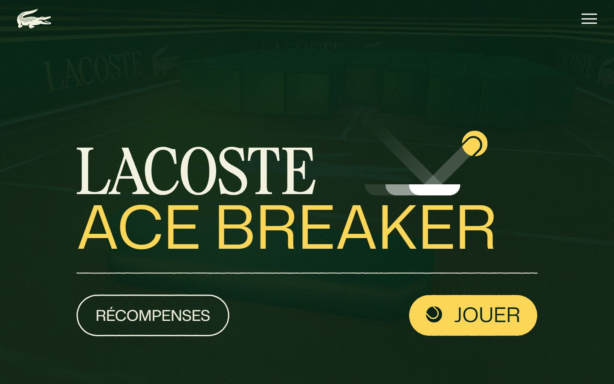</a> 

<details><summary>Toutes les captures</summary>

<a href="captures/desktop-01.jpg">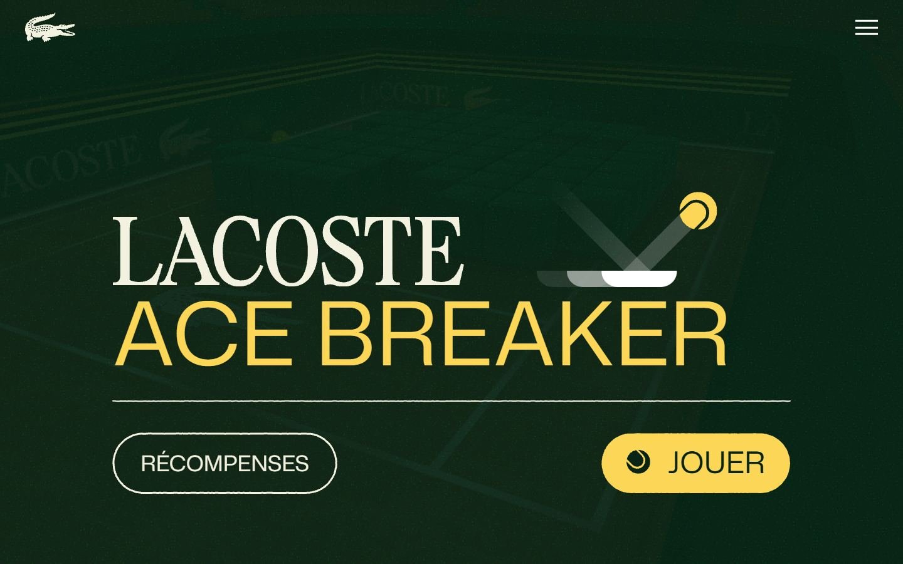</a> <a href="captures/desktop-02.jpg">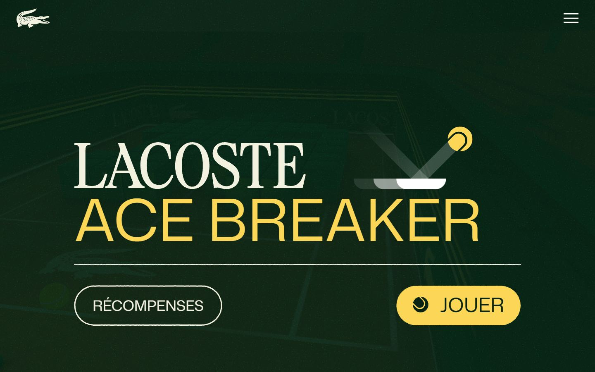</a> <a href="captures/desktop-03.jpg">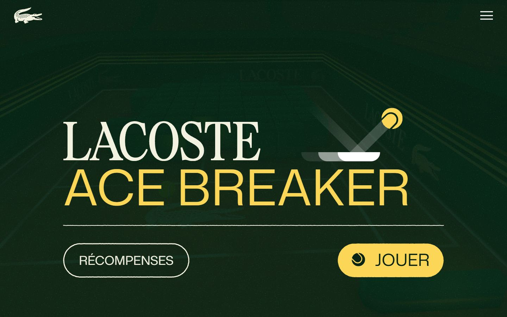</a> <a href="captures/desktop-04.jpg">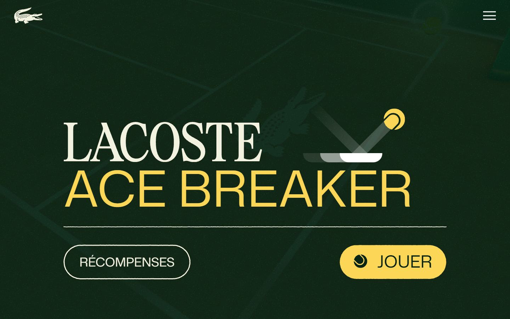</a> <a href="captures/desktop-05.jpg">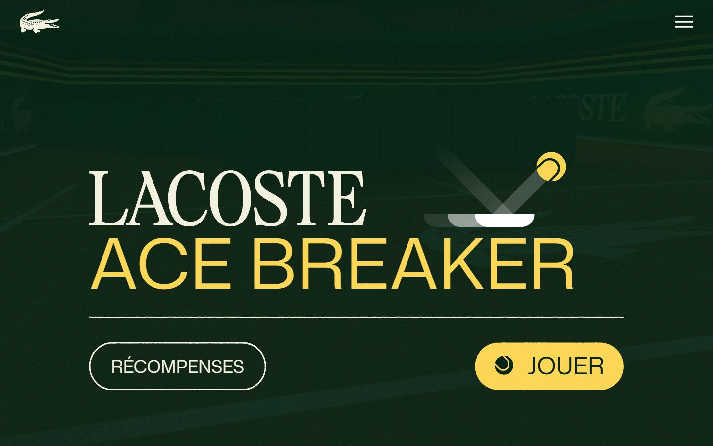</a> <a href="captures/desktop-06.jpg">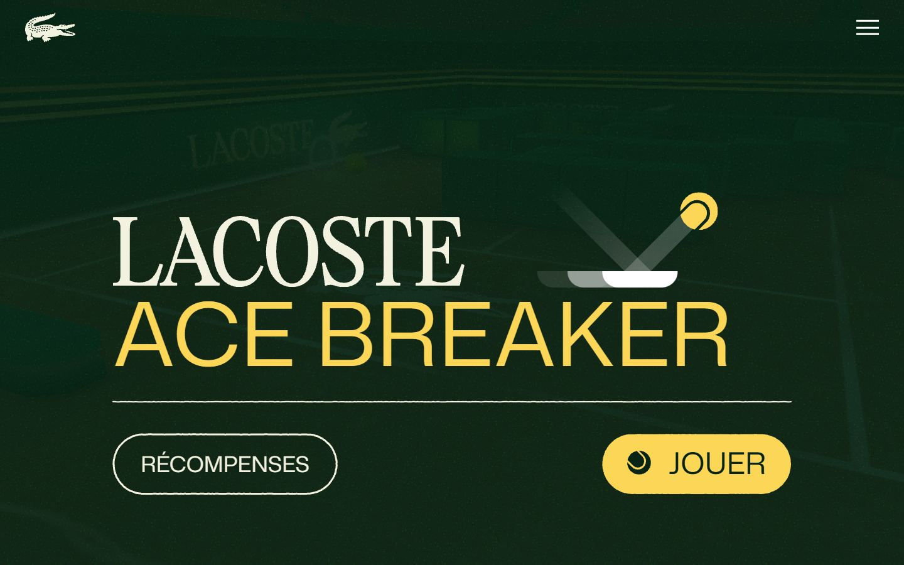</a> <a href="captures/desktop-07.jpg"></a> 

<a href="captures/page1-01.jpg">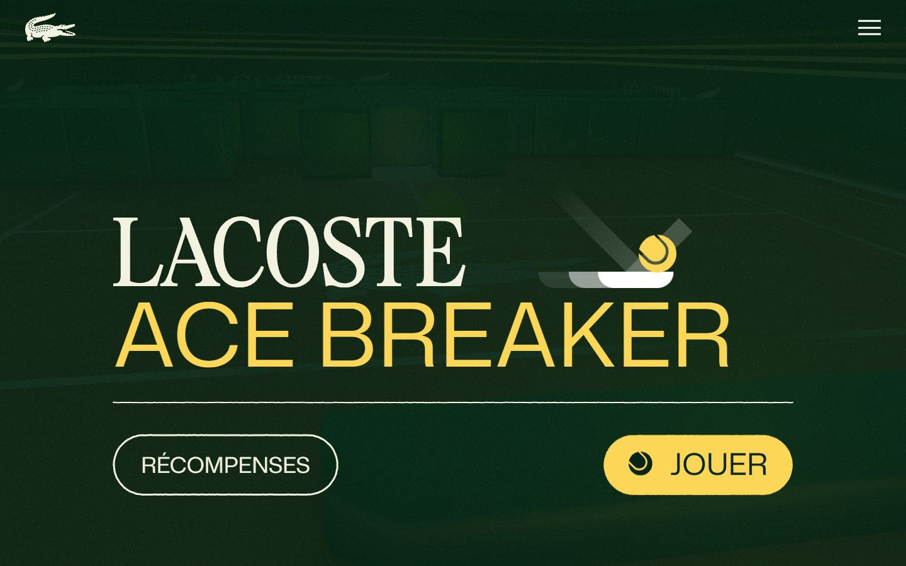</a> <a href="captures/page1-02.jpg"></a> <a href="captures/page1-03.jpg">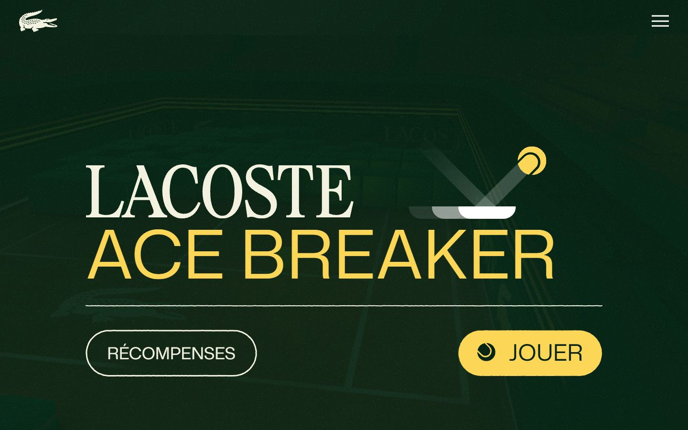</a> <a href="captures/page1-04.jpg">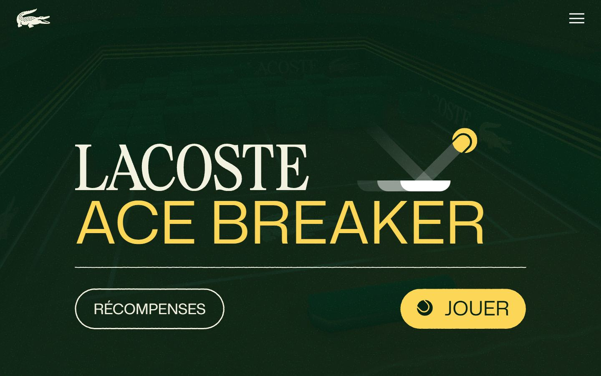</a> 

<a href="captures/mobile-01.jpg">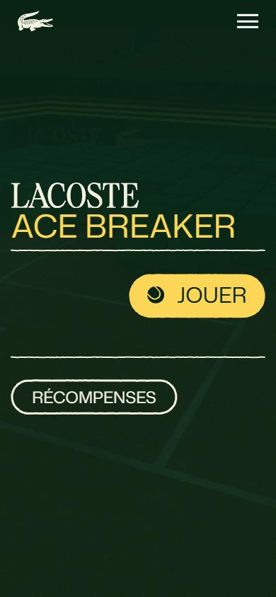</a> <a href="captures/mobile-02.jpg">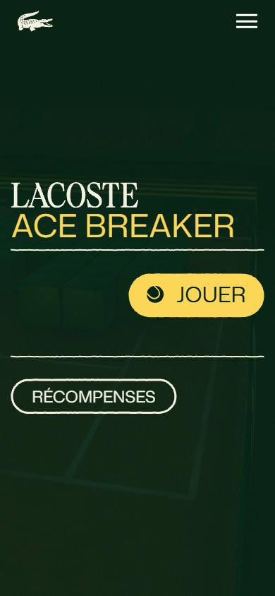</a> <a href="captures/mobile-03.jpg">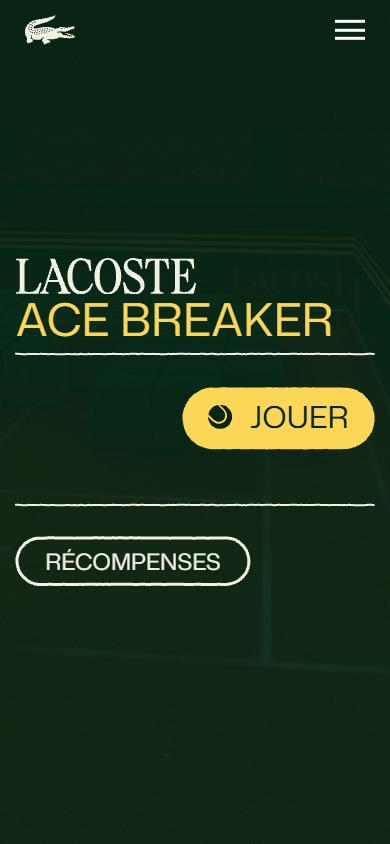</a> <a href="captures/mobile-04.jpg">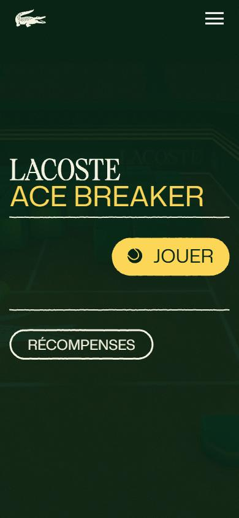</a> <a href="captures/mobile-05.jpg">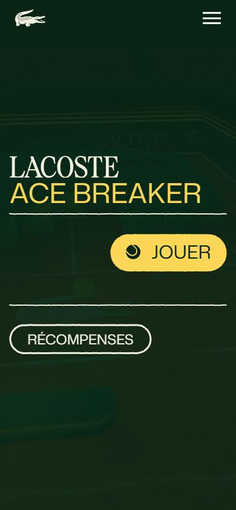</a> <a href="captures/mobile-06.jpg">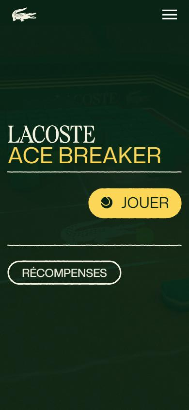</a> 

</details>

## Stack détectée
Barba.js, Three.js, Vue, WebGL

Shaders GLSL personnalisés extraits : 11 (voir `shaders.glsl`)

## Design tokens
### Couleurs (fonds, pondérées par surface)
`#00503c` · `#ffffff` · `#f3f2e1`
### Couleurs de texte
`#f3f2e1` · `#fcd757` · `#082415` · `#ffffff`
### Polices utilisées (par volume de texte)
MonaSans
### Fichiers de police chargés
- mona-sans-regular.713fcaa7526f9beb.woff2
- mona-sans-medium.c9b12174526f9beb.woff2
### Typographie
| Élément | Police | Taille | Graisse | Interligne | Interlettrage | Casse |
|---|---|---|---|---|---|---|
| h1 | MonaSans, Arial, Helvetica, sans-serif | 139.821px | 500 | 146.812px | normal | uppercase |
| a | MonaSans, Arial, Helvetica, sans-serif | 18.4px | 500 | 19.32px | normal | uppercase |
| button | MonaSans, Arial, Helvetica, sans-serif | 47.3973px | 400 | 49.7671px | normal | none |

### Échelle des tailles de texte
18px (24) · 18.4px (3) · 50px (2) · 47.3973px (2) · 34.6484px (2) · 139.821px (2)
### Arrondis
142.192px · 103.945px · 8px · 50px
### Transitions CSS fréquentes
- cubic-bezier(0.25 0.3s ×15
- cubic-bezier(0.55 0.3s ×8
- cubic-bezier(0.19 0.5s ×5
- ease-in-out 0.5s ×2
- ease 0.3s ×1
- ease-in-out 0.3s ×1
### Points de rupture (media queries)
1200px · 768px · 1024px · 699px · 400px · 1920px · 767px · 1921px · 639px · 1201px · 1023px · 1439px
### Animations CSS (@keyframes)
spinit-bd309550, shakeX-15c4d962, splide-loading, paddleMove, bounce, opacityIn, blinkIn2, blinkIn, rotateDevice-767a1a33, appear-767a1a33, appearNegative-767a1a33, lds-ellipsis1, lds-ellipsis3, lds-ellipsis2
### Variables CSS (:root)
```css
--base-text: calc((80px) * var(--h-demult, 1));
--color-main: #00503c;
--color-accent: #fcd757;
--color-green: #008A20;
--padding: calc(var(--base-text));
--font-btn: MonaSans, Arial, Helvetica, sans-serif;
--font-title: var(--font-system);
--font-text: var(--font-system);
--font-system: -apple-system, BlinkMacSystemFont, "Segoe UI", Roboto, Oxygen-Sans, Ubuntu, Cantarell, "Helvetica Neue", sans-serif;
--font-popin: var(--font-system);
--logo-size: calc((80px) * var(--h-demult, 1));
```

## Structure de la home
Hauteur : 900 px — 281 nœuds DOM — canvas 1, vidéos 0, images 0

| # | Bloc | Hauteur | Titre | Médias |
|---|---|---|---|---|
| 1 | aside .transition-overlay | 900 |  | 0 |
| 2 | div .bg app-background | 900 |  | 0 |
| 3 | section .page page-home | 900 | LacosteAce Breaker | 0 |

**Navigation :** 

**Boutons / CTA :** 

## SEO
- Title : Lacoste - Ace Breaker
- Description : Joue et tente de gagner des prix exclusifs
- Langue : fr — canonical : None
- Open Graph : oui — JSON-LD : aucun
- H1 : 1 — images sans alt : 0/0

### Plan des titres
- H1 LacosteAce Breaker

## Performance (mesure locale, Chrome headless, connexion non bridée)
- TTFB 34 ms · LCP 0 ms (None) · CLS 0 · load 1080 ms
- 44 requêtes · 24122 Ko transférés
- Par type : Document 2 req / 46 Ko, Stylesheet 3 req / 16 Ko, Script 11 req / 756 Ko, Image 13 req / 19564 Ko, Font 2 req / 42 Ko, XHR 5 req / 2508 Ko, Fetch 3 req / 1186 Ko, Other 3 req / 3 Ko, Preflight 1 req / 0 Ko, Ping 1 req / 1 Ko
- Plus gros fichiers :
- 9738 Ko — Image — https://members-play.lacoste.com/ace-breaker-rg/assets/stadiumRoughness-v2.66efc130526f9beb.png
- 7165 Ko — Image — https://members-play.lacoste.com/ace-breaker-rg/assets/ground.4a21dcf0526f9beb.png
- 2119 Ko — XHR — https://members-play.lacoste.com/ace-breaker-rg/assets/ambLoop.54048db0526f9beb.m4a
- 1080 Ko — Fetch — https://members-play.lacoste.com/ace-breaker-rg/assets/model.a91ccef3526f9beb.glb
- 615 Ko — Image — https://members-play.lacoste.com/ace-breaker-rg/assets/floor-roughness.647961b0526f9beb.jpg
- 585 Ko — Image — https://members-play.lacoste.com/ace-breaker-rg/assets/floor-normal.068212cd526f9beb.jpg
- 517 Ko — Image — https://members-play.lacoste.com/ace-breaker-rg/assets/floor-color.4a6fe46d526f9beb.jpg
- 494 Ko — Image — https://members-play.lacoste.com/ace-breaker-rg/assets/floor-height.e8f84b88526f9beb.jpg
- Services tiers : sdk.privacy-center.org, api.privacy-center.org, www.googletagmanager.com, www.google.fr, region1.analytics.google.com, stats.g.doubleclick.net

## Mobile
- H1 : {'size': '45px', 'lineHeight': '47.25px'} · corps : 22.1527px · débordement horizontal : False · menu burger : True

## Fichiers
- `captures/` : arrivée, scroll desktop (1440×900), pleine page, pages internes, mobile (390×844 @2x) ; vidéo de scroll dans la release GitHub « videos » (lien en haut de fiche)
- `page.html` : DOM rendu · `styles.css` : CSS chargé · `scripts/` : JS chargé (index dans `_index.json`) · `shaders.glsl` : shaders extraits · `rea-bundle.json` : analyse REA du bundle (chunks, routes, endpoints)

## Pages internes capturées
- https://members-play.lacoste.com/ace-breaker-rg/[https://www.lacoste.com/fr](https://www.lacoste.com/fr)
