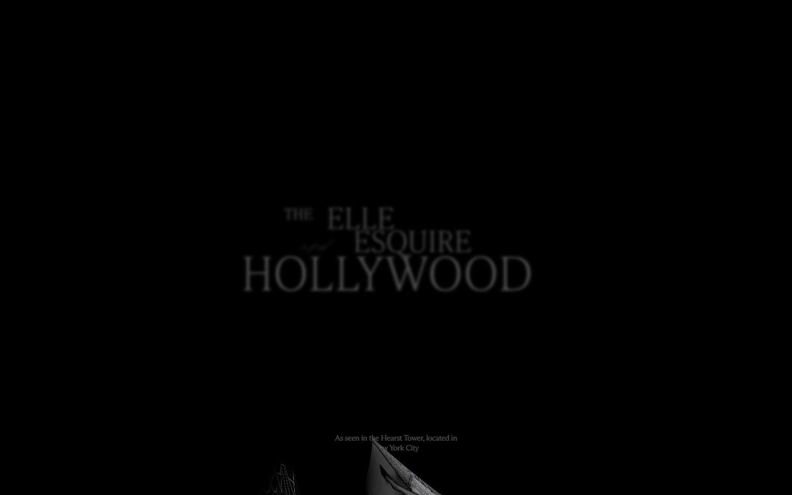
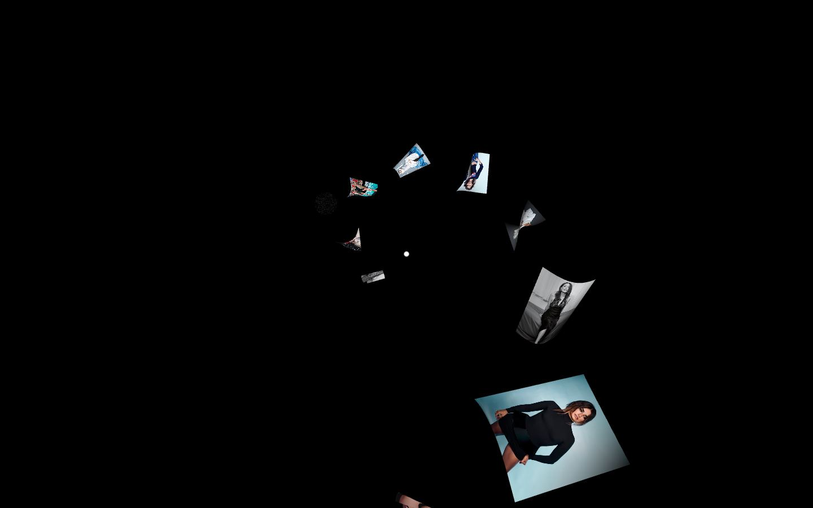
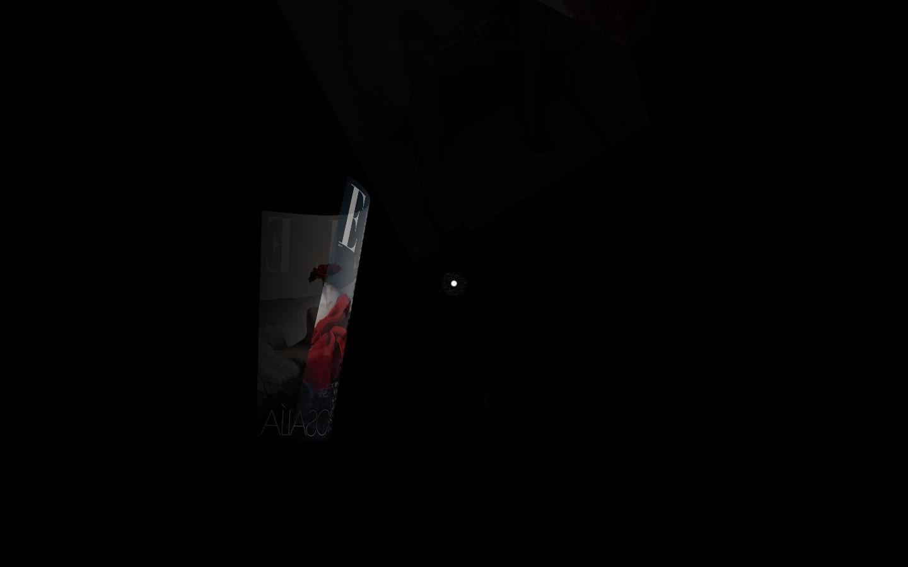
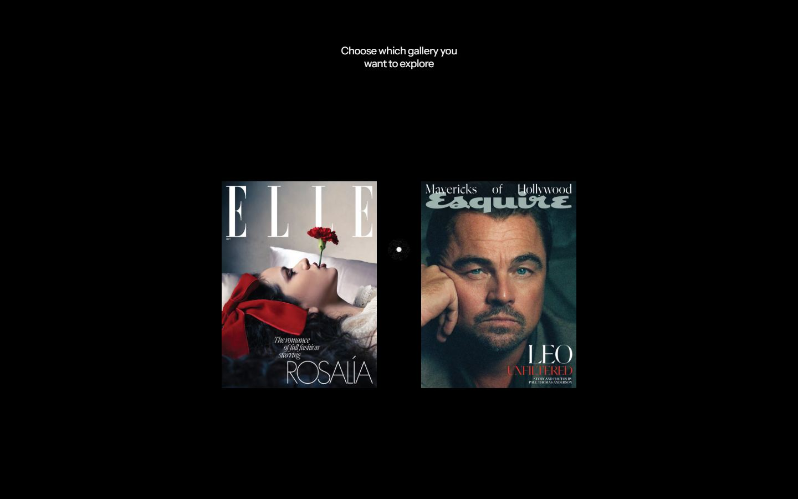
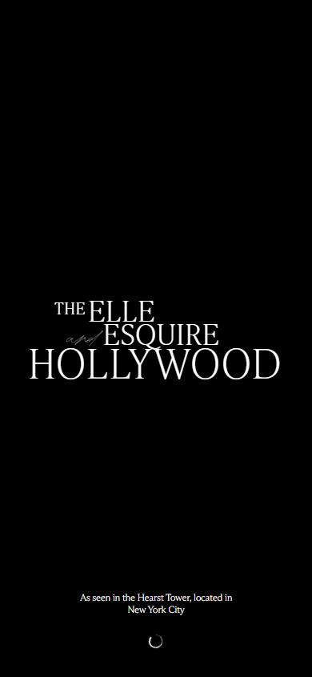
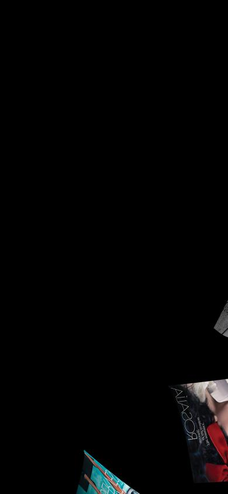
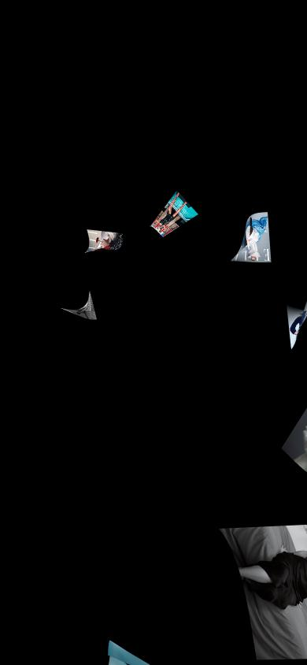
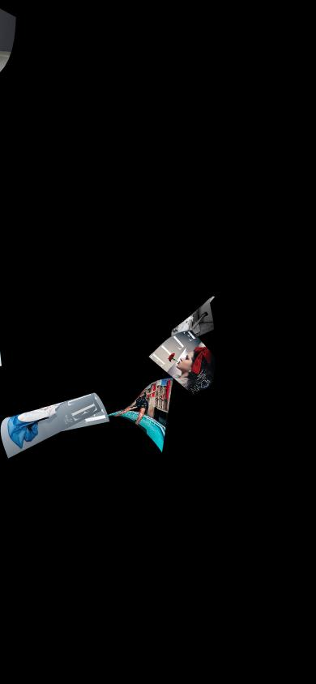
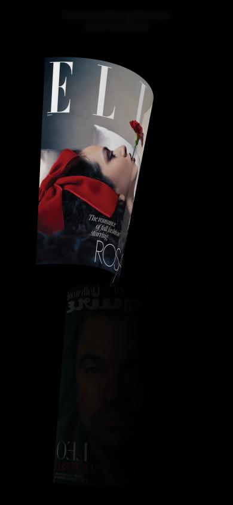
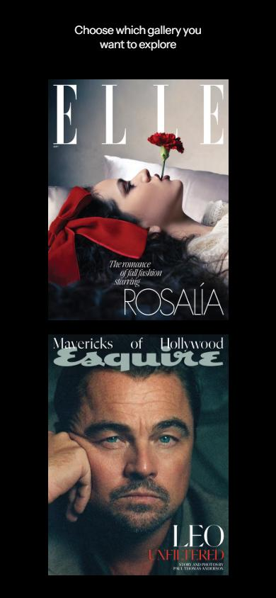

# Hearst Exhibit 2026

- Site : [https://www.hollywoodexhibit2026.com/](https://www.hollywoodexhibit2026.com/) — [aperçu statique local](apercu.html)
- Capturé le : 2026-11-03 — statut : ok
- Vidéo de scroll : [▶ ouvrir](https://github.com/t-baudry/bibliotheque-web/releases/download/videos/092-hearst-exhibit-2026.webm)

<a href="captures/desktop-00-arrivee.jpg"></a> 

<details><summary>Toutes les captures</summary>

<a href="captures/desktop-01.jpg"></a> <a href="captures/desktop-02.jpg"></a> <a href="captures/desktop-03.jpg"></a> <a href="captures/desktop-04.jpg"></a> <a href="captures/desktop-05.jpg"></a> <a href="captures/desktop-06.jpg"></a> <a href="captures/desktop-07.jpg"></a> 


<a href="captures/mobile-01.jpg"></a> <a href="captures/mobile-02.jpg"></a> <a href="captures/mobile-03.jpg"></a> <a href="captures/mobile-04.jpg"></a> <a href="captures/mobile-05.jpg"></a> <a href="captures/mobile-06.jpg"></a> 

</details>

## Stack détectée
GSAP, Lenis, Next.js, React, React Three Fiber, ScrollTrigger, SplitText/SplitType, Three.js, WebGL

Shaders GLSL personnalisés extraits : 15 (voir `shaders.glsl`)

## Design tokens
### Couleurs (fonds, pondérées par surface)
`#000000`
### Couleurs de texte

### Polices utilisées (par volume de texte)

### Fichiers de police chargés
- ABCArizonaVariable-s.p.6844b0f6.woff2
- Haigrast-s.p.42f2de84.woff2
- SafiraMarch-s.p.fcee3285.woff2
- IvyPrestoText_Thin-s.p.3ba47ad4.woff2
- IvyPrestoHeadline_Thin-s.p.830ff306.woff2
- l
- l
- l
- l
- l
- l
- l
- l
- f06bf9da926bae75-s.c68a79fb.woff2
### Typographie
| Élément | Police | Taille | Graisse | Interligne | Interlettrage | Casse |
|---|---|---|---|---|---|---|
| body | ui-sans-serif, system-ui, sans-serif, "Apple Color | 18.7573px | 400 | 23.4466px | -2% | none |

### Échelle des tailles de texte
18.7573px (11)
### Arrondis
50%
### Transitions CSS fréquentes
- (rien relevé)
### Points de rupture (media queries)
48rem · 64rem · 40rem · 80rem · 96rem · 479px
### Animations CSS (@keyframes)
grain, char-reveal, spin
### Variables CSS (:root)
```css
--spacing: .0625rem;
--font-weight-light: 300;
--animate-spin: spin 1s linear infinite;
--default-transition-duration: .15s;
--default-transition-timing-function: cubic-bezier(.4,0,.2,1);
--fluid-min-w: var(--layout-min-w,375);
--fluid-max-w: var(--layout-max-w,1920);
--fluid-slope: calc((100vw - calc(var(--spacing)*var(--fluid-min-w)))/(var(--fluid-max-w) - var(--fluid-min-w)));
--text-label: clamp(calc(var(--spacing)*12),calc(calc(var(--spacing)*12) + (14 - 12)*var(--fluid-slope)),calc(var(--spacing)*14));
--text-label--font-weight: 400;
--text-label--line-height: 1;
--text-label--letter-spacing: .03em;
--text-cta: clamp(calc(var(--spacing)*14),calc(calc(var(--spacing)*14) + (16 - 14)*var(--fluid-slope)),calc(var(--spacing)*16));
--text-body-10: clamp(calc(var(--spacing)*16),calc(calc(var(--spacing)*16) + (20 - 16)*var(--fluid-slope)),calc(var(--spacing)*20));
--text-body-10--font-weight: 400;
--text-body-10--line-height: 1.25;
--text-body-10--letter-spacing: -2%;
--text-headline-10: clamp(calc(var(--spacing)*20),calc(calc(var(--spacing)*20) + (30 - 20)*var(--fluid-slope)),calc(var(--spacing)*30));
--text-headline-10--font-weight: 400;
--text-headline-10--line-height: 1;
--text-headline-10--letter-spacing: normal;
--text-headline-18: clamp(calc(var(--spacing)*36),calc(calc(var(--spacing)*36) + (54 - 36)*var(--fluid-slope)),calc(var(--spacing)*54));
--text-headline-18--font-weight: 400;
--text-headline-18--line-height: 1;
--text-headline-18--letter-spacing: normal;
--text-subheadline: clamp(calc(var(--spacing)*30),calc(calc(var(--spacing)*30) + (40 - 30)*var(--fluid-slope)),calc(var(--spacing)*40));
--text-subheadline--font-weight: 400;
--text-subheadline--line-height: 1;
--text-subheadline--letter-spacing: normal;
--text-headline-20: clamp(calc(var(--spacing)*35),calc(calc(var(--spacing)*35) + (60 - 35)*var(--fluid-slope)),calc(var(--spacing)*60));
--text-headline-20--font-weight: 400;
--text-headline-20--line-height: 1;
--text-headline-20--letter-spacing: normal;
--text-headline-50: clamp(calc(var(--spacing)*50),calc(calc(var(--spacing)*50) + (100 - 50)*var(--fluid-slope)),calc(var(--spacing)*100));
--text-headline-50--font-weight: 400;
--text-headline-50--line-height: 1;
--text-headline-50--letter-spacing: normal;
--layout-min-w: 375;
--layout-max-w: 1920;
--font-instrument-sans: var(--font-helvetica-lt-pro);
--font-arizona: var(--font-abc-arizona),ui-sans-serif,system-ui,"Apple Color Emoji","Segoe UI Emoji","Segoe UI Symbol";
--font-safira-march: var(--font-helvetica-lt-pro);
--font-haigrast: var(--font-helvetica-lt-pro);
--font-helvetica-lt-pro: "helvetica-lt-pro",ui-sans-serif,system-ui,"Apple Color Emoji","Segoe UI Emoji","Segoe UI Symbol";
--font-ivy: "ivypresto-display",ui-serif,serif;
--font-ivy-headline: var(--font-ivy-presto-headline),ui-serif,serif;
--color-black: #000;
--color-white: #fff;
--radius-8: calc(var(--spacing)*8);
--radius-full: 9999px;
--ease-out-sine: cubic-bezier(.39,.57,.56,1);
--ease-in-out-quart: cubic-bezier(.77,0,.18,1);
--font-abc-arizona: var(--font-helvetica-lt-pro);
```

## Structure de la home
Hauteur : 900 px — 79 nœuds DOM — canvas 2, vidéos 0, images 0

| # | Bloc | Hauteur | Titre | Médias |
|---|---|---|---|---|
| 1 | div .fixed inset-0 bg-black text-white | 900 |  | 0 |

**Navigation :** 

**Boutons / CTA :** 

## SEO
- Title : ELLE & Esquire, The New Hollywood Photography Exhibition
- Description : Hearst Galleries presented a joint photography exhibition for ELLE and Esquire, ELLE: The New Hollywood and Esquire Goes to Hollywood, featuring iconic Hollywood photography from the brands’ archival collections and celebrating 40 years of ELLE’s commitment to women’s voices, creativity, and cultural influence.
- Langue : en — canonical : None
- Open Graph : non — JSON-LD : aucun
- H1 : 0 — images sans alt : 0/0

### Plan des titres
- (rien relevé)

## Performance (mesure locale, Chrome headless, connexion non bridée)
- TTFB 121 ms · LCP 3896 ms (SPAN.mx-auto) · CLS 0 · load 517 ms
- 73 requêtes · 2107 Ko transférés
- Par type : Document 1 req / 14 Ko, Stylesheet 5 req / 10 Ko, Font 14 req / 777 Ko, Script 21 req / 804 Ko, Image 29 req / 500 Ko, Other 1 req / 2 Ko, Fetch 2 req / 0 Ko
- Plus gros fichiers :
- 233 Ko — Font — https://www.hollywoodexhibit2026.com/_next/static/media/ABCArizonaVariable-s.p.6844b0f6.woff2
- 231 Ko — Script — https://www.hollywoodexhibit2026.com/_next/static/chunks/e731e01936617f80.js
- 177 Ko — Script — https://www.googletagmanager.com/gtag/js?id=G-CGTV8X0PTN
- 126 Ko — Font — https://www.hollywoodexhibit2026.com/_next/static/media/Haigrast-s.p.42f2de84.woff2
- 118 Ko — Image — https://cdn.prod.website-files.com/636b2cf855288e3688dba8c4/639e895e7a191c4ac8dccbff_noise.png
- 71 Ko — Font — https://www.hollywoodexhibit2026.com/_next/static/media/IvyPrestoText_Thin-s.p.3ba47ad4.woff2
- 70 Ko — Script — https://www.hollywoodexhibit2026.com/_next/static/chunks/0ce3dd20c5f71f31.js
- 69 Ko — Font — https://www.hollywoodexhibit2026.com/_next/static/media/IvyPrestoHeadline_Thin-s.p.830ff306.woff2
- Services tiers : use.typekit.net, p.typekit.net, www.googletagmanager.com, cdn.prod.website-files.com, region1.google-analytics.com

## Mobile
- H1 : None · corps : 16.0388px · débordement horizontal : False · menu burger : True

## Fichiers
- `captures/` : arrivée, scroll desktop (1440×900), pleine page, pages internes, mobile (390×844 @2x) ; vidéo de scroll dans la release GitHub « videos » (lien en haut de fiche)
- `page.html` : DOM rendu · `styles.css` : CSS chargé · `scripts/` : JS chargé (index dans `_index.json`) · `shaders.glsl` : shaders extraits · `rea-bundle.json` : analyse REA du bundle (chunks, routes, endpoints)
