# Noomo Showcase

- Site : [https://showcase.noomoagency.com/](https://showcase.noomoagency.com/) — [aperçu statique local](apercu.html)
- Capturé le : 2026-11-03 — statut : ok
- Vidéo de scroll : [▶ ouvrir](https://github.com/t-baudry/bibliotheque-web/releases/download/videos/093-noomo-showcase.webm)

<a href="captures/desktop-00-arrivee.jpg">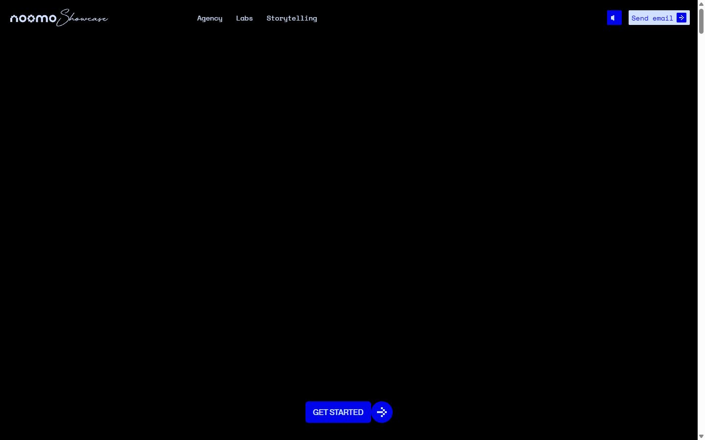</a> 

<details><summary>Toutes les captures</summary>

<a href="captures/desktop-01.jpg">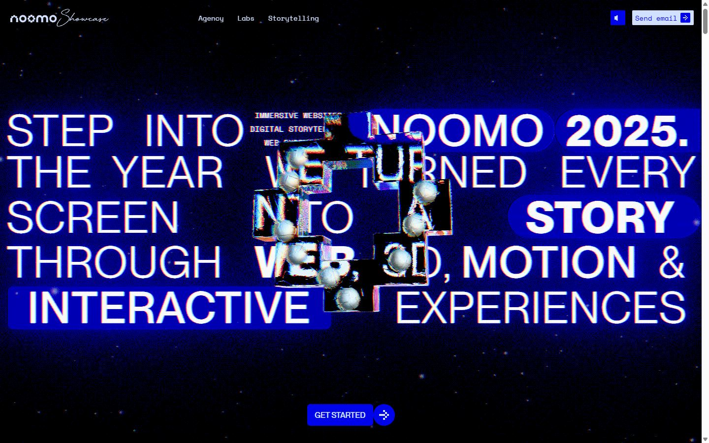</a> <a href="captures/desktop-02.jpg">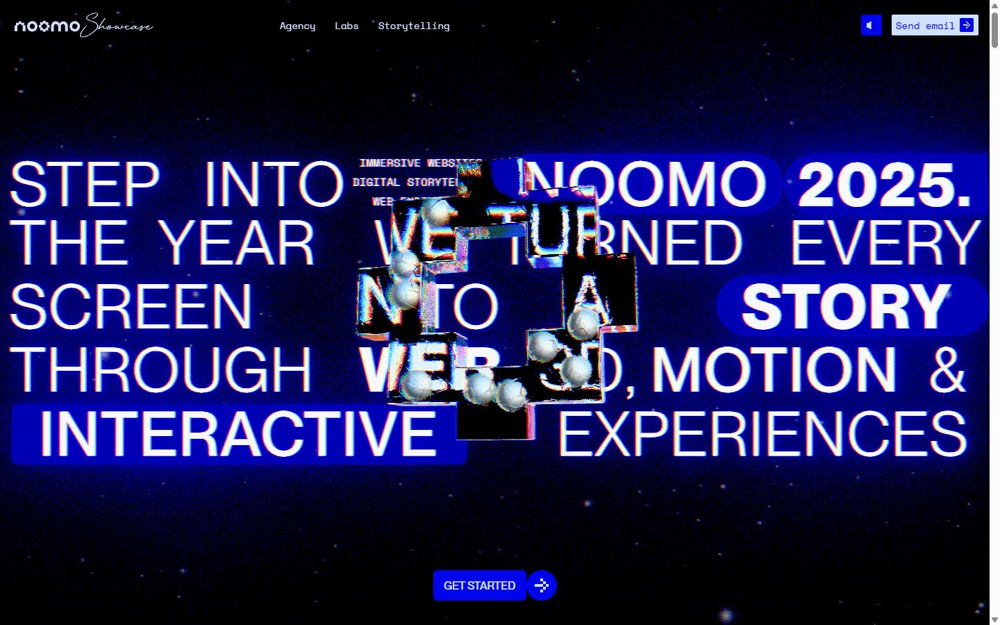</a> <a href="captures/desktop-03.jpg">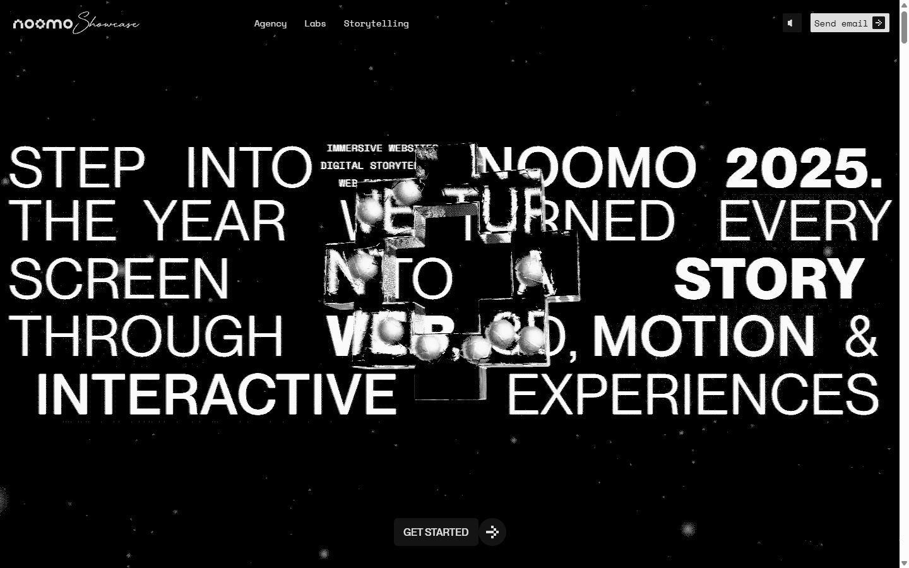</a> <a href="captures/desktop-04.jpg">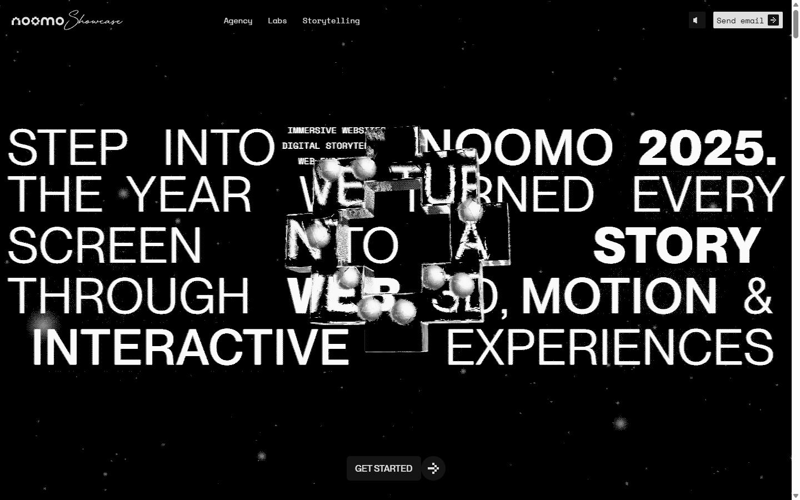</a> <a href="captures/desktop-05.jpg"></a> <a href="captures/desktop-06.jpg"></a> <a href="captures/desktop-07.jpg"></a> <a href="captures/desktop-08.jpg"></a> <a href="captures/desktop-09.jpg">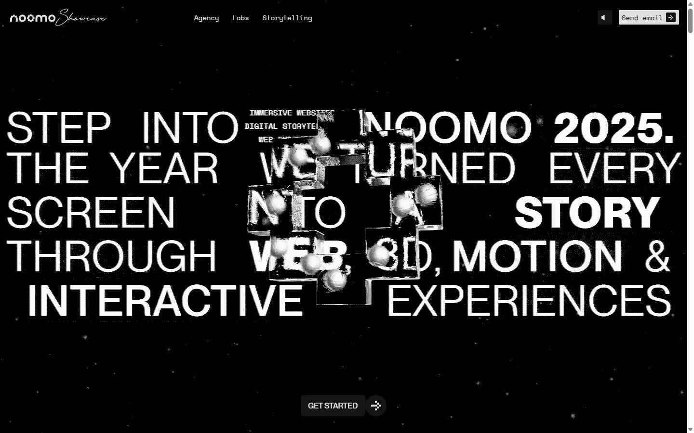</a> <a href="captures/desktop-10.jpg">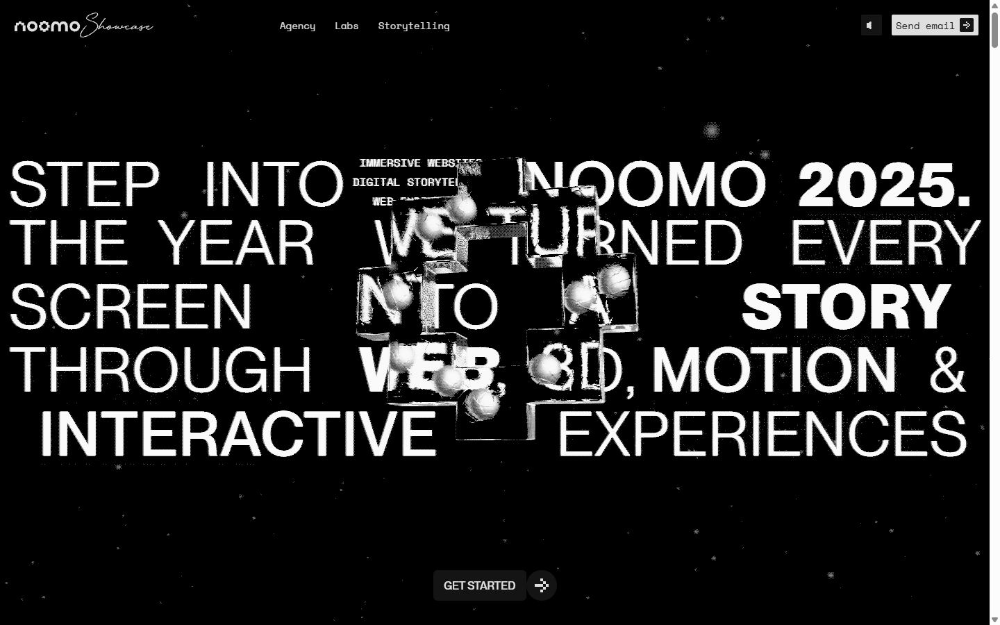</a> <a href="captures/desktop-11.jpg"></a> <a href="captures/desktop-12.jpg"></a> <a href="captures/desktop-13.jpg">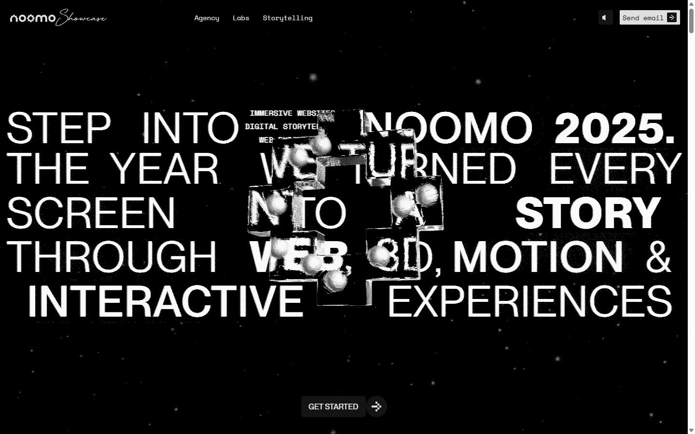</a> <a href="captures/desktop-14.jpg">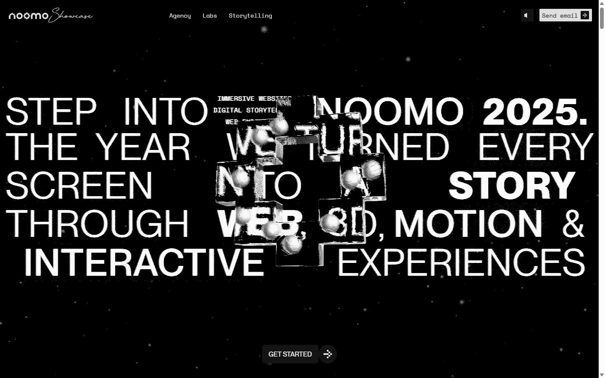</a> <a href="captures/desktop-pleine-page.jpg"></a> 


<a href="captures/mobile-01.jpg">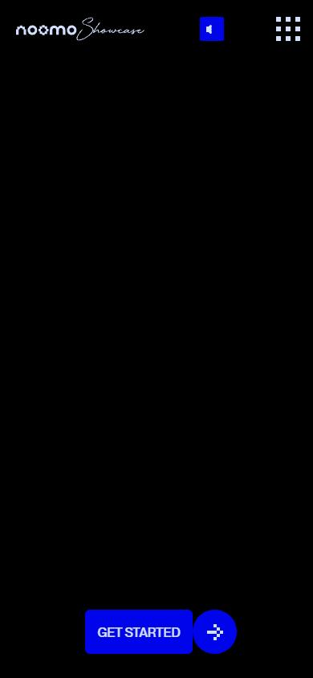</a> <a href="captures/mobile-02.jpg">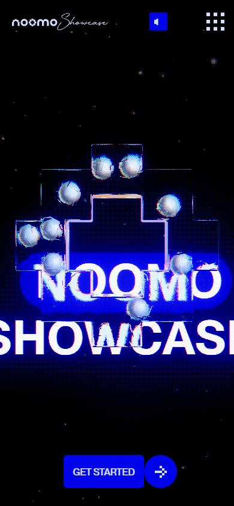</a> <a href="captures/mobile-03.jpg">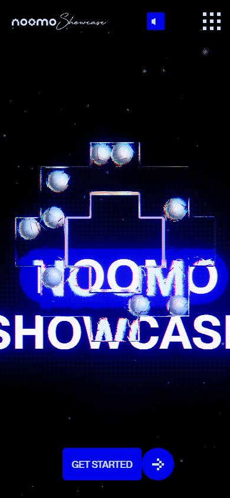</a> <a href="captures/mobile-04.jpg">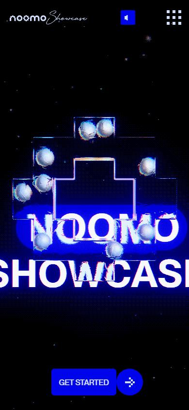</a> <a href="captures/mobile-05.jpg">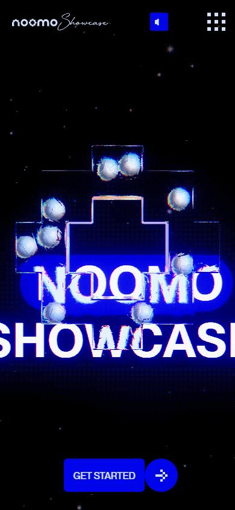</a> <a href="captures/mobile-06.jpg">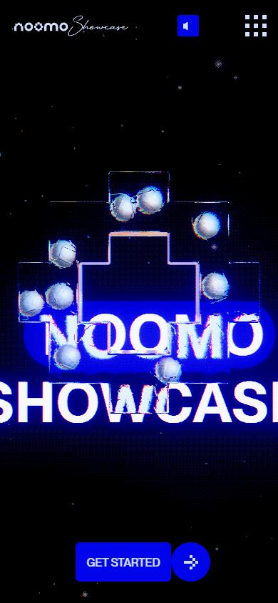</a> 

</details>

## Stack détectée
GSAP, Lil-GUI/Tweakpane (debug), Nuxt, ScrollTrigger, Three.js, Vue, WebGL

Versions : GSAP 3.11.0 · Three.js r?

Shaders GLSL personnalisés extraits : 3 (voir `shaders.glsl`)

## Design tokens
### Couleurs (fonds, pondérées par surface)
`#0004eb` · `#d9e0ed` · `#d2e0ff`
### Couleurs de texte
`#d9e0ed` · `#d2e0ff` · `#050516` · `#000000` · `#0004eb`
### Polices utilisées (par volume de texte)
GTAmericaMonoRegular · ppneuemontreal-book · ppneuemontreal-medium · ABCFavorit Regular
### Fichiers de police chargés
- SpaceMono-Regular.Ba0nOT4a.ttf
- ppneuemontreal-book.DWrvOlKa.otf
- ppneuemontreal-medium.Bc1YMBzw.otf
### Typographie
| Élément | Police | Taille | Graisse | Interligne | Interlettrage | Casse |
|---|---|---|---|---|---|---|
| p | GTAmericaMonoRegular, monospace | 14px | 400 | 21px | normal | none |
| a | GTAmericaMonoRegular, monospace | 20px | 400 | 30px | normal | uppercase |
| body | "ABCFavorit Regular", ui-sans-serif, system-ui, sa | 10px | 400 | 15px | normal | none |

### Échelle des tailles de texte
13px (268) · 20px (246) · 11px (96) · 14px (72) · 22px (4) · 10px (3) · 34px (1) · 15px (1) · 10.5px (1) · 16px (1)
### Arrondis
2px · 50px · 9999px · 6px
### Transitions CSS fréquentes
- cubic-bezier(0.65 0.3s ×21
- cubic-bezier(0.65 0.5s ×10
- cubic-bezier(0.65 0.4s ×9
- cubic-bezier(0.4 0.3s ×4
- ease-in-out 0.3s ×4
- cubic-bezier(0.4 0.35s ×1
- ease-out 0.26s ×1
### Points de rupture (media queries)
320px · 768px · 1024px · 410px · 1280px · 1440px · 450px
### Animations CSS (@keyframes)
bounce-63542410, bounce-822a7f9f
### Variables CSS (:root)
```css
--font-sans: ui-sans-serif,system-ui,sans-serif,"Apple Color Emoji","Segoe UI Emoji","Segoe UI Symbol","Noto Color Emoji";
--font-mono: 'Fira Code', 'Courier New', Courier, monospace;
--color-blue-400: #0004eb;
--spacing: .1rem;
--font-weight-black: 900;
--radius-2xl: 10rem;
--ease-in-out: cubic-bezier(.65,.05,.36,1);
--default-transition-duration: .15s;
--default-transition-timing-function: cubic-bezier(.4,0,.2,1);
--default-font-family: var(--font-sans);
--default-mono-font-family: var(--font-mono);
--color-brand-white-100: #d6e3fc;
--color-brand-white-200: #d9e0ed;
--color-brand-white-300: #d2e0ff;
--color-black-100: #050516;
--color-black-200: #020411;
--spacing-0: 0;
--spacing-14: 1.4rem;
--spacing-16: 1.6rem;
--spacing-28: 2.8rem;
--spacing-30: 3rem;
--spacing-32: 3.2rem;
--spacing-40: 4rem;
--spacing-42: 4.2rem;
--spacing-available: calc(100svh - var(--spacing));
--font-sans-regular: "ABCFavorit Regular",ui-sans-serif,system-ui,sans-serif,"Apple Color Emoji","Segoe UI Emoji","Segoe UI Symbol","Noto Color Emoji";
--text-34: 3.4rem;
--radius-2: .2rem;
--radius-4: .4rem;
--radius-6: .6rem;
--radius-50: 5rem;
--radius-full: 9999px;
--z-index-1: 1;
--z-index-2: 2;
--z-index-4: 4;
--z-index-10: 10;
--z-index-50: 50;
--opacity-0: 0;
--opacity-100: 1;
--container-padding: 2rem;
--container-padding-xs: 1.6rem;
--profiler-bg: #1e1e24f5;
--profiler-header-bg: #2a2a33aa;
--profiler-header: #2a2a33;
--profiler-border: #4a4a5a;
--text-primary: #e0e0e0;
--text-secondary: #9a9aab;
--accent-color: #00aaff;
--color-green: #4caf50;
--color-yellow: #ffc107;
--color-red: #f44336;
--color-fps: rgb(63, 81, 181);
--color-call: rgba(255, 185, 34, 1);
--font-family: 'Inter', 'Segoe UI', Tahoma, Geneva, Verdana, sans-serif;
```

## Structure de la home
Hauteur : 15300 px — 2260 nœuds DOM — canvas 1, vidéos 0, images 5

| # | Bloc | Hauteur | Titre | Médias |
|---|---|---|---|---|
| 1 | div .pointer-events-none fixed flex z-2 pb-33 | 600 |  | 0 |

**Navigation :** Agency · Labs · Storytelling

**Boutons / CTA :** View case studyView case study

## SEO
- Title : Noomo Showcase — Immersive 3D & WebGL Work
- Description : The latest from Noomo — immersive web design, 3D, and motion for brands like Salesforce, AMD, and Red Bull.
- Langue : en — canonical : None
- Open Graph : oui — JSON-LD : aucun
- H1 : 0 — images sans alt : 0/5

### Plan des titres
- (rien relevé)

## Performance (mesure locale, Chrome headless, connexion non bridée)
- TTFB 203 ms · LCP 508 ms (IMG.xs:w-[34vw]) · CLS 0.014 · load 546 ms
- 51 requêtes · 13231 Ko transférés
- Par type : Document 1 req / 3 Ko, Image 15 req / 1414 Ko, Stylesheet 2 req / 6 Ko, Script 4 req / 665 Ko, Font 3 req / 181 Ko, Other 3 req / 4 Ko, Fetch 13 req / 2240 Ko, Media 10 req / 8718 Ko
- Plus gros fichiers :
- 1609 Ko — Media — https://showcase.noomoagency.com/videos/amd_720p.mp4
- 1391 Ko — Media — https://showcase.noomoagency.com/videos/Clippers.mp4
- 1230 Ko — Fetch — https://showcase.noomoagency.com/audio/ShowcaseBG.mp3
- 1141 Ko — Media — https://showcase.noomoagency.com/videos/Coinbase.mp4
- 1114 Ko — Media — https://showcase.noomoagency.com/videos/Vogue.mp4
- 995 Ko — Media — https://showcase.noomoagency.com/videos/SF.mp4
- 954 Ko — Media — https://showcase.noomoagency.com/videos/car_720p.mp4
- 700 Ko — Fetch — https://showcase.noomoagency.com/models/newCell13.glb
- Services tiers : www.googletagmanager.com, region1.google-analytics.com

## Mobile
- H1 : None · corps : 10px · débordement horizontal : False · menu burger : False

## Fichiers
- `captures/` : arrivée, scroll desktop (1440×900), pleine page, pages internes, mobile (390×844 @2x) ; vidéo de scroll dans la release GitHub « videos » (lien en haut de fiche)
- `page.html` : DOM rendu · `styles.css` : CSS chargé · `scripts/` : JS chargé (index dans `_index.json`) · `shaders.glsl` : shaders extraits · `rea-bundle.json` : analyse REA du bundle (chunks, routes, endpoints)
