# Obys Experiment Space

- Site : [https://experiment.obys.agency/](https://experiment.obys.agency/) — [aperçu statique local](apercu.html)
- Capturé le : 2026-11-03 — statut : ok
- Vidéo de scroll : [▶ ouvrir](https://github.com/t-baudry/bibliotheque-web/releases/download/videos/097-obys-experiment-space.webm)

<a href="captures/desktop-00-arrivee.jpg">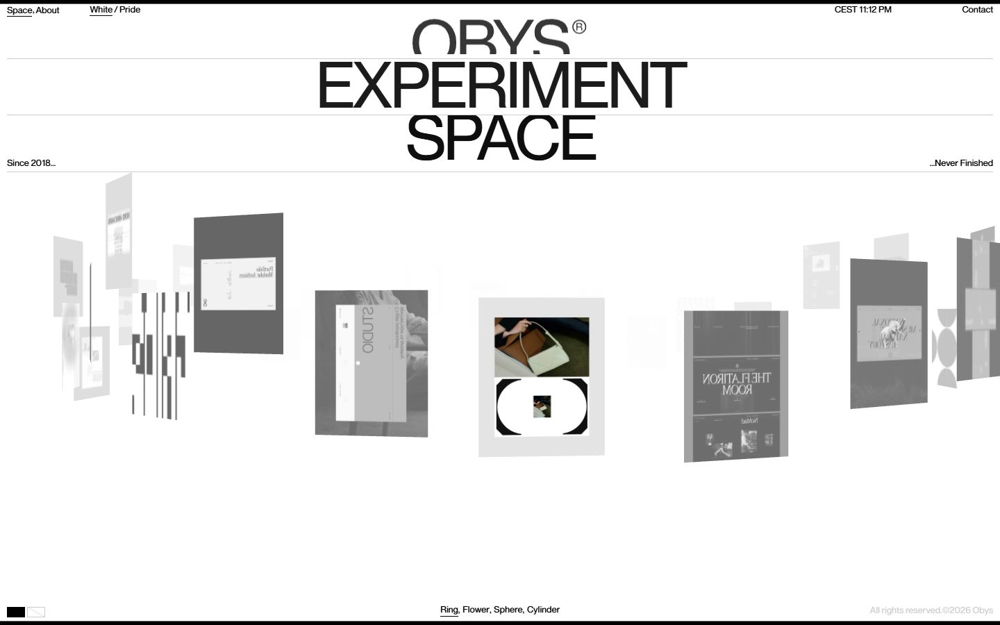</a> 

<details><summary>Toutes les captures</summary>

<a href="captures/desktop-01.jpg">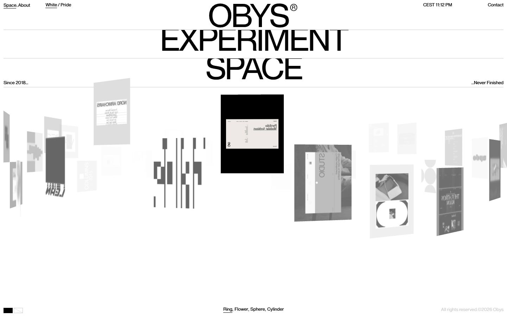</a> <a href="captures/desktop-02.jpg">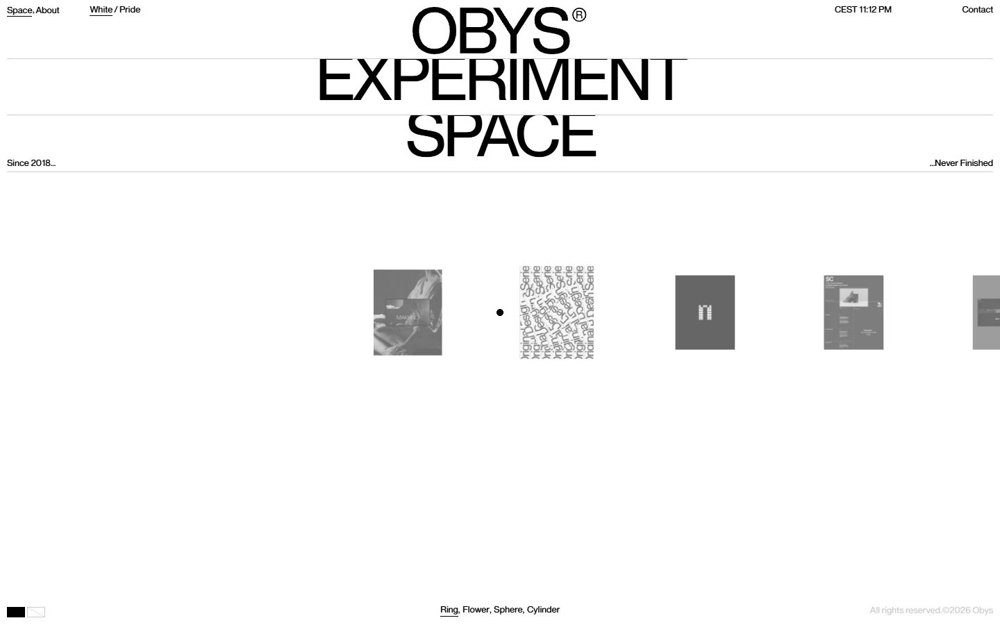</a> <a href="captures/desktop-03.jpg">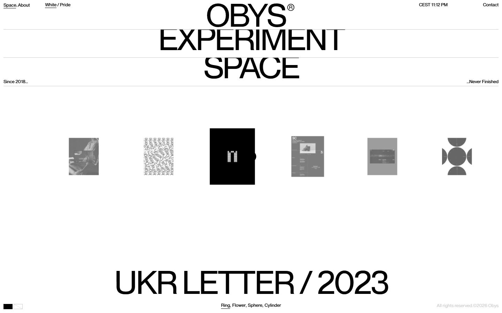</a> <a href="captures/desktop-04.jpg">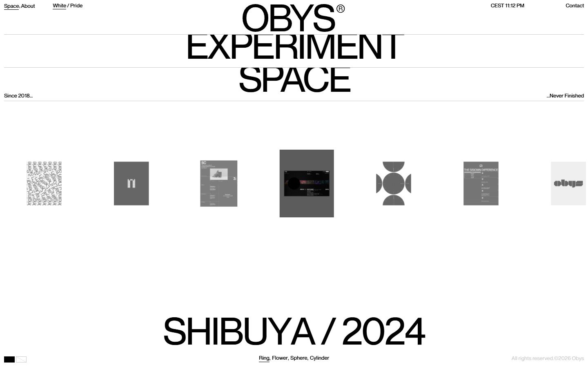</a> <a href="captures/desktop-05.jpg">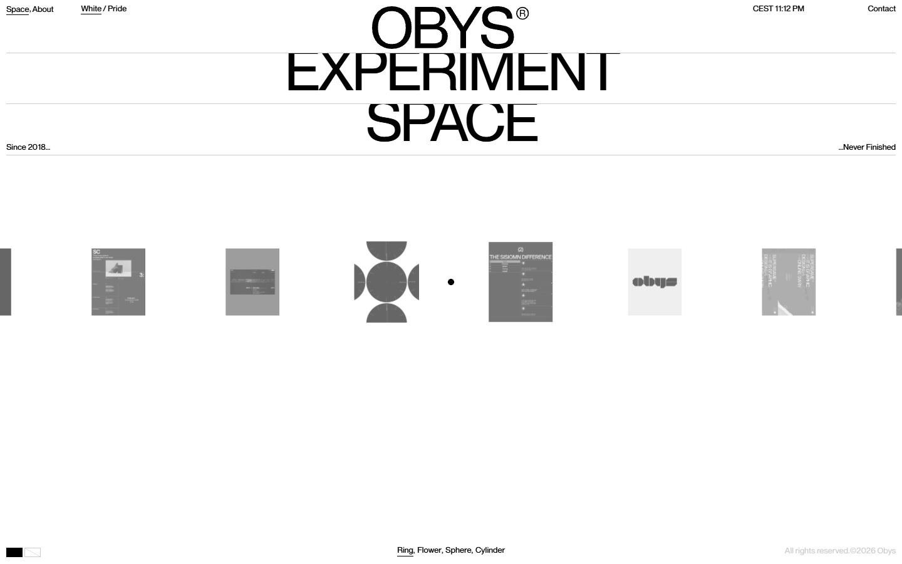</a> <a href="captures/desktop-06.jpg">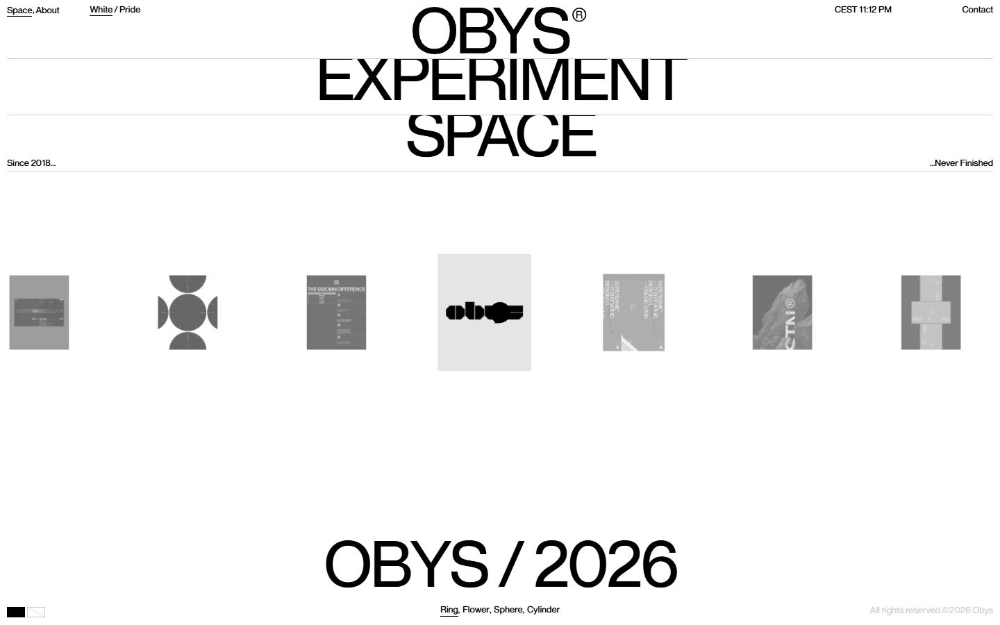</a> <a href="captures/desktop-07.jpg">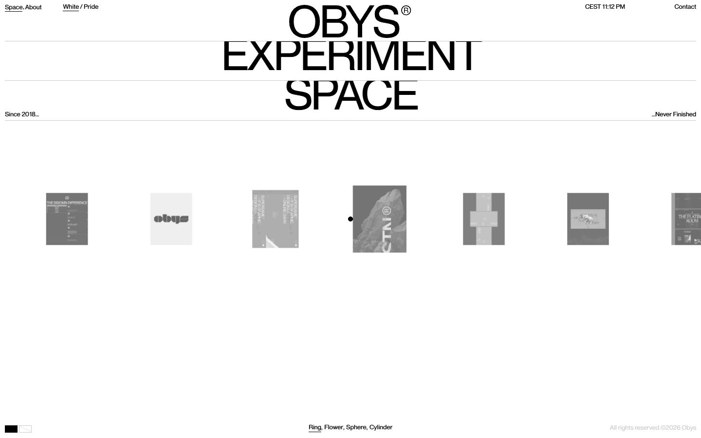</a> 

<a href="captures/page1-01.jpg">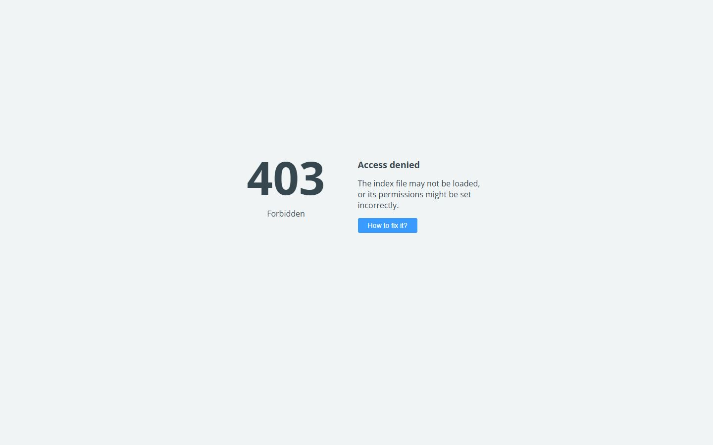</a> <a href="captures/page1-02.jpg"></a> <a href="captures/page1-03.jpg"></a> <a href="captures/page1-04.jpg"></a> 

<a href="captures/mobile-01.jpg"></a> <a href="captures/mobile-02.jpg">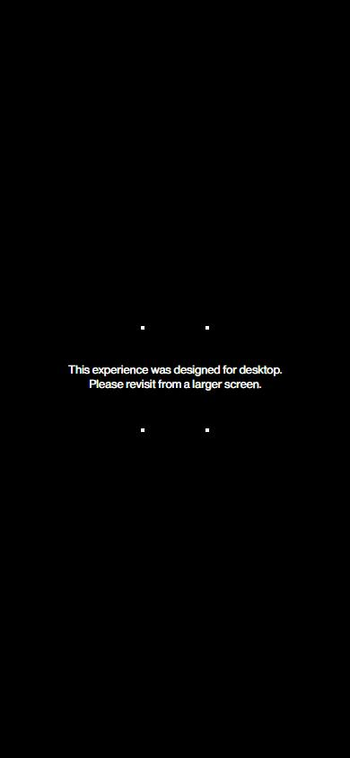</a> <a href="captures/mobile-03.jpg">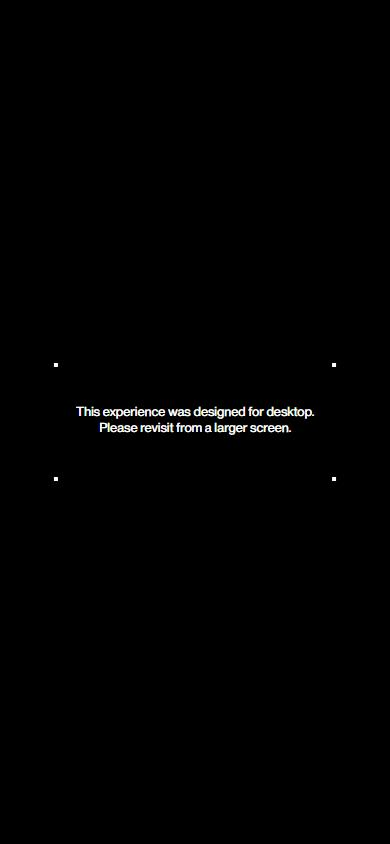</a> <a href="captures/mobile-04.jpg"></a> <a href="captures/mobile-05.jpg"></a> <a href="captures/mobile-06.jpg"></a> 

</details>

## Stack détectée
GSAP, ScrollTrigger, SplitText/SplitType, Three.js, WebGL, Webflow, jQuery

Versions : GSAP 3.12.5 · Three.js r?

Shaders GLSL personnalisés extraits : 6 (voir `shaders.glsl`)

## Design tokens
### Couleurs (fonds, pondérées par surface)
`#ffffff` · `#000000`
### Couleurs de texte
`#000000`
### Polices utilisées (par volume de texte)
OTF Obys NG
### Fichiers de police chargés
- 6a144ba0b441780cf00851eb_ObysSans-Regular.woff2
### Typographie
| Élément | Police | Taille | Graisse | Interligne | Interlettrage | Casse |
|---|---|---|---|---|---|---|
| a | "OTF Obys NG", sans-serif | 13px | 500 | 20px | normal | none |
| body | "Times New Roman" | 14px | 400 | 20px | normal | none |

### Échelle des tailles de texte
13px (22) · 14px (11) · 94px (2)
### Arrondis
aucun (angles droits)
### Transitions CSS fréquentes
- ease 0.3s ×3
- cubic-bezier(0.4 0.6s ×1
- ease 0.4s ×1
- cubic-bezier(0.16 0.5s ×1
- ease 0.2s ×1
### Points de rupture (media queries)
991px · 479px · 767px · 768px · 1199px
### Animations CSS (@keyframes)
spin, mbDot0, mbDot1, mbDot2, mbDot3
### Variables CSS (:root)
```css
```

## Structure de la home
Hauteur : 900 px — 131 nœuds DOM — canvas 2, vidéos 0, images 4

| # | Bloc | Hauteur | Titre | Médias |
|---|---|---|---|---|
| 1 | div .page-transition-overlay | 900 |  | 0 |
| 2 | div .div-block-3 | 900 |  | 2 |
| 3 | div .page-wrapper | 900 |  | 1 |

**Navigation :** 

**Boutons / CTA :** 

## SEO
- Title : Obys® Experiment Space — Unpublished Works & Experiments
- Description : Obys® Experiment Space is a living archive of unpublished concepts, experiments, and side projects. A glimpse into the ideas, explorations, and creative directions behind the work of Obys.
- Langue : None — canonical : https://experiment.obys.agency/
- Open Graph : oui — JSON-LD : aucun
- H1 : 0 — images sans alt : 3/4

### Plan des titres
- (rien relevé)

## Performance (mesure locale, Chrome headless, connexion non bridée)
- TTFB 603 ms · LCP 756 ms (DIV.hero-reveal-top) · CLS 0.008 · load 827 ms
- 45 requêtes · 5229 Ko transférés
- Par type : Document 1 req / 16 Ko, Script 6 req / 298 Ko, Stylesheet 1 req / 12 Ko, Image 35 req / 4896 Ko, Font 1 req / 7 Ko, Other 1 req / 1 Ko
- Plus gros fichiers :
- 1285 Ko — Image — https://media.base44.com/images/public/69cbcd44d3da2a5cef013f5e/35b4cd3a3_images_12_mpcm73ey.jpg
- 350 Ko — Image — https://media.base44.com/images/public/69cbcd44d3da2a5cef013f5e/81b4626b5_images_9_mpcm73ew.jpg
- 301 Ko — Image — https://media.base44.com/images/public/69cbcd44d3da2a5cef013f5e/0e40b44a8_images_17_mpcm73f0.jpg
- 247 Ko — Image — https://media.base44.com/images/public/69cbcd44d3da2a5cef013f5e/af618977f_images_26_mpcm73f2.jpg
- 222 Ko — Script — https://esm.sh/three@0.170.0/es2022/three.mjs
- 214 Ko — Image — https://media.base44.com/images/public/69cbcd44d3da2a5cef013f5e/524984858_images_1_mpcm73ev.jpg
- 195 Ko — Image — https://media.base44.com/images/public/69cbcd44d3da2a5cef013f5e/681d33c8f_images_30_mpcm73f3.jpg
- 188 Ko — Image — https://media.base44.com/images/public/69cbcd44d3da2a5cef013f5e/e290ce602_images_0_mpcm73ev.jpg
- Services tiers : cdnjs.cloudflare.com, d3e54v103j8qbb.cloudfront.net, cdn.prod.website-files.com, unpkg.com, esm.sh, media.base44.com

## Mobile
- H1 : None · corps : 14px · débordement horizontal : False · menu burger : False

## Fichiers
- `captures/` : arrivée, scroll desktop (1440×900), pleine page, pages internes, mobile (390×844 @2x) ; vidéo de scroll dans la release GitHub « videos » (lien en haut de fiche)
- `page.html` : DOM rendu · `styles.css` : CSS chargé · `scripts/` : JS chargé (index dans `_index.json`) · `shaders.glsl` : shaders extraits · `rea-bundle.json` : analyse REA du bundle (chunks, routes, endpoints)

## Pages internes capturées
- https://experiment.obys.agency/about
