# Partizan

- Site : [https://partizan.com/](https://partizan.com/) — [aperçu statique local](apercu.html)
- Capturé le : 2026-11-03 — statut : ok
- Vidéo de scroll : [▶ ouvrir](https://github.com/t-baudry/bibliotheque-web/releases/download/videos/099-partizan.webm)

<a href="captures/desktop-00-arrivee.jpg">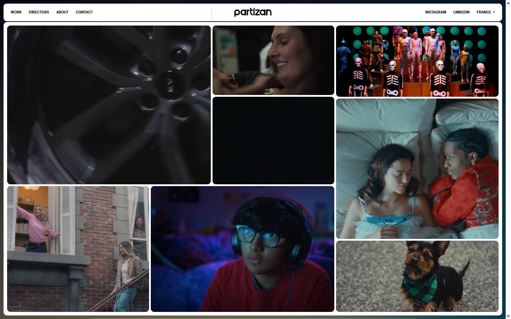</a> 

<details><summary>Toutes les captures</summary>

<a href="captures/desktop-01.jpg">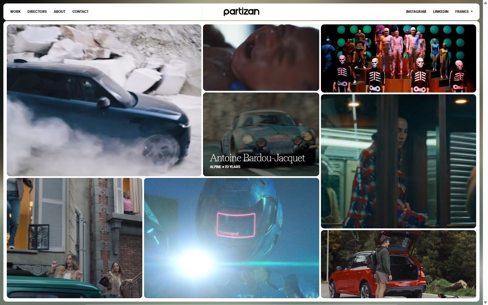</a> <a href="captures/desktop-02.jpg">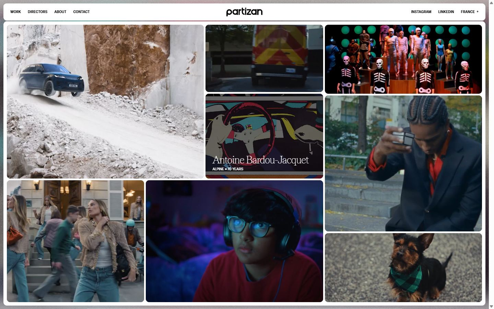</a> <a href="captures/desktop-03.jpg">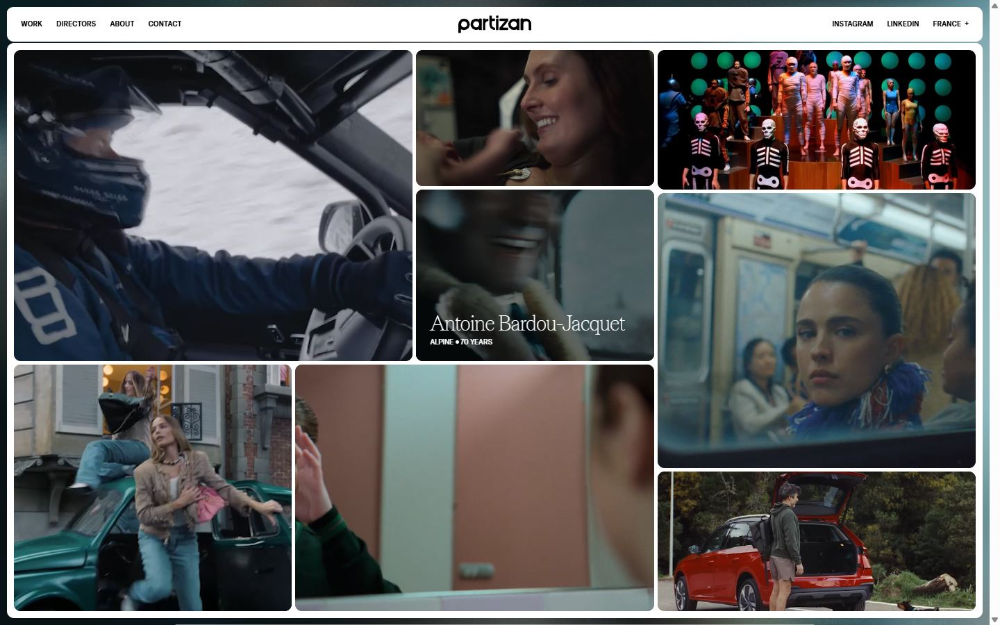</a> <a href="captures/desktop-04.jpg">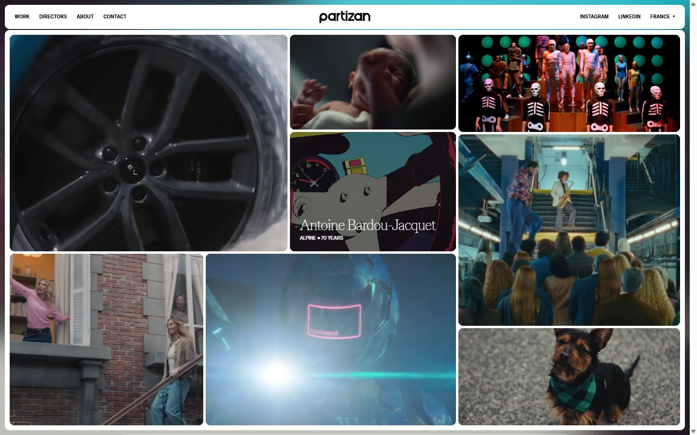</a> <a href="captures/desktop-05.jpg">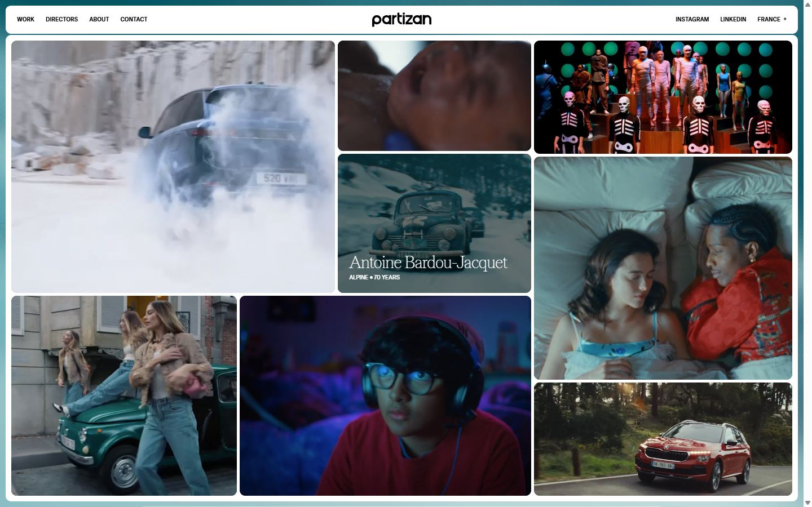</a> <a href="captures/desktop-06.jpg">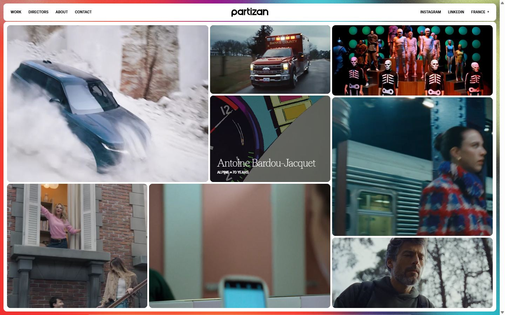</a> <a href="captures/desktop-07.jpg">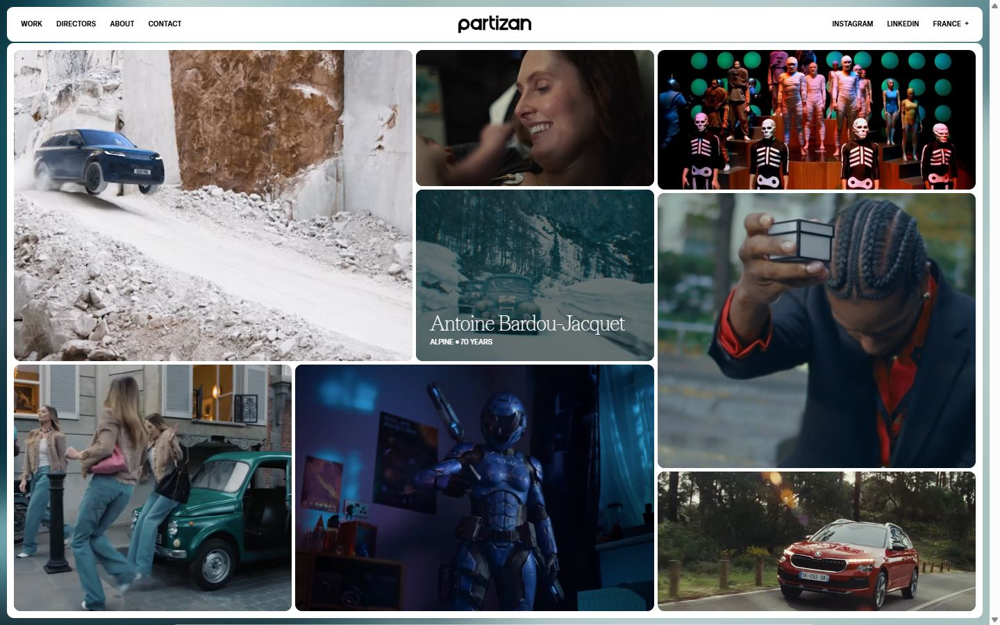</a> 

<a href="captures/page1-01.jpg"></a> <a href="captures/page1-02.jpg"></a> <a href="captures/page1-03.jpg"></a> <a href="captures/page1-04.jpg"></a> <a href="captures/page2-01.jpg"></a> <a href="captures/page2-02.jpg"></a> <a href="captures/page2-03.jpg"></a> <a href="captures/page2-04.jpg"></a> <a href="captures/page3-01.jpg"></a> <a href="captures/page3-02.jpg">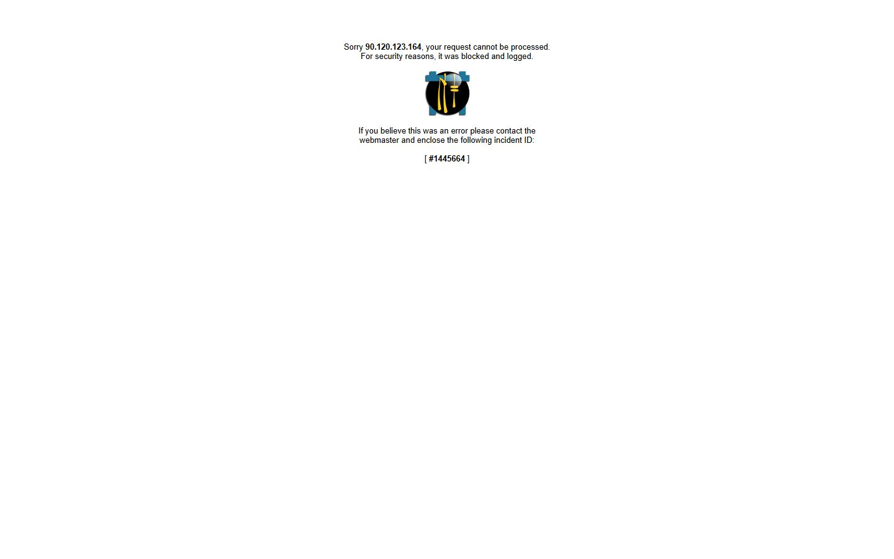</a> <a href="captures/page3-03.jpg"></a> <a href="captures/page3-04.jpg"></a> 

<a href="captures/mobile-01.jpg">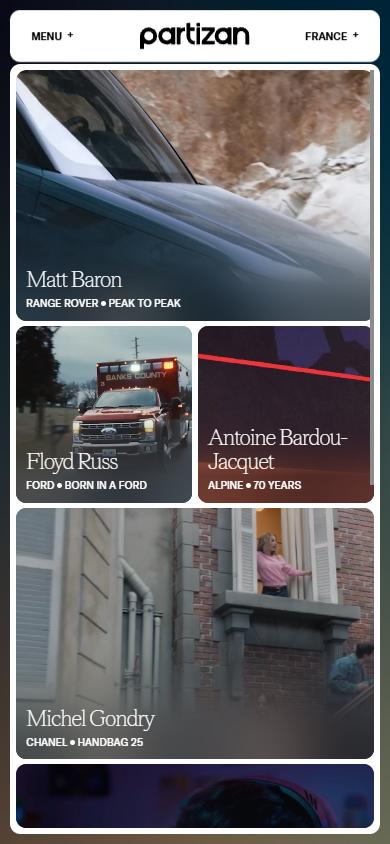</a> <a href="captures/mobile-02.jpg">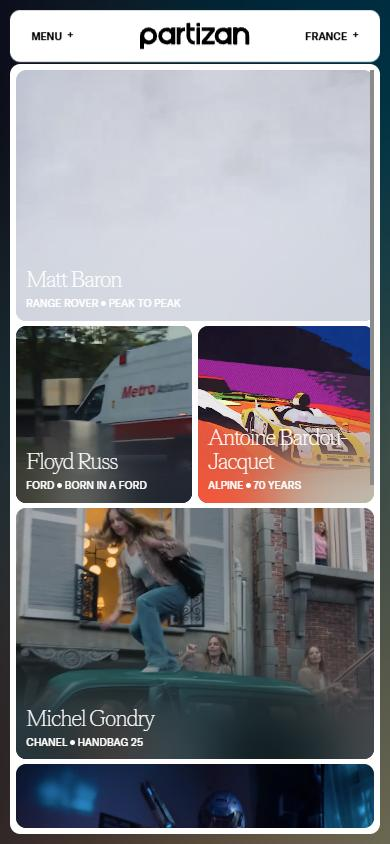</a> <a href="captures/mobile-03.jpg">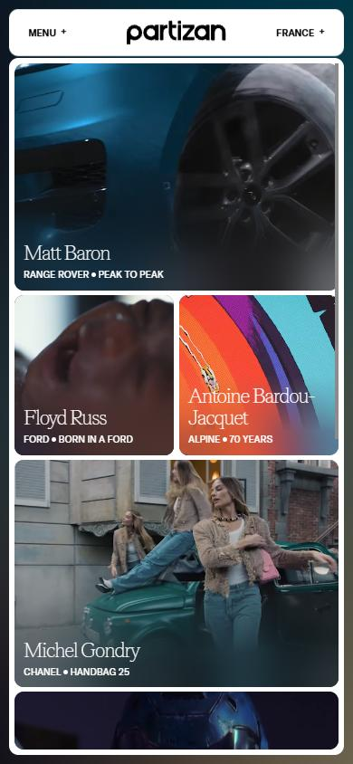</a> <a href="captures/mobile-04.jpg">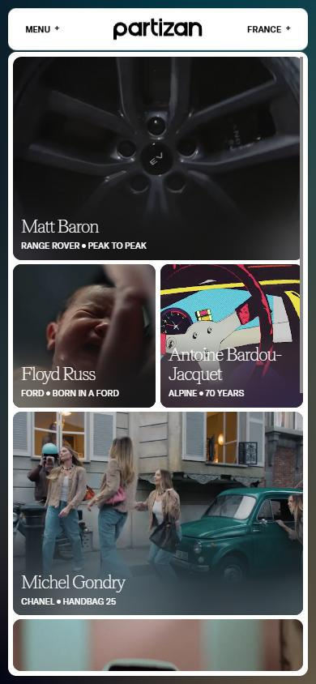</a> <a href="captures/mobile-05.jpg">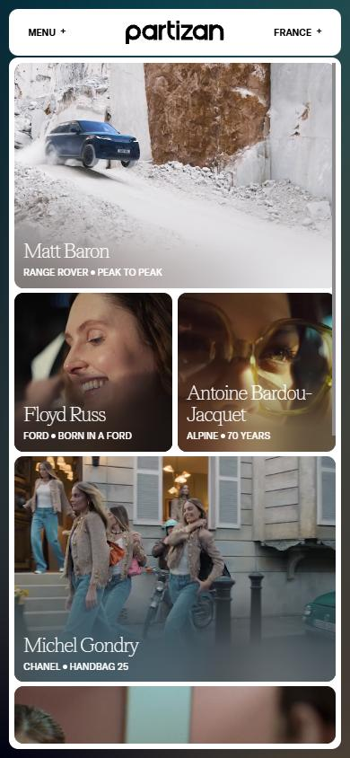</a> <a href="captures/mobile-06.jpg">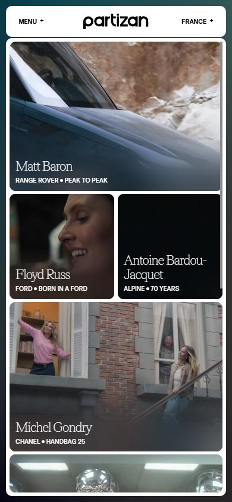</a> 

</details>

## Stack détectée
GSAP, Lenis, Lil-GUI/Tweakpane (debug), ScrollTrigger, Taxi.js, Three.js, Virtual scroll, WebGL, WordPress, jQuery

Versions : GSAP 3.11.0 · Three.js r?

Shaders GLSL personnalisés extraits : 8 (voir `shaders.glsl`)

## Design tokens
### Couleurs (fonds, pondérées par surface)
`#ffffff` · `#000000`
### Couleurs de texte
`#000000` · `#ffffff`
### Polices utilisées (par volume de texte)
GT America Standard · Teodor
### Fichiers de police chargés
- GT-America-Standard-Regular.d2f736.woff2
- Teodor-Thin.526ecf.woff2
- GT-America-Standard-Medium.3582f3.woff2
### Typographie
| Élément | Police | Taille | Graisse | Interligne | Interlettrage | Casse |
|---|---|---|---|---|---|---|
| a | "GT America Standard", sans-serif | 10px | 500 | 12.5px | normal | uppercase |
| body | "GT America Standard", sans-serif | 10px | 400 | 12.5px | normal | none |

### Échelle des tailles de texte
10px (246) · 36px (22) · 32px (16) · 20px (10) · 48px (2) · 12px (2) · 14px (1)
### Arrondis
10px · 9999px
### Transitions CSS fréquentes
- cubic-bezier(0.23 0.6s ×21
- cubic-bezier(0.4 0.3s ×1
### Points de rupture (media queries)
1200px · 768px · 1024px · 2560px · 767px · 1600px · 700px · 650px · 800px · 850px · 479px · 991px
### Animations CSS (@keyframes)
marquee
### Variables CSS (:root)
```css
--color-black: 0 0 0;
--color-white: 255 255 255;
--color-grid: 0 0 255;
--color-blue: 0 0 255;
--ease-out: cubic-bezier(0.23,1,0.32,1);
--ease-in: cubic-bezier(0.12,0,0.39,0);
--ease-in-out: cubic-bezier(0.86,0,0.07,1);
--ease-out-back: cubic-bezier(0.175,0.885,0.32,1.275);
--size: 1440;
--padding-container: 1rem;
--gap: 0.5rem;
--vw: 100vw;
--vh: calc(var(--vh-initial, 1vh)*100);
--header-height: 5rem;
--available-height: calc(var(--vh) - var(--header-height) - var(--padding-container)*2 - 0.2rem);
--column: calc(var(--vw)/24 - var(--padding-container)*2/24 - var(--gap)*23/24);
--tw-bg-opacity: 1;
--tw-text-opacity: 1;
```

## Structure de la home
Hauteur : 900 px — 1396 nœuds DOM — canvas 1, vidéos 36, images 16

| # | Bloc | Hauteur | Titre | Médias |
|---|---|---|---|---|
| 1 | div .loader fixed top-0 left-0 w-screen h-scr | 900 |  | 0 |
| 2 | div .popup-overlay fixed top-0 left-0 w-full  | 900 |  | 0 |
| 3 | div#popup .popup  fixed top-0 left-0 w-full h-scree | 900 |  | 0 |
| 4 | div .popup-small-overlay fixed top-0 left-0 w | 900 |  | 0 |
| 5 | div#popup-small .popup-small  fixed top-0 left-0 w-full h | 900 |  | 0 |
| 6 | div .popup-overlay fixed top-0 left-0 w-full  | 900 |  | 0 |
| 7 | div#popup-video .popup-video fixed top-0 left-0 w-full h- | 900 |  | 0 |
| 8 | div .popup-image-overlay fixed top-0 left-0 w | 900 |  | 0 |
| 9 | div#popup-image .fixed top-0 left-0 w-full h-screen overf | 900 |  | 0 |
| 10 | div .fade fixed top-0 left-0 w-full h-full bg | 900 |  | 0 |
| 11 | div .content | 900 |  | 52 |
| 12 | canvas#gl . | 900 |  | 0 |

**Navigation :** Work · Directors · About · Contact · Instagram · Linkedin · Instagram · Linkedin · US · UK · France · World

**Boutons / CTA :** 

## SEO
- Title : Home | Partizan
- Description : None
- Langue : en-US — canonical : https://partizan.com/
- Open Graph : oui — JSON-LD : Corporation
- H1 : 0 — images sans alt : 0/16

### Plan des titres
- (rien relevé)

## Performance (mesure locale, Chrome headless, connexion non bridée)
- TTFB 486 ms · LCP 676 ms (IMG.) · CLS 0 · load 889 ms
- 39 requêtes · 22142 Ko transférés
- Par type : Document 1 req / 11 Ko, Stylesheet 2 req / 13 Ko, Image 10 req / 659 Ko, Script 6 req / 446 Ko, Font 3 req / 162 Ko, Other 1 req / 1 Ko, Media 14 req / 20849 Ko, Fetch 2 req / 1 Ko
- Plus gros fichiers :
- 4254 Ko — Media — https://partizan.com/wp-content/uploads/2025/12/Michel-Gondry_Chanel_Metiers-dArt-2026_800px__.mp4
- 3735 Ko — Media — https://partizan.com/wp-content/uploads/2025/06/Antoine-Bardou-Jacquet_Alpine_70-Years_800px.mp4
- 3256 Ko — Media — https://partizan.com/wp-content/uploads/2026/05/Martin-Holzman_Skoda_Cest-Louche_800px.mp4
- 3183 Ko — Media — https://partizan.com/wp-content/uploads/2026/03/Michel-Gondry_Chanel_Handbag-25_800px.mp4
- 2751 Ko — Media — https://partizan.com/wp-content/uploads/2026/05/Ethan-and-Tom_NSPCC_Keyboard-Worriers_800px.mp4
- 1886 Ko — Media — https://partizan.com/wp-content/uploads/2026/06/Floyd-Russ_Ford_Born-in-a-Ford_800px_new.mp4
- 1784 Ko — Media — https://partizan.com/wp-content/uploads/2026/10/Matt-Baron_Range-Rover_Peak-to-Peak_800px.mp4
- 239 Ko — Script — https://partizan.com/wp-content/themes/beaucoup/public/js/app.6a6f75.js
- Services tiers : www.googletagmanager.com, region1.google-analytics.com

## Mobile
- H1 : None · corps : 10.4px · débordement horizontal : False · menu burger : False

## Fichiers
- `captures/` : arrivée, scroll desktop (1440×900), pleine page, pages internes, mobile (390×844 @2x) ; vidéo de scroll dans la release GitHub « videos » (lien en haut de fiche)
- `page.html` : DOM rendu · `styles.css` : CSS chargé · `scripts/` : JS chargé (index dans `_index.json`) · `shaders.glsl` : shaders extraits · `rea-bundle.json` : analyse REA du bundle (chunks, routes, endpoints)

## Pages internes capturées
- https://partizan.com/works/
- https://partizan.com/directors/
- https://partizan.com/about/
