# Artem Shcherbakov

- Site : [https://artemartemartem.com/](https://artemartemartem.com/) — [aperçu statique local](apercu.html)
- Capturé le : 2026-11-03 — statut : ok
- Vidéo de scroll : [▶ ouvrir](https://github.com/t-baudry/bibliotheque-web/releases/download/videos/100-artem-shcherbakov.webm)

<a href="captures/desktop-00-arrivee.jpg"></a> 

<details><summary>Toutes les captures</summary>

<a href="captures/desktop-01.jpg">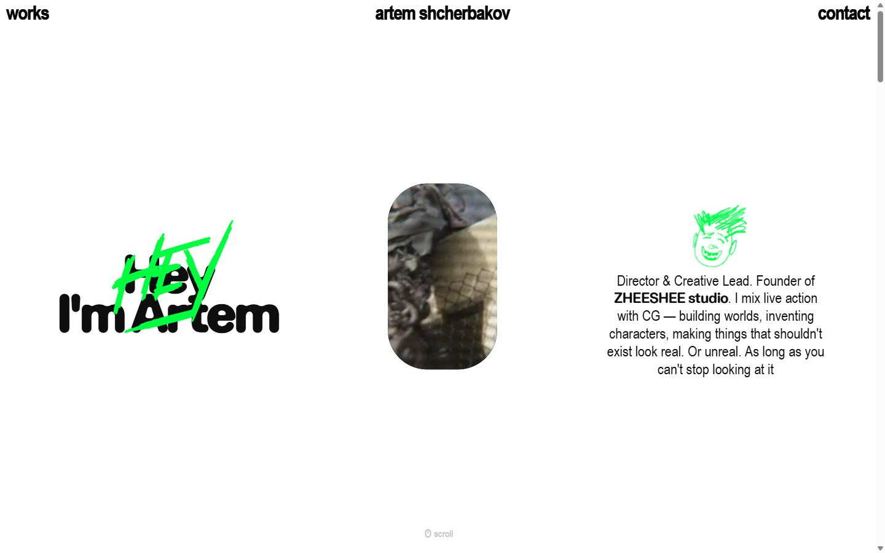</a> <a href="captures/desktop-02.jpg">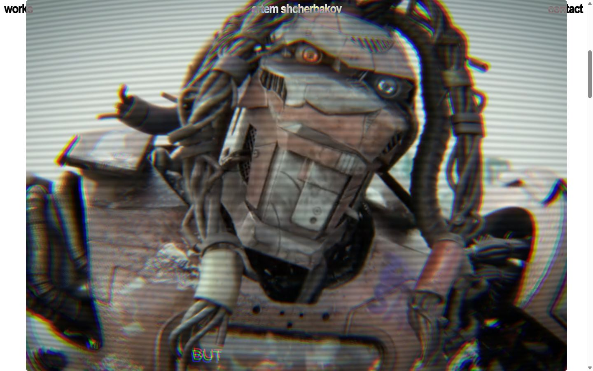</a> <a href="captures/desktop-03.jpg">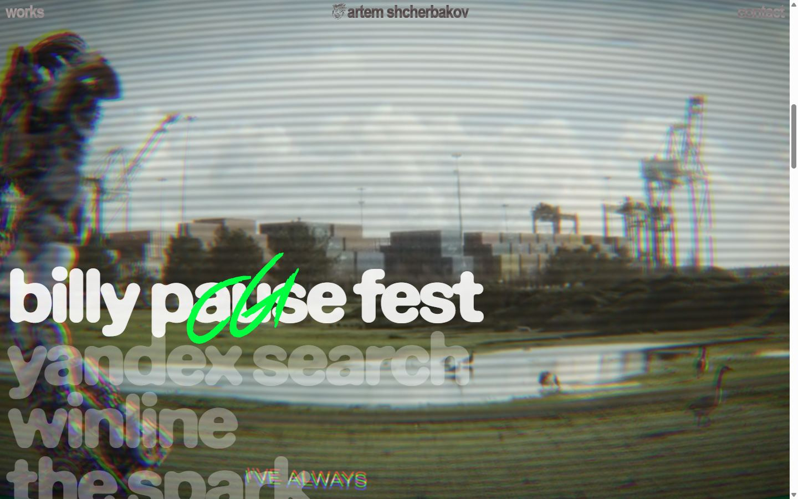</a> <a href="captures/desktop-04.jpg">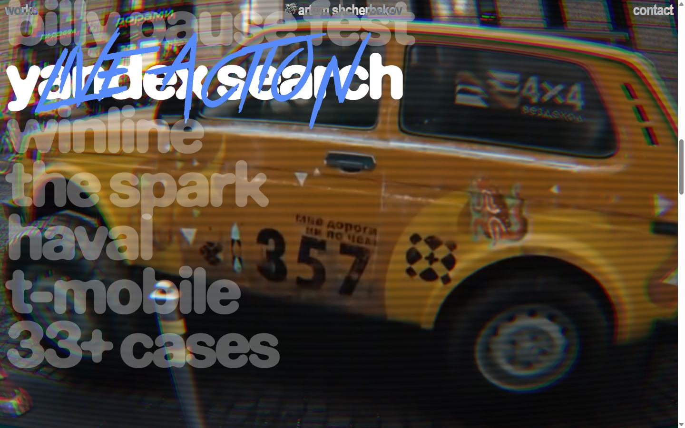</a> <a href="captures/desktop-05.jpg">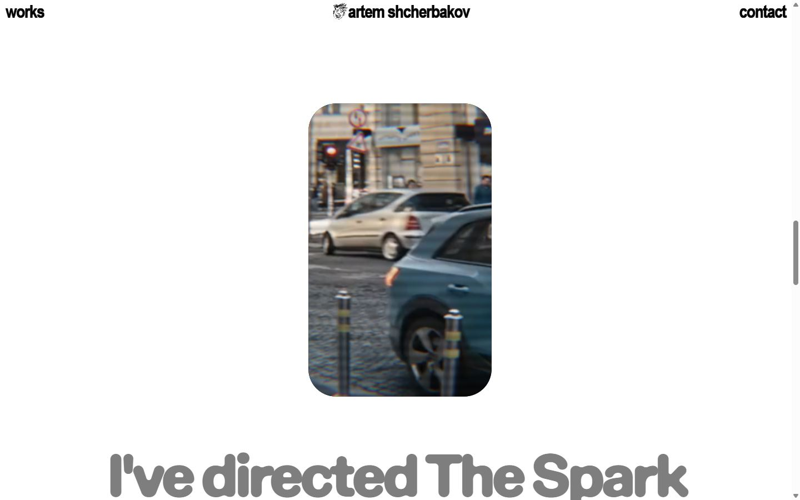</a> <a href="captures/desktop-06.jpg">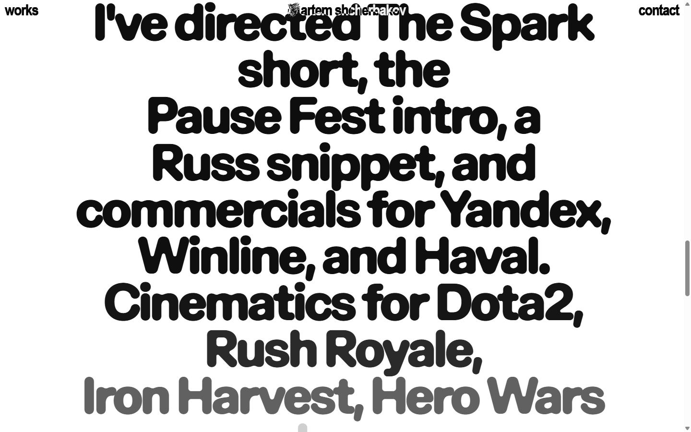</a> <a href="captures/desktop-07.jpg">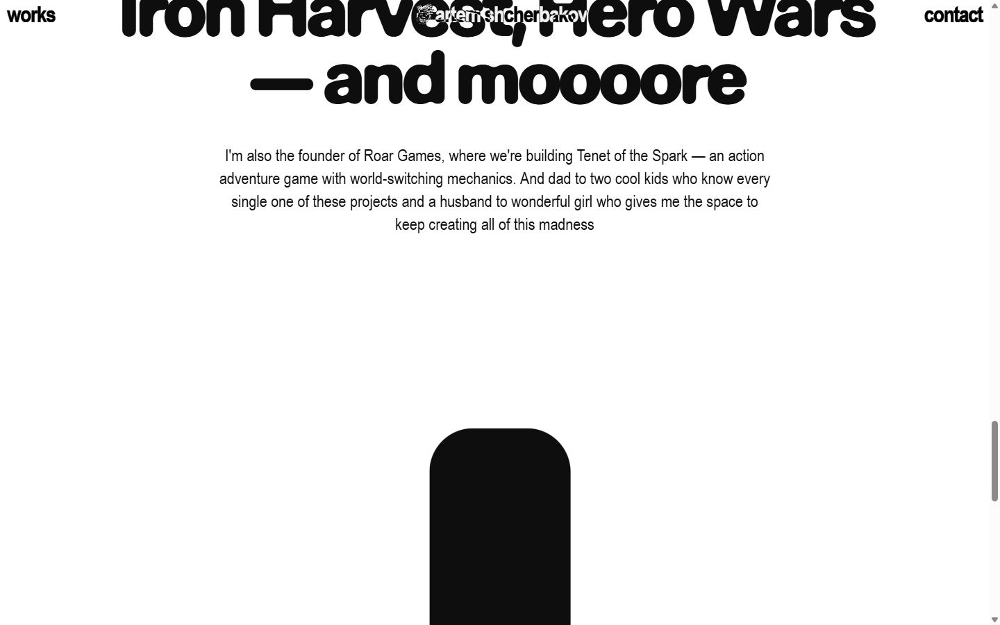</a> 

<a href="captures/page1-01.jpg">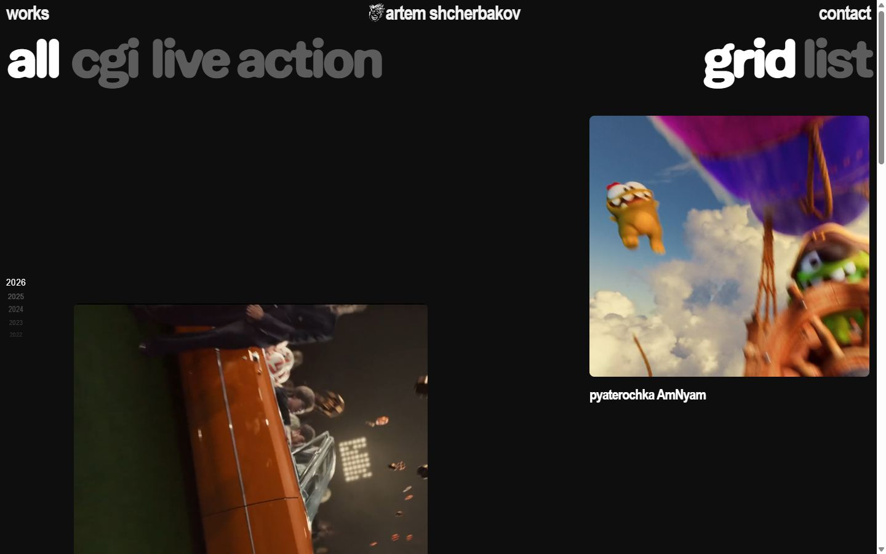</a> <a href="captures/page1-02.jpg">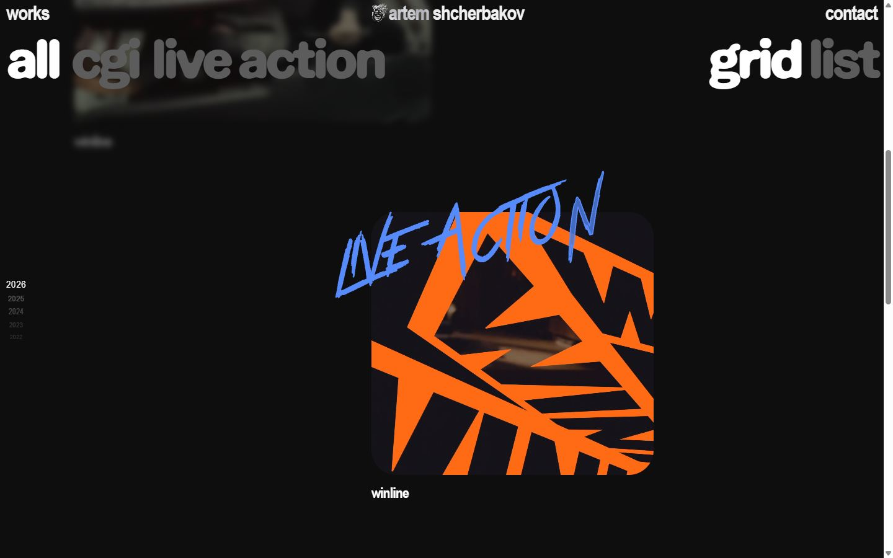</a> <a href="captures/page1-03.jpg">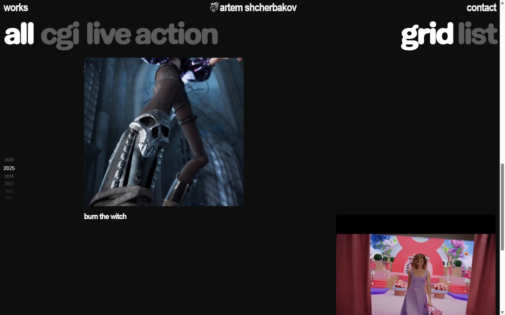</a> <a href="captures/page1-04.jpg">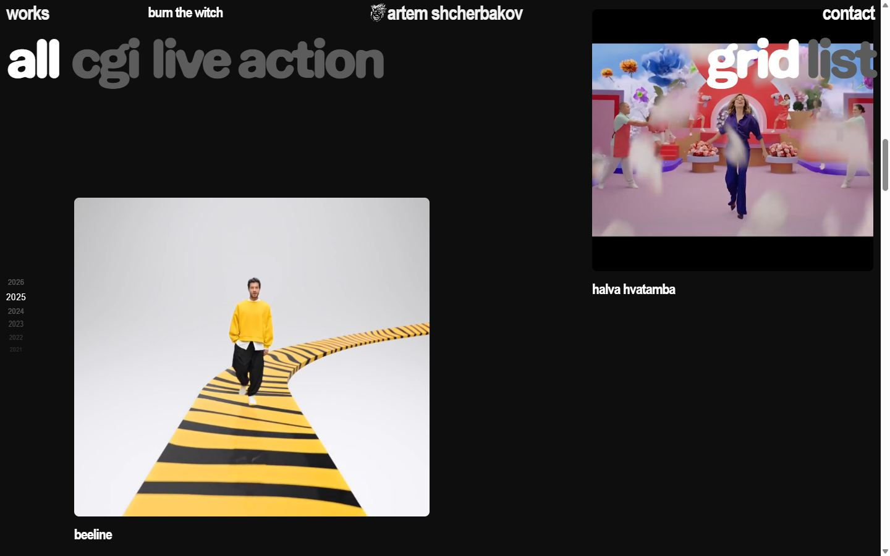</a> 

<a href="captures/mobile-01.jpg">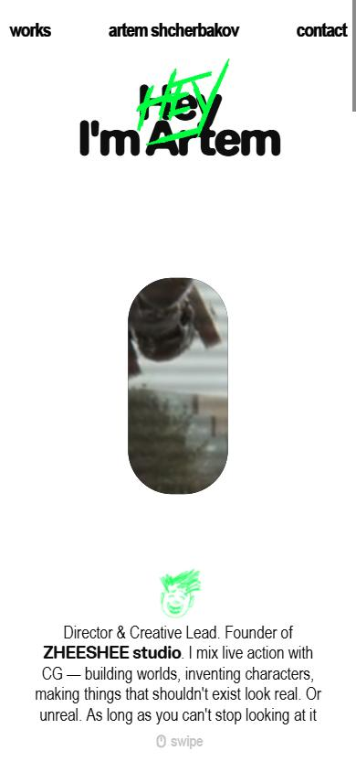</a> <a href="captures/mobile-02.jpg">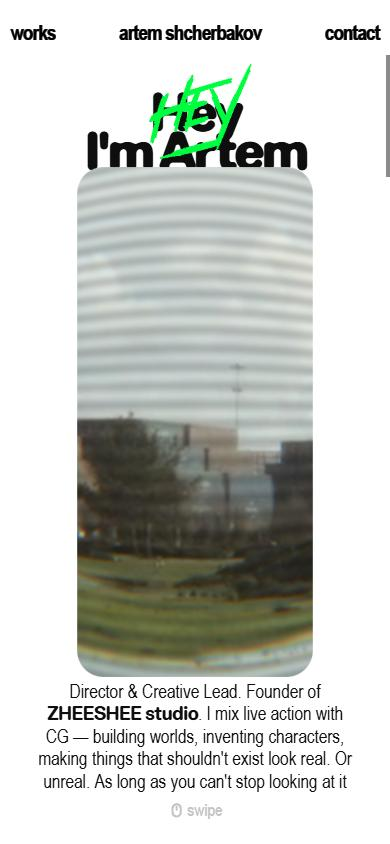</a> <a href="captures/mobile-03.jpg">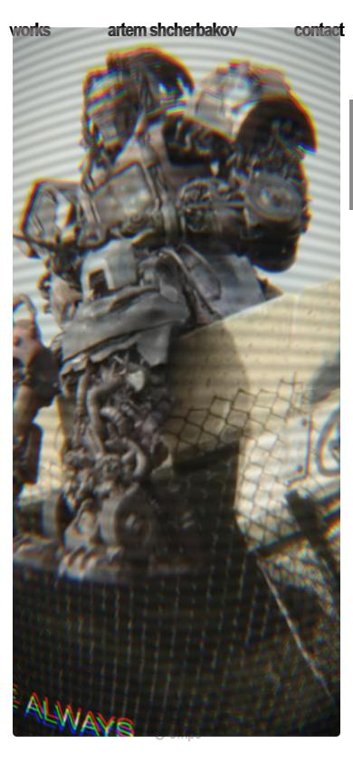</a> <a href="captures/mobile-04.jpg">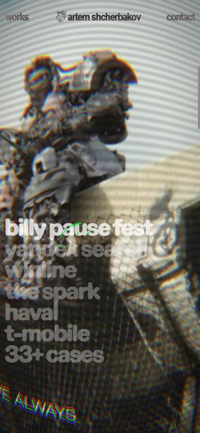</a> <a href="captures/mobile-05.jpg">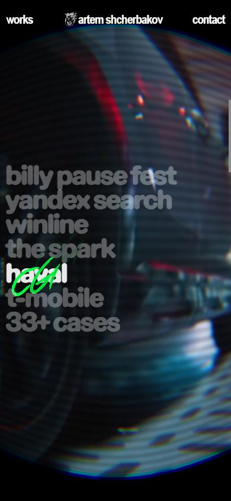</a> <a href="captures/mobile-06.jpg">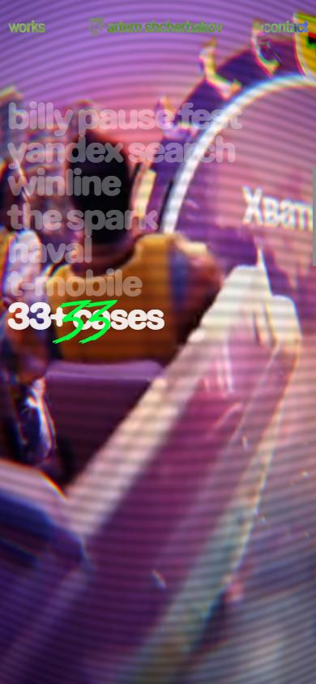</a> 

</details>

## Stack détectée
GSAP, Lenis, Next.js, Postprocessing, React, React Three Fiber, ScrollTrigger, Three.js, Virtual scroll, WebGL

Versions : GSAP 3.11.0 · Three.js r?

Shaders GLSL personnalisés extraits : 16 (voir `shaders.glsl`)

## Design tokens
### Couleurs (fonds, pondérées par surface)
`#0e0e0e`
### Couleurs de texte
`#0e0e0e` · `#ffffff`
### Polices utilisées (par volume de texte)
Arial Narrow · EaseDouble
### Fichiers de police chargés
- ArialNarrow-Bold.woff2
- EaseDoubleRounded-Black.woff2
- GreatRebellion.woff2
- ArialNarrow-Regular.woff2
- EaseRoundedTRIAL-Semibold.otf
- Great%20Rebellion.ttf
### Typographie
| Élément | Police | Taille | Graisse | Interligne | Interlettrage | Casse |
|---|---|---|---|---|---|---|
| h1 | EaseDouble | 88px | 900 | 64.24px | -7.04px | none |
| h2 | EaseDouble | 108px | 900 | 97.2px | -8.64px | none |
| h3 | "Arial Narrow" | 16px | 700 | normal | -0.64px | uppercase |
| p | "Arial Narrow", sans-serif | 24px | 400 | 28.8px | normal | none |
| a | "Arial Narrow", sans-serif | 32px | 700 | 32px | -1.28px | none |
| li | EaseDouble | 16px | 400 | 16px | normal | none |
| body | EaseDouble | 16px | 400 | 16px | normal | none |

### Échelle des tailles de texte
24px (96) · 108px (39) · 88px (12) · 16px (8) · 136px (8) · 120px (7) · 32px (6) · 23px (2) · 140px (1)
### Arrondis
50%
### Transitions CSS fréquentes
- cubic-bezier(0.455 0.4s ×35
- cubic-bezier(0.33 0.3s ×7
- ease 0.3s ×2
### Points de rupture (media queries)
480px · 768px · 1279px · 1024px
### Animations CSS (@keyframes)
(aucune)
### Variables CSS (:root)
```css
--ease-in-quad: cubic-bezier(0.55,0.085,0.68,0.53);
--ease-in-cubic: cubic-bezier(0.55,0.055,0.675,0.19);
--ease-in-quart: cubic-bezier(0.895,0.03,0.685,0.22);
--ease-in-quint: cubic-bezier(0.755,0.05,0.855,0.06);
--ease-in-expo: cubic-bezier(0.95,0.05,0.795,0.035);
--ease-in-circ: cubic-bezier(0.6,0.04,0.98,0.335);
--ease-out-quad: cubic-bezier(0.25,0.46,0.45,0.94);
--ease-out-cubic: cubic-bezier(0.215,0.61,0.355,1);
--ease-out-quart: cubic-bezier(0.165,0.84,0.44,1);
--ease-out-quint: cubic-bezier(0.23,1,0.32,1);
--ease-out-expo: cubic-bezier(0.19,1,0.22,1);
--ease-out-circ: cubic-bezier(0.075,0.82,0.165,1);
--ease-in-out-quad: cubic-bezier(0.455,0.03,0.515,0.955);
--ease-in-out-cubic: cubic-bezier(0.645,0.045,0.355,1);
--ease-in-out-quart: cubic-bezier(0.77,0,0.175,1);
--ease-in-out-quint: cubic-bezier(0.86,0,0.07,1);
--ease-in-out-expo: cubic-bezier(1,0,0,1);
--ease-in-out-circ: cubic-bezier(0.785,0.135,0.15,0.86);
--default-transition-duration: 0.4s;
--default-transition-timing-function: var(--ease-in-out-quad);
--vw-screen: 375;
--v-min-h: 636;
--spacing-4: calc(4 / var(--vw-screen) * 100 * 1vw);
--spacing-8: calc(8 / var(--vw-screen) * 100 * 1vw);
--spacing-12: calc(12 / var(--vw-screen) * 100 * 1vw);
--spacing-16: calc(16 / var(--vw-screen) * 100 * 1vw);
--spacing-20: calc(20 / var(--vw-screen) * 100 * 1vw);
--spacing-24: calc(24 / var(--vw-screen) * 100 * 1vw);
--spacing-28: calc(28 / var(--vw-screen) * 100 * 1vw);
--spacing-32: calc(32 / var(--vw-screen) * 100 * 1vw);
--spacing-36: calc(36 / var(--vw-screen) * 100 * 1vw);
--spacing-40: calc(40 / var(--vw-screen) * 100 * 1vw);
--spacing-44: calc(44 / var(--vw-screen) * 100 * 1vw);
--spacing-48: calc(48 / var(--vw-screen) * 100 * 1vw);
--spacing-52: calc(52 / var(--vw-screen) * 100 * 1vw);
--spacing-56: calc(56 / var(--vw-screen) * 100 * 1vw);
--spacing-60: calc(60 / var(--vw-screen) * 100 * 1vw);
--spacing-64: calc(64 / var(--vw-screen) * 100 * 1vw);
--spacing-68: calc(68 / var(--vw-screen) * 100 * 1vw);
--spacing-72: calc(72 / var(--vw-screen) * 100 * 1vw);
--spacing-76: calc(76 / var(--vw-screen) * 100 * 1vw);
--spacing-80: calc(80 / var(--vw-screen) * 100 * 1vw);
--spacing-84: calc(84 / var(--vw-screen) * 100 * 1vw);
--spacing-88: calc(88 / var(--vw-screen) * 100 * 1vw);
--spacing-92: calc(92 / var(--vw-screen) * 100 * 1vw);
--spacing-96: calc(96 / var(--vw-screen) * 100 * 1vw);
--spacing-100: calc(100 / var(--vw-screen) * 100 * 1vw);
--spacing-104: calc(104 / var(--vw-screen) * 100 * 1vw);
--spacing-108: calc(108 / var(--vw-screen) * 100 * 1vw);
--spacing-112: calc(112 / var(--vw-screen) * 100 * 1vw);
--spacing-116: calc(116 / var(--vw-screen) * 100 * 1vw);
--spacing-120: calc(120 / var(--vw-screen) * 100 * 1vw);
--spacing-124: calc(124 / var(--vw-screen) * 100 * 1vw);
--spacing-140: calc(140 / var(--vw-screen) * 100 * 1vw);
--z-preloader: 11;
--z-cursor: 10;
--z-transition-layout: 9;
--z-open-video: 8;
--z-header: 7;
--z-page: 6;
--z-modal: 5;
--z-menu: 4;
--z-transition: 3;
--z-header-dropdown: 2;
--z-selectors: 1;
--c-white: #fff;
--c-graphite: #222;
--c-light-graphite: #454545;
--c-dark-grey: #d4d4d4;
--c-light-grey: #f1f1f1;
--c-grey: #e8e8e8;
--text-gray: rgb(92,92,92);
--text-primary: rgba(14,14,14,1);
--text-primary-12: rgba(14,14,14,0.12);
--text-primary-24: rgba(14,14,14,0.24);
--text-primary-32: rgba(14,14,14,0.32);
--text-primary-inverse: rgba(255,255,255,1);
--text-secondary-inverse: rgba(255,255,255,1);
--text-tertiary-inverse: rgba(255,255,255,0.24);
--text-accent-green: rgba(0,254,64,1);
```

## Structure de la home
Hauteur : 900 px — 970 nœuds DOM — canvas 1, vidéos 0, images 14

| # | Bloc | Hauteur | Titre | Médias |
|---|---|---|---|---|
| 1 | div .home-page_heroWrapper__0Eh8U | 1800 | Hey I'm Artem | 8 |
| 2 | div .window-section-wrapper_root__m5TTH home- | 4050 |  | 1 |
| 3 | section .about-section_root____3vv | 1152 | I've directed The SparkThe Spark short, the Pause Fest intro Pause Fest intro ,  | 0 |
| 4 | div .window-section-wrapper_root__m5TTH home- | 1800 | Represented by Catalyzm | 6 |

**Navigation :** works · artem shcherbakov · contact

**Boutons / CTA :** 

## SEO
- Title : artem shcherbakov
- Description : Hey! I'm Artem. Director & Creative Lead. Maybe you see my work. Do you think "No"? Check it!
- Langue : en — canonical : None
- Open Graph : oui — JSON-LD : aucun
- H1 : 1 — images sans alt : 7/14

### Plan des titres
- H1 Hey I'm Artem
- H2 I've directed The SparkThe Spark short, the Pause Fest intro Pause Fest intro , a Russ sni
- H2 Represented by Catalyzm
- H3 Agent
- H3 E-mail
- H3 Phone

## Performance (mesure locale, Chrome headless, connexion non bridée)
- TTFB 540 ms · LCP 996 ms (H1.hero-section_title__DTVen) · CLS 0.003 · load 1347 ms
- 75 requêtes · 35570 Ko transférés
- Par type : Document 1 req / 254 Ko, Stylesheet 2 req / 9 Ko, Image 21 req / 2385 Ko, Script 20 req / 900 Ko, Font 5 req / 290 Ko, Fetch 4 req / 50 Ko, Other 5 req / 180 Ko, Media 17 req / 31501 Ko
- Plus gros fichiers :
- 4007 Ko — Media — https://download-video-ak.vimeocdn.com/v3-1/playback/80532a33-e390-40f9-9f31-8fec790d9a7b/d54a01a1-9dbe4b15?__token__=st=1793744290~exp=1793747890~acl=%2Fv3-1%2
- 4007 Ko — Media — https://download-video-ak.vimeocdn.com/v3-1/playback/80532a33-e390-40f9-9f31-8fec790d9a7b/d54a01a1-9dbe4b15?__token__=st=1793744291~exp=1793747891~acl=%2Fv3-1%2
- 2701 Ko — Media — https://download-video-ak.vimeocdn.com/v3-1/playback/fbe77496-4010-4b55-ba0d-72d3cab85137/98b63d4c-5ec904d6?__token__=st=1793744290~exp=1793747890~acl=%2Fv3-1%2
- 2701 Ko — Media — https://download-video-ak.vimeocdn.com/v3-1/playback/fbe77496-4010-4b55-ba0d-72d3cab85137/98b63d4c-5ec904d6?__token__=st=1793744292~exp=1793747892~acl=%2Fv3-1%2
- 2683 Ko — Media — https://download-video-ak.vimeocdn.com/v3-1/playback/84b2d5a2-a6cb-48d4-98d1-130aa33f2921/6ba6f10a-b84df058?__token__=st=1793744290~exp=1793747890~acl=%2Fv3-1%2
- 2683 Ko — Media — https://download-video-ak.vimeocdn.com/v3-1/playback/84b2d5a2-a6cb-48d4-98d1-130aa33f2921/6ba6f10a-b84df058?__token__=st=1793744292~exp=1793747892~acl=%2Fv3-1%2
- 2476 Ko — Media — https://download-video-ak.vimeocdn.com/v3-1/playback/fbe77496-4010-4b55-ba0d-72d3cab85137/98b63d4c-5ec904d6?__token__=st=1793744292~exp=1793747892~acl=%2Fv3-1%2
- 2363 Ko — Media — https://download-video-ak.vimeocdn.com/v3-1/playback/84b2d5a2-a6cb-48d4-98d1-130aa33f2921/6ba6f10a-b84df058?__token__=st=1793744292~exp=1793747892~acl=%2Fv3-1%2
- Services tiers : imgproxy.artemartemartem.com, download-video-ak.vimeocdn.com

## Mobile
- H1 : {'size': '54.08px', 'lineHeight': '39.4784px'} · corps : 16px · débordement horizontal : False · menu burger : False

## Fichiers
- `captures/` : arrivée, scroll desktop (1440×900), pleine page, pages internes, mobile (390×844 @2x) ; vidéo de scroll dans la release GitHub « videos » (lien en haut de fiche)
- `page.html` : DOM rendu · `styles.css` : CSS chargé · `scripts/` : JS chargé (index dans `_index.json`) · `shaders.glsl` : shaders extraits · `rea-bundle.json` : analyse REA du bundle (chunks, routes, endpoints)

## Pages internes capturées
- https://artemartemartem.com/projects
