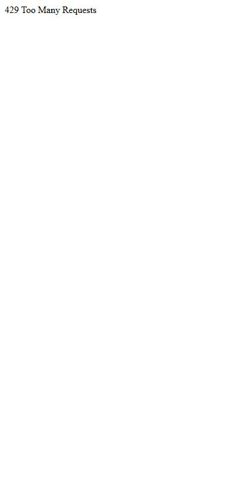

# Spotify Wrapped Party

- Site : [https://wrapped-party.activetheory.dev/](https://wrapped-party.activetheory.dev/) — [aperçu statique local](apercu.html)
- Capturé le : 2026-11-03 — statut : ok
- Vidéo de scroll : [▶ ouvrir](https://github.com/t-baudry/bibliotheque-web/releases/download/videos/101-spotify-wrapped-party.webm)

<a href="captures/desktop-00-arrivee.jpg"></a> 

<details><summary>Toutes les captures</summary>

<a href="captures/desktop-01.jpg"></a> <a href="captures/desktop-02.jpg"></a> <a href="captures/desktop-03.jpg"></a> <a href="captures/desktop-04.jpg"></a> <a href="captures/desktop-05.jpg"></a> <a href="captures/desktop-06.jpg"></a> <a href="captures/desktop-07.jpg"></a> 


<a href="captures/mobile-01.jpg"></a> <a href="captures/mobile-02.jpg"></a> <a href="captures/mobile-03.jpg"></a> <a href="captures/mobile-04.jpg"></a> <a href="captures/mobile-05.jpg"></a> <a href="captures/mobile-06.jpg"></a> 

</details>

## Stack détectée
Barba.js, CMS Sanity, Flip (GSAP), GSAP, Matter.js, SplitText/SplitType, WebGL

Shaders GLSL personnalisés extraits : 40 (voir `shaders.glsl`)

## Design tokens
### Couleurs (fonds, pondérées par surface)

### Couleurs de texte
`#f5f5f5`
### Polices utilisées (par volume de texte)
Times New Roman
### Fichiers de police chargés
- (rien relevé)
### Typographie
| Élément | Police | Taille | Graisse | Interligne | Interlettrage | Casse |
|---|---|---|---|---|---|---|
| h1 | "Times New Roman" | 20px | 400 | normal | normal | none |
| body | "Times New Roman" | 10px | 400 | normal | normal | none |

### Échelle des tailles de texte
20px (1) · 10px (1)
### Arrondis
aucun (angles droits)
### Transitions CSS fréquentes
- (rien relevé)
### Points de rupture (media queries)
960px · 768px · 1280px · 320px · 430px · 1920px · 700px · 687px · 475px · 400px · 340px · 460px
### Animations CSS (@keyframes)
reveal, pulse, muted, pulseOuter, pulseInner, lrotate, ldash, ldash-small, spin, horizontal-shaking
### Variables CSS (:root)
```css
--primary-color: #f5f5f5;
--secondary-color: #121212;
--sab: env(safe-area-inset-bottom,0);
--inline-direction-scalar: -1;
--line-padding: .5em 1em;
```

## Structure de la home
Hauteur : 900 px — 191 nœuds DOM — canvas 0, vidéos 0, images 0

| # | Bloc | Hauteur | Titre | Médias |
|---|---|---|---|---|

**Navigation :** 

**Boutons / CTA :** 

## SEO
- Title : Wrapped Party
- Description : Compare your Wrapped with up to nine friends.
- Langue : en — canonical : None
- Open Graph : oui — JSON-LD : aucun
- H1 : 1 — images sans alt : 0/0

### Plan des titres
- H1 Wrapped Party by Spotify.

## Performance (mesure locale, Chrome headless, connexion non bridée)
- TTFB 7 ms · LCP 0 ms (None) · CLS 0 · load 260 ms
- 659 requêtes · 939 Ko transférés
- Par type : Document 84 req / 328 Ko, Image 250 req / 0 Ko, Script 242 req / 601 Ko, Fetch 83 req / 10 Ko
- Plus gros fichiers :
- 554 Ko — Script — https://wrapped-party.activetheory.dev/assets/js/app.1780921720462.js
- 164 Ko — Document — https://wrapped-party.activetheory.dev/
- 164 Ko — Document — https://wrapped-party.activetheory.dev/unsupported
- 30 Ko — Script — https://browser.sentry-cdn.com/10.78.0/bundle.min.js
- 12 Ko — Script — https://wrapped-party.activetheory.dev/assets/js/lib/intl.C0aSRDRo.esm.js
- 10 Ko — Fetch — https://wrapped-party.activetheory.dev/assets/data/uil.1780921720462.json
- 3 Ko — Script — https://js.sentry-cdn.com/7bb23ac7ffa09413f6c7a8d9bae0084f.min.js
- 0 Ko — Script — https://wrapped-party.activetheory.dev/assets/js/app.1780921720462.js
- Services tiers : js.sentry-cdn.com, browser.sentry-cdn.com

## Mobile
- H1 : None · corps : 16px · débordement horizontal : False · menu burger : False

## Fichiers
- `captures/` : arrivée, scroll desktop (1440×900), pleine page, pages internes, mobile (390×844 @2x) ; vidéo de scroll dans la release GitHub « videos » (lien en haut de fiche)
- `page.html` : DOM rendu · `styles.css` : CSS chargé · `scripts/` : JS chargé (index dans `_index.json`) · `shaders.glsl` : shaders extraits · `rea-bundle.json` : analyse REA du bundle (chunks, routes, endpoints)
