# Lacoste - Polo Factory

- Site : [https://members-play.lacoste.com/polo-factory-experience](https://members-play.lacoste.com/polo-factory-experience) — [aperçu statique local](apercu.html)
- Capturé le : 2026-11-03 — statut : ok
- Vidéo de scroll : [▶ ouvrir](https://github.com/t-baudry/bibliotheque-web/releases/download/videos/104-lacoste-polo-factory.webm)

<a href="captures/desktop-00-arrivee.jpg">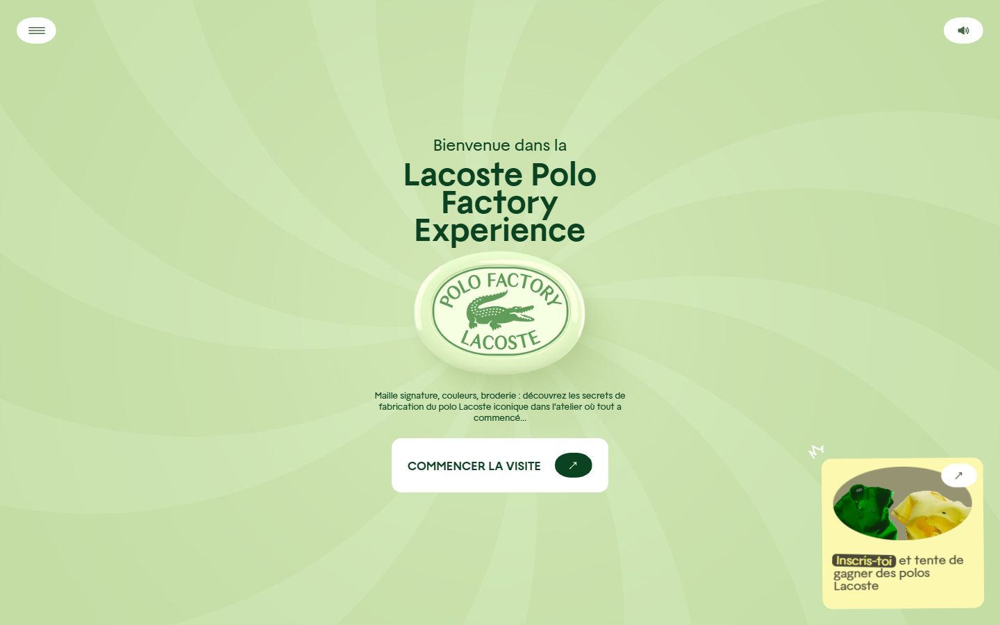</a> 

<details><summary>Toutes les captures</summary>

<a href="captures/desktop-01.jpg">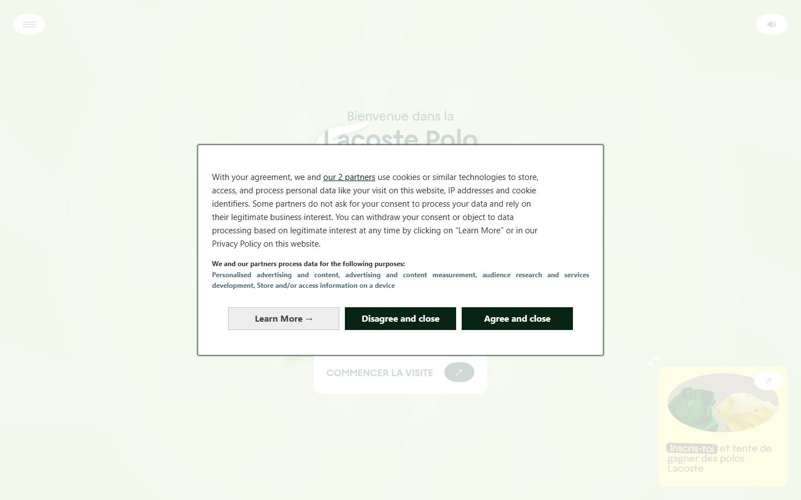</a> <a href="captures/desktop-02.jpg">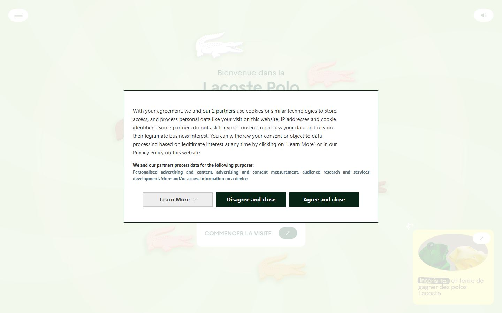</a> <a href="captures/desktop-03.jpg">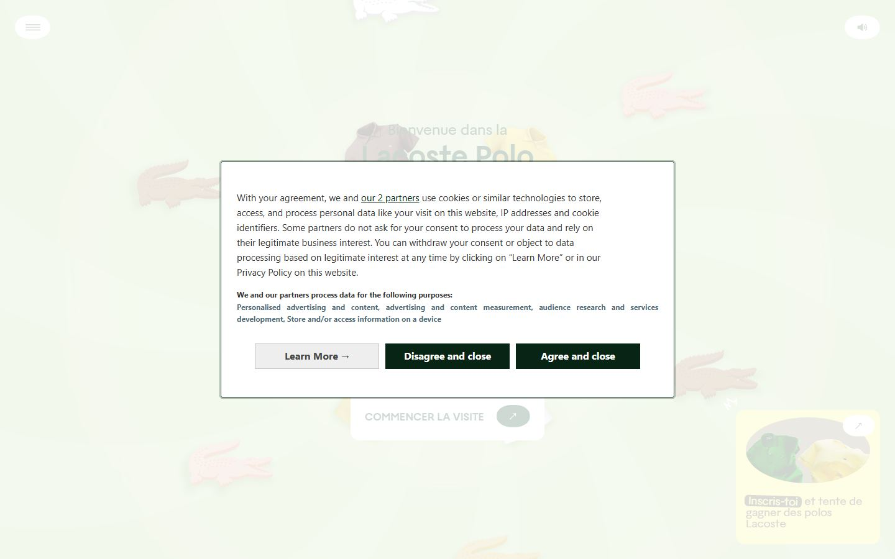</a> <a href="captures/desktop-04.jpg">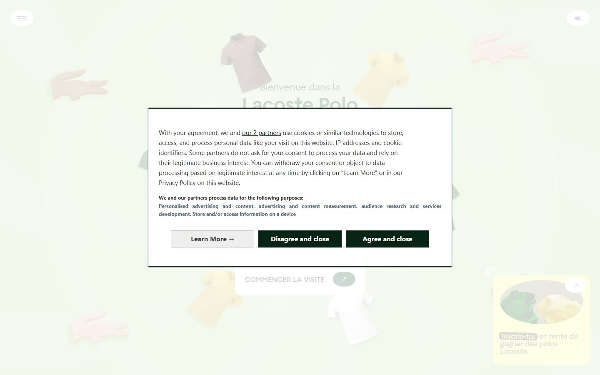</a> <a href="captures/desktop-05.jpg">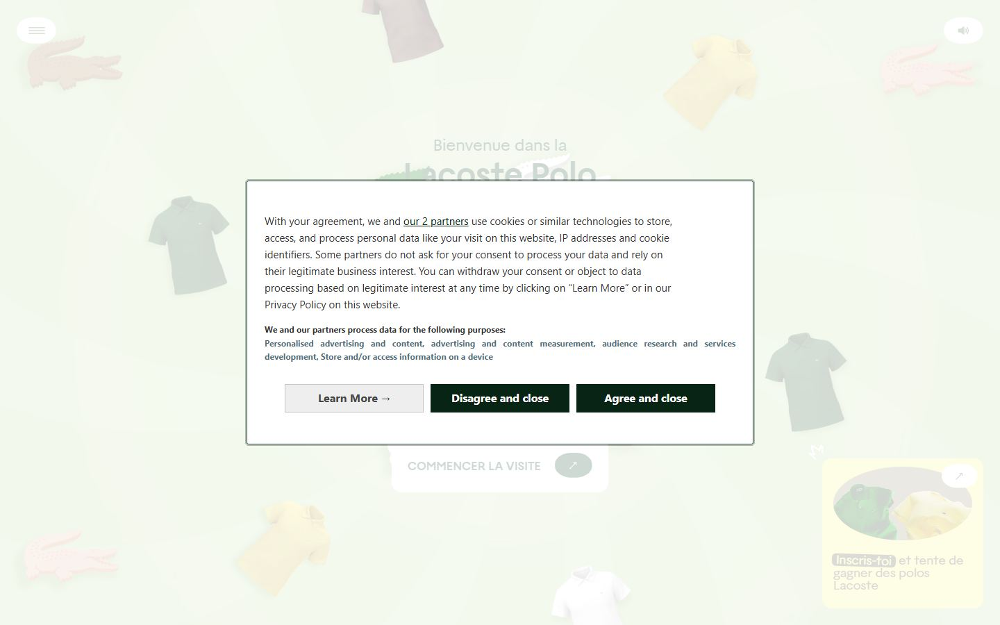</a> <a href="captures/desktop-06.jpg">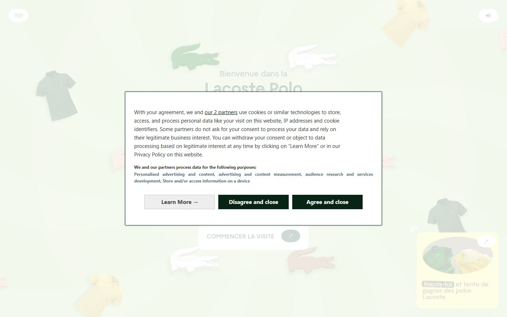</a> <a href="captures/desktop-07.jpg">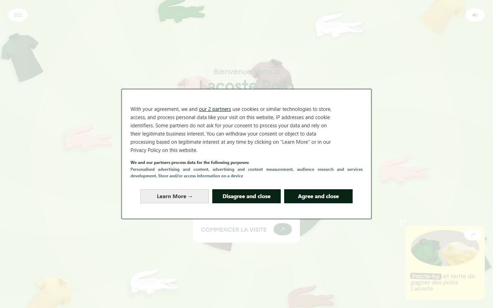</a> 


<a href="captures/mobile-01.jpg">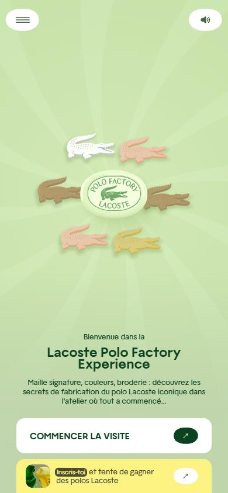</a> <a href="captures/mobile-02.jpg">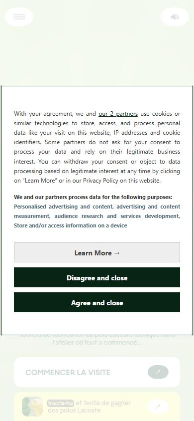</a> <a href="captures/mobile-03.jpg">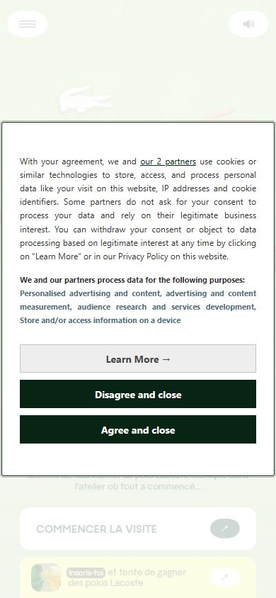</a> <a href="captures/mobile-04.jpg">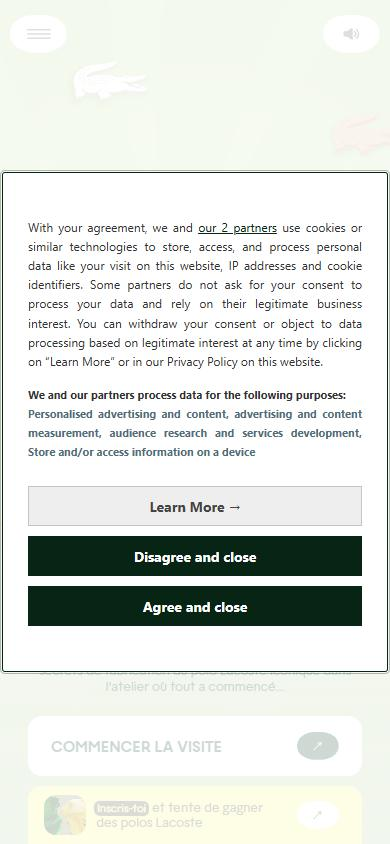</a> <a href="captures/mobile-05.jpg">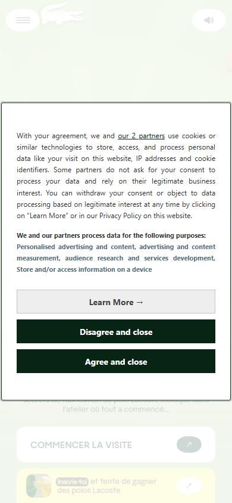</a> <a href="captures/mobile-06.jpg">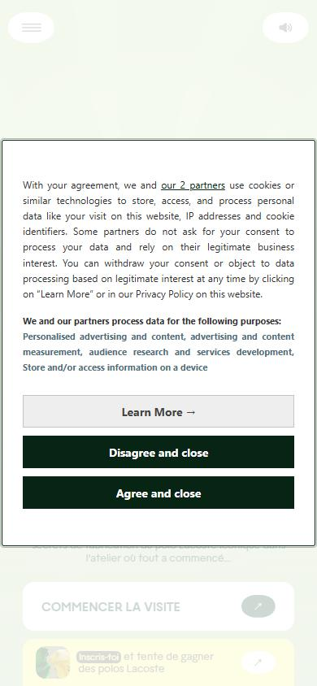</a> 

</details>

## Stack détectée
Barba.js, Three.js, Vue, WebGL, WordPress

Shaders GLSL personnalisés extraits : 13 (voir `shaders.glsl`)

## Design tokens
### Couleurs (fonds, pondérées par surface)
`#ffffff` · `#fcf383` · `#0b4221` · `#959372` · `#082415` · `#eeeeee` · `#4a4938`
### Couleurs de texte
`#767676` · `#333333` · `#0b4221` · `#526e7a` · `#000000` · `#ffffff` · `#4a4938` · `#082415`
### Polices utilisées (par volume de texte)
Lacoste · system-ui
### Fichiers de police chargés
- Lacoste-Bold.tPyPV4uHbb947c09.woff2
- Lacoste-Regular.DzMgoshubb947c09.woff2
- Lacoste-Italic.DYV4gA46bb947c09.woff2
### Typographie
| Élément | Police | Taille | Graisse | Interligne | Interlettrage | Casse |
|---|---|---|---|---|---|---|
| h1 | Lacoste, Arial, sans-serif | 48px | 700 | 39.84px | normal | none |
| h2 | Lacoste, Arial, sans-serif | 26px | 700 | 26px | normal | none |
| h3 | Lacoste, Arial, sans-serif | 14px | 400 | 14px | normal | none |
| p | system-ui, -apple-system, BlinkMacSystemFont, "Seg | 15px | 400 | 24px | normal | none |
| a | system-ui, -apple-system, BlinkMacSystemFont, "Seg | 15px | 400 | 24px | normal | none |
| button | system-ui, -apple-system, BlinkMacSystemFont, "Seg | 16px | 700 | 22.4px | normal | none |
| body | Lacoste, Arial, sans-serif | 40px | 400 | 60px | normal | none |

### Échelle des tailles de texte
16px (278) · 18px (8) · 10px (6) · 15px (5) · 12px (5) · 13px (5) · 40px (2) · 14px (2) · 24px (1) · 48px (1) · 26px (1)
### Arrondis
9px · 14px · 100% · 5px · 3px · 6px · 21px
### Transitions CSS fréquentes
- ease 0.3s ×8
- ease 0.15s ×7
- cubic-bezier(0.215 0.3s ×4
- cubic-bezier(0.86 0.5s ×2
- ease-in-out 0.4s ×1
- cubic-bezier(0.175 0.3s ×1
- cubic-bezier(0.24 0.75s ×1
- ease 0.5s ×1
### Points de rupture (media queries)
1023px · 1024px · 1600px · 639px · 769px · 1025px · 399px · 1200px · 1900px · 450px
### Animations CSS (@keyframes)
tilt-n-move-shaking-home-d60c26c0, tilt-n-move-shaking-knitting-d60c26c0, tilt-n-move-shaking-dyeing-d60c26c0, tilt-n-move-shaking-embroidering-d60c26c0, moveArrow-d60c26c0, spark-cycle-d60c26c0, tilt-n-move-shaking-b80a553e, hotspot-bounce-in-13fa3c8a, hotspot-bounce-out-13fa3c8a, rotateDevice-21295174, appear-21295174, appearReversed-21295174, lds-ellipsis1, lds-ellipsis3, lds-ellipsis2
### Variables CSS (:root)
```css
--base-text: calc((40px) * var(--h-demult, 1));
--padding: max(6px, calc(var(--base-text) * .15));
--cursor-auto: auto;
--cursor-crosshair: crosshair;
--cursor-pointer: pointer;
--cursor-grab: grab;
--cursor-grabbing: grabbing;
--ui-bps: xs:400px / s:640px / sm:768px / md:1024px / lg:1200px / xl:1600px / xxl:1920px;
--ui-colors: red:#b70606 / pink:#f7ece8 / green:#496646 / mint-green:#e1ffc2 / baby-blue:#98d9ea / denim-blue:#19527f / yellow:#fcf383 / brand-green:#0b4;
--ui-color-red: #b70606;
--ui-color-pink: #f7ece8;
--ui-color-green: #496646;
--ui-color-mint-green: #e1ffc2;
--ui-color-baby-blue: #98d9ea;
--ui-color-denim-blue: #19527f;
--ui-color-yellow: #fcf383;
--ui-color-brand-green: #0b4221;
--ui-color-greige: #d5cab0;
--ui-color-black: #000;
--ui-color-white: #fff;
--ui-color-dark-brown: #4a4938;
--ui-color-yellow-light: #fffbce;
--ui-color-green-light: #f1ffe3;
--ui-color-machine-yellow: #fffde3;
--ui-color-machine-green: #f5ffea;
--ui-color-machine-blue: #eff9fb;
--ui-color-light-brown: #959372;
--ui-color-light-blue: #c2dadf;
--ui-color-light-yellow: #e8e0be;
--ui-color-light-green: #d0dfbe;
--ui-color-brand-boulder: #767676;
--ui-color-grey: #cacaca;
--ui-color-grey-light: #f2f2f2;
```

## Structure de la home
Hauteur : 900 px — 767 nœuds DOM — canvas 2, vidéos 0, images 4

| # | Bloc | Hauteur | Titre | Médias |
|---|---|---|---|---|
| 1 | section .view view-home | 900 | Lacoste Polo Factory Experience | 5 |
| 2 | div .flash | 900 |  | 0 |

**Navigation :** Lacoste.com · Conditions générales · Mentions légales

**Boutons / CTA :** Learn More → · Disagree and close · Agree and close

## SEO
- Title : Lacoste Polo Factory Experience
- Description : Bienvenue dans la Lacoste Polo Factory
- Langue : fr — canonical : https://members-play.lacoste.com/polo-factory-experience/fr/fr/
- Open Graph : oui — JSON-LD : aucun
- H1 : 1 — images sans alt : 0/4

### Plan des titres
- H1 Lacoste Polo Factory Experience
- H2 PARTICIPER AU CONCOURS
- H3 Participez pour tenter de gagner l'un des 10 polos Lacoste iconiques.

## Performance (mesure locale, Chrome headless, connexion non bridée)
- TTFB 29 ms · LCP 300 ms (DIV.preloader-welcome) · CLS 0.001 · load 576 ms
- 82 requêtes · 18352 Ko transférés
- Par type : Document 2 req / 78 Ko, Stylesheet 1 req / 0 Ko, Script 7 req / 565 Ko, Image 35 req / 446 Ko, Font 3 req / 102 Ko, Fetch 32 req / 14336 Ko, XHR 1 req / 2816 Ko, Other 1 req / 9 Ko
- Plus gros fichiers :
- 2816 Ko — XHR — https://members-play.lacoste.com/polo-factory-experience/b/uzxHh2J3BJen.m4a
- 2105 Ko — Fetch — https://members-play.lacoste.com/polo-factory-experience/b/lJHMrF4RyKbX.ktx2
- 1950 Ko — Fetch — https://members-play.lacoste.com/polo-factory-experience/b/jUrcXBR-Zeml.bin
- 1840 Ko — Fetch — https://members-play.lacoste.com/polo-factory-experience/b/dubGUdb-V3vv.ktx2
- 1737 Ko — Fetch — https://members-play.lacoste.com/polo-factory-experience/b/xBRFaZNXBhQp.ktx2
- 1691 Ko — Fetch — https://members-play.lacoste.com/polo-factory-experience/b/yM2IxOx34RBR.exr
- 1447 Ko — Fetch — https://members-play.lacoste.com/polo-factory-experience/b/JR_JQavJnb9q.glb
- 625 Ko — Fetch — https://members-play.lacoste.com/polo-factory-experience/b/CBLrAT4ljZNr.glb
- Services tiers : sdk.privacy-center.org

## Mobile
- H1 : {'size': '24px', 'lineHeight': '19.92px'} · corps : 40px · débordement horizontal : False · menu burger : True

## Fichiers
- `captures/` : arrivée, scroll desktop (1440×900), pleine page, pages internes, mobile (390×844 @2x) ; vidéo de scroll dans la release GitHub « videos » (lien en haut de fiche)
- `page.html` : DOM rendu · `styles.css` : CSS chargé · `scripts/` : JS chargé (index dans `_index.json`) · `shaders.glsl` : shaders extraits · `rea-bundle.json` : analyse REA du bundle (chunks, routes, endpoints)
